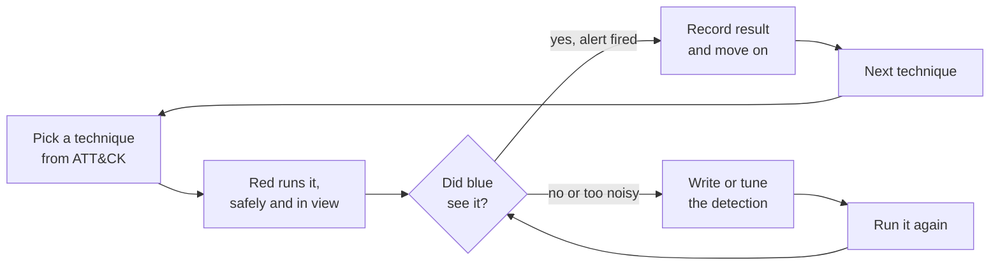
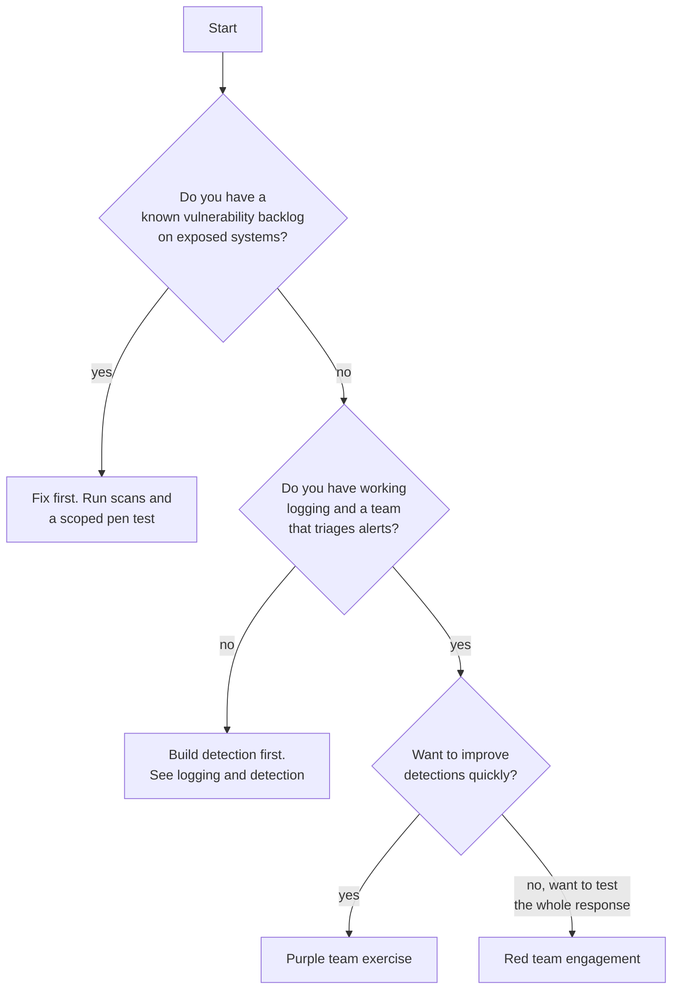

# Red team vs penetration test vs purple team

> **10-minute read. How to pick the right kind of offensive test, what each one gives you, and how to run it so the defenders come out stronger. Written from the buyer and defender side.**

## The one-line answer

A **penetration test** asks "what weaknesses can be found and proven in this scope?" A **red team** engagement asks "can a realistic attacker reach our most important asset without us stopping them?" A **purple team** exercise asks "does each detection we think we have actually fire?"

Same skills, three different questions. The question decides the scope, the rules, who knows about it, and what you get back.

## The three at a glance

| | Penetration test | Red team | Purple team |
|---|---|---|---|
| Main question | Which weaknesses exist and can be exploited? | Can an attacker reach a chosen goal, and does anyone notice? | Do our detections and responses work, technique by technique? |
| Scope | Defined systems, apps or networks | The whole organisation, aimed at a goal ("reach the finance database") | A list of attacker techniques |
| Defenders told? | Usually yes, at least the owners | Usually no, only a small "white cell" knows | Yes, they work alongside the testers |
| Duration | Days to a few weeks | Weeks to months | Hours to days, often repeated |
| Stealth | Not a goal | A central goal | Not a goal |
| What you get | A list of findings with proof and fixes | A story of the attack path plus what was and was not detected | New or fixed detections, measured before and after |
| Tests mainly | Technical controls | People, process and technology together | The blue team's visibility and response |

The mistake to avoid is buying the biggest one first. A red team against an organisation that still has unpatched internet-facing servers mostly rediscovers what a pen test would have found, at several times the cost.

## Penetration test

A penetration test is an authorised, time-boxed attempt to find vulnerabilities and show they are real. The tester gets a scope and rules of engagement, finds issues, proves impact (carefully), and writes a report.

Where it fits:

- A new web app or API before launch. See [OWASP Top 10 explained](./owasp-top-10-explained.md) and [OWASP API Security Top 10 explained](./owasp-api-security-top-10-explained.md) for what testers look for.
- After a major change to the network, identity setup or cloud environment.
- When a customer, auditor or regulator asks for one. PCI DSS, for example, requires penetration testing at least annually and after significant changes for in-scope environments (requirement 11.4 in v4.0.1). See the [PCI DSS guide](../../resources/compliance-guides/pci-dss.md).

How it differs from a vulnerability scan: a scanner lists suspected issues automatically. A pen test confirms which ones can be chained into real impact and finds logic flaws a scanner cannot. Scanning belongs in a continuous programme, see [Vulnerability management](./vulnerability-management.md); a pen test is a periodic, human check on top of it.

Common test types, named by how much the tester knows up front:

- **Black box**: no prior knowledge. Closest to an outsider, slowest and most expensive per finding.
- **Grey box**: some knowledge, such as a normal user account. The usual best value.
- **White box**: full access to design and source. Finds the most per day.

**[📖 NIST SP 800-115: Technical Guide to Information Security Testing and Assessment](https://csrc.nist.gov/pubs/sp/800/115/final)** - the standard government reference on planning, running and reporting technical security tests

## Red team engagement

A red team emulates a real adversary against the whole organisation. It does not try to find every flaw. It picks one or a few **objectives** (for example, read the board's email, or reach the production customer database) and tries to get there by any agreed route: technical weakness, stolen credentials, a convincing phishing message, a gap in a process.

Defining features:

- **Goal-based, not scope-based.** Success is reaching the objective, or proving it could not be reached.
- **Realistic tradecraft.** The team behaves like a specific threat, often built from [threat intelligence](./threat-intelligence-basics.md) about groups that target your sector, and describes its behaviour using [MITRE ATT&CK](./mitre-attack-for-defenders.md) technique names.
- **The blue team is not told.** The point is to test real detection and response, so only a small group (the white cell, often the CISO and a legal contact) knows. This needs strong rules: written authorisation, a safe-word to stop, and out-of-bounds systems such as life-safety and hospital equipment.
- **Detection is the product.** The most valuable output is often the timeline: what the red team did, when, and what the defenders saw or missed.

Red teaming is regulated in some sectors because it is seen as a maturity test. The EU's DORA requires threat-led penetration testing (TLPT) at least every three years for entities the authorities designate, following the ECB's TIBER-EU approach in practice. The Bank of England's CBEST is the UK equivalent. See the [DORA guide](../../resources/compliance-guides/dora.md).

**[📖 DORA, Regulation (EU) 2022/2554](https://eur-lex.europa.eu/eli/reg/2022/2554/oj)** - the primary text; threat-led penetration testing is in Chapter IV (applies from 17 January 2025)

**[📖 ECB: TIBER-EU framework](https://www.ecb.europa.eu/paym/cyber-resilience/tiber-eu/html/index.en.html)** - how a controlled, intelligence-led red team test is structured

## Purple team exercise

A purple team is less a team than a **method**. Red (attack) and blue (defence) sit together. The red side runs one technique at a time. The blue side checks whether it saw it. If not, they fix the detection on the spot and run the technique again.

*The purple loop: run a technique, check whether the alert fired, fix the detection if it did not, and replay until it does.*

Why it works: in a red team engagement, a miss is a finding in a report weeks later. In a purple exercise, a miss becomes a working detection by the end of the afternoon. Every technique tested leaves a measurable result.

Good purple exercises:

- Start from techniques seen against your sector, not from a random list. [MITRE ATT&CK](https://attack.mitre.org/) gives the shared vocabulary.
- Test the full chain: the telemetry exists, it reaches the SIEM, the rule fires, the alert reaches a person, and the person knows what to do. A rule that fires into a queue nobody reads is not a detection. See [Logging and detection](./logging-and-detection.md) and the [SOC detection and response pipeline](../../resources/architecture-patterns/soc-detection-and-response-pipeline.md).
- Record results per technique: detected, logged but no alert, not logged. That table is your coverage map, and it is evidence for auditors.
- Use safe, agreed test procedures. Public libraries of adversary emulation plans exist, such as the Center for Threat-Informed Defense's emulation library and Atomic Red Team's small tests, designed to be run in a controlled environment.

**[📖 MITRE Center for Threat-Informed Defense: Adversary Emulation Library](https://github.com/center-for-threat-informed-defense/adversary_emulation_library)** - emulation plans for known threat groups, intended for defensive testing

## How to choose

Use this order as a decision rule:

*A flowchart for choosing: fix known issues before paying to find more, build detection before testing it, use purple to improve detection fast, and use red to test the full response.*

Practical rules:

1. **Pen test first.** It is cheaper, produces a fix list, and is what most customers and auditors accept as evidence.
2. **Purple second.** Once you have logging and an analyst or two, purple exercises raise detection coverage faster than anything else.
3. **Red team third.** Do it when you believe you can detect and respond, and you want proof. If you expect to lose, run purple instead and save the money.
4. **Mix them over a year.** Many programmes run one or two pen tests on changed systems, a purple exercise each quarter, and a red team every one to two years.

## Running one well

Whatever you choose, these points decide whether the money was well spent.

**Before**

- Write down the question the test answers. "Can someone reach our payroll data?" is a better brief than "test our security".
- Agree **rules of engagement** in writing: scope, hours, forbidden actions (for example no denial of service, no touching production data beyond proof), contacts, and an emergency stop.
- Get **authorisation** from someone who can actually give it. For cloud and third-party hosted systems, check the provider's testing policy first; do not test systems you do not own or have rights to.
- Decide what happens to any data the testers touch and how it is deleted.

**During**

- Keep a named contact reachable. If the testers find something already compromised by a real attacker, stop and switch to [incident response](./incident-response-basics.md).
- For red team work, have the white cell watch for the moment a defender decides to escalate, so a real response is not confused with the exercise.

**After**

- Insist on a report that ranks by real risk, shows the evidence, and gives a fix for each finding, plus an executive summary a non-technical reader can act on.
- Hold a **debrief with the defenders**. For a red team this is the most valuable meeting: walk the timeline, and at each step ask what you could have seen.
- Turn every miss into a ticket with an owner and a date, and turn every detection gap into a rule. Then **retest** the fix.
- Track the numbers over time: time to detect, time to contain, and percentage of tested techniques detected. These are what show progress.

## Common mistakes

- **Calling a scan a pen test.** A scan report with a logo is not a human test. Ask who did the work and what they tried by hand.
- **Testing too early.** Paying experts to find issues you already know about wastes the engagement.
- **Treating the report as the finish line.** The value is in the fixes and the new detections.
- **Ignoring people and process.** Real attackers often go through phishing, helpdesk resets and over-powerful accounts. See [Phishing and social engineering](./phishing-and-social-engineering.md) and [Least privilege explained](./least-privilege-explained.md). A test limited to the network will miss them.
- **Red teaming without a blue team.** If nobody is watching, the result is "they got in", which you already assumed.
- **Hiding results from the team that has to fix things.** Blame kills learning. Present findings as gaps in the system, not failures of people.
- **Letting the same people test and fix every time.** Rotate testers now and then so the same blind spots are not repeated.

## Other terms you will hear

- **Vulnerability assessment**: finding and ranking weaknesses, usually with scanners, without trying to exploit them.
- **Adversary emulation**: a red team or purple exercise that follows the known behaviour of one named threat group.
- **Bug bounty**: a standing, public or invited programme that pays outside researchers for valid findings. It complements, but does not replace, a scoped pen test.
- **Tabletop exercise**: a discussion-only walk through an incident scenario. No systems are touched. It tests decisions and communication, not technology.
- **Breach and attack simulation (BAS)**: software that runs safe attack tests on a schedule. Useful for repeatable checks between purple exercises.

## How exams test this

- **Security+**: the definitions, and knowing that a pen test needs written authorisation and rules of engagement. Know known, partially known and unknown environment testing, and red, blue, white and purple team roles.
- **CySA+ and SecurityX**: using ATT&CK and emulation to validate detections, and reading a pen test report.
- **CISSP and CISM**: testing as part of an assessment programme, governance of third-party testers, and handling findings.
- **OSCP**: the hands-on side of the pen test described here.

## What to look at next

- **[MITRE ATT&CK for defenders](./mitre-attack-for-defenders.md)** - the technique vocabulary both red and purple teams use
- **[Logging and detection](./logging-and-detection.md)** - what a purple exercise is really testing
- **[Incident response basics](./incident-response-basics.md)** - what takes over when a test finds a real intruder
- **[Vulnerability management](./vulnerability-management.md)** - the continuous work a pen test sits on top of

## Check yourself

Try these from memory first, then open each answer.

1. In one sentence each, what question does a pen test, a red team and a purple team answer?
    

    
Answer

    A pen test: which weaknesses exist and can be exploited in this scope. A red team: can an attacker reach a chosen goal without being stopped. A purple team: does each detection we think we have actually fire. See: The one-line answer.
    

2. Why is the blue team usually not told about a red team engagement, but is told about a purple team exercise?
    

    
Answer

    A red team tests real detection and response, which needs defenders acting normally. A purple exercise is about improving detections together, so the blue side watches and fixes gaps live. See: Red team engagement and Purple team exercise.
    

3. A company has a long backlog of unpatched internet-facing servers and no alert triage. Which test should it buy first?
    

    
Answer

    None of the expensive ones. Fix the known backlog, build logging and triage, then run a scoped pen test. A red team would mostly rediscover known issues. See: How to choose.
    

4. Name three things to agree in writing before any offensive test.
    

    
Answer

    Any three of: scope, hours, forbidden actions, authorisation, contacts, an emergency stop, and how test data is handled. See: Running one well.
    

5. What turns a purple exercise result into lasting value?
    

    
Answer

    Each miss becomes a detection that is written, replayed and shown to fire, and the per-technique results are tracked over time. See: Purple team exercise.
    

