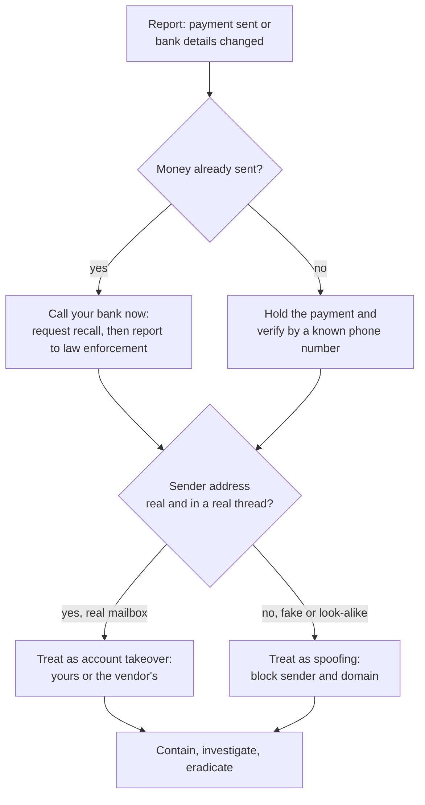

# Playbook: business email compromise

> **Use when:** someone reports, or a bank or vendor tells you, that a payment went to the wrong account after an email asked for it. Also use it when a mailbox shows hidden forwarding or rules and you suspect it is being used to steer money.

Business email compromise (BEC) is fraud first and a hacking incident second. The goal is a payment, and payments move fast. So this playbook has two clocks running at once: the **money clock** (can the bank still recall the transfer?) and the **access clock** (does the attacker still have a mailbox?). Work both in parallel, and start with the money.

Background on the attack itself: [Phishing and social engineering](../../learn/concepts/phishing-and-social-engineering.md).

## First: which kind of BEC is it?

The first decision changes everything after it. There are two common shapes, and they need different containment.

| | **Spoofed or look-alike** | **Account takeover** |
|---|---|---|
| What the attacker controls | Nothing of yours. They send from a fake or look-alike address. | A real mailbox, yours or a vendor's. |
| Tell-tale signs | Display name matches, address does not; look-alike domain; reply-to differs; mail fails [SPF, DKIM or DMARC](../../learn/concepts/email-security-spf-dkim-dmarc.md) | Mail comes from the real address; it sits inside an existing thread; hidden rules, forwarding or new devices appear on the mailbox |
| Main fix | Block the sender and domain, fix your email authentication | Reset credentials, kill sessions, remove persistence, then investigate scope |
| Who else is at risk | Anyone the fake persona emailed | Everyone in the compromised mailbox's contacts and threads |

Many cases are the second kind on the **other side**: your vendor's mailbox was taken over, and the attacker is replying inside a real thread with new bank details. Your systems show nothing wrong. Only a human check catches it.

*The first branch is about the money, the second about the mailbox. Both start within minutes of the report.*

## Detect

Signals that arrive through people and process:

- A vendor says "we never changed our bank details" or "we have not been paid."
- A finance user asks whether a bank-detail change request is real.
- A bank flags a first-time payee, or a payment that does not match the usual pattern.
- An executive says they never sent the urgent gift-card or wire request.

Signals from the mail system and logs (see [Logging and detection](../../learn/concepts/logging-and-detection.md)):

- New inbox rules that delete, move or forward mail, especially rules matching words such as invoice, payment, wire or bank.
- Mail forwarding set to an external address, or new delegates on a mailbox.
- Sign-ins from new countries, new devices, or impossible travel, followed by mailbox access.
- A new MFA method added just before the rule appeared.
- New inbound domains that look like your vendor's or your own, registered recently.

Record at the start: the reporter, the timestamp of the first email, the amount, the currency, the sending and receiving bank, the destination account, and the exact message headers of the fraudulent email.

## Contain

Do these in this order. The first two matter most in the first hour.

1. **Call the sending bank and ask for a recall.** Use the fraud line, not email. Give the transfer reference, amount, date and destination account. Recall is more likely to work the sooner it is asked, so do not wait for the investigation. Your bank will tell you what it can do and by when.
2. **Report to law enforcement.** In the US, file a complaint with the FBI Internet Crime Complaint Center. Elsewhere, use your national cybercrime reporting service. A prompt report can help banks act on frozen funds. **[📖 FBI Internet Crime Complaint Center (IC3)](https://www.ic3.gov/)** - where US victims file BEC and other internet crime complaints.
3. **Stop further payments to that account.** Put a hold on any pending payment to the changed bank details, and freeze the vendor record until it is verified.
4. **If a mailbox is compromised, cut access.** Reset the password, revoke all sessions and refresh tokens, and remove unknown MFA methods. A password change alone is not enough if the attacker has added their own MFA method or an app grant. See [Playbook: suspicious OAuth app grant](./suspicious-oauth-app-grant.md).
5. **Preserve evidence before cleaning up.** Export the mailbox audit log, sign-in logs, the full headers and the message bodies. Do not delete the fraudulent emails; move them to a quarantine or hold.
6. **Tell the people who need to know now.** Finance, the account owner, legal and your cyber insurer if you have one. Policies often have notice deadlines.

## Investigate

Work from the mailbox outward.

- **When did access begin?** The first suspicious sign-in or rule creation is your start time. Anything the mailbox sent or received after it is suspect.
- **What did the attacker read?** Look for searches in the audit log for words like invoice or wire. Attackers pick targets by reading real threads.
- **What persistence exists?** Rules, forwards, delegates, app grants, extra MFA methods, extra devices.
- **Who else got fooled?** Search mail logs for the fake address or domain across all users. Check whether other staff received the same persona.
- **Which other accounts were reached?** If the credentials were reused or phished, check sign-ins for the same user on other systems.
- **How did the attacker get in?** Usually a phished password or token, a reused password, or a missing MFA. Trace back to the phishing message. See [Playbook: phishing report triage](./phishing-report-triage.md).
- **Was it your side or the vendor's?** If your own mailboxes show nothing, the vendor's mailbox is likely the one taken over. Tell the vendor through a verified channel so they can start their own response.

**[📖 Microsoft: respond to a compromised email account](https://learn.microsoft.com/en-us/defender-office-365/responding-to-a-compromised-email-account)** - the steps for investigating and cleaning a hijacked Microsoft 365 mailbox, including rules and forwarding.

## Eradicate

- Remove every malicious inbox rule, forward, delegate and app grant.
- Remove attacker-added MFA methods and enrol the user in [phishing-resistant MFA](../../learn/concepts/mfa-and-passkeys.md).
- Block the look-alike domains and sender addresses at the mail gateway.
- Reset any other credentials that were stored in the mailbox or exposed in it.
- Check the user's device. If the access began from a malware infection rather than a phish, treat the endpoint as compromised too. See [Endpoint security: EDR and XDR](../../learn/concepts/endpoint-security-edr-xdr.md).

## Recover

- Confirm the status of the recall with the bank, and keep a written log of every contact.
- Re-verify every bank-detail change made in the exposure window, not just the one that was reported. Attackers often try more than once.
- Tell the affected vendors or customers through a channel the attacker does not control.
- Restore normal mail flow and let the user back in, with an explanation of what to watch for.
- Keep monitoring the mailbox and the sender's domain for several weeks.

## Prevent: the process controls that actually stop the payment

BEC usually succeeds because a human process allowed it, so the strongest fixes are process fixes.

- **Callback verification.** Any change to bank details, or any new payee, is confirmed by phoning a number you already hold, not one in the email. This is the single most useful control.
- **Two-person approval** for new payees and for changes to payee details, with the approver seeing the old and new details side by side.
- **A cooling-off period** for changed bank details before the first payment.
- **Pay-to confirmation** where your bank offers account-name checking for payees.
- **Email authentication.** Publish and enforce SPF, DKIM and DMARC on your own domains so exact-domain spoofing fails. See [Email security: SPF, DKIM and DMARC](../../learn/concepts/email-security-spf-dkim-dmarc.md). This does not stop look-alike domains or a vendor's hijacked mailbox, which is why it cannot be your only control.
- **Mailbox hygiene.** Phishing-resistant MFA on finance and executive mailboxes, alerts on new external forwarding and rules, and conditional access that blocks sign-ins from unmanaged devices.
- **Targeted training** for finance and executive assistants. See [Security awareness training](../../learn/concepts/security-awareness-training.md).

## Lessons learned

- Measure the gap between "fraudulent email received" and "bank called." That gap decides whether money comes back.
- Check whether the callback control existed and was skipped, or did not exist. Fix the process, not the person.
- Add detections for new forwarding and for inbox rules that match payment keywords.
- Add a rule that urgency plus secrecy plus a change in payment details always means stop and verify.
- Write the bank's fraud line and your insurer's notice number into the incident runbook now, so nobody has to look them up at 4 pm on a Friday.

For the general incident lifecycle this playbook follows, see [Incident response basics](../../learn/concepts/incident-response-basics.md).

## Checklist

- [ ] Case type decided: spoofed or look-alike, or account takeover (yours or the vendor's)
- [ ] Bank called and recall requested, reference number recorded
- [ ] Law enforcement complaint filed
- [ ] Payments to the changed account held, vendor record frozen
- [ ] Credentials reset, sessions revoked, attacker MFA methods removed (if a mailbox was taken)
- [ ] Rules, forwards, delegates and app grants removed
- [ ] Logs and headers preserved
- [ ] All other bank-detail changes in the window re-verified by callback
- [ ] Vendor or customer notified through a verified channel
- [ ] Callback and two-person approval controls in place and tested
