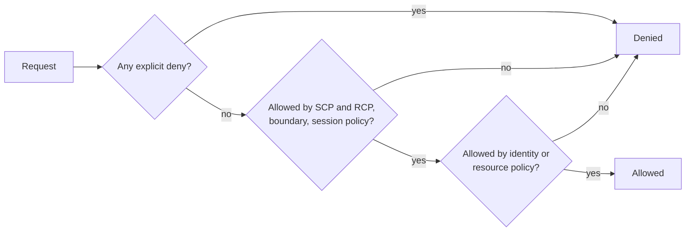

# 04 - Identity and access management

**Domain 4: Identity and Access Management (20%)** - SCS-C03 tasks 4.1 and 4.2.

The largest domain, up from 16% in C02. The guide removed the basic "components of a policy" topic, so the exam assumes you can read a policy and focuses on evaluating several policies together, building ABAC, and diagnosing denials.

---

## 4.1 Authentication strategies

**People.** Use **AWS IAM Identity Center** for workforce access: connect your identity provider (or its built-in directory), assign users and groups to **permission sets** in accounts, and users receive short-term credentials. Enforce MFA, and prefer phishing-resistant methods. Avoid IAM users with long-term credentials; AWS best practice is roles with temporary credentials. **Amazon Cognito** handles customer-facing authentication: user pools authenticate and issue tokens (with MFA, federation to social and SAML or OIDC providers), and identity pools exchange tokens for temporary AWS credentials. **AWS Directory Service** provides managed Microsoft AD and connectors for directory-integrated workloads.

**Applications and systems.** Workloads authenticate with roles, never embedded keys: instance profiles, execution roles, task roles. For code running outside AWS, **IAM Roles Anywhere** exchanges an X.509 certificate from your certificate authority for temporary credentials. For cross-account access, a role in the target account trusts the calling account or role.

**Temporary credentials.** **AWS STS** issues them: `AssumeRole` (cross-account and service use), `AssumeRoleWithSAML` and `AssumeRoleWithWebIdentity` (federation), and `GetSessionToken` (MFA for an IAM user). A role's **trust policy** decides who may assume it, and its permissions policies decide what the session can do. S3 **presigned URLs** give time-limited access to one object using the signer's permissions; they stop working when those credentials expire, so sign with a role whose session outlasts the URL's lifetime.

```bash
aws sts assume-role \
  --role-arn arn:aws:iam::111122223333:role/audit-reader \
  --role-session-name audit-2026-11 \
  --external-id example-external-id
```

Use an **external ID** in trust policies for third parties to prevent the confused-deputy problem.

**Troubleshooting authentication.** CloudTrail shows the failed `AssumeRole`, `ConsoleLogin` or Cognito call and its error. Common causes: the trust policy does not name the caller, MFA is required by a condition but not supplied, a permission set was not provisioned to the account, or the identity provider's clock or certificate is wrong.

## 4.2 Authorization strategies

### Policy evaluation

AWS authenticates the request, builds the request context and then evaluates all applicable policies. The rules to know cold, from the policy evaluation logic documentation:

- Within one account, identity-based and resource-based permissions are a **union**: if either allows, the action is allowed, and an explicit deny in either overrides.
- A **permissions boundary** and the identity-based policies together give the **intersection**: both must allow.
- For members of an organization, effective permissions are the intersection of identity-based policies, **SCPs** and **RCPs**: the action must be allowed by all, and an explicit deny in any overrides.
- SCPs never grant permissions; they set maximums for IAM users and roles in member accounts, and do not affect the management account.
- An explicit deny always wins.



The diagram summarises the order of reasoning: deny first, then the limits, then a grant.

### Cross-account and resource policies

A resource-based policy (S3 bucket policy, KMS key policy, SQS queue policy, role trust policy) can allow a principal in another account. For cross-account access both must allow: the resource policy in the trusting account must name the caller, and the identity-based policy in the calling account must also allow the action. (The shortcut where a resource policy naming a principal is enough applies only within one account.) **IAM paths**, **resource policies for cross-account access** and **role trust policies** are the guide's named tools, and **Amazon Verified Permissions** provides fine-grained application authorization using Cedar policies.

### ABAC and RBAC

**RBAC** assigns permissions through roles by job function. **ABAC** grants access when attributes match, using tags on principals and resources, so one policy scales without new roles per project.

```json
{
  "Version": "2012-10-17",
  "Statement": [{
    "Effect": "Allow",
    "Action": ["ec2:StartInstances", "ec2:StopInstances"],
    "Resource": "arn:aws:ec2:*:*:instance/*",
    "Condition": {
      "StringEquals": {"aws:ResourceTag/team": "${aws:PrincipalTag/team}"}
    }
  }]
}
```

This policy lets a principal start and stop only instances tagged with their own team value. ABAC is safe only if people cannot change their own principal tags or the resource tags, so restrict `iam:TagRole`, `ec2:CreateTags` and similar.

### Least privilege tools

- **Permissions boundaries** cap what a role or user can ever receive, which allows delegated administration: developers may create roles, but only roles carrying the boundary.
- **Session policies** further restrict a single assumed-role session.
- **Condition keys** such as `aws:SourceIp`, `aws:PrincipalOrgID`, `aws:MultiFactorAuthPresent` and `aws:RequestedRegion` narrow when a grant applies.
- **IAM Access Analyzer** has several functions. External access analyzers identify resources shared outside your zone of trust (the account or organization) using logic-based reasoning on resource policies; internal access analyzers show which principals inside your organization can reach selected resources; unused access analyzers report unused roles, access keys, passwords, services and actions; policy validation checks grammar and best practices; custom policy checks test whether a policy grants new access; policy generation builds a policy from CloudTrail activity.

```bash
aws accessanalyzer create-analyzer --analyzer-name org-external --type ORGANIZATION
aws accessanalyzer create-analyzer --analyzer-name org-unused --type ORGANIZATION_UNUSED_ACCESS \
  --configuration '{"unusedAccess":{"unusedAccessAge":90}}'
```

An external access analyzer is Regional and covers only the Region where it is created, so create one per Region in use.

### Troubleshooting authorization

Work from the error. The **IAM Policy Simulator** evaluates policies for given actions and resources. CloudTrail's error message and `errorCode` say whether a deny came from an identity policy, SCP, RCP, boundary or resource policy. Typical causes: an SCP denies the Region or service; a boundary omits the action; a KMS key policy does not enable IAM policies (see notes 05); the session policy is narrower than expected; a condition key is missing from the request. Correct unintended grants by tightening the policy, then use Access Analyzer findings to confirm they are gone.

---

## Key terms

- **IAM Identity Center** - the AWS service for workforce single sign-on with permission sets across accounts
- **Permission set** - an Identity Center template of permissions assigned to users or groups for an account
- **Amazon Cognito** - a service for customer identity: user pools authenticate and identity pools issue temporary AWS credentials
- **IAM Roles Anywhere** - a feature that exchanges an X.509 certificate for temporary AWS credentials for workloads outside AWS
- **AWS STS** - the Security Token Service that issues temporary credentials
- **Trust policy** - the policy attached to a role that defines who may assume it
- **External ID** - a value in a role trust policy that prevents the confused-deputy problem for third-party access
- **Permissions boundary** - a managed policy that sets the maximum permissions an identity-based policy can grant
- **Session policy** - an inline policy passed when assuming a role that further limits that session
- **Service control policy** - an organization policy that sets maximum available permissions for IAM users and roles in member accounts
- **Resource control policy** - an organization policy that sets maximum permissions on resources in member accounts
- **ABAC** - attribute-based access control, granting access by matching tags on principals and resources
- **Zone of trust** - the account or organization that an Access Analyzer analyzer treats as trusted
- **Unused access analyzer** - an Access Analyzer type that reports unused roles, keys, passwords, services and actions
- **Amazon Verified Permissions** - a service for fine-grained application authorization using Cedar policies

---

## Related

- [Notes 05: data protection](./05-data-protection.md) for key policies
- [Notes 06: security foundations and governance](./06-security-foundations-and-governance.md) for SCPs
- [Least-privilege IAM review lab](../../../../../resources/hands-on-projects/least-privilege-iam-review.md)
- [IAM topic](../../../../../topics/iam.md)
- **[📖 Policy evaluation logic](https://docs.aws.amazon.com/IAM/latest/UserGuide/reference_policies_evaluation-logic.html)** - how identity, resource, boundary, SCP and RCP policies combine
- **[📖 Using IAM Access Analyzer](https://docs.aws.amazon.com/IAM/latest/UserGuide/what-is-access-analyzer.html)** - external, internal and unused access analysis, validation and generation
- **[📖 SCS-C03 exam guide, Domain 4](https://docs.aws.amazon.com/aws-certification/latest/security-specialty-03/security-specialty-03-domain4.html)** - task statements and skills
