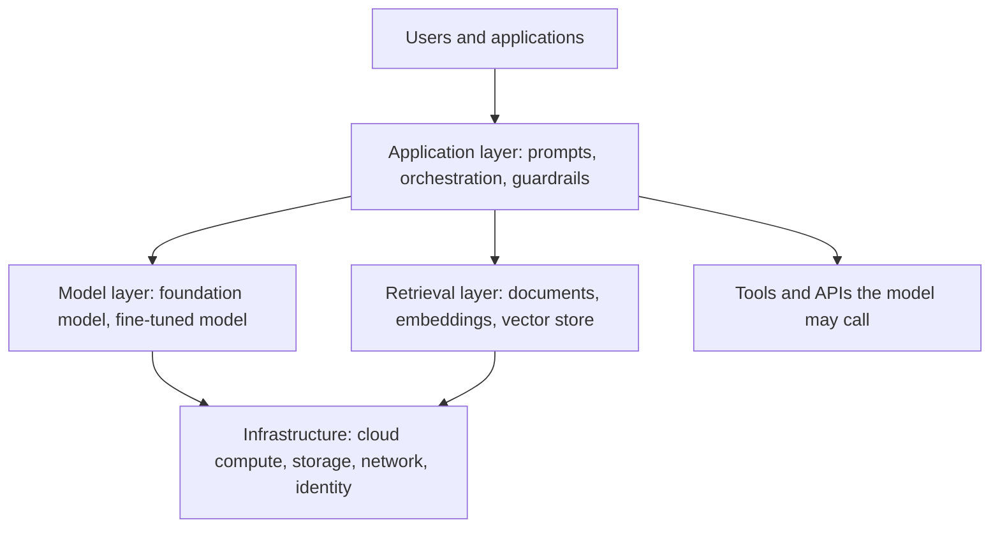

# 01 - Introduction to AI; Generative AI architecture and design

**Modules 1 and 2 of 10 (6 exam questions each).** CSA's titles: "Introduction to AI" and "Generative AI Architecture and Design". CSA's module outlines are in its downloadable curriculum; this note builds the concepts from primary sources.

---

## Module 1: Introduction to AI

**What counts as AI.** The OECD defines an AI system as a machine-based system that, for explicit or implicit objectives, infers from the input it receives how to generate outputs such as predictions, content, recommendations or decisions that can influence physical or virtual environments, with varying levels of autonomy and adaptiveness after deployment. The EU AI Act uses nearly the same words. The key idea is inference: instead of following fixed rules written line by line, the system derives behavior from data.

**[📖 OECD AI Principles](https://oecd.ai/en/ai-principles)** - the OECD definition of an AI system and its life cycle
**[📖 Regulation (EU) 2024/1689 (AI Act), Article 3](https://eur-lex.europa.eu/eli/reg/2024/1689/oj)** - the legal definition of AI system, provider and deployer

**Why safety is a distinct topic.** NIST lists the characteristics that make an AI system trustworthy: valid and reliable, safe, secure and resilient, accountable and transparent, explainable and interpretable, privacy-enhanced, and fair with harmful bias managed. NIST adds that these influence each other: highly secure but unfair systems, accurate but opaque systems, and inaccurate but secure and transparent systems are all undesirable, so balancing trade-offs is part of the job.

**[📖 NIST AI RMF 1.0 (NIST AI 100-1)](https://doi.org/10.6028/NIST.AI.100-1)** - characteristics of trustworthy AI, the AI life cycle and the four risk functions

**The life cycle at a glance.** NIST describes AI activities along dimensions: application context, data and input, the AI model, and task and output, with test, evaluation, verification and validation (TEVV) throughout. Different actors own different parts, so no single team sees the whole system. That is why governance is cross-functional.

## Module 2: Generative AI architecture and design

**What generative AI is.** NIST AI 600-1 quotes the definition in US Executive Order 14110 (since rescinded in January 2025): the class of AI models that emulate the structure and characteristics of input data in order to generate derived synthetic content, which can include images, video, audio, text and other digital content. For its purposes, generative AI generally means generative foundation models. A **foundation model** is trained on broad data, usually with self-supervision, and can be adapted to many tasks.

**[📖 NIST AI 600-1 Generative AI Profile](https://doi.org/10.6028/NIST.AI.600-1)** - definitions and twelve risk areas for generative AI

**Architecture layers.** A deployed generative AI application is more than the model. A secure design thinks in layers:

The diagram shows the typical layers of a generative AI application: the application orchestrates prompts, the model, retrieval and tools, all running on cloud infrastructure.

- **Prompting** supplies instructions and context to the model. A **system prompt** sets behavior.
- **Fine-tuning** further trains a pre-trained model on specific data; it changes the model and needs data governance.
- **Retrieval-augmented generation (RAG)** looks up relevant documents at query time and gives them to the model. The retrieval store, built from embeddings in a vector database, becomes a new data asset to protect. OWASP lists Vector and Embedding Weaknesses (LLM08) as flaws in how vectors and embeddings are generated, stored or retrieved.
- **Agents** let a model call tools and take actions. OWASP's Excessive Agency (LLM06) names the risk of too much functionality, permission or autonomy.

**Design implications.** Each layer adds an attack surface and a control point: authenticate and rate-limit at the gateway, constrain what tools can do, enforce document permissions in retrieval, validate output before it reaches downstream systems (OWASP LLM05, Improper Output Handling), and log for monitoring. NIST AI 600-1 also stresses that generative AI value chains involve many third-party components, such as procured datasets, pre-trained models and software libraries.

> **Exam habit:** when a question describes a feature (a plugin, retrieval, an agent), ask which new layer it adds and what control belongs there.

---

## Key terms

- **AI system** - a machine-based system that infers from input how to generate outputs such as predictions, content, recommendations or decisions (OECD, EU AI Act)
- **Generative AI** - AI models that emulate the structure and characteristics of input data to generate derived synthetic content (NIST AI 600-1, quoting EO 14110)
- **Foundation model** - a model trained on broad data, generally with self-supervision, that can be adapted to many tasks
- **Fine-tuning** - further training of a pre-trained model on specific data to adapt it
- **Retrieval-augmented generation (RAG)** - a pattern where relevant documents are retrieved at query time and supplied to the model
- **Embedding** - a numeric vector representation of content used for similarity search
- **System prompt** - instructions that set a model's behavior for an application
- **TEVV** - test, evaluation, verification and validation, performed throughout the AI life cycle (NIST)
- **Trustworthy AI characteristics** - valid and reliable, safe, secure and resilient, accountable and transparent, explainable and interpretable, privacy-enhanced, fair with harmful bias managed (NIST)
