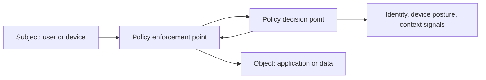

# 02 - Security architecture

**Domain 2: Security Architecture (27%)** - CAS-005. Sections follow CompTIA's published objectives summary.

Architecture is where you decide, before any product is bought, where trust is placed and how it is enforced. The exam favours designs that assume breach, limit blast radius and keep working when a layer fails.

---

## Cloud capabilities

**Shared responsibility.** The provider secures the cloud itself; you secure what you put in it. The line moves with the service model (IaaS, PaaS, SaaS), but you always keep responsibility for your data, identities and configuration. Most breaches in cloud come from the customer side of the line, usually misconfiguration.

**CASB (cloud access security broker)** sits between users and cloud services to enforce policy: visibility, data loss prevention, threat protection and access control. Two deployment styles matter:

- **API-based** CASBs connect to the SaaS provider's API and inspect data at rest and after the fact. They see sanctioned services only, work for unmanaged devices, add no latency, and can retroactively remediate (for example removing a public share).
- **Proxy-based** (inline) CASBs sit in the traffic path, forward or reverse, so they can block in real time, but they need traffic steering and can break applications that pin certificates.

**Shadow IT detection** discovers unsanctioned cloud services from proxy, firewall and DNS logs or an agent, so they can be sanctioned, controlled or blocked.

**Delivery and automation.** **CI/CD pipelines** build and deploy software, and are themselves a high-value target: protect pipeline credentials, sign artefacts, pin dependencies and run security scanning as a gate. **Infrastructure as code** (Terraform, CloudFormation and similar) makes environments repeatable and reviewable, so scan templates for misconfiguration before deploy. **Containers** package applications with shared-kernel isolation: use minimal, scanned, signed images, run as non-root, drop capabilities and set read-only filesystems. **Orchestration** (Kubernetes) adds its own plane to secure: API server access, RBAC, network policies, secrets handling and admission control. **Serverless** removes servers to patch but moves risk to function permissions, event inputs and third-party dependencies.

## Cloud data security

Cloud data failures follow a pattern:

- **Data exposure**: public storage or over-shared links. Use account-level block-public-access controls and policy guardrails.
- **Data leakage**: through misconfigured integrations, logs, snapshots and backups. Classify, tag and monitor egress.
- **Data remanence**: data persists after deletion in storage you do not control. Use **cryptographic erase**, destroying the key so the ciphertext is useless, because you cannot overwrite a provider's disks.
- **Insecure storage**: unencrypted or weakly encrypted data, or secrets in code.
- **Encryption keys**: who holds them determines who can read the data. Options run from provider-managed keys to customer-managed keys in a KMS to bring-your-own-key and external key stores held outside the provider. More control means more operational duty and more availability risk.

## Cloud control strategies

Combine control timing. **Proactive** controls stop bad configuration before it deploys (policy as code, IaC scanning, service control policies). **Preventative** controls block actions at run time (guardrails, network rules). **Detective** controls find what slipped through (configuration monitoring, log analysis, threat detection). A strong design uses all three and shows how a failure at one layer is caught by the next.

**Customer-to-cloud connectivity** can be internet with strong encryption and identity, a VPN, or a dedicated private link; choose by latency, bandwidth, cost and the requirement that traffic not cross the public internet. **Service integration** between clouds and SaaS should use scoped, short-lived credentials and workload identity rather than long-lived keys. **Continuous authorization** replaces one-time approval with ongoing evaluation of posture, so a system loses authorization when it drifts out of compliance.

## Network architecture

**Segmentation** splits a network into zones with enforced rules between them so a compromise cannot spread freely: user, server, data, management, guest and operational technology each get a zone. **Microsegmentation** applies policy per workload or per process, typically with host-based or overlay controls, which is the answer for east-west traffic inside a data centre or cloud VPC where traditional firewalls do not see the traffic.

**VPNs** protect traffic over untrusted networks. **Always-on VPN** connects automatically before the user can reach anything, so devices are never briefly exposed on hostile networks. Decide between full tunnel (all traffic through corporate inspection) and split tunnel (only corporate traffic, with the rest going direct), accepting that split tunnel loses visibility. **API integration** between security tools lets controls share signals, for example a NAC quarantining a host when the EDR raises an alert; secure the APIs themselves with authentication, authorization and rate limits.

## Security boundaries

A boundary is only defensible if you know what is inside it. **Asset identification and management** keep the inventory current. **Attestation** is evidence that a device or workload is in a known good state, for example a hardware-backed measurement of boot integrity, and can gate access. **Data perimeters** limit where data can go and who can reach it regardless of network, such as policies that allow access only from approved networks and identities within your organization. **Secure zones** hold the most sensitive assets behind extra authentication, logging and egress control (a jump host, a bastion or a privileged access workstation as the only way in).

## Deperimeterization

As applications and users move out of the data centre, the network edge stops being the security edge. **SD-WAN** manages branch and site connectivity over any transport with central policy. **SASE (secure access service edge)** combines network functions (SD-WAN) with cloud-delivered security services such as secure web gateway, CASB, firewall as a service and zero trust network access, so policy follows the user to wherever they connect. **Software-defined networking** separates control plane from data plane to allow central, programmable policy; the controller becomes a critical asset to harden.

## Zero trust

NIST SP 800-207 describes zero trust as cybersecurity approaches that move defences from fixed network perimeters toward users, devices and resources, in which network location and asset ownership grant no implicit trust and authentication and authorization occur before access to a resource is granted. The exam phrases this as **defining subject-object relationships**: for each subject (user, device, service) and object (application, data, API) decide exactly what access is allowed, evaluate it per request using identity, device posture and context, and log it.

The diagram shows the zero trust loop: every request passes an enforcement point that asks a decision point, which weighs identity, posture and context before access is granted.

Build toward it incrementally: strong identity and MFA, device posture checks, microsegmentation, least privilege and continuous monitoring. Legacy systems that cannot support modern authentication are placed behind a proxy or gateway that can.

---

## Key terms

- **CASB** - a cloud access security broker that enforces security policy between users and cloud services
- **API-based CASB** - a CASB that connects through a service's API to inspect data at rest and remediate after the fact
- **Proxy-based CASB** - a CASB placed inline in the traffic path so it can block activity in real time
- **Shadow IT** - cloud services and applications used without organizational approval
- **Cryptographic erase** - making data unrecoverable by destroying the encryption key
- **Data remanence** - data that persists after deletion on storage the owner does not control
- **Proactive control** - a control that prevents bad configuration from being deployed, such as policy as code
- **Continuous authorization** - ongoing evaluation of a system's posture that can withdraw its authorization when it drifts
- **Microsegmentation** - applying segmentation policy per workload rather than per network
- **Always-on VPN** - a VPN that connects automatically so devices are never exposed on untrusted networks
- **Attestation** - evidence that a device or workload is in a known good state
- **Data perimeter** - guardrails limiting which identities, networks and resources can access data
- **SASE** - secure access service edge, combining wide area networking with cloud-delivered security services
- **SD-WAN** - software-defined wide area networking with central policy over any transport
- **Zero trust** - an approach in which no network location or asset ownership grants implicit trust and every request is authenticated and authorized

---

## Related

- [Notes 01: governance, risk, and compliance](./01-governance-risk-and-compliance.md)
- [Notes 03: security engineering](./03-security-engineering.md)
- [Implement zero trust](../../../../resources/hands-on-projects/implement-zero-trust.md)
- **[📖 NIST SP 800-207: Zero Trust Architecture](https://csrc.nist.gov/pubs/sp/800/207/final)** - the abstract architecture, deployment models and use cases (August 2020)
- **[📖 CompTIA SecurityX](https://www.comptia.org/en-us/certifications/securityx/)** - the objectives summary for this domain
