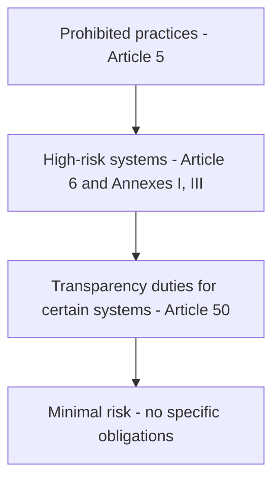

# 02 - How laws, standards and frameworks apply to AI

**Domain II: Understanding how laws, standards and frameworks apply to AI (19-23 questions)** - competencies II.A to II.D of the v2.1 blueprint.

The blueprint says this domain means understanding "the major elements of current AI laws (e.g., the EU AI Act, the South Korean AI Basic Law, federal and state AI laws that apply to private sector organizations)". You are not expected to be a lawyer. You are expected to know which law engages, what it asks of whom, and what the consequence is. The note below goes deep on the EU AI Act because the blueprint names it and its text is public. For other laws, the blueprint gives topics, not statutes; learn the concept, then apply it to whichever jurisdiction the question names.

---

## II.A Existing data privacy laws apply to AI (4-6 questions)

Most AI systems process personal data, so privacy law applies before any AI-specific law does. The blueprint lists what to know:

- **Transparency, choice, lawful basis and purpose limitation.** Data collected for one purpose cannot be freely reused to train a model for another. A lawful basis is needed for training and for use.
- **Data minimization and privacy by design.** Collect and keep only what the purpose needs. Build the control in rather than adding it later.
- **Obligations on data controllers**: privacy impact assessments, use of third-party processors, cross-border transfers, data subject rights, automated decision making, incident management, breach notification and record keeping.
- **Sensitive or special categories of data**, such as biometrics, carry stricter rules.
- **Intellectual property law**: some data may be prohibited or limited for AI training, and ownership of outputs raises its own questions.

The tricky part is data subject rights in a trained model. A person can ask for their data to be deleted or corrected, but it may be embedded in model weights. The governance answer is to decide before training what data goes in, document its source and lawful basis, and plan how requests will be handled. Automated decision making is the other recurring theme: where a decision has significant effect on a person, privacy law commonly gives them rights around human review and explanation.

## II.B Other existing laws apply to AI (4-6 questions)

AI does not sit outside older law. The blueprint's examples:

- **Nondiscrimination law** applies to AI in employment, credit, lending, housing and insurance. A model that screens CVs or scores credit can create unlawful disparate outcomes even with no intent.
- **Consumer protection law** prohibits unfair and deceptive acts or practices. Overstating what an AI product can do, or hiding that a person is talking to a machine, can fall under it.
- **Product liability law** prohibits design and manufacturing defects. An AI-enabled product that harms someone because of a defect in design or training can create liability for its maker.

The exam pattern: a scenario describes an AI use and asks which existing body of law is most engaged. Match the use to the domain (hiring to nondiscrimination, marketing claims to consumer protection, physical harm from a product to product liability).

## II.C The main elements of AI-specific laws (6-8 questions)

The blueprint asks about the risk classification framework (prohibited, high, limited, minimal risk), requirements for risk management, data governance, technical documentation, conformity and impact assessments, record keeping, human oversight, transparency and notification, quality management, general-purpose AI models, enforcement and penalties, and how requirements differ for providers, deployers, importers and distributors. Those are exactly the headings of the EU AI Act, Regulation (EU) 2024/1689, so study it closely.

**[📖 Regulation (EU) 2024/1689 (AI Act), full text on EUR-Lex](https://eur-lex.europa.eu/eli/reg/2024/1689/oj)** - the primary text; every Article cited below is read from it

### The four tiers

The Act sorts AI by risk. Treat it as a pyramid.

The diagram shows the tiers from most to least restricted. General-purpose AI models sit in a separate chapter (Chapter V) with their own rules.

**Prohibited practices (Article 5).** Banned outright, including: AI using subliminal or purposefully manipulative techniques that materially distort behavior and cause harm; exploiting vulnerabilities due to age, disability or social or economic situation; social scoring leading to detrimental treatment; predicting criminal offenses based solely on profiling; untargeted scraping of facial images to build facial recognition databases; inferring emotions in the workplace and education (except for medical or safety reasons); biometric categorization to infer sensitive traits such as race, political opinions, religion or sexual orientation; and real-time remote biometric identification in public spaces for law enforcement, unless strictly necessary for narrow objectives such as targeted search for victims or preventing a specific imminent threat, with prior authorization.

**High-risk systems (Article 6 and Annex III).** Annex III lists the areas: biometrics; critical infrastructure; education and vocational training; employment, workers' management and access to self-employment; access to essential private and public services and benefits (including creditworthiness and life and health insurance risk assessment); law enforcement; migration, asylum and border control; and administration of justice and democratic processes. AI used as a safety component of products covered by the Union harmonization legislation in Annex I is also high-risk under Article 6(1).

High-risk providers must meet the requirements in Articles 9 to 15: a **risk management system** (Article 9), **data and data governance** (10), **technical documentation** (11), **record-keeping** (12), **transparency and provision of information to deployers** (13), **human oversight** (14), and **accuracy, robustness and cybersecurity** (15). Article 16 sets the provider obligations, which include a **quality management system** (Article 17). Then **deployer obligations** (Article 26) cover using the system as instructed, assigning competent human oversight, monitoring and keeping logs. Article 27 requires certain deployers to carry out a **fundamental rights impact assessment**. Providers also run **post-market monitoring** (Article 72) and report **serious incidents** (Article 73).

**Transparency duties (Article 50).** Providers must ensure people are told when they interact with an AI system, unless obvious; providers of systems generating synthetic audio, image, video or text must mark outputs in a machine-readable format as artificially generated; deployers of emotion recognition or biometric categorization must inform exposed people; deployers of deep fakes must disclose that content is artificially generated or manipulated; and AI-generated text published to inform the public on matters of public interest must be disclosed. This information must be clear and given at the latest at first interaction.

**General-purpose AI models (Chapter V).** A general-purpose AI model is one with significant generality, capable of competently performing a wide range of distinct tasks and integrable into many downstream systems. Article 53 requires providers to keep technical documentation, provide information to downstream providers, put in place a copyright compliance policy, and publish a sufficiently detailed summary of training content using the AI Office template. A model is presumed to have high-impact capabilities, and so to carry **systemic risk**, when the cumulative computation used for training exceeds 10^25 floating point operations (Article 51(2)); the Commission can also designate models. Providers must notify the Commission within two weeks of meeting the threshold (Article 52), and Article 55 adds duties for systemic-risk models.

### Roles and the value chain

The same company can be a provider for one system and a deployer for another. Article 25 covers responsibilities along the AI value chain, including when a downstream party puts its own name on a high-risk system or substantially modifies it and so takes on provider duties. Importers and distributors have their own duties. In a scenario, always identify the role first.

### Dates and penalties

Article 113 of the original text (Regulation (EU) 2024/1689) says the Regulation applies from 2 August 2026, with exceptions: Chapters I and II (definitions and prohibited practices, including AI literacy) from 2 February 2025; Chapter III Section 4 (notified bodies), Chapter V (general-purpose models), Chapter VII (governance), Chapter XII (penalties) and Article 78 from 2 August 2025 (with an exception for Article 101); and Article 6(1) and its obligations from 2 August 2027. The Regulation entered into force on the twentieth day after publication, which is 1 August 2024.

**The Digital Omnibus on AI changed some of these dates.** Regulation (EU) 2026/1744 of 8 July 2026 was published in the Official Journal on 24 July 2026 and entered into force on the third day after publication (27 July 2026). It moves the high-risk obligations of Chapter III Sections 1 to 3 to **2 December 2027** for Annex III systems (Article 6(2)) and **2 August 2028** for Annex I product-embedded systems (Article 6(1)). It adds two prohibitions on AI that generates non-consensual intimate imagery and child sexual abuse material (Article 5(1)(ba) and (bb)), applying from 2 December 2026, and gives providers of generative systems already on the market before 2 August 2026 until 2 December 2026 to comply with the Article 50(2) marking duty. The 2 February 2025 prohibitions and the 2 August 2025 general-purpose model rules are not moved. Confirm any date you rely on in the consolidated text, because the exam and your organization may use either version.

**[📖 Regulation (EU) 2026/1744 (Digital Omnibus on AI), EUR-Lex](https://eur-lex.europa.eu/eli/reg/2026/1744/oj)** - amending point (40) restates Article 113; Article 4 sets entry into force

Article 99 sets the penalty ceilings: non-compliance with the Article 5 prohibitions up to EUR 35,000,000 or, for an undertaking, 7% of total worldwide annual turnover of the preceding financial year, whichever is higher; breaches of most operator obligations up to EUR 15,000,000 or 3%; supplying incorrect, incomplete or misleading information to authorities up to EUR 7,500,000 or 1%. Fines on providers of general-purpose AI models are capped at 3% or EUR 15,000,000 (Article 101).

### Other AI-specific laws

The blueprint also names the South Korean AI Basic Law and "federal and state AI laws that apply to private sector organizations". I did not fetch those texts for this guide, so learn them from IAPP's own materials. The approach that works in the exam: map any law you meet to the same questions as above (what is regulated, which role is liable, what documentation and oversight are required, what enforcement looks like).

## II.D Industry standards and tools that apply to AI (3-5 questions)

**OECD principles.** The OECD AI Principles are values-based: inclusive growth, sustainable development and well-being; human rights and democratic values, including fairness and privacy; transparency and explainability; robustness, security and safety; and accountability. They also give recommendations for policymakers. The OECD describes them as the first intergovernmental standard on AI.

**[📖 OECD AI Principles](https://oecd.ai/en/ai-principles)** - the five principles and the AI system lifecycle definition

**NIST AI Risk Management Framework (AI RMF 1.0, NIST AI 100-1, January 2023).** Voluntary, with four functions. NIST states that GOVERN is cross-cutting and infused throughout; MAP, MEASURE and MANAGE can then be applied in specific contexts and at specific stages of the life cycle.

- **GOVERN** has six categories: policies and processes (legal and regulatory requirements understood, trustworthy characteristics built into policy); accountability structures; workforce diversity, equity and inclusion; a culture of critical thinking and safety first; engagement with those outside the team; and third-party risk.
- **MAP** establishes context: intended purposes and settings, categorization of the system, capabilities and costs examined, risks and benefits mapped for all components including third-party data and software, and impacts on individuals, groups and society characterized.
- **MEASURE** uses quantitative, qualitative or mixed-method tools to analyse, assess, benchmark and monitor risk: appropriate metrics, evaluation for trustworthy characteristics, mechanisms to track identified risks over time, and feedback about the efficacy of measurement. NIST says systems should be tested before deployment and regularly in operation.
- **MANAGE** allocates resources to mapped and measured risks: prioritize and respond, strategies to maximize benefit and minimize harm, manage third-party risks and benefits, and treat risks including response, recovery and communication plans with post-deployment monitoring.

NIST also published a companion Playbook and a Generative AI Profile (NIST AI 600-1, 26 July 2024) for generative AI risks. The page notes AI RMF 1.0 is being revised, so check for a newer version.

**[📖 NIST AI Risk Management Framework (AI RMF 1.0), NIST AI 100-1](https://doi.org/10.6028/NIST.AI.100-1)** - the framework text, functions, categories and characteristics
**[📖 NIST AI RMF overview page](https://www.nist.gov/itl/ai-risk-management-framework)** - Playbook, Generative AI Profile and revision status

**ISO standards.** The blueprint names three: ISO/IEC 22989, 42001 and 42005. ISO/IEC 42001:2023 is the AI management system standard. Its abstract says it specifies requirements and provides guidance for establishing, implementing, maintaining and continually improving an AI management system within the context of an organization, for any organization that provides or uses products or services that utilize AI systems, regardless of size, type or nature. Because it is a management system standard, organizations can be audited and certified against it, and it is built to follow the same pattern as other ISO management systems (context, leadership, planning, support, operation, performance evaluation, improvement). The full text is paid, so I read only the abstract, from national standards bodies' catalogue pages; I did not read 22989 or 42005. Treat their descriptions in IAPP's own study material as the authority.

**[📖 ISO/IEC 42001:2023 AI management system](https://www.iso.org/standard/42001)** - the official catalogue entry for the standard

> **Exam habit:** A framework is guidance you adopt (NIST AI RMF, OECD); a law is binding; an ISO management standard is something you can be certified against. Questions often turn on that difference.

---

## Key terms

- **Prohibited practice** - an AI use banned outright by Article 5 of the EU AI Act
- **High-risk AI system** - a system in an Annex III area, or a safety component of a product under Annex I legislation, subject to Articles 9 to 15 requirements
- **General-purpose AI model** - an AI model with significant generality that can competently perform a wide range of distinct tasks and be integrated into many downstream applications (EU AI Act)
- **Systemic risk** - a risk specific to the high-impact capabilities of general-purpose AI models that can propagate at scale across the value chain (EU AI Act)
- **Fundamental rights impact assessment** - an assessment certain deployers of high-risk systems must carry out under Article 27
- **Post-market monitoring** - the provider's system for collecting and analysing performance data after a high-risk system is placed on the market (Article 72)
- **GOVERN** - the NIST AI RMF function that cuts across the others, covering policies, accountability, culture and third-party risk
- **MAP** - the NIST AI RMF function that establishes context and identifies risks and impacts
- **MEASURE** - the NIST AI RMF function that analyses, benchmarks and monitors identified risks
- **MANAGE** - the NIST AI RMF function that prioritizes and treats risks and plans response and recovery
- **ISO/IEC 42001** - the international AI management system standard that organizations can be certified against
- **OECD AI Principles** - five values-based principles for trustworthy AI adopted by the OECD
