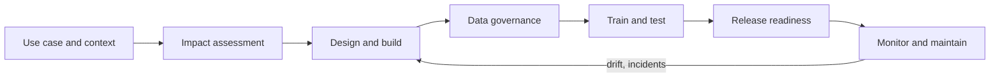

# 03 - Governing AI development

**Domain III: Understanding how to govern AI development (21-25 questions)** - competencies III.A to III.C of the v2.1 blueprint.

The blueprint frames this as the governance professional's responsibilities for "designing, building, training, testing and maintaining AI systems". You are not the engineer. You are the person who makes sure the right questions are asked at each stage, the answers are recorded, and release happens only when conditions are met.

The flow shows development governance as a loop: monitoring findings feed back into design.

---

## III.A Govern the designing and building of the AI system (6-8 questions)

Start with the **business context and use case**. Why does this system exist, who uses it, who is affected, what decision does it influence? Everything later depends on this record, and it is where you find out the use falls into a prohibited or high-risk category (see [note 02](./02-laws-standards-and-frameworks.md)).

Next, **perform or review an impact assessment** on the system. The assessment asks who could be harmed, how likely and how badly, and what controls reduce it. The NIST MAP function asks for the same thing: understand intended purposes and settings, examine benefits and costs including non-monetary ones, and characterize impacts on individuals, groups and society.

**[📖 NIST AI RMF 1.0 (NIST AI 100-1), MAP function](https://doi.org/10.6028/NIST.AI.100-1)** - context, categorization and impact characterization

Then apply policies, practices and ethical considerations to design and build. The blueprint lists the design decisions to govern: the purpose of the AI, requirements gathering, architecture and model selection, human oversight, data analysis, metric and threshold evaluation, stakeholder engagement and feedback, and operational controls. Two of these deserve a closer look.

- **Human oversight** is a design choice, not an afterthought. Decide up front whether a human reviews each decision, reviews a sample, or can intervene after the fact. The EU AI Act's Article 14 requires high-risk systems to be designed so natural persons can effectively oversee them.
- **Metrics and thresholds** define what "good enough" means before you test. Setting them after seeing results invites cherry-picking.

**Manage internal and external risks** with tools the blueprint names: a probability and severity harms matrix, a risk mitigation hierarchy, stakeholder mapping, use-case evaluation, benchmarking, and pre-deployment pilots and testing. The harms matrix plots each harm by how likely it is and how severe, so effort goes first to the likely-and-severe corner. The mitigation hierarchy prefers removing the hazard by design over controlling it, and controlling it over warning about it.

Finally, **document the designing and building** to establish compliance and manage risk. For high-risk systems under the EU AI Act, Article 11 requires technical documentation and Article 12 record-keeping. Documentation is not paperwork for its own sake: it is what lets someone else reproduce, audit or defend a decision later.

## III.B Govern the collection and use of data in training and testing (6-8 questions)

Data governance for AI is a set of questions asked before a record enters a training set:

- Do we have **lawful rights** to collect and use it (consent, contract, legitimate interest, license, copyright position)?
- Is its **quality, quantity and integrity** fit for the purpose? Is it representative of the people the system will affect?
- Where did it come from? **Data lineage and provenance** document the origin and every transformation, so you can trace a problem back or respond to a deletion or license request.

EU AI Act Article 10 sets data governance requirements for high-risk systems, covering design choices, data collection and origin, preparation, examination for possible bias, and gaps. Use that as a checklist even outside the EU.

**Plan and perform training and testing.** The blueprint lists the test types: unit, integration, validation, performance, security, bias and interpretability. Know what each is for. Unit and integration tests check that components work and connect. Validation checks the model meets its requirements on held-out data. Performance measures accuracy and speed against the thresholds you set. Security testing probes for attacks. Bias testing compares outcomes across groups. Interpretability testing checks whether you can explain behavior well enough for the use. The NIST MEASURE function adds that tests should be documented, that measurement should be connected to deployment context, and that independent review improves testing and mitigates internal bias.

**Identify and manage issues during training and testing**, and **document the training and testing process** so results can be validated. If the test shows a gap, the governance question is whether to fix, constrain the use, or stop. That is a decision with an owner, not an engineer's quiet tweak.

## III.C Govern the release, monitoring and maintenance of the AI system (8-10 questions)

This is the biggest slice of Domain III.

**Release readiness.** Assess readiness before production: model card created, conformity requirements satisfied, tests passed, owner and escalation path named. A **model card** is a short document describing what a model is for, how it was evaluated and what its limits are. Under the EU AI Act, high-risk providers also complete conformity assessment before placing the system on the market.

**Continuous monitoring and maintenance.** Establish a regular schedule for monitoring, maintenance, updates and retraining. A model that was right at launch drifts as the world changes. **Model drift** is degrading performance as the relationship between inputs and outcomes changes; **data drift** is a change in the input data itself. The blueprint lists them with brittleness, lack of robustness, lack of quality data and insufficient testing as reasons incidents arise.

**Periodic assessment.** Conduct periodic activities to assess performance, reliability and safety: audits, **red teaming** (a team deliberately attacks or probes the system to find failures), threat modeling and security testing. These are defensive exercises, run under agreed rules to find weaknesses before others do.

**Incidents.** Manage and document incidents, issues and risks, and work with cross-functional stakeholders to learn why they arose. For high-risk EU systems, providers must report serious incidents (Article 73). A good incident process for AI looks like any other: detect, triage, contain (including the option to switch the system off), investigate root cause, remediate, report, learn.

**Public disclosure and transparency.** Make disclosures to meet transparency obligations: technical documentation, instructions for use to deployers, and post-market monitoring plans. Article 13 requires high-risk systems to come with instructions that let deployers interpret and use outputs appropriately, and Article 72 requires a post-market monitoring system.

> **Exam habit:** If a question describes a model performing worse months after launch, the answer is about monitoring, retraining schedule and drift, not about re-running pre-launch tests.

---

## Key terms

- **Impact assessment** - a structured review of who could be harmed by an AI system, how likely and how badly, and what controls reduce it
- **Probability and severity harms matrix** - a grid that ranks harms by likelihood and seriousness to prioritize mitigation
- **Risk mitigation hierarchy** - an ordering of responses that prefers eliminating a hazard by design over controlling it or warning about it
- **Data lineage** - the documented path of data from origin through every transformation
- **Provenance** - the verifiable origin and ownership history of data or a model
- **Model card** - a document describing a model's intended use, evaluation results and limitations
- **Model drift** - decline in model performance as real-world conditions change after deployment
- **Data drift** - change in the statistical properties of input data compared with training data
- **Red teaming** - authorized adversarial testing of an AI system to find failures and weaknesses
- **Post-market monitoring** - systematic collection and analysis of performance data after a system is released
- **Conformity assessment** - the procedure showing a high-risk AI system meets the legal requirements before it is placed on the market
