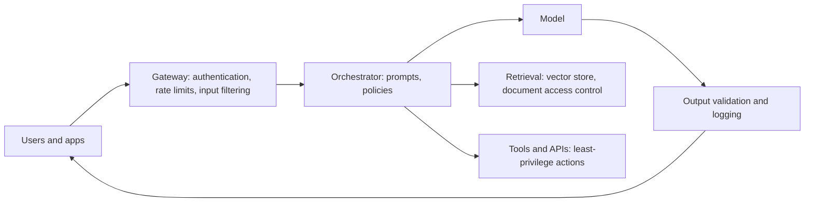

# 03 - AI technologies and controls

**Domain 3: AI Technologies and Controls (38%)** - content areas 3A to 3E, the largest domain. Related tasks: design and implement security architecture specifically for AI, advise on integrating AI architecture into enterprise architecture, design, implement and review AI security controls to treat risk to an acceptable level, identify and treat security risk associated with data in the AI life cycle, and conduct risk-based human oversight of AI inputs and outputs.

---

## 3A AI security architecture and design

Layer the architecture. An AI application is more than a model:

The diagram shows the control points: a gateway in front, the orchestrator that assembles prompts, the model, retrieval and tools behind policy, and output validation before anything reaches a user or another system.

Design principles that map to familiar security thinking:

- **Least privilege for agents and tools.** OWASP's Excessive Agency (LLM06) is exactly the failure of an LLM system granted too much functionality, permission or autonomy. Limit what each tool can do, scope credentials, and require human approval for high-impact actions.
- **Treat model output as untrusted input.** OWASP's Improper Output Handling (LLM05) is insufficient validation and sanitization of what the model produces before it goes downstream. Validate, encode and constrain it.
- **Separate trusted instructions from untrusted content.** Prompt injection (LLM01) works because both arrive as text. NIST AI 600-1 distinguishes direct and indirect injection. Controls reduce impact: privilege limits, content isolation, approval gates and monitoring. No single filter is sufficient.
- **Enforce access control where data is retrieved.** OWASP describes vector and embedding weaknesses (LLM08) as flaws in how vectors and embeddings are generated, stored or retrieved that can be exploited to inject harmful content, manipulate outputs or access sensitive information. The model must not see documents the user may not see.
- **Network and environment segmentation, secrets management and encryption** as for any workload.

Integrate with enterprise architecture (task 11): AI services should use the same identity, logging, key management and network patterns as other systems, with documented exceptions.

## 3B AI life cycle (for example model selection, training and validation)

Security gates attach to each life cycle stage.

- **Model selection.** Choose with security in mind: provenance and license, vendor assurance, whether open weights can be inspected, size and cost, whether it must run in your environment. Pin versions.
- **Training and fine-tuning.** Control who can change data and code, keep data lineage, isolate training environments, protect checkpoints and weights as sensitive assets. NIST AI 100-2 describes poisoning at training time, so integrity controls on training data matter.
- **Validation.** Test for accuracy against thresholds, robustness to adversarial input, bias, privacy leakage (memorization of training data is a privacy risk NIST AI 600-1 describes), and security. NIST MEASURE says systems should be tested before deployment and regularly while operating, with documented test sets and metrics and, where possible, independent review.
- **Deployment and operation.** Staged rollout, change control, rollback, monitoring for drift and abuse.
- **Retirement.** Remove access, delete copies and records per policy.

Task 7 asks you to design and implement testing and vulnerability management. For AI, include adversarial testing (red teaming) done under authorized rules, and re-test after any model, prompt or data change.

## 3C Data management controls

Data is the model's raw material and its largest risk surface. Controls include:

- **Classification and minimization**: use the least data needed, and keep sensitive data out of prompts and training unless justified.
- **Access control and encryption** for datasets, vector stores, logs and checkpoints.
- **Lineage and provenance** records for every dataset and transformation.
- **Quality and integrity checks**: detect corrupted or manipulated data before training; OWASP LLM04 and NIST AI 100-2 cover poisoning.
- **Retention and deletion** aligned to law and contracts; plan how deletion requests reach derived data.
- **Logging** of prompts and outputs with care: logs themselves hold sensitive data and need protection and retention limits.

Task 14 asks you to identify and treat security risk associated with data used in the AI life cycle. Sensitive information disclosure (LLM02) is the risk when a model reveals data it should not; NIST describes models leaking, generating or inferring sensitive personal information and the memorization behind it.

## 3D Privacy, ethical, trust and safety controls

These controls address harm to people, not only to systems.

- **Privacy.** Apply data minimization and purpose limitation, run privacy impact assessments, honor data subject rights where they apply, and watch for inferred sensitive attributes. NIST AI 600-1 notes models may infer personal information not in training data by combining sources.
- **Fairness and bias.** Test outputs across groups and monitor in production. NIST's characteristic is "fair with harmful bias managed", which accepts bias cannot be zero but must be managed.
- **Transparency and explainability.** Tell users when they interact with AI and when content is AI-generated (EU AI Act Article 50 sets such duties), and provide explanations at a level fit for the decision.
- **Safety.** Content filters, refusal behavior, restrictions on dangerous capabilities, and human fallback.
- **Human oversight.** Task 20 calls for risk-based human oversight of inputs and outputs including trust and safety, quality, explainability and robustness. Risk-based means more review where harm is greater. Oversight must be real: reviewers need competence, time and authority, or it is theater.

## 3E Security controls and monitoring

Operate what you built. Monitoring for AI covers:

- **Security signals**: unusual prompts, repeated attempts to extract system prompts or data, spikes in token or compute use (OWASP LLM10 Unbounded Consumption covers excessive, uncontrolled inference leading to denial of service, economic loss, model theft and service degradation), anomalous tool calls, and access to retrieval stores.
- **Quality and drift signals**: output quality metrics, error and override rates, drift in input data.
- **Control health**: filters firing, approval queues, logging gaps.
- **Metrics** (task 18) reported to management.

Feed alerts into the existing security operations and incident process. Protect the telemetry, because logs of prompts may contain sensitive data. Review and implement AI security tools (task 19) against the risks you identified rather than buying by category. Finally, train people: AI-specific awareness and acceptable use (task 21) closes the gap that no technical control can, such as staff pasting sensitive data into an unapproved tool.

> **Exam habit:** in Domain 3 the best answer layers controls and matches the specific threat. Prompt injection is not solved by one filter; poisoning is addressed at the data and training pipeline, not at the output.

---

## Key terms

- **AI security architecture** - the layered design of gateway, orchestration, model, retrieval, tools and monitoring with security controls at each point
- **Improper output handling** - insufficient validation, sanitization and handling of model output before it is passed downstream (OWASP LLM05)
- **System prompt leakage** - exposure of the instructions given to a model, which may contain sensitive information (OWASP LLM07)
- **Vector and embedding weaknesses** - security weaknesses in how embeddings and vector stores are generated, stored and retrieved (OWASP LLM08)
- **Unbounded consumption** - an LLM application allowing excessive and uncontrolled inferences, leading to denial of service, economic losses, model theft and service degradation (OWASP LLM10)
- **Data minimization** - using only the data needed for the stated purpose
- **Memorization** - a model reproducing or revealing training data in its outputs
- **Red teaming** - authorized adversarial testing that probes an AI system for failures and weaknesses
- **Drift** - change in input data or model performance over time after deployment
- **Human-in-the-loop** - a design in which a person reviews or approves AI output before action
