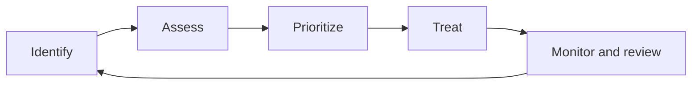

# 01 - Security principles

**Domain 1: Security Principles (24%)** - the largest domain in the outline effective September 1, 2026, and the vocabulary the rest of the exam uses.

The outline splits this domain into five objectives: cybersecurity concepts (1.1), risk management (1.2), governance (1.3), cybersecurity controls (1.4), and professional and ethical conduct (1.5). Business continuity and disaster recovery, which used to have their own domain, now sit in [Domain 2](./02-security-governance.md).

---

## 1.1 Cybersecurity concepts

### The CIA triad

Almost every security question comes back to three properties. **Confidentiality** means only authorized parties can read the information. **Integrity** means the information is accurate and has not been changed without authorization. **Availability** means authorized users can reach the information and systems when they need them.

| Property | Broken by | Protected by |
|---|---|---|
| **Confidentiality** | Data breach, eavesdropping, shoulder surfing | Encryption, access control, classification |
| **Integrity** | Tampering, corruption, unauthorized change | Hashing, digital signatures, change control |
| **Availability** | Denial of service, hardware failure, ransomware | Redundancy, backups, capacity planning |

A useful exam habit is to ask which of the three a scenario damages. Ransomware is mostly an availability attack (you cannot reach your files), even though attackers now usually steal a copy first, which adds a confidentiality breach on top.

### AAA: authentication, authorization, accounting

The outline names all three, and the exam likes to swap them. **Authentication** proves who you are. **Authorization** decides what you may do once your identity is proven. **Accounting** records what you actually did, so it can be reviewed later. A login prompt is authentication, a "permission denied" message is authorization, and an audit log entry is accounting.

Authentication uses factors: something you **know** (a password), something you **have** (a token or phone), and something you **are** (a fingerprint). Using two or more different categories is **multi-factor authentication**. Two passwords is still one factor, because both are something you know.

### Non-repudiation

**Non-repudiation** means a person cannot credibly deny having done something, such as sending a message or approving a payment. The usual technical mechanism is a **digital signature**, because only the holder of the private key could have produced it. Accounting supports non-repudiation too, as long as the logs are protected from tampering.

### Privacy

Privacy is about the rights of the people the data describes, which is a different question from whether the data is secure. A perfectly encrypted database can still breach privacy if it holds data the organization had no right to collect.

**Personally identifiable information (PII)** is information that can identify a person, alone or combined with other data. **Protected health information (PHI)** is health data covered by regulations such as HIPAA. The core privacy principles are simple: collect only what you need, use it only for the purpose you stated, keep it only as long as necessary, and let people exercise their rights over it. The major regimes you should recognize are **GDPR** (EU), **HIPAA** (US health), and **GLBA** (US financial).

AI makes privacy harder in a specific way: personal data typed into an AI assistant may be stored, used for training, or surface in another user's answer, depending on the service's terms. That is why many organizations now have an AI acceptable use rule saying which data may go into which AI tools.

---

## 1.2 Risk management

### The vocabulary

| Term | Definition |
|---|---|
| **Asset** | Something of value: data, systems, people, reputation. The 2026 outline also expects you to recognize AI models, training data, and prompts as assets |
| **Vulnerability** | A weakness that could be exploited |
| **Threat** | A person, event, or circumstance with the potential to exploit a vulnerability |
| **Likelihood** | The probability that a threat exploits a vulnerability |
| **Impact** | The consequence if it happens |
| **Risk** | The combination of likelihood and impact |
| **Risk appetite / tolerance** | How much risk the organization is willing to accept |
| **Residual risk** | The risk remaining after controls are applied |

### The risk management lifecycle

The outline asks for the risk management **lifecycle** and its **processes**, which means knowing the order of the steps, not just the definitions. Risk management is a loop, not a one-off project:

1. **Identify** the assets, and the threats and vulnerabilities that apply to them. You cannot manage a risk you have not found.
2. **Assess** each risk by estimating likelihood and impact. **Qualitative** assessment uses ratings such as high, medium, and low. **Quantitative** assessment uses money: single loss expectancy, annualized rate of occurrence, and annualized loss expectancy.
3. **Prioritize** the risks, usually by comparing them with the organization's risk appetite. The ones above appetite need treatment first.
4. **Treat** each risk with one of four responses (below), and record the decision in a **risk register** with an owner.
5. **Monitor and review**, because threats, systems, and the business all change. A risk accepted last year may be unacceptable now.

The diagram shows the lifecycle as a loop: monitoring feeds back into identifying new risks.

### Risk treatment

| Treatment | Means | Example |
|---|---|---|
| **Avoid** | Stop doing the risky activity | Decommission the vulnerable service |
| **Mitigate** (reduce) | Apply controls to lower likelihood or impact | Patch it, add monitoring |
| **Transfer** (share) | Move the financial consequence to another party | Cyber insurance, outsourcing |
| **Accept** | Acknowledge the risk and take no further action | Document it, get sign-off, review it periodically |

Two traps here. Transfer moves the **financial** consequence, never the accountability: if your outsourced provider loses your customers' data, your customers still blame you. And acceptance is a legitimate, documented decision by someone with authority, not the same thing as ignoring a risk.

---

## 1.3 Governance concepts

Governance is how an organization directs and controls security: who decides, what the rules are, and how anyone knows the rules are followed. The outline lists three layers of source material.

**Regulations and laws** are imposed from outside and are mandatory. GDPR, HIPAA, and PCI DSS (a contractual standard, but enforced like a regulation by the card brands) are the usual examples.

**Frameworks and guidelines** are structured bodies of good practice that an organization chooses to adopt. The ones to recognize are the **NIST Cybersecurity Framework** (whose 2.0 version, released in 2024, added a Govern function to Identify, Protect, Detect, Respond, and Recover), the **ISO/IEC 27001** standard for an information security management system, and the **CIS Critical Security Controls**, a prioritized list of practical safeguards. The outline names ISO and the Center for Internet Security directly.

**Policies, standards, and procedures** are the organization's own documents, and the exam tests the difference between them:

| Document | Nature | Example |
|---|---|---|
| **Policy** | High level, mandatory, states intent | "All data must be classified" |
| **Standard** | Specific, mandatory, states requirements | "All laptops use AES-256 full disk encryption" |
| **Procedure** | Step by step, mandatory to follow | "How to enable BitLocker: steps 1 to 8" |
| **Guideline** | **Recommended**, not mandatory | "Consider using a password manager" |

The tested distinction: **guidelines are recommendations; policies, standards, and procedures are mandatory.** A standard can come from outside (an ISO standard) or inside (the company laptop encryption standard); either way, once adopted it is mandatory.

---

## 1.4 Cybersecurity controls

A control is anything that reduces risk. The outline groups controls by **type**, meaning how they are implemented:

- **Technical** (logical) controls are implemented in technology: a firewall, encryption, an access control list.
- **Administrative** (managerial) controls are implemented through people and process: a policy, training, a background check.
- **Physical** controls are implemented in the physical world: a lock, a fence, a guard, CCTV.

Controls also have a **function**, meaning what they do. A **preventive** control stops the event (a lock). A **detective** control notices it happened (an alarm). A **corrective** control fixes things afterwards (restoring from backup). A **deterrent** control discourages the attempt (a warning sign). A **compensating** control is an alternative used when the preferred control is not feasible (extra monitoring on a legacy system that cannot be patched).

These are two independent axes, and every control has a position on both. A CCTV camera is a physical control that is both deterrent (when visible) and detective (when recording). The exam often asks for one axis while you are thinking about the other, so read which one the question wants.

### Physical controls in practice

| Control | Function |
|---|---|
| **Badge or card reader** | Preventive; restricts entry to authorized holders |
| **Mantrap** (access control vestibule) | Preventive; stops **tailgating** by letting one person through at a time |
| **Turnstile** | Preventive; enforces single-person entry |
| **Security guard** | Preventive and deterrent; can use judgment |
| **CCTV** | Deterrent when visible, detective when recorded |
| **Fence, bollard, lighting** | Deterrent and preventive perimeter controls |
| **Sensor and alarm** | Detective |

**Tailgating** is following an authorized person through a door without them knowing. **Piggybacking** is being let through knowingly. Both defeat badge readers, which is why mantraps and turnstiles exist.

**Defense in depth** means layering controls of different types so that the failure of one does not expose the asset. A data center with a fence, a badge reader, a mantrap, cameras, and locked racks is defense in depth applied physically.

---

## 1.5 Professional and ethical conduct

### Due care and due diligence

These two terms are new to the outline and easy to mix up. **Due diligence** is the investigation: finding out what the risks are and what a reasonable organization should do about them, such as assessing a vendor before signing. **Due care** is the action: actually doing what a reasonable person would do, such as patching known vulnerabilities and following the policies you wrote. A short way to hold them apart: diligence is doing your homework, care is doing the right thing. An organization that knew about a risk (diligence) and did nothing (no care) is negligent.

### Professional code of conduct

Most employers and professional bodies have a code of conduct covering honesty, confidentiality, conflicts of interest, and acting within your authority. For a security professional it also means not testing systems you have no permission to test, however good your intentions.

### The ISC2 Code of Ethics

Everyone who certifies with ISC2 agrees to the code. The four canons apply in **order of precedence**, which is itself testable:

1. Protect society, the common good, necessary public trust and confidence, and the infrastructure
2. Act honorably, honestly, justly, responsibly, and legally
3. Provide diligent and competent service to principals
4. Advance and protect the profession

Where canons conflict, the earlier one wins. If your employer (a principal, canon 3) asks you to hide a breach that harms the public (canon 1), canon 1 takes precedence.

---

## Key terms

- **Confidentiality** - the property that information is accessible only to authorized parties
- **Integrity** - the property that information is accurate and has not been altered without authorization
- **Availability** - the property that information and systems are accessible to authorized users when needed
- **Non-repudiation** - assurance that an actor cannot credibly deny having performed an action
- **Authentication** - the process of proving an identity claim
- **Authorization** - the process of determining what an authenticated identity may do
- **Accounting** - the recording of actions taken by an identity, for later review
- **Multi-factor authentication** - authentication using two or more different factor categories
- **PII** - personally identifiable information, data that can identify an individual
- **Asset** - anything of value to the organization that warrants protection
- **Vulnerability** - a weakness that a threat could exploit
- **Threat** - a circumstance or actor with the potential to exploit a vulnerability
- **Risk** - the combination of the likelihood of an event and its impact
- **Residual risk** - the risk that remains after controls have been applied
- **Risk tolerance** - the amount of risk an organization is willing to accept
- **Risk register** - the record of identified risks, their ratings, owners, and chosen treatments
- **Risk management lifecycle** - the repeating cycle of identifying, assessing, prioritizing, treating, and monitoring risk
- **Risk transfer** - moving the financial consequence of a risk to another party, such as an insurer, while accountability stays
- **Framework** - a structured, voluntarily adopted body of good practice such as NIST CSF, ISO/IEC 27001, or the CIS Controls
- **Policy** - a high-level mandatory statement of organizational intent
- **Standard** - a specific mandatory requirement supporting a policy
- **Procedure** - mandatory step-by-step instructions for carrying out a task
- **Guideline** - a recommended, non-mandatory practice
- **Preventive control** - a control that stops an unwanted event from occurring
- **Detective control** - a control that identifies that an event has occurred
- **Corrective control** - a control that restores systems after an event
- **Deterrent control** - a control that discourages an actor from attempting an action
- **Compensating control** - an alternative control used when the primary control is not feasible
- **Defense in depth** - layering multiple controls so no single failure exposes the asset
- **Tailgating** - following an authorized person through a physical access control without authenticating
- **Mantrap** - an access control vestibule permitting one person through at a time
- **Due diligence** - investigating risks and what reasonable protection requires before acting
- **Due care** - taking the reasonable actions that protect the organization and others from known risks

---

## Related

- [Notes 02: security governance](./02-security-governance.md)
- [Scenarios](../scenarios.md) - scenarios 1 and 2
- **[📖 ISC2 CC exam outline](https://www.isc2.org/certifications/cc/cc-certification-exam-outline)** - objectives 1.1 to 1.5
- **[📖 NIST Cybersecurity Framework](https://www.nist.gov/cyberframework)** - CSF 2.0 and its six functions
- **[📖 CIS Critical Security Controls](https://www.cisecurity.org/controls)** - the prioritized safeguards the outline names
