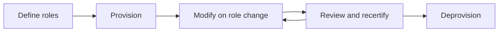

# 03 - Identity and access management concepts

**Domain 3: Identity And Access Management (IAM) Concepts (20%)** - in the outline effective September 1, 2026.

The old "Access Control Concepts" domain mixed physical and logical access. The new domain is about identity: how an identity is created, given access, reviewed, and removed (3.1), and the rules that decide what it may do (3.2). Physical access controls now sit with the other control types in [notes 01](./01-security-principles.md#14-cybersecurity-controls).

---

## Why identity is the new perimeter

When everyone worked in one building on one network, the firewall was the main boundary. Today staff work from home, applications run in the cloud, and data sits in SaaS services the network team never touches. What is left to protect every request is the question "who is this, and should they be allowed?" That is why identity is often called the new perimeter, and why stolen credentials are behind so many breaches.

---

## 3.1 Identity life cycle management

Every identity, whether a person, a service, or an AI agent, goes through the same life cycle. The outline lists its stages: roles definition, provisioning, review, and deprovisioning, plus the frameworks and tools that support them.

The diagram shows the life cycle: roles are defined first, access is provisioned against them, changed and reviewed repeatedly, and finally removed.

### Roles definition

Before you can grant the right access, you have to decide what "right" means for each job. **Roles definition** groups the permissions a job needs into a named role, such as "accounts payable clerk" or "help desk analyst". Defining roles well is slow, careful work with the business, but it pays off: new joiners get correct access on day one, and reviewers can check a role once instead of checking every person's individual permissions.

### Provisioning

**Provisioning** creates the identity and grants its initial access, ideally automatically from an authoritative source. In most organizations the HR system is that source: a new hire record triggers an account, a mailbox, and the access attached to their role. Manual provisioning by ticket is slower and drifts, because people copy a colleague's access ("make her like Bob") and inherit everything Bob has collected over the years.

When someone changes job, their access should change too. The classic failure is **privilege creep**: new access is added for the new role, but the old access is never removed, so long-serving staff end up with far more than they need. The joiner, mover, leaver model names the three moments where access must change.

### Review

**Access reviews** (also called recertification or attestation) periodically ask a manager or resource owner to confirm that each person's access is still needed. They catch privilege creep, forgotten exceptions, and accounts nobody recognizes. Reviews work only if reviewers actually remove access; a review where everything is approved in bulk is a compliance ritual, not a control.

### Deprovisioning

**Deprovisioning** removes access when someone leaves or no longer needs it, and it must be prompt. Accounts that stay active after a departure are a common audit finding and a real insider risk, since a former employee, or anyone who has their credentials, can still log in. Automated deprovisioning from the HR leave date is the strongest pattern. For high-risk departures, access should be removed at the moment the person is told, not at the end of the day.

### Non-human identities

Service accounts, API keys, workloads, and now **AI agents** are identities too, and in most organizations they outnumber people. They follow the same life cycle, but they are easy to forget because no HR record creates or removes them. Every non-human identity needs a named human owner, the least privilege its task requires, and a review date. An AI agent that can read email and call APIs on a user's behalf should be treated as a privileged identity, not as a feature.

### Frameworks and tools

**Identity governance and administration (IGA)** tools automate the life cycle: provisioning from HR, role management, access requests with approval, and access reviews. A **directory** stores the identities and their attributes. An **identity provider (IdP)** authenticates users and vouches for them to applications.

**Single sign-on (SSO)** lets one authentication give access to many applications. It improves the user experience and centralizes control, but it concentrates risk in that one sign-in, which is why SSO is almost always paired with MFA. **Federation** extends SSO across organizations using standards such as **SAML** and **OpenID Connect**, so a partner's staff can sign in with their own company's identity. **SCIM** is the standard for provisioning and deprovisioning accounts in SaaS applications automatically.

**Privileged access management (PAM)** applies stricter treatment to administrator accounts: separate admin accounts, stronger authentication, **just-in-time** elevation that grants admin rights only for a short approved window, session recording, and close monitoring.

The framework to recognize is **NIST SP 800-63**, the US digital identity guidelines, which define assurance levels for identity proofing, authentication, and federation.

---

## 3.2 Logical access controls

### Principle of least privilege

The **principle of least privilege (PoLP)** grants only the permissions needed to do the job, and no more. It limits the damage any single compromised account, mistake, or malicious insider can do. Least privilege applies to people, services, and AI agents alike, and over time, which is why just-in-time access is least privilege applied to the clock.

A related idea is **need to know**: access to information only when the task requires it, even if the person's clearance or role would technically allow more. Least privilege limits what you can **do**; need to know limits what you can **see**.

### Separation of duties

**Separation of duties (SoD)** splits a sensitive process so that no single person can complete it alone. The person who creates a supplier should not be the person who approves payments to it; the developer who writes code should not be the one who deploys it to production unreviewed. SoD prevents fraud and catches mistakes, because a second person sees the work.

Related controls include **two-person control** (two people must act together, as with launch keys), **job rotation** (moving people between roles, which exposes fraud that depends on one person staying in place), and **mandatory vacation**, which has the same detective purpose.

### Access control models

| Model | Who decides | Characteristic | Typical setting |
|---|---|---|---|
| **DAC** (discretionary) | The data owner | The owner grants access at their discretion | File shares, personal file permissions |
| **MAC** (mandatory) | The system, from labels and clearances | Users cannot override it; enforced centrally | Military and government classification |
| **RBAC** (role-based) | Roles carry permissions; users are assigned roles | Scales well and simplifies administration | Most enterprises |
| **ABAC** (attribute-based) | A policy evaluates attributes at access time | Most flexible: user, resource, device, time, location | Modern cloud and zero trust |
| **Rule-based** | Predefined rules applied to everyone | Often used alongside another model | Firewall rule sets, time-of-day restrictions |

The reliable question is DAC versus MAC: in DAC the owner decides, in MAC the system decides and the owner cannot override it. RBAC connects directly to roles definition in 3.1, since good roles are what make RBAC work.

### Authentication strength

Access decisions are only as good as the authentication behind them. Factors are something you **know**, **have**, or **are**, sometimes with **somewhere you are** (location) and **something you do** (behavior) added. MFA needs factors from **different** categories.

Biometric systems trade two errors against each other: the **false acceptance rate** (letting an impostor in) and the **false rejection rate** (locking out the real user). The **crossover error rate**, where the two are equal, is used to compare systems; lower is better.

Phishing-resistant methods, such as passkeys and hardware security keys, are now preferred over codes sent by SMS, because they cannot be typed into a fake login page.

---

## Key terms

- **Identity life cycle** - the stages an identity passes through: roles definition, provisioning, modification, review, and deprovisioning
- **Roles definition** - grouping the permissions a job needs into a named role that can be granted and reviewed as one unit
- **Provisioning** - creating an identity and granting its initial access
- **Joiner, mover, leaver** - the three moments in employment when access must be granted, changed, or removed
- **Privilege creep** - the accumulation of unnecessary permissions as a person changes roles over time
- **Access review** - periodic recertification that existing access is still required
- **Deprovisioning** - removing access when a person leaves or no longer requires it
- **Non-human identity** - a service account, API key, workload, or AI agent that authenticates and holds access
- **IGA** - identity governance and administration, tooling that automates provisioning, roles, requests, and reviews
- **Identity provider** - the service that authenticates users and vouches for them to applications
- **Single sign-on** - one authentication event granting access to multiple systems
- **Federation** - trusting identities issued by another organization, using standards such as SAML or OpenID Connect
- **SCIM** - the standard for automatically provisioning and deprovisioning accounts in applications
- **Privileged access management** - the stricter controls applied to administrative accounts
- **Just-in-time access** - granting elevated rights only for a short, approved window
- **Least privilege** - granting only the permissions required to perform a role, and no more
- **Need to know** - restricting access to only the information required for a specific task
- **Separation of duties** - dividing a sensitive process so no one person can complete it alone
- **Job rotation** - periodically moving staff between roles, which helps surface concealed fraud
- **DAC** - discretionary access control, where the data owner decides who may access a resource
- **MAC** - mandatory access control, where the system enforces access from labels and clearances
- **RBAC** - role-based access control, where permissions attach to roles and users are assigned roles
- **ABAC** - attribute-based access control, where a policy evaluates multiple attributes at access time
- **False acceptance rate** - the rate at which a biometric system wrongly accepts an impostor
- **False rejection rate** - the rate at which a biometric system wrongly rejects a legitimate user
- **Crossover error rate** - the point where false acceptance and false rejection rates are equal

---

## Related

- [Notes 04: networking and cloud security](./04-networking-and-cloud-security.md)
- [Scenarios](../scenarios.md) - scenarios 3 and 4
- [IAM explained](../../../../learn/concepts/iam-explained.md)
- **[📖 NIST SP 800-63 Digital Identity Guidelines](https://pages.nist.gov/800-63-4/)** - assurance levels for identity proofing, authentication, and federation
