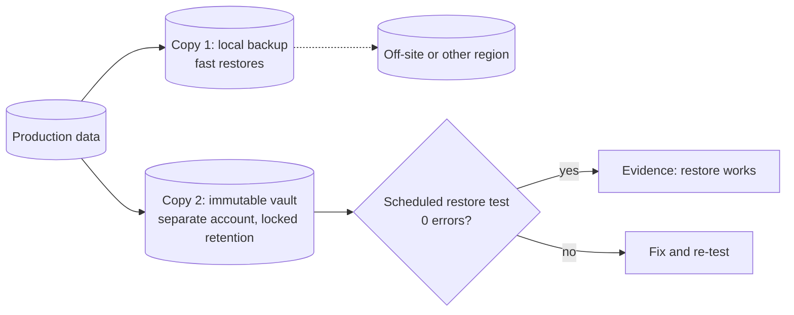

# Backup and ransomware resilience

> **14-minute read. No prerequisites, though [Incident response basics](./incident-response-basics.md) explains the process a ransomware recovery sits inside.**

## The one-line answer

Ransomware resilience means being able to **restore your systems and data without paying**, within a time the business can survive. That depends on backups an attacker **cannot delete or encrypt** (immutable, offline or in a separate account), on backups you have **actually restored from** recently, and on a recovery plan that starts with clean identity and infrastructure. A backup you have never tested is a hope, not a control.

## Why it matters

Modern ransomware groups do not just encrypt files. A typical attack:

1. Gains access (phished credentials, an unpatched VPN appliance, stolen remote access).
2. Spends days or weeks escalating to domain or cloud admin.
3. **Finds and destroys the backups**: deletes snapshots, wipes the backup server, removes cloud backup vaults, corrupts the backup catalogue.
4. Steals data for extortion (**double extortion**: "pay or we publish").
5. Encrypts everything at once, often on a Friday night.

Step 3 is why "we have backups" is not enough. If the attacker holds the same admin credentials as your backup administrator, your backups are just more files to delete. Backups are designed against accidents and hardware failure; ransomware is an **adversary** that targets them on purpose.

## The vocabulary

- **RPO (recovery point objective)**: how much data you can afford to lose, measured in time. RPO of 4 hours means backups at least every 4 hours.
- **RTO (recovery time objective)**: how long until the service must be back.
- **Immutable backup**: a copy that cannot be changed or deleted until a retention date passes, even by an administrator.
- **Air-gapped / offline backup**: a copy with no network path from production (tape in a vault, or a logically isolated vault with separate credentials).
- **Full, incremental and differential backups**: a full copy; changes since the last backup of any kind; changes since the last full backup.
- **Snapshots**: point-in-time copies on the same storage system. Fast to restore, but they live next to the thing they protect, so they are not a backup on their own.

## The 3-2-1-1-0 rule

The classic **3-2-1** rule has been extended for ransomware:

| Digit | Rule | Why |
|---|---|---|
| **3** | Three copies of the data (production plus two backups) | One failure never leaves you with zero |
| **2** | On two different types of media or storage | One storage bug or vendor issue does not hit every copy |
| **1** | One copy off-site | A fire, flood or regional outage does not take all copies |
| **1** | One copy **immutable or air-gapped** | An attacker with admin rights cannot delete or encrypt it |
| **0** | **Zero errors** in restore verification | You know the backups actually restore |

The last two digits are the ransomware additions, and they are the ones most organisations are missing.

*A 3-2-1-1-0 layout: a fast local copy, an immutable copy in a separate account and location, and a scheduled restore test that proves the copies work.*

## Making backups attacker-resistant

**Immutability**

- **Cloud object lock**: S3 Object Lock in compliance mode, Azure immutable blob storage with locked policies, Google Cloud Storage bucket lock. In compliance mode **no one**, including the root account, can delete the object before its retention date.
- **Cloud backup vault locks**: AWS Backup Vault Lock, Azure Backup immutable vaults with soft delete, Google Cloud Backup and DR backup vaults with enforced retention.
- **Hardened backup appliances** and immutable Linux repositories from backup vendors.

**Separation**

- **Separate credentials**: backup administration must not use the same identity as production administration. Backup admin accounts should not be in the main directory domain at all, or should require separate phishing-resistant MFA.
- **Separate account or subscription**: in the cloud, copy backups to a dedicated backup account in the organisation, where production admins have no rights.
- **Multi-person approval** for destructive actions (deleting a vault, shortening retention) where the platform supports it.

**Coverage of what you need to rebuild, not just data**

- Identity: Active Directory or your IdP configuration, which you need first.
- Infrastructure as code, DNS zones, firewall configuration, certificates and keys (from your KMS, with key backups where you manage them).
- SaaS data: Microsoft 365 and Google Workspace keep deleted items for a limited time; the provider's retention is not a backup under your control.

## Recovery testing: the "0"

Untested backups fail in predictable ways: an agent that stopped running months ago, an encryption key nobody can find, a database backup that is crash-inconsistent, a restore that takes 9 days against an RTO of 1 day. Test at three levels:

1. **Automated verification** (daily or weekly): the backup software restores samples and checks integrity. Cheap; catches broken jobs.
2. **Application restore tests** (monthly or quarterly): restore a whole system into an isolated network and prove the application starts and the data is correct. Measure the time and compare it with the RTO.
3. **Full recovery exercise** (yearly): a tabletop plus technical exercise of "everything is encrypted, including identity". Most organisations discover their recovery order is wrong: nothing comes back until directory services, DNS and the backup system itself are back, and those were never planned for.

Write down the results. Auditors, cyber insurers and boards increasingly ask for **evidence of a successful restore**, not just a backup policy.

## A worked example: a mid-size company on AWS

A 400-person company runs its product on AWS and its office IT on Microsoft 365. An assessment finds: EBS snapshots and RDS automated backups in the production account only; the same SSO role can delete both; no restore test in 18 months; Microsoft 365 relying on the recycle bin.

The plan:

1. **Separate backup account**: create a backup account in AWS Organizations. AWS Backup copies daily backups of RDS, EBS and DynamoDB into a vault there.
2. **Lock it**: AWS Backup Vault Lock in compliance mode with 35 days minimum retention. A service control policy denies anyone in production accounts from touching that account's vaults.
3. **Credentials**: backup-account access only through a separate permission set requiring a hardware security key, used by two named people.
4. **Microsoft 365**: a third-party backup service with its own immutable storage for mail, OneDrive and SharePoint.
5. **Rebuild kit**: Terraform state and modules, DNS zone exports, and the identity provider's configuration exported weekly to the locked vault.
6. **Test**: monthly, a script restores the production database snapshot from the backup account into an isolated VPC and runs data checks; time-to-restore is charted against the 8-hour RTO. The first test takes 14 hours. The team switches the largest database to a faster restore method and re-tests: 5 hours.

Six months later, if an attacker gains production admin, they can delete production and its local snapshots, but not the vault, and the company has a measured, rehearsed path back.

## Recovering from an actual attack

When ransomware hits, restore discipline matters as much as backups:

- **Contain first**, then restore. Restoring into a network the attacker still controls gets you encrypted twice.
- **Find the initial access and persistence** before reconnecting restored systems, or restore from a point before the attacker arrived. Attackers are often inside for days before encrypting; your newest backup may contain their backdoor.
- **Rebuild identity cleanly**: reset privileged credentials, including service accounts and the Kerberos `krbtgt` account in Active Directory, and revoke cloud keys and sessions.
- **Restore in priority order** agreed in advance: identity and DNS, then the systems that make money or keep people safe.
- **Involve legal and insurers early**; data theft may trigger breach notification duties, and paying ransoms can carry sanctions risk. Law enforcement and national agencies (such as CISA in the US) can help.

**[📖 CISA #StopRansomware Guide](https://www.cisa.gov/stopransomware/ransomware-guide)** - prevention best practices and a response checklist

**[📖 NIST IR 8374: Ransomware Risk Management (CSF profile)](https://csrc.nist.gov/pubs/ir/8374/final)** - ransomware controls mapped to the Cybersecurity Framework

**[📖 AWS Backup Vault Lock](https://docs.aws.amazon.com/aws-backup/latest/devguide/vault-lock.html)** - governance vs compliance mode for immutable backups

**[📖 Azure Backup immutable vaults](https://learn.microsoft.com/en-us/azure/backup/backup-azure-immutable-vault-concept)** - immutability and locking for Recovery Services and Backup vaults

## Common mistakes

- **Snapshots as the only backup.** They share the fate of the system they protect.
- **One admin identity for everything.** Whoever owns production can delete the backups.
- **Governance mode when you meant compliance mode.** Governance-mode locks can be bypassed by users with special permissions; an attacker with those permissions will.
- **Never testing restore times.** Backups that exist but take two weeks to restore miss every RTO.
- **Forgetting identity, DNS and the backup server itself** in the recovery plan.
- **Retention shorter than attacker dwell time.** If attackers lurk for 3 weeks and you keep 7 days, every backup contains them.
- **Assuming the SaaS provider backs up your data for you.** Read the shared responsibility terms.

## How exams test this

- **Security+**: backup types, on-site vs off-site, snapshots, replication, journaling, RPO and RTO, and resilience vs recovery; ransomware as a malware type and its indicators.
- **CISSP**: business continuity and disaster recovery planning, recovery strategies and site types (hot, warm, cold), RPO, RTO, MTD, and testing types (read-through, tabletop, simulation, parallel, full interruption).
- **CISA and CISM**: auditing backup and recovery controls, and BCP/DRP governance.
- **Cloud security exams**: the native tools - AWS Backup and Vault Lock, Azure Backup with immutable vaults and soft delete, Google Cloud Backup and DR - and cross-account or cross-region copies.

## What to look at next

- **[Incident response basics](./incident-response-basics.md)** - the lifecycle a ransomware recovery follows
- **[Endpoint security: EDR and XDR](./endpoint-security-edr-xdr.md)** - catching ransomware before it reaches the encryption stage
- **[Least privilege explained](./least-privilege-explained.md)** - why backup admins and production admins must be different identities
