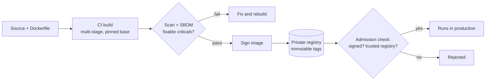

# Container security basics

> **12-minute read. Assumes you know what a container is; [Containers vs VMs](https://cloud.noblerworks.com/learn/concepts/containers-vs-vms/) on Cloud Zero to Hero covers that.**

## The one-line answer

Securing containers means securing three things: **the image** (what you ship), **the registry and pipeline** (how it gets to production), and **the runtime** (how it runs). Most risk comes from bloated images full of vulnerable packages, containers running as root with more privileges than they need, and secrets baked into image layers. Small, signed, scanned images running as a non-root user with a read-only filesystem remove most of it.

## Why it matters

A container is not a VM. All containers on a host share **one kernel**. Isolation comes from Linux kernel features: **namespaces** (each container sees its own processes, network and filesystem) and **cgroups** (limits on CPU and memory), plus **capabilities**, **seccomp** and **AppArmor/SELinux** that limit what a process may ask the kernel to do. That isolation is good but thinner than a hypervisor's. A container that runs as root with extra privileges is only a kernel bug or a misconfiguration away from the host, and from every other container on it.

Containers also changed how software ships. An image pulls in an entire base OS userland, so a "three-line Python app" can carry hundreds of packages, each a potential CVE.

## Layer 1: the image

### Start small

The base image is the biggest decision you make:

| Base | Typical packages | Trade-off |
|---|---|---|
| Full distro (`ubuntu`, `debian`) | Hundreds | Easy to debug; large attack surface, many CVEs |
| Slim variants (`debian-slim`, `python:3-slim`) | Fewer | A good default |
| Alpine | Very few | Small, but musl libc can surprise some apps |
| Distroless / minimal images | App runtime only, no shell or package manager | Smallest attack surface; debug with ephemeral debug containers instead |

Fewer packages mean fewer CVEs to triage and fewer tools for an attacker who gets in. An image with no shell makes "spawn a shell" impossible.

### Build it cleanly

- **Multi-stage builds**: compile in a build stage with all the tools, then copy only the binary or app into a minimal final stage.
- **Pin versions**: reference base images by digest (`@sha256:...`) or at least a specific tag, so builds are reproducible and a compromised `latest` does not slip in.
- **Never put secrets in the image.** Every layer is stored and anyone who can pull the image can read it, including a secret you "deleted" in a later layer. Inject secrets at runtime; see [Secrets management](./secrets-management.md).
- **Set a non-root user** in the image (`USER 10001`), so the default is safe even if the deployment forgets.

### Scan it

Image scanners (Trivy, Grype, the scanners built into ECR, Artifact Registry and Defender for Containers) compare the packages in each layer against vulnerability databases. Scan in the pipeline and fail on fixable criticals; scan again in the registry, because new CVEs are published against images you already built. Generate an **SBOM** at build time so you can later answer "which running images contain library X?" in minutes. See [Software supply chain security](./software-supply-chain-security.md).

## Layer 2: registry and pipeline

*The secure image pipeline: build small, scan, sign, store in a private registry, and let the platform admit only signed images from that registry.*

- **Private registry** with access control: only CI can push, workloads can pull.
- **Immutable tags**: once `v1.4.2` is pushed it cannot be overwritten, so a tag means one thing forever.
- **Signing**: sign images in CI (for example with Sigstore cosign or Notation) and verify signatures before running them. This proves the image came from your pipeline and was not swapped.
- **Rebuild regularly**: a weekly rebuild picks up patched base images even when your code did not change.

## Layer 3: the runtime

These settings are the difference between "attacker has a process in a container" and "attacker owns the host":

| Setting | Safe value | Why |
|---|---|---|
| User | Non-root (`runAsNonRoot`) | Root in a container is root on the host if isolation breaks |
| Privileged mode | Never | `--privileged` disables almost all isolation |
| Linux capabilities | Drop all, add back only what is needed | Root is split into capabilities; most apps need none |
| Privilege escalation | Disabled (`no-new-privileges` / `allowPrivilegeEscalation: false`) | Blocks setuid binaries from regaining privileges |
| Root filesystem | Read-only | Attackers cannot drop tools or modify the app; mount a small writable `tmp` if needed |
| Seccomp | `RuntimeDefault` profile | Blocks rarely needed, risky system calls |
| Host mounts | None, especially not the container runtime socket | Mounting `docker.sock` hands over the host |
| Resources | CPU and memory limits | One container cannot starve the host |

Add **runtime detection** (Falco, or the container sensors in cloud CWPP tools) to alert on behaviour that should never happen in an immutable container: a shell starting, a package manager running, an outbound connection to a mining pool.

**[📖 NIST SP 800-190: Application Container Security Guide](https://csrc.nist.gov/pubs/sp/800/190/final)** - the reference on image, registry, orchestrator, container and host risks

**[📖 OWASP Docker Security Cheat Sheet](https://cheatsheetseries.owasp.org/cheatsheets/Docker_Security_Cheat_Sheet.html)** - concrete runtime settings and why

**[📖 CIS Docker Benchmark](https://www.cisecurity.org/benchmark/docker)** - host and daemon configuration baseline

## A worked example

A team's Node.js API image is 1.1 GB, based on the full `node` image, runs as root and shows 340 vulnerabilities in the scanner.

1. **Multi-stage build** on a slim base: install dependencies in a build stage, copy `node_modules` and the app into `node:<version>-slim`. Image drops to 210 MB; findings to 40.
2. **Remove dev dependencies** from the final stage: 22 findings, of which 3 are fixable highs. Upgrade those packages.
3. **Switch to a distroless Node base**: 6 low findings, no shell, no package manager.
4. **Runtime**: `USER` set in the Dockerfile; deployment sets read-only root filesystem with a writable `/tmp`, drops all capabilities, disables privilege escalation.
5. **Pipeline**: CI fails on fixable criticals, signs the image, and production only admits signed images.

The team did not triage 340 findings. It removed the packages that caused them.

## Common mistakes

- **Triaging CVEs in packages you do not need.** Shrink the image first; the findings shrink with it.
- **`latest` tags in production.** You cannot tell what is running or roll back reliably.
- **Secrets in environment variables baked into the image or in build args.** They end up in the image history.
- **Scanning once at build time.** Yesterday's clean image has today's CVE. Scan the registry continuously.
- **Assuming containers are a security boundary like VMs.** For untrusted multi-tenant code use stronger isolation: sandboxed runtimes (gVisor, Kata Containers) or separate VMs.
- **Debugging by adding tools to production images.** Use ephemeral debug containers instead of shipping a shell and curl everywhere.

## How exams test this

- **CKS and KCSA**: image scanning, minimal base images, `securityContext` settings, seccomp and AppArmor profiles, runtime detection with Falco, and supply chain checks. See the **[CKS guide](../../exams/kubernetes/cks/)**.
- **Security+ and CCSP**: containerisation as a technology, its isolation model compared with VMs, and container-specific risks.
- **Cloud security exams**: the native registry scanners and runtime protection (ECR scanning and Inspector, Defender for Containers, Artifact Analysis).

## What to look at next

- **[Kubernetes security basics](./kubernetes-security-basics.md)** - enforcing these settings across a whole cluster
- **[Software supply chain security](./software-supply-chain-security.md)** - SBOMs, signing and SLSA in depth
- **[Vulnerability management](./vulnerability-management.md)** - deciding which remaining CVEs to fix first
