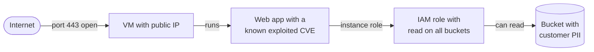

# CSPM and CNAPP explained

> **13-minute read. Assumes the [shared responsibility model](./shared-responsibility-model.md) and [IAM explained](./iam-explained.md).**

## The one-line answer

**CSPM** (cloud security posture management) continuously checks your cloud **configuration** against best practice and flags what is wrong: the public bucket, the database without encryption, the security group open to the internet. **CWPP** (cloud workload protection platform) protects what **runs** in the cloud: VMs, containers and functions. **CNAPP** (cloud-native application protection platform) is the market's name for one platform that does both, plus identity, code and pipeline checks, and connects the findings so you fix the few that matter first.

## Why it exists

Most cloud breaches are not clever exploits of the cloud provider. They are the customer's own configuration: storage left public, over-privileged roles, keys in code, management ports open to the world. Under the [shared responsibility model](./shared-responsibility-model.md) configuration is always your job, and a cloud estate changes thousands of times a day through consoles, scripts and pipelines. No person can review that by hand. CSPM automates the review.

The second problem is scale of output. A first CSPM scan of a real organisation often produces tens of thousands of findings. Most are low risk. CNAPP exists largely to answer "which ten do I fix today?"

## The pieces, one at a time

### CSPM: is the cloud configured safely?

A CSPM tool reads your cloud's configuration through its APIs (read-only, no agent) and evaluates each resource against rules:

- Storage: public access, encryption, versioning, access logging.
- Identity: root or global-admin use, users without MFA, unused credentials, wildcard permissions.
- Network: security groups or firewall rules allowing `0.0.0.0/0` to admin ports, resources with public IPs.
- Logging: audit logging disabled, log retention too short.
- Encryption: databases, disks and backups without encryption, keys never rotated.

Rules are usually grouped into **benchmarks and frameworks**: the CIS Foundations Benchmarks for each cloud, the provider's own best-practice standard, and mappings to PCI DSS, ISO 27001, NIST and others. That mapping is why compliance teams like CSPM: one dashboard shows "73% compliant with CIS AWS Foundations", with evidence.

Good CSPM also covers **drift**: a resource deployed correctly by Terraform and then changed by hand in the console.

### CWPP: is what runs on it safe?

CWPP looks inside workloads:

- **Vulnerability scanning** of VM images, container images and function packages (see [Vulnerability management](./vulnerability-management.md)).
- **Runtime protection**: detecting malicious behaviour on hosts and in containers, such as a crypto-miner starting or a shell spawned inside a web container. This is [EDR](./endpoint-security-edr-xdr.md) adapted for servers and containers.
- **Hardening and integrity**: OS configuration checks, file integrity monitoring.

Older CWPP products used agents on every host. Many now offer **agentless scanning**: the platform snapshots a VM's disk through the cloud API and scans the snapshot, so you get coverage without deploying anything. Agents are still needed for real-time runtime detection.

### The rest of the CNAPP alphabet

| Acronym | Name | What it checks |
|---|---|---|
| **CIEM** | Cloud infrastructure entitlement management | Who and what can do what: unused permissions, toxic privilege combinations, cross-account access |
| **DSPM** | Data security posture management | Where sensitive data lives in the cloud and who can reach it (see [DLP](./data-loss-prevention-explained.md)) |
| **KSPM** | Kubernetes security posture management | Cluster configuration (see [Kubernetes security basics](./kubernetes-security-basics.md)) |
| **IaC scanning** | Infrastructure-as-code scanning | Terraform, CloudFormation and Kubernetes manifests before they deploy |
| **ASPM** | Application security posture management | Aggregates code-scanning and pipeline findings |

**CNAPP** = CSPM + CWPP + usually CIEM, DSPM, KSPM and IaC scanning, with a shared inventory underneath.

## Why "connected" matters: attack paths

The real value of a CNAPP is not the number of checks. It is that it can **join findings into a path an attacker could walk**:

*An attack path: four findings that are each "medium" on their own become one critical risk because they connect the internet to sensitive data.*

Each of those four findings alone might be rated medium: a public VM, a vulnerable package, a broad role, an unencrypted bucket. Together they are a critical path from the internet to customer data. Fix **any one link** and the path breaks. That is how a CNAPP turns 40,000 findings into a short list: it ranks by **exposure** (reachable from the internet?), **exploitability** (known exploited?), **privilege** (what can the identity reach?) and **data sensitivity**.

## A worked example: the first month

A company with 60 AWS accounts turns on a CSPM.

1. **Week 1, inventory**: 31,000 findings. The team does not try to fix them. It reads the inventory: 4 accounts nobody claims, 2 regions in use that policy says should be empty.
2. **Week 1, criticals by path**: filter to attack paths that reach sensitive data. There are 12. Each gets an owner and a ticket, fixed in days.
3. **Week 2, guardrails, not tickets**: rather than fixing 900 public-bucket findings one by one, enable account-level Block Public Access and an organisation policy that denies new public buckets. The class of problem disappears. (On Azure the equivalent is Azure Policy; on Google Cloud, Organization Policy constraints.)
4. **Week 3, shift left**: add IaC scanning to the Terraform pipeline so new misconfigurations fail the pull request instead of becoming findings.
5. **Week 4, metrics**: track new criticals per week and mean time to fix, not total finding count. The total will stay large for months; the trend in criticals is what shows progress.

The lesson: **prevent classes of finding with guardrails, and prioritise the rest by attack path.** Ticketing every finding is how CSPM programmes drown.

## The native tools

Every major cloud ships its own posture tooling:

- **AWS**: Security Hub (CSPM checks against the AWS Foundational Security Best Practices and CIS standards, and a central findings view), with GuardDuty, Inspector and Macie feeding it.
- **Azure**: Microsoft Defender for Cloud (foundational CSPM free, Defender CSPM and the Defender for Servers / Containers plans for CWPP and attack paths).
- **Google Cloud**: Security Command Center (Standard, Premium and Enterprise tiers, with attack exposure scores in the higher tiers).

Third-party CNAPPs (Wiz, Prisma Cloud, Orca, Sysdig and others) mainly win on **multicloud** coverage (Defender for Cloud and Security Command Center can also connect other clouds) and on the quality of their attack-path analysis. The comparison table is on **[Security tools compared](../../resources/service-comparison-security-tools.md)**.

**[📖 AWS Security Hub](https://docs.aws.amazon.com/securityhub/latest/userguide/what-is-securityhub.html)** - security standards, controls and findings aggregation

**[📖 Microsoft Defender for Cloud](https://learn.microsoft.com/en-us/azure/defender-for-cloud/defender-for-cloud-introduction)** - CSPM and workload protection plans

**[📖 Google Security Command Center](https://cloud.google.com/security-command-center/docs/security-command-center-overview)** - tiers, misconfiguration and threat findings

**[📖 CIS Benchmarks](https://www.cisecurity.org/cis-benchmarks)** - the configuration baselines most CSPM rules come from

## Common mistakes

- **Measuring total findings.** It punishes turning on more checks and rewards ignoring new accounts. Measure criticals, attack paths and time to fix.
- **Fixing in the console.** The next Terraform apply puts the misconfiguration back. Fix in code.
- **Read-only role scoped too narrowly.** The tool only sees part of the estate and the dashboard looks greener than reality. Onboard at the organisation level so new accounts are covered automatically.
- **No owners.** Findings without a team that owns the resource sit forever. Tag resources with owners and route findings by tag.
- **Suppressing instead of accepting.** Muting a finding hides it; a risk acceptance has an owner, a reason and an expiry date.
- **Buying a CNAPP before using the free native tools.** Security Hub, Defender for Cloud foundational CSPM and Security Command Center Standard cover a lot at little or no cost.

## How exams test this

- **CCSP and CCSK**: CSPM and CWPP as categories, configuration management in the cloud, the shared responsibility split, and continuous compliance monitoring.
- **AWS security specialty, SC-100 / SC-200 and the Google Cloud Security Engineer**: the native tools by name - Security Hub standards, Defender for Cloud plans and secure score, Security Command Center tiers and findings - and which one answers a given scenario.
- **Security+**: cloud misconfiguration as an attack vector and continuous monitoring as a control.
- **CKS**: the Kubernetes slice - cluster posture and image scanning.

## What to look at next

- **[Kubernetes security basics](./kubernetes-security-basics.md)** - the posture checks that apply inside a cluster
- **[Least privilege explained](./least-privilege-explained.md)** - what CIEM findings are telling you to do
- **[Vulnerability management](./vulnerability-management.md)** - prioritising the CVEs the CWPP finds
