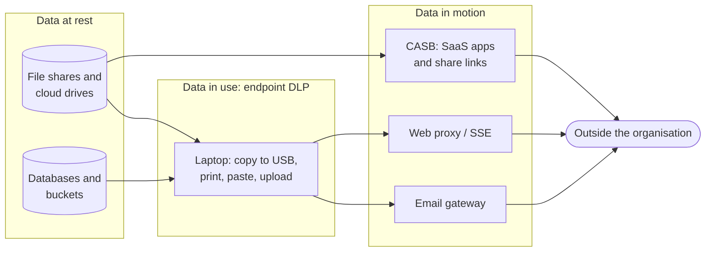

# Data loss prevention explained

> **13-minute read. Helps to have read [Encryption explained](./encryption-explained.md) and [IAM explained](./iam-explained.md); DLP sits on top of both.**

## The one-line answer

Data loss prevention (DLP) is the set of tools and rules that **find sensitive data, label it, and stop it leaving the places it is allowed to be**: an email to a personal address, an upload to an unapproved cloud drive, a paste into a public chatbot, a copy to a USB stick. It only works if you first know which data matters, which is why DLP always starts with **data classification**.

## Why it exists

Access control answers "who may read this file?" It says nothing about what that person does next. A finance analyst is allowed to open the payroll spreadsheet; DLP is what notices when they attach it to an email to a Gmail address. Most data leaks are not dramatic intrusions. They are an employee sending the wrong file, a sales rep taking the customer list on their last day, a developer pasting a production log full of customer emails into a support ticket, or a misconfigured share link set to "anyone with the link".

Regulation pushes in the same direction. GDPR, HIPAA and PCI DSS all expect you to know where personal, health and card data lives and to stop it spreading. ISO 27001:2022 added a dedicated control for it (8.12 Data leakage prevention).

## Step 1: Classify the data

You cannot protect everything equally, so you sort data into a few levels. Most organisations use three or four:

| Level | Example | Typical handling |
|---|---|---|
| **Public** | Marketing pages, published prices | No restrictions |
| **Internal** | Org charts, internal wiki | Employees only, no external sharing by default |
| **Confidential** | Customer lists, contracts, source code | Need-to-know access, encryption, external sharing blocked or justified |
| **Restricted** | Card numbers, health records, credentials, M&A plans | Strictest controls, logged access, never leaves approved systems |

Two rules make a scheme usable. **Keep it small**: five or more levels means people guess. **Give every level a handling rule**: a label that changes nothing is decoration.

Classification is done in three ways, usually combined:

- **User-driven**: people pick a label when they create a document. Accurate for context ("this is a draft board paper") but inconsistent.
- **Automatic, content-based**: tools scan content for patterns and apply labels. Consistent, but only as good as the detection.
- **Context-based**: data inherits a label from where it lives (everything in the HR share is Confidential) or who created it.

## Step 2: Find the data (discovery)

Before you can stop data leaving, you need to know where it is. **Data discovery** scans storage (file shares, SharePoint, cloud buckets, databases, SaaS apps) for sensitive content. The first scan is usually an unpleasant surprise: card numbers in a support-ticket export, passport scans in someone's personal OneDrive, a database backup in a public bucket.

How DLP tools recognise sensitive content:

- **Pattern matching**: regular expressions for structured data like card numbers, national ID numbers or IBANs.
- **Validation**: a 16-digit number is only a likely card number if it passes the **Luhn checksum**; this cuts false positives sharply.
- **Keywords and proximity**: "SSN" or "date of birth" near a matching number raises confidence.
- **Exact data match (EDM)**: hash the actual values from your customer database and match against those, so only *your* real records trigger, not random numbers that look similar.
- **Document fingerprinting**: fingerprint a template (a patent application form, a contract) so filled-in copies are recognised.
- **Trained classifiers**: machine-learning models that recognise categories like "source code", "resume" or "financial statement" without a fixed pattern.

Each detection usually carries a **confidence level** and a **count threshold**: one card number in an email might be a customer quoting their own card; 500 is an export.

## Step 3: Watch the exits

DLP enforces policy at the points where data moves. Each channel needs its own sensor:

*Data at rest is found by discovery scans; data in use is watched on the endpoint; data in motion is inspected at the email gateway, the web proxy and the CASB before it leaves.*

- **Data at rest**: discovery scans, plus automatic labelling and encryption of what they find.
- **Data in use (endpoint DLP)**: an agent on the laptop watches copy to removable media, printing, clipboard, screen capture, and uploads from the browser.
- **Data in motion (network DLP)**: the email gateway, a web proxy or a Security Service Edge (SSE) platform inspects outbound traffic. A **CASB** (cloud access security broker) does the same for SaaS apps: it can see a file shared publicly in a cloud drive, or a user uploading to a personal instance of an approved app.

Network inspection of HTTPS needs TLS interception, which brings its own privacy and breakage questions. That is one reason endpoint DLP and API-based CASB connectors have become the main sensors.

## Step 4: Decide what happens

A DLP policy is a rule: **condition** (content plus context) and **action**. Actions range from gentle to strict:

| Action | What the user sees | When to use it |
|---|---|---|
| **Audit only** | Nothing; the event is logged | New policies, while you measure false positives |
| **Notify / policy tip** | A banner: "this email contains card numbers" | Teaching moments for low-risk data |
| **Block with override** | Blocked unless they type a business justification | Confidential data with legitimate edge cases |
| **Block** | Blocked outright | Restricted data to clearly unapproved destinations |
| **Encrypt / quarantine** | Message encrypted or held for review | Email that must go out but only to the right recipient |

## A worked example

A hospital wants to stop patient data leaving by email.

1. **Classify**: patient records are Restricted. The electronic health record system exports carry a "Restricted - PHI" label automatically (context-based).
2. **Detect**: a policy looks for medical record numbers (a pattern plus a check digit), combined with names or dates of birth. EDM is loaded with hashed medical record numbers from the real patient index, so a random 8-digit number does not trigger.
3. **Start in audit mode** for two weeks. The logs show 1,200 matches a day. Most are internal emails between clinicians (allowed), 40 are to partner clinics with a data-sharing agreement (allowed), and 6 are to personal webmail addresses.
4. **Tune**: exclude internal-to-internal mail, allow the partner domains but force encryption, and block-with-override for everything else.
5. **Enforce**: one month later, the override log shows a doctor emailing records to her own Gmail to work from home. That is a policy and tooling problem (she needs secure remote access), not just a DLP event. The fix is a supported remote option, then a hard block.

The pattern - audit, measure, tune, enforce, then fix the business need behind the override - is how every DLP rollout that sticks works.

## DLP in the cloud and in AI tools

- **Cloud storage**: AWS Macie, Microsoft Purview and Google Sensitive Data Protection scan buckets and data stores for sensitive data. Pair them with posture checks that catch public buckets; see [CSPM and CNAPP explained](./cspm-and-cnapp-explained.md).
- **Generative AI**: pasting confidential data into public chatbots is now one of the most common DLP use cases. Endpoint and browser DLP can block pastes into unapproved AI sites, and approved enterprise AI tools should honour your labels. The AI-specific risks are covered on the AI site: **[Guardrails and safety](https://ai.noblerworks.com/learn/concepts/guardrails-and-safety/)**.
- **Masking and tokenisation**: the best DLP is data that is not there. Replace real values with tokens in test environments and analytics, so a leak of that copy exposes nothing.

**[📖 Microsoft Purview Data Loss Prevention](https://learn.microsoft.com/en-us/purview/dlp-learn-about-dlp)** - policies, locations, actions and how endpoint DLP fits

**[📖 Amazon Macie](https://docs.aws.amazon.com/macie/latest/user/what-is-macie.html)** - discovering sensitive data in S3

**[📖 Google Sensitive Data Protection](https://cloud.google.com/sensitive-data-protection/docs/sensitive-data-protection-overview)** - inspection, classification and de-identification

## Common mistakes

- **Turning on blocking on day one.** False positives stop real work, executives complain, and the whole programme gets switched off. Start in audit mode.
- **No classification behind the policies.** Pattern rules without knowing what matters produce noise about test data and miss the real secrets, which rarely match a regex (a pricing strategy deck has no card numbers).
- **Ignoring the override log.** Overrides are where the business need lives. Review them; each cluster is either a policy to tune or a process to fix.
- **Treating DLP as an insider-threat detector only.** Most matches are honest mistakes. Messaging that treats every user as a suspect kills cooperation.
- **Forgetting SaaS and AI.** Watching email and USB while customer data flows through a dozen SaaS apps and a public chatbot.
- **Expecting DLP to stop a determined insider.** Someone can photograph a screen. DLP reduces accidents and raises the cost of deliberate theft; it does not make leaks impossible.

## How exams test this

- **Security+**: data types and classifications, data states (at rest, in motion, in use) and which control fits each, DLP as a control, and masking vs tokenisation vs encryption.
- **CISSP**: data classification and ownership roles (owner, custodian, steward), data lifecycle, and choosing controls by data state.
- **Microsoft SC-401 and SC-900**: Purview sensitivity labels, sensitive information types, EDM, trained classifiers, DLP policy locations and actions. See the **[SC-401 guide](../../exams/azure/sc-401/)**.
- **CCSP and CCSK**: discovery and classification in the cloud, CASB, and data protection across the cloud data lifecycle.

## What to look at next

- **[Encryption explained](./encryption-explained.md)** - the control DLP often triggers, and what it does and does not protect
- **[CSPM and CNAPP explained](./cspm-and-cnapp-explained.md)** - finding the public bucket before the DLP scan finds the data in it
- **[Logging and detection](./logging-and-detection.md)** - where DLP events go once they are generated
