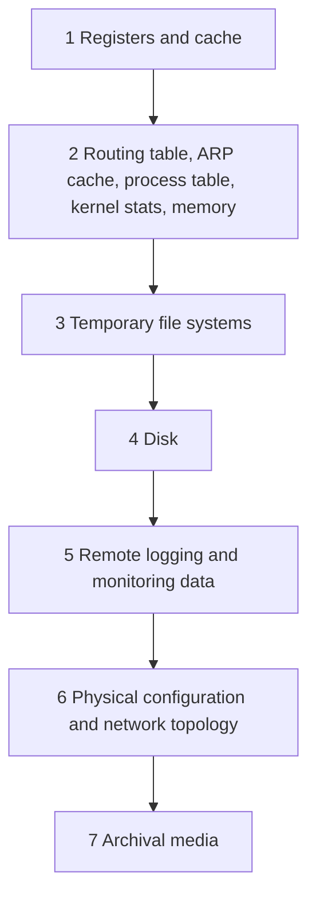

# Digital forensics basics

> **12-minute read. Written for defenders who must preserve evidence during an incident. Concepts only. This page does not cover attacking or evading anything.**

## The one-line answer

Digital forensics is collecting, preserving and examining digital evidence in a way you can later explain and defend. The goals are to learn what happened and, if needed, to support HR, insurance, regulators or law enforcement. The three habits that matter most: collect the most volatile data first, work on copies, and write everything down.

**[📖 NIST SP 800-86: Guide to Integrating Forensic Techniques into Incident Response](https://csrc.nist.gov/pubs/sp/800/86/final)** - practical forensic advice from an IT, not law-enforcement, view (August 2006)

**[📖 RFC 3227: Guidelines for Evidence Collection and Archiving](https://www.rfc-editor.org/rfc/rfc3227)** - order of volatility, chain of custody and collection principles (February 2002)

Both documents are old. The principles hold, but the tools and the data sources (cloud, containers, SaaS) have moved on. NIST's page also says the guide is not legal advice and to involve management and legal counsel.

## Where forensics fits

Forensics supports [incident response](./incident-response-basics.md). Responders want to contain fast. Forensics wants to preserve. Decide early, with legal counsel if the case may go to court or a regulator, which matters more, and record the decision.

## Evidence handling

From RFC 3227's guiding principles:

- Follow your security policy and involve incident handlers (and law enforcement where relevant).
- Capture as accurate a picture of the system as possible.
- Keep detailed, timestamped notes. Record whether times are UTC or local, and any clock drift.
- Minimise changes to the data, including access times.
- **Collect first, analyse later. Analyse a copy, not the original.**
- Do not shut the system down until collection is finished.
- Be careful about disconnecting a system: RFC 3227 warns that some systems have "deadman switches" that destroy evidence.

## Chain of custody

NIST's glossary defines chain of custody as following evidence through its lifecycle, from collection through safekeeping and analysis, recording each person who handled it, when it was collected or transferred, and why. RFC 3227 lists what to record:

- where, when and by whom evidence was found and collected;
- where, when and by whom it was handled or examined;
- who held it, for how long, and how it was stored;
- every transfer of custody and how it happened.

Store evidence with restricted access, log every access and make unauthorised access detectable. If the chain has gaps, a court or regulator may doubt the evidence. Even in a purely internal case, a clear record lets someone else check your work.

## Volatile first

Data disappears at different speeds. RFC 3227 gives this order, from most to least volatile:

The diagram reads top to bottom, fastest-changing first. Memory vanishes at power-off, so it is captured before the disk. Archival media stays put, so it can wait. In practice, registers and cache are rarely collectable, so teams start with memory and running state.

Cloud note: the same idea applies, but "volatile" often means instance memory, short-lived container filesystems and logs with short retention. Snapshot volumes and export logs early. We have not covered provider-specific steps here; use the cloud provider's documentation.

## Imaging concepts

- A **forensic image** is a bit-for-bit copy of a disk or volume, including unused space, so deleted data can still be examined.
- Use a **write blocker** (hardware or software) when connecting a source disk, so reading it cannot change it.
- Record a **cryptographic hash** (for example SHA-256) of the source and of the image. If the hashes match, the copy is exact. Hash again later to show nothing changed. See [Hashing and password storage](./hashing-and-password-storage.md) for what hashes are.
- Make **two copies**: one to analyse, one kept sealed as a master.
- Memory is captured with a dedicated tool and also hashed. Capturing memory itself changes memory slightly, so note the tool and time.

## Documentation checklist

- Case or incident number
- Who, what, where, when for each item
- Tool names and versions used
- Hashes of originals and copies
- Time zone and clock offset
- Storage location and access log

## Common mistakes

- Powering off a live machine first and losing memory.
- Analysing the original disk.
- Missing time zone notes, which makes log timelines wrong.
- Letting an eager admin "clean up" before capture.
- No record of who touched the evidence.

## Next

- [Logging and detection](./logging-and-detection.md) - logs are your best evidence, so protect and retain them.
- [Playbooks](../../resources/playbooks/README.md) - defensive runbooks for first-hour response.
