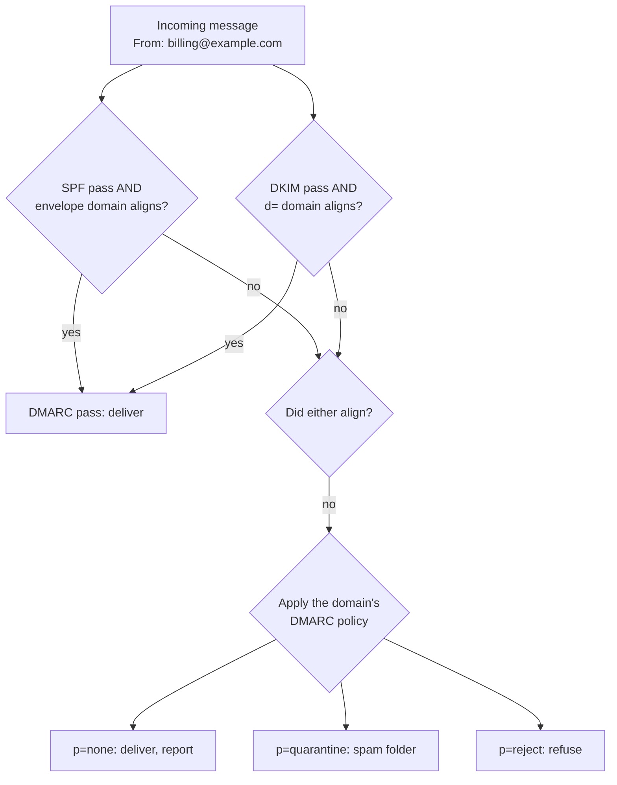

# Email security: SPF, DKIM and DMARC

> **14-minute read. Assumes you know what DNS records are ([DNS explained](https://cloud.noblerworks.com/learn/concepts/dns-explained/)). [Phishing and social engineering](./phishing-and-social-engineering.md) gives the short version of this page; this is the deep dive.**

## The one-line answer

Email was designed with no way to prove who sent a message: anyone can write `From: ceo@yourcompany.com`. **SPF** lists which servers may send mail for your domain, **DKIM** signs each message so receivers can check it was not altered and which domain vouches for it, and **DMARC** ties both to the visible From address and tells receivers what to do when a message fails: deliver it, quarantine it or reject it. Together, at `p=reject`, they stop attackers sending mail that exactly spoofs your domain.

## Why it exists

SMTP, the protocol that moves email, dates from 1982. A sending server announces whatever sender it likes and the receiver accepts it. That made exact-domain spoofing trivial: fake invoices "from" your finance team, fake password resets "from" your IT team, fake payment-change requests "from" your CEO (business email compromise, see [Phishing and social engineering](./phishing-and-social-engineering.md)).

Since 2024, Google and Yahoo require bulk senders (roughly 5,000+ messages a day to their users) to have SPF, DKIM and a DMARC record, and Microsoft announced similar requirements for Outlook.com in 2025. Email authentication went from best practice to a delivery requirement.

## The two "from" addresses

This is the concept everything else depends on. An email has two sender addresses:

- **Envelope sender** (`MAIL FROM`, shown later as `Return-Path`): used by servers for bounces. Users never see it.
- **Header From** (`From:`): what the user sees in their mail client.

They can be different, and attackers rely on that. SPF checks the envelope sender. DKIM checks a domain named in the signature. Neither, on its own, checks the address the user sees. **DMARC closes the gap** by requiring that the domain which passed SPF or DKIM **aligns** with the visible From domain.

## SPF: which servers may send

SPF (Sender Policy Framework, RFC 7208) is a TXT record on your domain listing authorised senders:

```text
example.com.  TXT  "v=spf1 include:_spf.google.com include:sendgrid.net ip4:203.0.113.10 -all"
```

The receiving server takes the envelope sender's domain, looks up its SPF record, and checks whether the connecting IP is listed. The final mechanism says what to do with everything else: `-all` (fail), `~all` (soft fail), `?all` (neutral).

SPF's limits:

- It checks the **envelope** domain, not the visible From.
- It **breaks on forwarding**: when a mailing list or a user's auto-forward resends your message, it comes from the forwarder's IP, which is not in your record.
- **10 DNS lookup limit**: each `include`, `a`, `mx` and similar costs a lookup; more than ten makes SPF return a permanent error. Organisations with many SaaS senders hit this constantly.

## DKIM: a signature on each message

DKIM (DomainKeys Identified Mail, RFC 6376) has the sending server sign selected headers and the body with a private key. The public key is published in DNS under a **selector**:

```text
s1._domainkey.example.com.  TXT  "v=DKIM1; k=rsa; p=MIIBIjANBgkq..."
```

The signature header names the signing domain (`d=example.com`) and selector (`s=s1`). The receiver fetches the key and verifies the signature. If someone modified the signed headers or body in transit, verification fails.

DKIM survives plain forwarding (the signature travels with the message), which makes it the more reliable half of DMARC. It breaks when an intermediary modifies the message, such as a mailing list adding a footer. Use 2048-bit keys and rotate them; each sending service (your mail platform, your marketing tool, your ticketing system) gets its own selector.

## DMARC: alignment, policy and reports

DMARC (Domain-based Message Authentication, Reporting and Conformance, RFC 7489) is a TXT record at `_dmarc.yourdomain`:

```text
_dmarc.example.com.  TXT  "v=DMARC1; p=reject; rua=mailto:dmarc-reports@example.com; adkim=r; aspf=r; pct=100"
```

A message **passes DMARC** if **either**:

- SPF passes **and** the envelope domain aligns with the From domain, **or**
- DKIM passes **and** the signing `d=` domain aligns with the From domain.

**Alignment** can be relaxed (the default: `mail.example.com` aligns with `example.com`, same organisational domain) or strict (exact match).

The **policy** `p=` tells receivers what to do with failures: `none` (deliver, just report), `quarantine` (spam folder) or `reject` (refuse). `sp=` sets the policy for subdomains.

**Reports**: `rua=` receives daily **aggregate reports** (XML) from receivers: which IPs sent mail claiming to be your domain, and whether each passed SPF, DKIM and DMARC. These reports are how you find every legitimate service sending as you before you enforce.



*How a receiver evaluates DMARC: one aligned pass from SPF or DKIM is enough; if neither aligns, the domain's published policy decides the message's fate.*

**[📖 RFC 7489: DMARC](https://datatracker.ietf.org/doc/html/rfc7489)** - the specification, including alignment and reporting

**[📖 DMARC.org overview](https://dmarc.org/overview/)** - how SPF, DKIM and DMARC fit together

## A worked example: getting example.com to p=reject

1. **Publish monitoring**: `v=DMARC1; p=none; rua=mailto:...`. Point reports at a DMARC report processor (many are free for small volumes); raw XML is unreadable at scale.
2. **Read two to four weeks of reports.** They show mail from Microsoft 365 (passing), a marketing platform (SPF passes for its own bounce domain, so no alignment; no DKIM for example.com), the ticketing system (not in SPF), an old on-premises scanner relay, and a few thousand messages a day from IPs in countries where the company does no business. Those last ones are spoofing.
3. **Fix each legitimate sender**: set up custom DKIM signing with an example.com selector on the marketing platform and the ticketing system (DKIM alignment is the robust fix), route the scanner through Microsoft 365, and trim SPF to stay under ten lookups.
4. **Move to `p=quarantine`**, optionally with `pct=25` then 100, and keep watching the reports for legitimate senders that start failing.
5. **Move to `p=reject`.** Spoofed mail from example.com is now refused by any receiver that checks DMARC, which is all the major mailbox providers.
6. **Protect parked domains**: domains that never send mail get `v=spf1 -all`, and `v=DMARC1; p=reject;`, so attackers cannot spoof them either.

The whole process typically takes one to three months, and most of it is step 3: discovering who in the business set up a SaaS tool that sends "as" the company.

## Beyond the big three

- **MTA-STS** (RFC 8461) and **TLS-RPT**: tell other servers that mail to your domain must be delivered over verified TLS, and get reports when it fails. Protects inbound mail from downgrade and interception.
- **DANE**: a DNSSEC-based alternative to MTA-STS for the same goal.
- **ARC** (Authenticated Received Chain): lets intermediaries like mailing lists record the authentication results they saw, so receivers can trust messages that SPF and DKIM no longer verify after forwarding.
- **BIMI**: shows your logo in supporting mail clients, only for domains at `p=quarantine` or `p=reject`. A marketing incentive for enforcement.

## What DMARC does not stop

DMARC protects **your exact domain**. It does nothing about:

- **Look-alike domains**: `examp1e.com`, `example-billing.com`, `example.co`. Monitor new domain registrations and consider defensive registrations.
- **Display name spoofing**: `"Example CEO" <random@gmail.com>`. Mail clients can flag external senders; users should check the address.
- **Compromised real accounts**: mail from a hijacked supplier mailbox passes everything because it is genuinely from them. Payment-change verification by phone is the control.
- **Malicious content**: authentication says who sent it, not whether it is safe. You still need filtering, link and attachment sandboxing, and [phishing-resistant MFA](./mfa-and-passkeys.md).

## Common mistakes

- **Sitting at `p=none` forever.** Monitoring mode protects nothing. Treat `p=none` as a project phase with an end date.
- **Jumping straight to `p=reject`** without reading reports, and breaking invoices, password resets or the CEO's newsletter.
- **SPF over ten lookups.** SPF then fails everywhere. Flatten carefully or move senders to DKIM-aligned subdomains.
- **Multiple SPF records** on one domain. That is invalid; merge them.
- **Third-party senders signing with their own domain.** DKIM passes but does not align; configure custom DKIM for your domain.
- **Forgetting subdomains and parked domains**, which attackers then use instead.

## How exams test this

- **Security+**: what SPF, DKIM and DMARC each do, which one uses a signature, which lists IPs, and which sets policy; email gateway and secure email as controls.
- **CySA+**: reading message headers: `Received` chains, `Authentication-Results`, SPF/DKIM/DMARC pass or fail, and spotting a spoofed or look-alike sender during phishing analysis.
- **Microsoft SC-200 and SC-900**: Defender for Office 365 anti-spoofing, DMARC reporting and how failed authentication shows in alerts.
- **CISSP**: email security protocols (S/MIME, and the anti-spoofing trio) in the communications security domain.

## What to look at next

- **[Phishing and social engineering](./phishing-and-social-engineering.md)** - the attacks this protects against, and the layers DMARC cannot provide
- **[TLS and HTTPS](./tls-and-https.md)** - the encryption MTA-STS enforces for mail in transit
- **[MFA and passkeys](./mfa-and-passkeys.md)** - the control that matters when a phishing email gets through anyway
