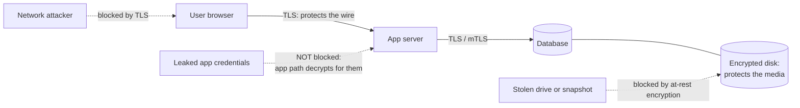
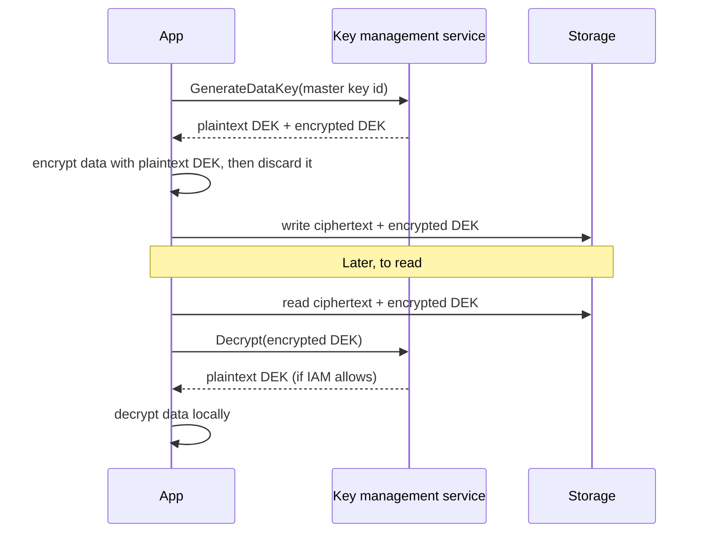

# Encryption explained

> **12-minute read. Helps to have read [TLS and HTTPS](./tls-and-https.md) first, but not required.**

## The one-line answer

Encryption turns readable data into unreadable data that only someone holding the right key can turn back. The maths is a solved problem: you will almost never write a cipher yourself. The hard, interesting and frequently broken part is **the keys**: who holds them, where they live, how they rotate, and who is allowed to use them.

## Why it exists

Data travels over networks you do not own and sits on disks you do not physically control. Encryption is how you keep it confidential (nobody can read it) and, with the right modes, prove its integrity (nobody changed it). It does not stop an attacker reaching the data. It makes the data useless to them if they do, *as long as they cannot also reach the key*. That condition is the whole game, and it is why this page spends more time on keys than on algorithms.

## Two families of encryption

### Symmetric: one shared key

The same key encrypts and decrypts. AES is the standard you will see everywhere, almost always as AES-256 in GCM mode. It is fast enough to encrypt gigabytes per second on ordinary hardware.

The weakness is distribution: both sides need the same secret key, and you need a safe way to get it to them.

### Asymmetric: a key pair

Each party has a **public key** they can hand to anyone and a **private key** they never share. Data encrypted with the public key can only be decrypted with the matching private key. Run the other direction, the private key produces a **digital signature** that anyone with the public key can verify. RSA and elliptic-curve algorithms (ECDSA, Ed25519, X25519) are the common ones.

Asymmetric encryption solves the distribution problem but is far slower than symmetric. So real systems combine them: use asymmetric crypto to agree or exchange a symmetric key, then use the symmetric key for the bulk data. TLS does exactly this, and envelope encryption (below) uses the same idea for stored data.

| | Symmetric | Asymmetric |
|---|---|---|
| Keys | One shared secret | Public + private pair |
| Speed | Very fast | Slow (100x to 1000x) |
| Typical use | Bulk data on disk and on the wire | Key exchange, signatures, certificates |
| Examples | AES-256-GCM, ChaCha20-Poly1305 | RSA, ECDSA, Ed25519, X25519 |
| Hard part | Getting the key to both sides safely | Protecting the private key, trusting the public key |

## Encryption in transit vs at rest

These are two different protections against two different attackers. People say "it's encrypted" without saying which, and that is where gaps hide.

### In transit

[Encryption in transit](../glossary.md#term-encryption-in-transit) protects data while it moves between two systems. The attacker it stops is someone on the network path: a compromised router, a hostile Wi-Fi hotspot, a cloud tenant sniffing a shared link. TLS is the default answer (see [TLS and HTTPS](./tls-and-https.md)). Inside a cluster, mutual TLS (mTLS) gives both sides a certificate so each proves its identity to the other.

What it does **not** protect: the data once it arrives. A TLS connection to a compromised server delivers your data, perfectly encrypted, to the attacker.

### At rest

[Encryption at rest](../glossary.md#term-encryption-at-rest) protects data stored on a disk, in a database, in object storage or in a backup. The attacker it stops is someone who gets the *physical or raw storage* without going through your application: a stolen laptop, a discarded drive, a snapshot copied to the wrong account, a backup tape lost in a van.

What it does **not** protect against: anyone who can ask the system for the data through the normal path. If an attacker has valid credentials for your database, the database decrypts rows for them happily, because that is its job. This is the single most misunderstood point in cloud security. Ticking "encryption at rest" in a console protects you against the cloud provider losing a disk. It does almost nothing against a leaked access key.

*Each layer stops a specific attacker. Neither stops someone who holds valid credentials, which is why identity and least privilege still matter after you encrypt everything.*

### In use (briefly)

A third category, encryption in use, protects data while it is being processed in memory. Confidential computing (AWS Nitro Enclaves, Azure confidential VMs, GCP Confidential VMs) uses hardware-isolated memory so even the host operator cannot read it. It matters for highly sensitive workloads and appears on newer exam outlines; most systems do not need it yet.

## Envelope encryption

Here is the problem envelope encryption solves. You want one master key, tightly guarded, ideally inside a hardware security module (HSM) that never lets the key out. But you have terabytes of data, and sending every byte to the HSM to be encrypted is slow and expensive.

The answer is two layers of keys:

1. A **data encryption key (DEK)** is generated for each object, file or database. It encrypts the data locally and quickly.
2. A **key encryption key (KEK)**, the master key held in a key management service, encrypts the DEK.
3. You store the **encrypted DEK next to the encrypted data**. The plaintext DEK is thrown away from memory.

To read the data, you send the small encrypted DEK to the key service, which checks your permissions, decrypts it and returns the plaintext DEK. You decrypt the data locally.

*Envelope encryption: only the small data key ever travels to the key service. The master key never leaves it.*

Why this design is so good:

- **The master key never leaves the HSM.** There is nothing to steal from your servers except data keys that are themselves encrypted.
- **Access control moves to one place.** Being able to call `Decrypt` on the master key *is* being able to read the data. That is an IAM permission you can scope, audit and revoke.
- **Every decrypt is logged.** In AWS, every KMS call lands in CloudTrail. You get a record of who read what, even for data in places that have no logging of their own.
- **Rotation is cheap.** Rotating the master key does not mean re-encrypting terabytes. New data keys are wrapped with the new key version; old versions stay available to unwrap old data keys.
- **Crypto-shredding.** Delete or disable the master key and every piece of data under it becomes unreadable at once. That is a legitimate way to satisfy some data deletion requirements.

**[📖 AWS KMS concepts](https://docs.aws.amazon.com/kms/latest/developerguide/concepts.html)** - keys, data keys and envelope encryption in AWS terms

**[📖 Google Cloud: Envelope encryption](https://cloud.google.com/kms/docs/envelope-encryption)** - the same pattern explained with Cloud KMS

## Key management services (KMS)

Every major cloud offers a managed [KMS](../glossary.md#term-kms-key-management-service): AWS KMS, Azure Key Vault, and Google Cloud KMS. They store master keys in HSMs, expose encrypt/decrypt/sign APIs, enforce IAM on every call, log every call, and handle rotation.

The decision you will actually face is **who manages the key**:

| Option | Who controls the key | What you gain | What it costs |
|---|---|---|---|
| Provider-managed (the default) | The cloud service, on your behalf | Zero effort, always on | No separate access control or audit on the key; you cannot revoke the provider's access |
| Customer-managed key (CMK / CMEK) | You, inside the provider's KMS | Your own key policy, rotation schedule, audit trail and the ability to disable it | Small per-key and per-call cost; a misconfigured key policy can lock you out |
| Customer-supplied or external key (BYOK, HYOK, EKM) | You, sometimes outside the cloud entirely | Legal or sovereignty separation from the provider | Real operational burden; if your key service is down, so is your data |

For most teams the right answer is **customer-managed keys for sensitive data**, because they buy two things that matter: a key policy that is separate from the storage permissions (so reading a bucket needs *both* `s3:GetObject` and `kms:Decrypt`), and a log of every use.

**[📖 Azure Key Vault overview](https://learn.microsoft.com/en-us/azure/key-vault/general/overview)** - keys, secrets and certificates in Azure

## A worked example

A team stores customer documents in an S3 bucket. Encryption at rest is on, with the default AWS-managed key. A developer's access key leaks from a CI log, and that key has `s3:GetObject` on the bucket.

- Does at-rest encryption help? **No.** S3 decrypts objects for any caller with read permission.
- What would have helped? A **customer-managed KMS key** whose key policy allows `kms:Decrypt` only for the application's role. The developer's key could call `GetObject`, but S3 would need to decrypt the data key on the caller's behalf, KMS would refuse, and the read would fail. Plus, the failed `Decrypt` attempts would appear in CloudTrail as a loud signal.

Same bucket, same encryption algorithm. The difference is entirely who can use the key.

## Common mistakes

- **Treating "encrypted at rest" as "secure".** It protects the media, not the data path. See the worked example.
- **Rolling your own crypto.** Writing your own cipher, mode or padding scheme. Use a vetted library (libsodium, your language's standard crypto, the AWS Encryption SDK, Google Tink) and its high-level APIs.
- **Hardcoding keys.** An encryption key in source code is a [secret](./secrets-management.md) in source code. Keys live in a KMS or a secrets manager.
- **Using outdated algorithms or modes.** DES, 3DES, RC4, MD5 and SHA-1 for signatures, and AES in ECB mode (which leaks patterns) are all out. AES-GCM or ChaCha20-Poly1305 are the defaults.
- **Reusing a nonce with GCM.** Two messages encrypted with the same key and nonce destroy both confidentiality and integrity. Let the library generate nonces.
- **Granting `kms:*` broadly.** If every role can decrypt with every key, the key policy adds nothing. Scope `Decrypt` to the workloads that need it.
- **Forgetting backups and replicas.** A snapshot copied to another account or region needs its key to be usable there, and needs the same protection.
- **Confusing encryption with hashing.** Encryption is reversible with a key. Hashing is one-way. Passwords are hashed, never encrypted; see [Hashing and password storage](./hashing-and-password-storage.md).

## A note on post-quantum cryptography

A large enough quantum computer would break RSA and elliptic-curve cryptography (the asymmetric half), though not AES-256. NIST published its first post-quantum standards (ML-KEM for key exchange, ML-DSA and SLH-DSA for signatures) in 2024, and browsers and cloud providers are already rolling out hybrid key exchange in TLS. The practical advice today is crypto-agility: know where you use asymmetric crypto, and use libraries and services you can upgrade, rather than hardcoding algorithms.

**[📖 NIST Post-Quantum Cryptography](https://csrc.nist.gov/projects/post-quantum-cryptography)** - the standards and migration guidance

## How exams test this

- **Security+ and ISC2 CC**: symmetric vs asymmetric, which algorithm fits which job, what a digital signature proves (integrity, authenticity, non-repudiation), and at-rest vs in-transit.
- **Cloud security exams (AWS, Azure, GCP, CCSK, CCSP)**: envelope encryption, customer-managed vs provider-managed keys, key policies, cross-account key use, and rotation. A classic scenario: "the compliance team needs to be able to revoke access to the data immediately and audit every access" points to a customer-managed key.
- **CISSP**: key lifecycle (generation, distribution, storage, rotation, revocation, destruction) and why key management, not the algorithm, is usually the weak point.

## What to look at next

- **[TLS and HTTPS](./tls-and-https.md)** - encryption in transit in detail
- **[Hashing and password storage](./hashing-and-password-storage.md)** - the one-way cousin of encryption
- **[Secrets management](./secrets-management.md)** - where keys, passwords and tokens should live
- **[Security tools compared](../../resources/service-comparison-security-tools.md)** - KMS and secrets services across AWS, Azure and GCP
