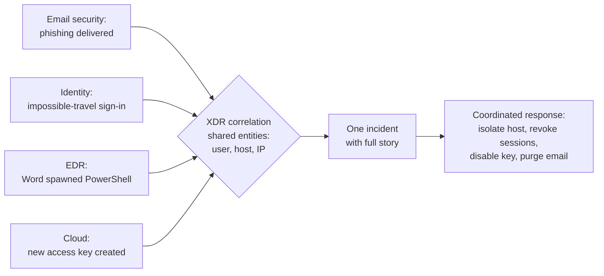

# Endpoint security: EDR and XDR

> **13-minute read. Helps to have read [Logging and detection](./logging-and-detection.md) first.**

## The one-line answer

**Antivirus** blocks files it recognises as bad. **EDR** (endpoint detection and response) records what every process on a laptop or server does, detects suspicious **behaviour** even when no file is known to be bad, and lets responders isolate the machine and investigate remotely. **XDR** (extended detection and response) applies the same idea across more sources - endpoints, identity, email, cloud and network - and correlates them into one incident. Endpoint protection is the layer that catches what got past prevention, on the machines attackers actually land on.

## Why it exists

Endpoints are where attacks become real. The phishing email is opened on a laptop; the stolen credential is used from a workstation; ransomware encrypts files on servers. For decades the main defence was signature-based antivirus: compare each file against a list of known malware. That stopped working well once attackers:

- changed malware slightly for each victim, so no signature matched;
- stopped using malware at all, and **"lived off the land"** with built-in tools like PowerShell, WMI, `certutil` or remote management software that are on every machine legitimately;
- moved fast once inside, from first click to domain-wide ransomware in hours.

EDR's answer is to watch behaviour and keep a record, so a defender can see that Word spawned PowerShell, which downloaded a file and created a scheduled task, even though each tool on its own is legitimate.

## The layers on an endpoint

| Layer | What it does | Example |
|---|---|---|
| **Hardening** | Reduces what can run at all | Patching, removing local admin rights, blocking Office macros from the internet, application allowlisting |
| **EPP** (endpoint protection platform) | Prevention: next-generation antivirus with signatures plus machine-learning file analysis, exploit protection, device control | Blocks a known ransomware binary on write |
| **EDR** | Detection, investigation and response | Flags Word launching an encoded PowerShell command; analyst isolates the laptop |
| **MDR** (managed detection and response) | A service: an external team watches your EDR around the clock | Your three-person IT team cannot cover nights; the provider calls you at 03:00 |

Most products now sell EPP and EDR as one agent. "Antivirus vs EDR" is less a product choice than a question of whether you use, and staff, the detection and response half.

## What EDR records and detects

An EDR agent continuously records **telemetry**: process starts (with command line and parent process), file writes, registry changes, network connections, logins, driver and script loads. It sends this to a cloud console, typically keeping weeks to months of history.

Detections come from:

- **Behavioural rules**: an Office app spawning a script interpreter; a process reading the memory of `lsass.exe` (where Windows keeps credentials); mass file renames with new extensions (ransomware); shadow copies being deleted.
- **Indicators of attack** mapped to **MITRE ATT&CK** techniques, so each alert says which tactic (persistence, credential access, lateral movement) it represents.
- **Machine learning** on process behaviour and file features.
- **Threat intelligence**: known bad hashes, domains and IPs.

## What EDR lets you do

The "R" is what changes incident response:

- **Isolate the host**: cut it off from the network except the EDR console, in one click, while the user keeps working offline or not at all.
- **Kill processes and quarantine files** remotely.
- **Investigate**: a process tree and timeline for the alert, and **threat hunting** queries across every endpoint ("which machines ran this command line in the last 30 days?").
- **Remote shell / live response** to collect evidence.
- **Rollback**: some products can restore files encrypted by ransomware on Windows, using shadow copies they protect.

## XDR: joining the dots across sources

An attack rarely touches only endpoints. A typical intrusion: a phishing email (email), a stolen session token used from a new country (identity), a malicious macro on a laptop (endpoint), then a new access key created in the cloud console (cloud). Four tools, four alert queues, four analysts who may never connect them.

*XDR correlates alerts from email, identity, endpoint and cloud by the user, host and IP they share, so the analyst sees one incident and can respond across all four from one place.*

XDR products correlate these by shared entities and give the analyst one incident with one timeline, plus response actions across the sources: isolate the host, revoke the user's sessions, purge the email from every inbox.

**Native XDR** comes from one vendor's suite (for example Microsoft Defender XDR across Defender for Endpoint, Office 365, Identity and Cloud Apps). **Open XDR** ingests other vendors' tools. In practice XDR overlaps heavily with a modern SIEM; many organisations run XDR for the high-fidelity correlated incidents and a SIEM for everything else and long-term retention.

**[📖 Microsoft Defender for Endpoint](https://learn.microsoft.com/en-us/defender-endpoint/microsoft-defender-endpoint)** - EDR capabilities, attack surface reduction and automated investigation

**[📖 Microsoft Defender XDR](https://learn.microsoft.com/en-us/defender-xdr/microsoft-365-defender)** - cross-source incidents and response

**[📖 MITRE ATT&CK](https://attack.mitre.org/)** - the technique catalogue EDR detections map to

## A worked example: one alert, end to end

At 10:42 the EDR raises a high-severity alert on a finance laptop: `EXCEL.EXE` started `powershell.exe -enc ...`, which connected to an unfamiliar domain and wrote a DLL to the user's temp folder.

1. **Triage (5 minutes)**: the process tree shows the spreadsheet came from an email attachment received at 10:39. Excel launching encoded PowerShell is not normal for this user or any finance user. Treat as a true positive.
2. **Contain (1 minute)**: isolate the laptop from the EDR console. The user is told to keep it powered on.
3. **Scope (30 minutes)**: hunt across all endpoints for the domain, the DLL hash and the attachment name. Two other users received the email; one opened it, but macro blocking stopped execution. In the XDR view, the email security tool confirms the sender and lets the team purge the message from all mailboxes.
4. **Identity check**: the user's sign-in logs show no unusual activity yet, but the team resets her password and revokes sessions in case the payload stole tokens.
5. **Eradicate and recover**: reimage the laptop rather than trying to clean it.
6. **Learn**: why did macros run on this laptop? It was missing the policy that blocks macros in files from the internet. Fix the policy gap fleet-wide.

The whole thing took under an hour because the telemetry already existed. Without EDR, the first sign might have been encrypted file shares two days later.

## Coverage and tuning

- **Coverage is the first metric.** An EDR on 90% of machines means attackers will find the other 10%. Reconcile the EDR device list against your asset inventory every week; servers, contractors' laptops and old VMs are the usual gaps.
- **Tamper protection on.** Attackers try to stop or uninstall the agent first; tamper protection blocks that even for local admins.
- **Prevention mode, not detect-only**, once tuned.
- **Linux and macOS too**, not only Windows. Cloud servers are endpoints.
- **Tune with exclusions sparingly.** Broad exclusions (a whole folder, a whole process) are where malware hides.

## Common mistakes

- **Buying EDR and not watching it.** Alerts at 02:00 with nobody to act until 09:00. If you cannot staff it, buy MDR.
- **Detect-only forever** for fear of false positives.
- **Agent gaps** on servers, build agents and the CEO's personal laptop that "can't have it".
- **Over-broad exclusions** for performance or developer convenience.
- **Users with local admin rights**, which make every compromise worse and let users (and attackers) disable protections.
- **Treating XDR as a replacement for logging.** XDR keeps what its sources send for a limited time; audit and compliance needs still require a log platform with long retention.

## How exams test this

- **Security+**: EDR vs antivirus vs XDR, host-based firewalls and HIPS, application allowlisting, isolation as a containment step, and endpoint hardening.
- **CySA+**: analysing EDR output: process trees, suspicious parent-child relationships, living-off-the-land indicators, and mapping behaviour to ATT&CK.
- **Microsoft SC-200**: Defender for Endpoint and Defender XDR in depth: device isolation, live response, advanced hunting with KQL, attack surface reduction rules and automated investigation. See the **[SC-200 guide](../../exams/azure/sc-200/)**.
- **CISSP**: endpoint security within security operations, and defence in depth.

## What to look at next

- **[Logging and detection](./logging-and-detection.md)** - where endpoint telemetry fits in the wider detection picture
- **[Incident response basics](./incident-response-basics.md)** - the lifecycle the worked example follows
- **[Backup and ransomware resilience](./backup-and-ransomware-resilience.md)** - what saves you when endpoint defences lose
