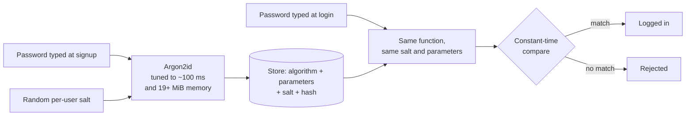

# Hashing and password storage

> **10-minute read. No prerequisites. Pairs well with [Encryption explained](./encryption-explained.md).**

## The one-line answer

A hash function turns any input into a fixed-size fingerprint, and there is no key that turns the fingerprint back into the input. That one-way property makes hashing the right tool for checking passwords and detecting tampering. But a general-purpose hash like SHA-256 is the **wrong** tool for passwords: passwords need a deliberately slow, salted hash such as Argon2id, scrypt or bcrypt.

## What a hash function is

Feed a cryptographic hash function any input (a word, a file, a whole disk image) and it returns a short fixed-length value, the digest. SHA-256 always returns 256 bits, written as 64 hex characters. A good cryptographic hash has three properties:

- **One-way (preimage resistance):** given a digest, you cannot work out an input that produces it.
- **Collision resistance:** you cannot find two different inputs with the same digest.
- **Avalanche effect:** change one bit of the input and roughly half the output bits change, so similar inputs give unrelated digests.

```text
sha256("password")  = 5e884898da28047151d0e56f8dc6292773603d0d6aabbdd62a11ef721d1542d8
sha256("Password")  = e7cf3ef4f17c3999a94f2c6f612e8a888e5b1026878e4e19398b23bd38ec221a
```

One capital letter, a completely different fingerprint.

## Hashing vs encryption vs encoding

These three get confused constantly, in code reviews and on exams.

| | Reversible? | Needs a key? | Purpose |
|---|---|---|---|
| **Encoding** (Base64, URL encoding) | Yes, by anyone | No | Represent data safely in another format. Not security at all. |
| **Encryption** (AES, RSA) | Yes, with the key | Yes | Keep data confidential. |
| **Hashing** (SHA-256, Argon2) | No | No (but see HMAC) | Verify data or passwords without storing the original. |

If someone says a password is "encrypted with Base64", the password is stored in plaintext with extra steps.

## Where plain hashes are the right tool

- **Integrity checks.** A download page lists the SHA-256 of the file. You hash what you downloaded and compare. If they match, the file was not corrupted or swapped (as long as you trust where you got the published hash).
- **Content addressing.** Git commits, container image digests (`sha256:...`) and package lockfile integrity fields all identify content by its hash. Pin a container image by digest and you know exactly which bytes you are running.
- **Digital signatures.** Signatures are computed over a hash of the message, not the message itself.
- **HMAC.** A hash combined with a secret key (HMAC-SHA256) proves both integrity and that the sender knew the key. Webhooks from Stripe, GitHub and others are signed this way, and AWS Signature Version 4 is built on it.

Avoid MD5 and SHA-1 for anything security-relevant. Practical collisions exist for both. SHA-256, SHA-384, SHA-512 and SHA-3 are the current choices.

## Why passwords need special handling

Here is the scenario every password design must survive: **your user database leaks.** It happens to well-run companies. When it does, the question is how long it takes an attacker to turn your stored values back into real passwords, which they will then try on other sites because people reuse them.

The attacker does not reverse the hash. They guess: take a candidate password, hash it, compare. So the defences are about making each guess expensive and making precomputed guesses useless.

### Problem 1: plain SHA-256 is too fast

SHA-256 was designed to be fast. A single modern GPU computes billions of SHA-256 hashes per second. Against a leaked table of unsalted SHA-256 password hashes, every common password falls in seconds.

### Problem 2: identical passwords give identical hashes

Without anything extra, every user whose password is `Summer2026!` has the same hash. Crack it once, and you have all of them. Worse, attackers can precompute hashes of billions of common passwords (rainbow tables) before they ever see your database.

### The fix: salt, then a slow hash

- A **salt** is a random value, unique per user, generated when the password is set and stored next to the hash. It is not secret. It means two users with the same password get different hashes, and precomputed tables are worthless because the attacker would need one per salt.
- A **password hashing function** (also called a key derivation function) is deliberately slow and, in the better ones, memory-hungry. You tune it so one hash takes something like 50 to 500 milliseconds on your server. That is invisible to a user logging in once, and ruinous for an attacker making billions of guesses. Memory-hard functions also blunt GPUs and custom hardware, which have lots of compute but limited fast memory per core.



*Signup stores the salt and parameters alongside the hash; login recomputes with the same inputs and compares. The password itself is never stored.*

### Which algorithm

Follow the OWASP Password Storage Cheat Sheet, which is kept current:

1. **Argon2id** is the first choice. It won the Password Hashing Competition and is memory-hard.
2. **scrypt** if Argon2id is not available.
3. **bcrypt** for older systems. Still acceptable, but it truncates input at 72 bytes and is not memory-hard.
4. **PBKDF2** (with HMAC-SHA-256 and a high iteration count) where FIPS-140 validation is required.

Most libraries encode the algorithm, parameters and salt into one string, for example `$argon2id$v=19$m=19456,t=2,p=1$<salt>$<hash>`. Store that whole string. It lets you raise the cost later: when a user logs in successfully with an old-parameter hash, rehash their password with the new parameters and save it.

**[📖 OWASP Password Storage Cheat Sheet](https://cheatsheetseries.owasp.org/cheatsheets/Password_Storage_Cheat_Sheet.html)** - current algorithm choices and minimum parameters

**[📖 RFC 9106: Argon2](https://datatracker.ietf.org/doc/html/rfc9106)** - the Argon2 specification and recommended parameters

### Pepper

A **pepper** is an extra secret mixed into every password hash, stored somewhere other than the database (a secrets manager or HSM). If only the database leaks, the attacker cannot even start guessing without the pepper. It is a useful defence-in-depth layer, but it adds key management and rotation work. Salt is mandatory; pepper is optional.

## Password policy, briefly

Storage is half the story. The other half is which passwords you accept. Current NIST guidance (SP 800-63B) flipped several old habits:

- **Favour length over complexity rules.** A long passphrase beats `P@ssw0rd!`. Allow at least 64 characters and all printable characters, including spaces.
- **Check new passwords against known-breached lists** and reject matches.
- **Do not force periodic rotation** without evidence of compromise. Forced rotation produces `Spring2026!` followed by `Summer2026!`.
- **Do not use password hints or knowledge questions.**
- **Rate-limit login attempts** so online guessing is slow too.

And then add [MFA](./mfa-and-passkeys.md), or skip passwords entirely with passkeys.

**[📖 NIST SP 800-63-4: Digital Identity Guidelines](https://csrc.nist.gov/pubs/sp/800/63/4/final)** - the authoritative source for password and authenticator rules

## A worked example

A team migrates an old app that stored `sha1(password)` with no salt. They cannot recompute Argon2id hashes because they do not have the passwords. Two common migration paths:

1. **Wrap the old hash:** store `argon2id(sha1(password))` for every user now. At login, compute `sha1` of the typed password, then verify with Argon2id. Every stored value is protected immediately, and you can switch each user to a plain `argon2id(password)` on their next login.
2. **Rehash on login:** keep the old hashes, and replace each one when its user next logs in. Simpler, but accounts that never log in stay weakly protected forever, so pair it with forcing a reset on dormant accounts.

Option 1 is better because it removes the weak hashes from the database on day one.

## Common mistakes

- **Encrypting passwords instead of hashing them.** If you can decrypt them, so can whoever steals the key.
- **Fast hashes for passwords.** Unsalted or salted SHA-256, MD5 or SHA-1. Salt alone does not fix speed.
- **One global salt.** A salt shared by every user is barely better than none.
- **Comparing hashes with `==`.** Use the library's verify function, which compares in constant time and handles the encoded parameters.
- **Logging passwords.** Request logging that captures login form bodies, or error messages that echo the input. Scrub them.
- **Writing your own scheme.** Use your framework's built-in password hasher (Django, Spring Security, ASP.NET Identity, `argon2-cffi`, `bcrypt` packages) rather than assembling primitives.

## How exams test this

- **Security+, ISC2 CC**: hashing vs encryption vs encoding, salting, rainbow tables, which algorithms are deprecated, and what HMAC adds.
- **CISSP**: properties of hash functions (collision and preimage resistance), integrity vs confidentiality, and password attack types at a conceptual level.
- **Developer-focused cloud exams**: storing credentials correctly and using managed identity services so you avoid storing passwords at all.

A useful exam heuristic: if a question asks how to protect stored passwords, the answer involves a salt and a slow hash. If an option says "encrypt the passwords with AES-256", it is the distractor.

## What to look at next

- **[MFA and passkeys](./mfa-and-passkeys.md)** - because even perfect password storage does not stop phishing
- **[Encryption explained](./encryption-explained.md)** - the reversible side of cryptography
- **[OWASP Top 10 explained](./owasp-top-10-explained.md)** - where cryptographic failures sit among web app risks
