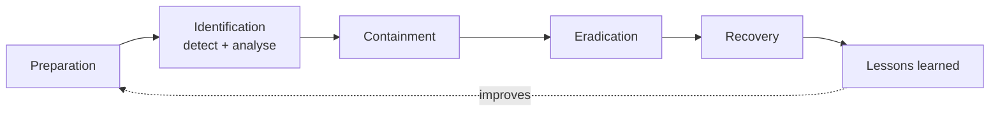

# Incident response basics

> **13-minute read. Pairs with [Logging and detection](./logging-and-detection.md), which covers how incidents get noticed.**

## The one-line answer

Incident response (IR) is the planned, practised way an organisation handles a security incident: **prepare** before anything happens, **detect and analyse** what is going on, **contain** it, **eradicate** the cause, **recover** to normal, and **learn** so it does not happen the same way again. The plan matters less than the practice. Teams that have rehearsed make calm, fast decisions; teams that have not make expensive ones.

## Events, incidents and breaches

These words have specific meanings, and using them correctly matters because legal and notification duties hang on them.

- An **event** is anything observable: a login, a firewall block, a file change. Millions per day, nearly all harmless.
- An **incident** is an event (or series) that actually or potentially harms confidentiality, integrity or availability, or violates policy. A confirmed compromised account is an incident.
- A **breach** is an incident where data was accessed or disclosed without authorisation. "Breach" often carries legal meaning and notification deadlines (GDPR: 72 hours to the regulator; US state laws, HIPAA, SEC rules and sector regulators all have their own), so leave the formal call to legal counsel.

## The lifecycle

Two models dominate. NIST SP 800-61 has long described four phases: preparation; detection and analysis; containment, eradication and recovery; and post-incident activity. Its 2025 revision (Rev. 3) reframes incident response around the NIST Cybersecurity Framework 2.0 functions, so preparation and lessons learned become part of continuous governance and improvement rather than bookends. The SANS model splits the same work into six steps (PICERL), which is easier to teach:

*The incident response lifecycle. In real incidents you loop between identification, containment and eradication several times as you learn more.*

**[📖 NIST SP 800-61 Rev. 3: Incident Response Recommendations and Considerations](https://csrc.nist.gov/pubs/sp/800/61/r3/final)** - incident response mapped to CSF 2.0

### 1. Preparation

Everything that makes the bad day manageable happens before it:

- **An incident response plan**: who is in charge, how to declare an incident, severity levels, communication rules, when to involve legal, PR, executives and law enforcement.
- **Roles**: an incident commander (coordinates, does not do hands-on work), technical leads, a scribe, a communications lead. Name backups.
- **Contacts**: on-call rotations, your cloud provider's support, external IR retainer, cyber insurer (many policies require you to call them first and use their approved firms), legal counsel.
- **Access**: break-glass accounts that work when SSO is down or compromised, and pre-provisioned read access to logs for responders.
- **Logging and tooling** in place *before* you need them (see [Logging and detection](./logging-and-detection.md)).
- **Runbooks** for the likely scenarios.
- **Practice**: tabletop exercises at least yearly.

### 2. Identification (detection and analysis)

An alert fires or someone reports something odd. The questions are:

- Is this real, or a false positive?
- What is affected: which accounts, systems, data?
- When did it start? (The first sign you saw is rarely the first thing that happened.)
- Is it ongoing?
- How severe is it?

Declare an incident early. It is cheap to stand down a false alarm and expensive to start organising two days late. Start a timeline immediately, in UTC, recording what was observed and every action taken, by whom.

### 3. Containment

Stop the damage from spreading while keeping evidence:

- **Short-term**: disable the compromised account, revoke its sessions and keys, isolate the host from the network (but do not power it off yet, because memory holds evidence), block the malicious IP or domain.
- **Long-term**: temporary fixes that let the business keep running while you clean up, such as moving a service behind extra authentication.

Containment is a trade-off. Acting too soon can tip off an attacker who then switches to a backup access path you did not know about; acting too late lets damage continue. For a confirmed active intrusion, find as many footholds as you can first, then contain them all at once.

### 4. Eradication

Remove the attacker and the cause: delete persistence mechanisms (new users, keys, scheduled tasks, backdoored functions), rotate every credential that could have been exposed, patch the exploited vulnerability, and rebuild compromised systems from known-good images rather than trying to clean them.

### 5. Recovery

Restore service carefully: rebuild, restore data from backups taken before the compromise (and verify they are clean), bring systems back in stages, and monitor closely for signs the attacker is returning.

### 6. Lessons learned

Within a week or two, hold a post-incident review. Then do the follow-ups. This step is skipped more than any other, and it is the one that makes the next incident less likely.

## Evidence and chain of custody

If there is any chance of legal action, insurance claims or regulatory scrutiny, handle evidence carefully:

- Preserve before changing: snapshot disks, capture memory if you can, export relevant logs.
- Record who collected what, when, how, and where it is stored, with hashes to prove it has not changed (chain of custody).
- Collect in order of volatility: memory and live network connections disappear first; disks and logs last longer.

In the cloud, snapshots and log exports make preservation much easier than on physical hardware, as long as you have pre-built permissions and a forensics account to copy them into.

## Runbooks

A runbook (or playbook) is a step-by-step guide for one type of incident. It turns a 3 a.m. panic into a checklist. A useful runbook includes:

1. **Trigger**: which alert or report starts it.
2. **Triage**: how to confirm it is real and assess scope.
3. **Containment steps**, with the exact commands or console paths.
4. **Who to notify** and when.
5. **Evidence to preserve.**
6. **Eradication and recovery steps.**
7. **Exit criteria**: how you know it is over.

Example runbook outline: **leaked cloud access key**

- Identify the key and its owner from the alert; check CloudTrail (or equivalent) for every action taken with it.
- Deactivate (do not delete yet) the key; revoke active sessions for the role.
- Look for persistence: new users, keys, roles, policies, compute instances, Lambda functions, changes to logging.
- Check data access: storage reads, database snapshots shared, KMS decrypts.
- Remove persistence, rotate any secrets the key could read, delete the key.
- Find how it leaked (a public repo, a CI log) and fix the source.
- Review whether billing shows unexpected resources (crypto-mining is common after key leaks).

## Postmortems

A good postmortem (post-incident review) is **blameless**: it assumes people acted reasonably given what they knew and the systems they had, and it looks for the conditions that made the mistake possible. Blame teaches people to hide problems; blameless reviews teach the organisation.

A useful postmortem document covers:

- **Summary**: what happened and the impact, in a paragraph.
- **Timeline**: detection, key decisions and actions, in UTC.
- **Root cause and contributing factors**: usually several. "Why did the key leak? Why did it have admin rights? Why did it take four days to notice?"
- **What went well** and **what went badly**.
- **Action items**: each with an owner and a due date, prioritised by how much they reduce risk.

Track the action items like any other engineering work.

## Tabletop exercises

A tabletop exercise is a guided discussion where the team walks through a realistic scenario ("a customer emails to say their data is on a leak site") and talks through what they would do, step by step. A facilitator adds complications ("the CEO is on a plane", "legal wants to know if card data was involved"). They are cheap, they expose missing access, unclear ownership and stale contacts, and they build the habits that hold up under pressure.

## Common mistakes

- **No plan until the incident.** Deciding roles and authority during a crisis wastes the most valuable hours.
- **Wiping systems before collecting evidence.** You lose the ability to know what happened.
- **Partial containment.** Removing one backdoor and tipping off the attacker, who uses the second.
- **Communicating on compromised channels.** If email or chat may be compromised, use an out-of-band channel.
- **Forgetting to rotate secrets** the attacker could have read.
- **Restoring from backups taken after the compromise.**
- **No lessons learned, or action items nobody does.**

## How exams test this

- **Security+, ISC2 CC and CySA+**: the order of the phases (a classic question: "what should the analyst do *first*?"), the difference between events and incidents, order of volatility, chain of custody, and which actions belong to containment vs eradication.
- **SC-200**: investigation and response in Microsoft Sentinel and Defender, automated playbooks.
- **AWS, Azure and GCP security exams**: cloud-specific IR, such as isolating an instance by swapping its security group, snapshotting volumes into a forensics account, revoking role sessions, and automating response with event rules.
- **CISSP and CISM**: incident management as a programme: governance, communication, legal and regulatory duties, business continuity links.

## What to look at next

- **[Logging and detection](./logging-and-detection.md)** - how incidents get noticed in the first place
- **[Phishing and social engineering](./phishing-and-social-engineering.md)** - the most common starting point for incidents
- **[Vulnerability management](./vulnerability-management.md)** - closing the hole an incident came through
- **[Security engineer interview prep](../../resources/interview-prep/security-engineer-interview.md)** - incident scenarios are a staple of interviews
