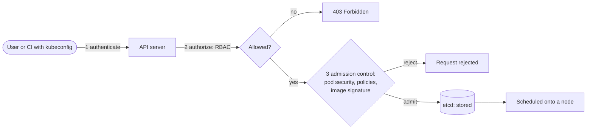

# Kubernetes security basics

> **15-minute read. Assumes you know pods, deployments and namespaces ([Kubernetes in 10 minutes](https://cloud.noblerworks.com/learn/concepts/kubernetes-in-10-minutes/)) and the image and runtime basics in [Container security basics](./container-security-basics.md).**

## The one-line answer

Kubernetes security is about controlling **who can talk to the API server and what they may do** (authentication and RBAC), **what pods are allowed to run** (pod security standards and admission control), **who pods can talk to** (network policies), and **how secrets and images are handled**. Out of the box, a cluster is permissive: any pod can talk to any other pod, and many settings default to "allowed". Security is mostly turning on the restrictions that already exist.

## Why it matters

The Kubernetes API server is the control plane for everything in the cluster. Anyone who can create a pod with the right settings can usually reach the node underneath, and from a node, often the cloud credentials of the node itself. So a cluster has two layers of risk:

- **The control plane**: over-broad RBAC, exposed API servers, unauthenticated dashboards and kubelets, leaked kubeconfig files.
- **The workloads**: privileged pods, pods with host mounts, flat networks that let one compromised pod reach every database, secrets readable by too many service accounts.

Real-world cluster compromises are overwhelmingly of the boring kind: an exposed dashboard, a service account with `cluster-admin`, a pod with the host filesystem mounted.

## The 4Cs: where Kubernetes fits

The Kubernetes docs describe security in four nested layers: **Cloud** (or data centre), **Cluster**, **Container**, **Code**. Each layer can only be as secure as the one around it. Your cluster RBAC is pointless if the cloud account lets anyone download the kubeconfig; your container settings are pointless if the code has an injection flaw. This page covers the cluster layer.



*Every request to the API server passes three gates in order: authentication, RBAC authorization, then admission control, before anything is stored in etcd and run.*

## 1. Authentication and RBAC: who can do what

Kubernetes has two kinds of identity:

- **Users** (humans): Kubernetes does not store users. In managed clusters they come from the cloud's identity (AWS IAM via EKS access entries, Microsoft Entra ID for AKS, Google identities for GKE) or an OIDC provider.
- **Service accounts**: identities for pods. Every pod runs as one; if you do not set one it gets the namespace's `default`.

**RBAC** grants permissions with four objects:

| Object | Scope | What it is |
|---|---|---|
| **Role** | One namespace | A list of allowed verbs on resources ("get, list pods") |
| **ClusterRole** | Whole cluster | The same, cluster-wide or for cluster-scoped resources |
| **RoleBinding** | One namespace | Grants a Role or ClusterRole to subjects in that namespace |
| **ClusterRoleBinding** | Whole cluster | Grants a ClusterRole everywhere |

A minimal Role for an app that only needs to read its own ConfigMaps:

```yaml
apiVersion: rbac.authorization.k8s.io/v1
kind: Role
metadata:
  namespace: shop
  name: read-config
rules:
  - apiGroups: [""]
    resources: ["configmaps"]
    verbs: ["get", "list", "watch"]
```

Permissions that are effectively cluster-admin and should be rare:

- `*` on `*` (wildcards), anything bound to `cluster-admin`.
- `create` on pods in a namespace: the holder can start a privileged pod (unless admission control blocks it) and mount any secret in that namespace.
- `get`/`list` on secrets: reads every secret in scope.
- `escalate`, `bind` and `impersonate`: ways to grant yourself more.

Habits that go with RBAC:

- Set `automountServiceAccountToken: false` for pods that never call the API (most apps), so a compromised pod has no token to steal.
- One service account per workload, not a shared `default`.
- Cloud workload identity (EKS Pod Identity or IRSA, AKS Workload Identity, GKE Workload Identity Federation) so pods get short-lived cloud credentials, instead of node-wide credentials or static keys.
- Keep the API server endpoint private or restricted to known networks; audit-log it.

## 2. Pod Security Standards: what pods may run

The **Pod Security Standards** define three profiles:

| Profile | What it allows | Use for |
|---|---|---|
| **Privileged** | Everything | Trusted system components only (CNI, storage drivers) |
| **Baseline** | Blocks known privilege escalations: no privileged containers, no host namespaces, no host path mounts, limited capabilities | A minimum for every namespace |
| **Restricted** | Baseline plus hardening: must run as non-root, drop all capabilities, `allowPrivilegeEscalation: false`, seccomp `RuntimeDefault` | Application namespaces |

They are enforced by the built-in **Pod Security Admission** controller, configured with namespace labels. Each label sets a mode: `enforce` (reject), `audit` (record in the audit log) or `warn` (warn the user).

```yaml
apiVersion: v1
kind: Namespace
metadata:
  name: shop
  labels:
    pod-security.kubernetes.io/enforce: restricted
    pod-security.kubernetes.io/warn: restricted
```

Pod Security Admission replaced the older PodSecurityPolicy, which was removed in Kubernetes 1.25. A rollout tip: label namespaces with `warn` and `audit` first, fix what they report, then switch on `enforce`.

**[📖 Kubernetes: Pod Security Standards](https://kubernetes.io/docs/concepts/security/pod-security-standards/)** - the exact controls in each profile

## 3. Admission control: custom rules

Pod Security Admission covers pod settings. Organisations usually need more: "images only from our registry", "every image must be signed", "every deployment needs an owner label", "no `latest` tags". These are enforced by **admission controllers** that inspect requests before they are stored:

- **ValidatingAdmissionPolicy**: built into Kubernetes, rules written in CEL, no extra component to run.
- **Policy engines**: OPA Gatekeeper (policies in Rego) and Kyverno (policies in YAML) run as admission webhooks and add mutation, reporting and image signature verification.

Run policies in **audit** mode first, read the violation report, then enforce. Make sure the webhook's failure behaviour is a deliberate choice: fail-closed blocks deployments if the policy engine is down; fail-open lets anything through.

## 4. Network policies: who pods can talk to

By default every pod can reach every other pod in the cluster, across namespaces. A **NetworkPolicy** selects pods by label and lists allowed ingress and egress. The standard pattern is **default deny, then allow**:

```yaml
apiVersion: networking.k8s.io/v1
kind: NetworkPolicy
metadata:
  name: default-deny
  namespace: shop
spec:
  podSelector: {}
  policyTypes: ["Ingress", "Egress"]
```

Then add specific policies: the `web` pods may reach `api` on port 8080; `api` may reach the database and DNS; nothing may reach the cloud metadata endpoint unless it needs to. Two things trip people up:

- NetworkPolicy is only enforced if the cluster's **network plugin (CNI) supports it**. On a CNI without support the objects are accepted and silently do nothing.
- A default-deny egress policy also blocks **DNS**; allow it explicitly.

**[📖 Kubernetes: Network Policies](https://kubernetes.io/docs/concepts/services-networking/network-policies/)** - selectors, ingress and egress rules, and examples

## 5. Secrets

Kubernetes Secrets are **base64-encoded, not encrypted**, by default. Anyone with `get` on secrets, or with access to etcd or its backups, can read them. To protect them:

- Enable **encryption at rest for etcd** with a KMS provider (managed clusters offer envelope encryption with the cloud KMS).
- Restrict RBAC on secrets tightly; audit reads.
- For high-value secrets, use an external manager (cloud secrets managers or Vault) through the Secrets Store CSI Driver or External Secrets Operator, so the source of truth and rotation live outside the cluster. See [Secrets management](./secrets-management.md).
- Mount secrets as files rather than environment variables where possible; environment variables leak into logs and crash dumps more easily.

## 6. Images, nodes and visibility

- **Images**: scan in CI and in the registry, admit only signed images from your registry, no `latest` tags. Detail in [Container security basics](./container-security-basics.md).
- **Nodes**: use the managed node OS images, patch them by replacing nodes, restrict SSH, and block pods from reaching the cloud metadata service where they do not need it.
- **Audit logs**: enable Kubernetes audit logging and send it to your SIEM. Alert on `exec` into pods, new ClusterRoleBindings, secret reads by unusual accounts and pods created with privileged settings. See [Logging and detection](./logging-and-detection.md).
- **Runtime detection**: Falco or a cloud CWPP sensor for behaviour inside running pods.
- **Posture**: run the CIS Kubernetes Benchmark (kube-bench) and a KSPM tool to catch drift; see [CSPM and CNAPP explained](./cspm-and-cnapp-explained.md).

**[📖 Kubernetes: Security checklist](https://kubernetes.io/docs/concepts/security/security-checklist/)** - the project's own baseline checklist

**[📖 NSA and CISA: Kubernetes Hardening Guide](https://media.defense.gov/2022/Aug/29/2003066362/-1/-1/0/CTR_KUBERNETES_HARDENING_GUIDANCE_1.2_20220829.PDF)** - pod security, network separation, authentication, logging

## A worked example: hardening the `shop` namespace

A team runs a web front end, an API and a worker in one namespace. Today all three use the `default` service account (which someone bound to `edit`), no network policies exist, and the API image runs as root.

1. **Identity**: create three service accounts. Only the worker needs the Kubernetes API (to read a ConfigMap), so it gets the `read-config` Role above; the others get `automountServiceAccountToken: false`. Remove the `edit` binding from `default`.
2. **Pod security**: label the namespace `warn: restricted`. Deploying shows two warnings: the API runs as root, and the worker lacks a seccomp profile. Fix the image `USER` and add `seccompProfile: RuntimeDefault`. Then set `enforce: restricted`.
3. **Network**: apply default deny, then allow web to API on 8080, API to the database on 5432, all three to DNS. The worker's egress to the internet is limited to the payment provider's endpoint via the egress gateway.
4. **Admission**: a Kyverno or ValidatingAdmissionPolicy rule rejects images not from the company registry.
5. **Secrets**: the database password moves to the cloud secrets manager, synced in with External Secrets Operator; etcd encryption with KMS is confirmed on.
6. **Detection**: audit log alerts on `kubectl exec` into `shop` pods in production.

A compromised web pod now has no API token, cannot run as root, cannot reach the database directly, and cannot pull a tool from the internet.

## Common mistakes

- **Binding `cluster-admin` to CI or to a default service account "to make it work".** Grant the exact verbs the pipeline needs, per namespace.
- **Network policies on a CNI that ignores them.** Test that a denied connection is actually denied.
- **Believing base64 is encryption.** Turn on etcd encryption and lock down secret reads.
- **Leaving the API server public with only a kubeconfig between attackers and the cluster.** Restrict network access to it.
- **Enforcing policies with no audit phase.** You break deployments, and teams ask for exemptions that never expire.
- **Forgetting the cloud layer.** Node instance roles with broad permissions turn any pod escape into an account compromise.

## How exams test this

- **CKS**: hands-on, in a live cluster: write RBAC Roles and bindings, NetworkPolicies, configure Pod Security Admission, set `securityContext`, use AppArmor and seccomp, scan images, configure audit logging, read Falco output, and harden the API server and kubelet. Speed with `kubectl` matters. See the **[CKS guide](../../exams/kubernetes/cks/)**.
- **KCSA**: the same areas conceptually, multiple-choice: the 4Cs, threat model of a cluster, the Pod Security Standards profiles, RBAC objects. See the **[KCSA guide](../../exams/kubernetes/kcsa/)**.
- **Cloud security exams**: managed Kubernetes specifics: EKS access entries and Pod Identity, AKS with Entra ID and Defender for Containers, GKE Workload Identity Federation and Binary Authorization.

## What to look at next

- **[Container security basics](./container-security-basics.md)** - the image and runtime layer under every pod
- **[Least privilege explained](./least-privilege-explained.md)** - the principle behind every RBAC decision
- **[Zero trust explained](./zero-trust-explained.md)** - network policies and service identity as zero trust inside the cluster
