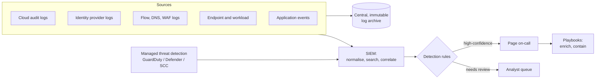

# Logging and detection

> **14-minute read. Helps to know what logs, metrics and traces are; [Observability basics](https://cloud.noblerworks.com/learn/concepts/observability-basics/) on Cloud Zero to Hero covers that.**

## The one-line answer

Security logging means recording the events that let you answer **"who did what, when, from where, and did it work?"**, keeping those records somewhere an attacker cannot erase them, and collecting them in one place. Detection is turning those logs into **alerts that a human should act on**. The difficulty is not collecting data; it is choosing the right data and writing detections that catch real attacks without burying the team in noise.

## Why it matters

Prevention eventually fails. A credential gets phished, a zero-day lands, a contractor makes a mistake. From that moment, what matters is how quickly you notice and how much you can reconstruct. Industry breach reports keep finding that many breaches are discovered by an outside party, such as a customer, a researcher or an attacker's ransom note, rather than by the victim's own monitoring. Logs are also evidence: auditors, regulators, insurers and courts will ask for them.

## What to log

You cannot log everything (cost, noise, privacy), so focus on the events that matter most for security.

### Identity and access

- Successful and failed logins, MFA challenges and failures, password and MFA resets.
- Changes to users, groups, roles and permissions.
- Use of privileged accounts and break-glass access.
- Creation and use of API keys and tokens.

### Control plane (the cloud's audit log)

Every cloud records API calls made against your account: who created, changed or deleted which resource. These are the single most important security logs in a cloud environment.

- **AWS CloudTrail** (management events by default; data events like S3 object reads are opt-in).
- **Azure Activity Log** for subscription operations, plus Microsoft Entra sign-in and audit logs.
- **Google Cloud Audit Logs** (Admin Activity always on; Data Access logs opt-in for most services).

### Data access

Reads and writes of sensitive data: object storage data events, database audit logs, key management decrypt calls. These are often off by default because they are high-volume, so turn them on selectively for sensitive stores.

### Network

VPC flow logs, DNS query logs, firewall and WAF logs, load balancer access logs. They answer "did anything talk to that IP?" during an investigation.

### Endpoints and workloads

Process creation, logins and privilege changes on servers and laptops (via EDR tools or the OS audit system), container runtime events, and Kubernetes audit logs.

### Application

Your own app's security events: login attempts, access-control failures, input validation failures, high-value transactions, admin actions.

**[📖 OWASP Logging Cheat Sheet](https://cheatsheetseries.owasp.org/cheatsheets/Logging_Cheat_Sheet.html)** - which application events to log, which fields to include, and what never to log

### What a good log entry contains

- **When**: a timestamp in UTC, with clocks synchronised (NTP) across systems.
- **Who**: the user or service identity, not just an IP address.
- **What**: the action and the target resource.
- **Where from**: source IP, device, user agent.
- **Outcome**: success or failure, and why.
- **Correlation**: a request or session ID that ties events together across services.

And what it must not contain: passwords, session tokens, full card numbers, secrets, and personal data beyond what is needed.

## Protecting and keeping logs

Attackers who get in often try to delete or disable logging to cover their tracks. So:

- **Centralise** logs into a separate account or project that production admins cannot modify.
- **Make them immutable**: object lock / write-once storage, or retention locks on log buckets.
- **Alert on logging being disabled or changed.** Stopping CloudTrail or deleting a diagnostic setting should page someone.
- **Set retention deliberately.** Compliance frameworks set minimums (PCI DSS requires one year, with three months immediately available). Keep hot, searchable storage short and archive the rest cheaply.
- **Control access to logs**, because logs themselves can contain sensitive data.

## SIEM: putting it all together

A [SIEM](../glossary.md#term-siem-security-information-and-event-management) (Security Information and Event Management) system ingests logs from everywhere, normalises them into a common format, lets analysts search across them, and runs detection rules that raise alerts. Examples include Microsoft Sentinel, Splunk, Google Security Operations, Elastic Security and the AWS-native combination of Security Lake with an analytics layer.

Around the SIEM you will meet:

- **SOAR** (security orchestration, automation and response): playbooks that enrich alerts and take routine actions automatically, such as disabling a user or isolating a host.
- **Managed threat detection** services: AWS GuardDuty, Microsoft Defender for Cloud and Google Security Command Center analyse cloud logs with provider-built detections. They are the fastest way to get good baseline coverage and should be turned on in every account.
- **XDR / EDR**: detection and response focused on endpoints, often feeding the SIEM.

*Logs flow from every source into an immutable archive and a SIEM; detection rules split alerts into those that page someone and those that wait for review.*

## Detection engineering basics

Detection engineering is treating detections like software: designed, tested, version-controlled and measured.

### Types of detection

- **Signature or indicator matching**: known-bad IPs, domains and file hashes (indicators of compromise, IOCs). Easy to write, easy for attackers to change.
- **Behavioural rules**: patterns of activity that suggest an attack regardless of the specific tools, such as a new access key created for a user who has never used the API, followed by calls from an unusual country. Harder to evade.
- **Anomaly detection**: statistical baselines that flag unusual volume or behaviour. Good at finding the unexpected, prone to false positives.
- **Threshold rules**: 50 failed logins in 5 minutes.

### Start from attacker behaviour

MITRE ATT&CK catalogues real attacker techniques, grouped by tactic (initial access, persistence, privilege escalation, defence evasion, credential access, discovery, lateral movement, exfiltration, impact). Map your detections to it to see where you have coverage and where you are blind.

**[📖 MITRE ATT&CK](https://attack.mitre.org/)** - the knowledge base of adversary tactics and techniques, including cloud matrices

### High-value starting detections for a cloud account

1. Root or global admin sign-in.
2. Any sign-in without MFA for privileged users.
3. Audit logging stopped, deleted or changed.
4. New IAM user, access key or admin role assignment.
5. Security group or firewall rule opened to `0.0.0.0/0` on admin ports.
6. Storage made public.
7. Key management key scheduled for deletion or disabled.
8. Managed threat detection findings above medium severity.

The [centralized logging and alerting project](../../resources/hands-on-projects/centralized-logging-and-alerting.md) builds several of these.

### Write rules in a portable format

Sigma is an open, vendor-neutral format for detection rules that converts into the query languages of most SIEMs. Keeping detections as code in a repository gives you review, history and testing.

### Tuning: the real work

Every detection has two failure modes:

- **False positives**: alerts on harmless activity. Too many and analysts start ignoring alerts (alert fatigue), which is how real attacks get missed.
- **False negatives**: real attacks that do not trigger. You only learn about these through testing or after an incident.

For each detection, document what it looks for, why it matters, how to triage it and known benign causes. Measure how often it fires and how often it is real. Retire or rewrite detections that are never actionable. Test detections by safely simulating the activity in a test account and confirming the alert fires.

## Common mistakes

- **Logging everything, watching nothing.** Terabytes collected, no alerts defined, nobody looking.
- **Data events left off where they matter.** The audit log shows the bucket policy change but not who downloaded the files.
- **Logs in the same account as production**, deletable by the same admins an attacker would compromise.
- **No alert on logging being disabled.** It is the first thing many attackers do.
- **Alerts with no owner or runbook.** An alert that nobody knows how to triage is noise.
- **Unsynchronised clocks**, making timelines impossible to reconstruct.
- **Sensitive data in logs**, which turns the log system into a breach target.

## How exams test this

- **CySA+ and SC-200**: the core of both. Reading log entries, building and tuning detections, SIEM and SOAR concepts, KQL in Microsoft Sentinel for SC-200, and identifying indicators of compromise.
- **Security+ and ISC2 CC**: log types, SIEM purpose, and monitoring as a detective control.
- **AWS, Azure and GCP security exams**: which log captures which activity (management vs data events, Activity Log vs resource logs, Admin Activity vs Data Access), centralising logs across accounts, making them immutable, and alerting on specific API calls.
- **CISSP**: logging and monitoring as part of security operations, plus retention and evidence handling.

## What to look at next

- **[Incident response basics](./incident-response-basics.md)** - what to do when an alert is real
- **[Centralized logging and alerting (hands-on)](../../resources/hands-on-projects/centralized-logging-and-alerting.md)** - build a cloud audit log pipeline with alerts
- **[Security tools compared](../../resources/service-comparison-security-tools.md)** - GuardDuty vs Defender vs Security Command Center
