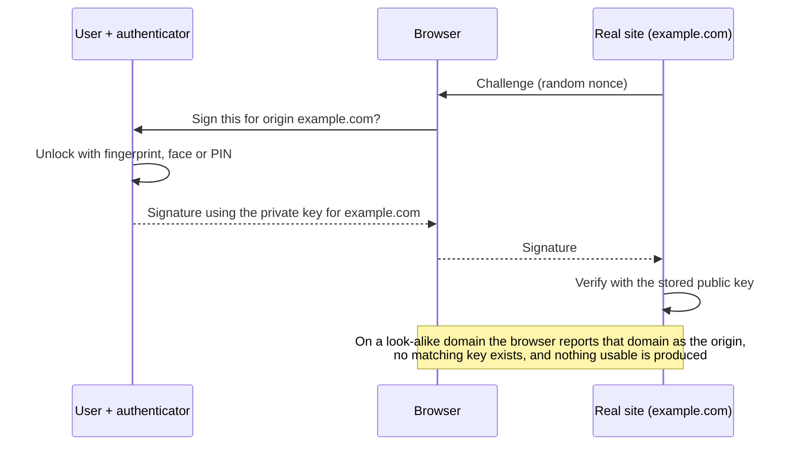

# MFA and passkeys

> **11-minute read. Read [IAM explained](./iam-explained.md) first if "authentication" is a fuzzy word.**

## The one-line answer

[Multi-factor authentication (MFA)](../glossary.md#term-mfa-multi-factor-authentication) means a login needs two or more different kinds of proof, so a stolen password alone is not enough. But MFA methods are not equal. SMS codes and push approvals stop password-spraying bots, yet a convincing phishing page can still capture them in real time. **Phishing-resistant** methods, which today means passkeys and security keys built on FIDO2/WebAuthn, cannot be relayed by a fake site at all. That difference is why they have become the standard to aim for.

## The three factors

A factor is a category of evidence:

- **Something you know** - a password, PIN or passphrase.
- **Something you have** - a phone, a hardware security key, a smart card.
- **Something you are** - a fingerprint or face.

MFA means factors from **different** categories. A password plus a security question is two things you know, so it is not MFA. A password plus a code from an authenticator app is.

Location ("somewhere you are") and behaviour are sometimes called factors, but they are better thought of as risk signals that conditional access policies use to decide *when* to demand MFA.

## Why passwords alone fail

Passwords fail for reasons that have nothing to do with how strong they are:

- **Reuse.** One breached site hands attackers a username and password to try everywhere else (credential stuffing).
- **Phishing.** A fake login page collects the password directly.
- **Spraying.** Attackers try a few common passwords against many accounts, staying under lockout thresholds.

MFA addresses all three, which is why turning it on is consistently ranked among the highest-value controls an organisation can deploy.

## MFA methods, from weakest to strongest

| Method | How it works | Phishing-resistant? | Main weakness |
|---|---|---|---|
| SMS or voice code | Code sent to your phone number | No | SIM swapping, number porting, interception; the user can type it into a fake site |
| Email code or magic link | Code or link sent to your inbox | No | Only as strong as the email account |
| TOTP authenticator app | Phone app generates a 6-digit code every 30 seconds from a shared secret | No | User can type the code into a fake site, which replays it within the window |
| Push notification | App asks "Is this you? Approve / Deny" | No | MFA fatigue: attackers trigger repeated prompts until the user taps Approve |
| Push with number matching | User types a number shown on the login screen into the app | Partly | Stops blind approvals, but a real-time phishing proxy can still show the right number |
| FIDO2 security key | Hardware key signs a challenge bound to the website's origin | **Yes** | Cost and logistics of hardware; need a backup key |
| Passkey | Same FIDO2 cryptography, with the key stored in a phone, laptop or password manager | **Yes** | Recovery and account-sharing design need thought |
| Smart card / PIV / certificate-based | Private key on a card, used through a reader or OS integration | **Yes** | Heavy infrastructure; common in government |

SMS is still better than no MFA. But if you are choosing what to roll out, start with the strongest method your users can practically use.

## Why "phishing-resistant" is the key idea

Picture an attacker-in-the-middle phishing kit. The victim visits `rnicrosoft-login.example`, a pixel-perfect copy of the real page. Behind the scenes the kit proxies everything to the real site:

1. The victim types their password. The kit passes it to the real site.
2. The real site asks for an MFA code. The kit shows the same prompt.
3. The victim types their TOTP code, or approves the push. The kit passes it on.
4. The real site issues a session cookie. The kit keeps it. The attacker is now logged in.

Codes and push approvals are just secrets the user can be tricked into handing over. Nothing in them says *which website* they were meant for.

FIDO2 changes that. When you register a security key or passkey with `login.microsoft.com`, the authenticator creates a key pair **scoped to that exact origin**. At login, the browser tells the authenticator which origin is asking. A passkey for `login.microsoft.com` will not sign a challenge for `rnicrosoft-login.example`, and there is no code for the user to copy. The phishing page has nothing to relay.

*A FIDO2 login: the private key never leaves the authenticator, and the signature is bound to the site's real origin, which is what defeats phishing proxies.*

**[📖 CISA: Implementing phishing-resistant MFA](https://www.cisa.gov/sites/default/files/publications/fact-sheet-implementing-phishing-resistant-mfa-508c.pdf)** - why FIDO and PKI-based MFA are the target state

## Passkeys

A passkey is a FIDO2 credential designed to replace the password, not just sit next to it. The private key lives in a device or a password manager and is unlocked with the device's own biometric or PIN. The website stores only the public key.

Two kinds you will meet:

- **Synced passkeys** live in a platform or password manager account (Apple iCloud Keychain, Google Password Manager, Microsoft, 1Password, Bitwarden) and appear on all your devices. Easy for consumers, and losing a phone does not lose your account.
- **Device-bound passkeys** never leave one piece of hardware, such as a YubiKey or a managed laptop's TPM. Enterprises and high-assurance settings often require these, because a synced passkey is only as safe as the account it syncs through.

What passkeys fix beyond phishing:

- **Nothing reusable leaks in a breach.** The site holds only public keys. A stolen database gives attackers nothing to replay elsewhere.
- **No credential stuffing or spraying.** There is no shared secret to guess.
- **Faster logins.** One biometric prompt instead of a password plus a code.

**[📖 FIDO Alliance: Passkeys](https://fidoalliance.org/passkeys/)** - how passkeys work and which platforms support them

**[📖 W3C Web Authentication (WebAuthn)](https://www.w3.org/TR/webauthn/)** - the browser API underneath passkeys and security keys

## The parts teams get wrong

### Recovery is the real attack surface

Strong MFA is pointless if the "lost my phone" flow resets it with an email link or a help-desk call. Attackers increasingly skip the login entirely and social-engineer the help desk into resetting MFA (see [Phishing and social engineering](./phishing-and-social-engineering.md)). Design recovery with the same assurance as enrolment: require a second registered passkey or security key, or identity verification for staff, and alert the user on any MFA change.

### Fallbacks undo the upgrade

If a user has a security key **and** SMS enabled, an attacker simply chooses SMS. Phishing resistance only counts once weaker methods are removed for that account, starting with administrators.

### MFA at login is not MFA forever

After a successful login, the session cookie or token is the credential. Infostealer malware that copies browser cookies bypasses MFA entirely. Defences include short session lifetimes for sensitive apps, re-authentication for risky actions, device-bound sessions where supported, and endpoint protection.

### Service accounts cannot do MFA

Machines do not have fingers. For workloads, the equivalent is getting rid of long-lived secrets: use workload identity federation, instance roles and short-lived tokens. See [Secrets management](./secrets-management.md).

## A sensible rollout order

1. **Administrators and break-glass accounts first**, with FIDO2 security keys and no weaker fallback. Cloud root and global admin accounts above all.
2. **Everyone else on any MFA**, with number matching turned on for push, and SMS phased out where possible.
3. **Conditional access**: require stronger methods for risky sign-ins, unmanaged devices and sensitive apps.
4. **Passkeys as the default** for workforce and customers, with passwords kept only as a transitional fallback, then removed.
5. **Harden recovery** and alert on every authenticator change.

The [zero trust hands-on project](../../resources/hands-on-projects/implement-zero-trust.md) walks through enforcing MFA and conditional access on AWS, Azure and GCP.

## How exams test this

- **Security+ and ISC2 CC**: the three factor types, why two passwords are not MFA, and the weaknesses of SMS. Expect "which provides the strongest authentication" questions where a hardware token or FIDO2 key is the answer.
- **Azure SC-300 and SC-900**: Conditional Access, authentication strengths, number matching and passwordless methods (Windows Hello for Business, FIDO2, Microsoft Authenticator).
- **Cloud security exams**: MFA on root and admin accounts, MFA conditions in IAM policies (`aws:MultiFactorAuthPresent`), and why workloads use roles instead.
- **CISSP**: authentication types, false accept and false reject rates for biometrics, and assurance levels.

## What to look at next

- **[OAuth and OIDC explained](./oauth-and-oidc-explained.md)** - how a login turns into tokens that apps trust
- **[Phishing and social engineering](./phishing-and-social-engineering.md)** - the attacks MFA is meant to blunt
- **[Hashing and password storage](./hashing-and-password-storage.md)** - doing passwords properly while they still exist
- **[Zero trust explained](./zero-trust-explained.md)** - strong authentication on every request, not just at the door
