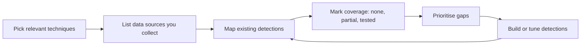

# MITRE ATT&CK for defenders

> **12-minute read. Written for analysts and engineers who see "T1059" in a report and want to use the framework to measure their own detection.**

## The one-line answer

MITRE ATT&CK is a public knowledge base of adversary behaviour, built from real-world observations. It gives defenders a common language for what attackers do. Used well, it is a map for asking "which of these behaviours would we notice?" It is not a checklist to tick off, and it is not a score.

**[📖 MITRE ATT&CK resources](https://attack.mitre.org/resources/)** - what ATT&CK is, how it is organised, the Navigator and defensive resources

## How to read the matrix

ATT&CK describes behaviour in layers:

| Term | Question it answers | Notes |
|---|---|---|
| **Tactic** | Why is the adversary doing this? | The columns of the matrix (the attacker's goal at that moment) |
| **Technique** | How do they achieve the goal? | The cells; each has an ID |
| **Sub-technique** | What exactly is the method? | A lower-level variant of a technique |
| **Procedure** | How was it really done? | A specific in-the-wild use by a group or tool |

There are separate matrices for **Enterprise** (networks and cloud), **Mobile** and **ICS** (industrial control systems). Techniques list the platforms they apply to, so filter to the ones you run.

Each technique page also links to mitigations and detection information. The resources page lists Mitigations, Assets, Detection Strategies, Analytics and Data Components. This page does not describe how attacks are carried out, and neither does it need to: defenders need the behaviour name, the data that would show it, and the control that blocks it.

## Using it to measure detection coverage

The idea is simple: for each technique that matters to you, record whether you could detect it and how well.

The diagram shows a loop, not a one-off project. You choose techniques, check you collect the logs that would show them, map the detection rules you already have, mark honest coverage levels, fix the biggest gaps and repeat.

### Step by step

1. **Pick what is relevant.** Start from threat intelligence about groups that target your sector (see [Threat intelligence basics](./threat-intelligence-basics.md)), your incident history and your platforms. Do not try to cover the whole matrix.
2. **Check the data first.** A detection rule cannot fire if the log is not collected. Many gaps are missing logs, not missing rules. See [Logging and detection](./logging-and-detection.md).
3. **Map existing detections** to technique IDs. Tag rules with the ID so the mapping stays current.
4. **Rate coverage honestly.** A useful scale: *none*, *log collected but no rule*, *rule exists*, *rule tested and alerts reach someone*. A rule that was never tested counts as unproven.
5. **Visualise it.** The ATT&CK Navigator, which the resources page describes as a tool for visualising defensive coverage, lets you colour cells by coverage level.
6. **Prioritise gaps** by how likely the technique is for your threats and how bad the impact would be. Work the top few.
7. **Test.** Confirm detections fire, for example with agreed, authorised exercises such as purple-team sessions run by your own team. Re-test when systems change.

## Traps to avoid

- **Coverage is not a percentage to maximise.** One weak rule on a technique does not equal real protection. Count tested detections, not tagged cells.
- **Technique-level mapping hides variation.** Attackers can do one technique many ways, and a rule may catch only some. Note which sub-techniques and variations you cover.
- **Do not skip mitigations.** Preventing a behaviour is often better than detecting it.
- **Mapping is judgement.** Two analysts may map the same rule differently. Write down your reasoning.

## Other good uses

The resources page also lists threat intelligence, adversary emulation and assessment as use cases. For defenders the common ones are: tagging alerts and incident reports with technique IDs so trends show up, writing incident reports in a shared language, and checking whether a new tool covers the techniques you worry about. See [Incident response basics](./incident-response-basics.md) and [Endpoint security, EDR and XDR](./endpoint-security-edr-xdr.md).

## Unverified

We read the ATT&CK resources page. We did not verify the current matrix version number or technique counts, which change with each release. Check attack.mitre.org for the current version.

## Check yourself

Try these from memory first, then open each answer.

1. What is the difference between a tactic and a technique in ATT&CK?
    

    
Answer

    A tactic answers why the adversary is acting and is a column of the matrix, the attacker's goal at that moment. A technique answers how they achieve the goal and is a cell with an ID. See: How to read the matrix.
    

2. Why should you check your log data before writing detection rules for a technique?
    

    
Answer

    A detection rule cannot fire if the log is not collected, and many gaps are missing logs rather than missing rules. See: Using it to measure detection coverage.
    

3. Why is a high coverage percentage a misleading goal?
    

    
Answer

    One weak rule on a technique does not equal real protection. The page says to count tested detections, not tagged cells. See: Traps to avoid.
    

4. A rule is tagged to a technique but has never been tested. How should you rate it?
    

    
Answer

    As unproven. The suggested scale only gives full credit to a rule that is tested and whose alerts reach someone. See: Step by step.
    

