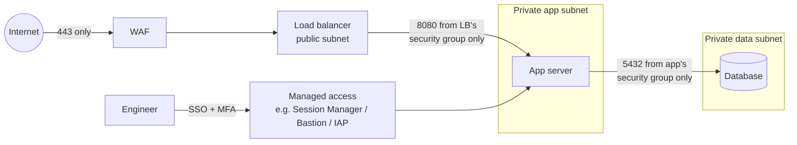

# Network security basics

> **13-minute read. Assumes you know what an IP address and a port are. If not, start with [Day One](https://cloud.noblerworks.com/learn/day-one/) and [VPC explained](https://cloud.noblerworks.com/learn/concepts/vpc-explained/) on Cloud Zero to Hero.**

## The one-line answer

Network security controls decide **which systems can talk to which, on which ports, in which direction**. Firewalls enforce the rules, segmentation splits the network into zones so one compromise does not reach everything, and a web application firewall (WAF) inspects HTTP traffic for attack patterns. In the cloud these show up as security groups, network ACLs, firewall rules and managed WAFs. Networks are no longer the main perimeter (identity is), but they are still the cheapest way to make whole classes of attack impossible.

## Why network controls still matter

A common modern claim is that "the network perimeter is dead". It is half true. You can no longer assume that anything inside the corporate network is trustworthy, which is the idea behind [zero trust](./zero-trust-explained.md). But network controls are still extremely effective at one thing: **removing reachability**. A database with no route from the internet cannot be brute-forced from the internet, no matter how its authentication is configured. An admin port that is closed cannot be exploited when the next critical vulnerability in its software is announced.

So the modern view is: identity decides *who* may do something; the network decides *what can even be reached*. You want both.

## Firewalls

A [firewall](../glossary.md#term-firewall) allows or blocks traffic according to rules. Each rule typically matches on source, destination, protocol and port, and says allow or deny.

### Stateful vs stateless

This distinction comes up constantly, in design and on exams.

- A **stateful** firewall tracks connections. If it allows an outbound request from your server to port 443 on some API, it automatically allows the response back in. You write rules for the direction the connection starts.
- A **stateless** firewall judges every packet on its own, with no memory. To allow that same outbound request, you need an outbound rule *and* an inbound rule for the return traffic, which arrives on a high-numbered ephemeral port (typically 1024-65535).

Stateful is easier to get right. Stateless is simpler and cheaper to run at very high volume, and is often used as a coarse outer layer.

### Layers of inspection

- **Packet filters (layer 3/4)** look at IPs, protocols and ports. Fast and simple. Security groups and most cloud firewall rules are this.
- **Next-generation firewalls (NGFW)** also identify applications, users and known threats, and can decrypt and inspect TLS. Palo Alto, Fortinet and cloud services like AWS Network Firewall and Azure Firewall Premium sit here.
- **Web application firewalls (layer 7)** understand HTTP specifically. More on them below.

## Segmentation

Segmentation splits a network into zones and controls traffic between them. The goal is that compromising one zone does not give automatic access to the others. Attackers who get a foothold almost always try to move sideways (lateral movement) toward something valuable, so segmentation directly limits the damage.

Classic zones:

- **Public or DMZ**: things the internet must reach, such as load balancers and reverse proxies.
- **Application**: app servers, reachable only from the public tier.
- **Data**: databases and caches, reachable only from the application tier.
- **Management**: admin access paths, reachable only from a bastion or a managed access service.

**Microsegmentation** takes this down to individual workloads: each service can talk only to the specific services it needs, often enforced by host firewalls, Kubernetes network policies or a service mesh. It is least privilege applied to network paths.

*A segmented three-tier design: each tier accepts traffic only from the tier in front of it, the database has no internet path, and admin access goes through an identity-aware service instead of an open SSH port.*

## Security groups vs network ACLs

In AWS (and with equivalents elsewhere), two built-in controls do different jobs. This is one of the most tested networking topics on cloud exams.

| | Security group | Network ACL (NACL) |
|---|---|---|
| Attached to | A network interface (an instance, a database, a load balancer) | A subnet |
| State | **Stateful**: return traffic allowed automatically | **Stateless**: write rules for both directions |
| Rule types | **Allow only** | Allow **and** deny |
| Evaluation | All rules considered together | Numbered rules, evaluated in order, first match wins |
| Default | Deny all inbound, allow all outbound | The default NACL allows everything; a new custom NACL denies everything |
| Can reference | Other security groups as sources | Only CIDR ranges |
| Typical use | The primary, fine-grained control for every workload | A coarse subnet-wide backstop, or blocking a specific bad IP range |

The most useful feature here is that **a security group can reference another security group**. "The database accepts port 5432 from the app tier's security group" keeps working as app servers scale up and down, with no IP addresses in the rules.

The equivalents on other clouds:

- **Azure**: Network Security Groups (NSGs), stateful, with allow and deny rules and priorities, attachable to a subnet or a network interface. Application Security Groups play the "reference a group of workloads" role.
- **Google Cloud**: VPC firewall rules and hierarchical firewall policies, stateful, applied across the VPC and targeted by network tags or service accounts.

**[📖 AWS: Control traffic with security groups](https://docs.aws.amazon.com/vpc/latest/userguide/vpc-security-groups.html)** - rules, statefulness and referencing other groups

**[📖 AWS: Control subnet traffic with network ACLs](https://docs.aws.amazon.com/vpc/latest/userguide/vpc-network-acls.html)** - rule numbering, statelessness and ephemeral ports

**[📖 Azure: Network security groups](https://learn.microsoft.com/en-us/azure/virtual-network/network-security-groups-overview)** - how NSG rules are evaluated

**[📖 Google Cloud: VPC firewall rules](https://cloud.google.com/firewall/docs/firewalls)** - targets, priorities and implied rules

## Web application firewalls

A [WAF](../glossary.md#term-waf-web-application-firewall) sits in front of a web application, usually at the load balancer or CDN, and inspects each HTTP request. It can:

- block requests matching known attack patterns (managed rule sets based on the OWASP Core Rule Set: injection strings, path traversal, known bad bots);
- rate-limit clients that send too many requests;
- block by geography or IP reputation;
- apply custom rules, such as "only these IPs may reach `/admin`".

A WAF is a useful layer, especially for buying time when a new vulnerability is announced and you cannot patch the app today: a virtual patch rule can block the exploit pattern in minutes. But it is a filter, not a fix. Attack payloads can be encoded in ways rules miss, and a WAF knows nothing about your business logic, so it cannot stop a user reading another user's records through a valid-looking request. Fix the code; use the WAF to reduce noise and buy time.

Managed options include AWS WAF, Azure Web Application Firewall (on Front Door or Application Gateway), Google Cloud Armor and Cloudflare. They charge per rule and per request, so weigh cost against what you get; a well-built app behind a CDN with rate limiting is a reasonable baseline for small sites.

**[📖 AWS WAF developer guide](https://docs.aws.amazon.com/waf/latest/developerguide/waf-chapter.html)** - web ACLs, managed rule groups and rate-based rules

## Other controls worth knowing

- **Private endpoints** (AWS PrivateLink, Azure Private Link, GCP Private Service Connect) let workloads reach cloud services over the provider's private network, so storage and databases need no public endpoint at all.
- **Egress control**: restricting *outbound* traffic is underrated. Malware that cannot reach the internet cannot download its next stage or send data out. Route egress through a NAT and an egress firewall or proxy with an allowlist where you can.
- **DDoS protection**: providers absorb large network floods by default (AWS Shield Standard, Azure DDoS infrastructure protection, Google's edge). Paid tiers add support and cost protection.
- **VPNs and bastions** were the classic way into private networks. Identity-aware access services (AWS Systems Manager Session Manager, Azure Bastion, Google Identity-Aware Proxy) are now preferred because they need no open inbound port and log every session.
- **Intrusion detection and prevention (IDS/IPS)** watch traffic for known attack signatures and anomalies. In the cloud, flow logs plus a threat detection service (GuardDuty, Defender for Cloud, Security Command Center) cover much of this.

## Common mistakes

- **`0.0.0.0/0` on SSH (22) or RDP (3389).** Internet-wide scanners find it within minutes. Use a managed access service instead.
- **Databases in public subnets.** Even with a password, the database is now one vulnerability away from the internet.
- **Allowing all traffic inside the VPC.** "It's internal" is exactly the assumption lateral movement relies on.
- **Forgetting ephemeral ports on NACLs.** Responses get dropped and someone "fixes" it by allowing everything.
- **Open egress everywhere.** Data exfiltration and malware callbacks walk straight out.
- **Treating the WAF as the security model.** It is a layer, not a substitute for input validation and access control.
- **No flow logs.** Without VPC flow logs you cannot answer "did anything talk to that IP?" during an incident.

## How exams test this

- **Security+ and ISC2 CC**: firewall types, stateful vs stateless, DMZs, segmentation, IDS vs IPS, and where a WAF fits.
- **AWS exams (all levels)**: security groups vs NACLs is near-guaranteed. Expect a scenario where traffic fails because a NACL lacks an ephemeral-port rule, or where blocking a specific IP requires a NACL or WAF because security groups cannot deny.
- **Azure AZ-500 and AZ-104**: NSG rule priority, Azure Firewall vs NSG vs WAF, Application Security Groups.
- **GCP security exams**: firewall rule priorities, hierarchical policies and VPC Service Controls.
- **Palo Alto PCNSA and CKS**: application-aware policy and Kubernetes network policies respectively.

## What to look at next

- **[Zero trust explained](./zero-trust-explained.md)** - why network location stops being a trust signal
- **[TLS and HTTPS](./tls-and-https.md)** - protecting traffic that is allowed through
- **[OWASP Top 10 explained](./owasp-top-10-explained.md)** - the application risks a WAF tries to filter
- **[Networking topic on Cloud Zero to Hero](https://cloud.noblerworks.com/topics/networking/)** - VPCs, routing and DNS in depth
