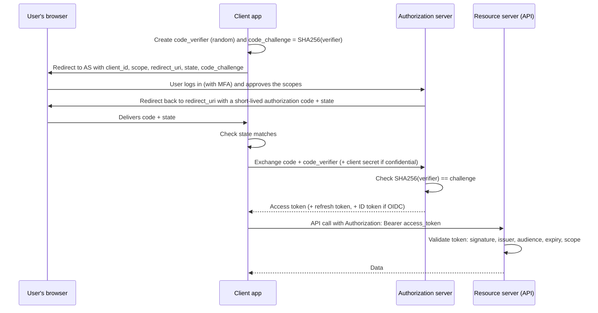

# OAuth and OIDC explained

> **14-minute read. Read [IAM explained](./iam-explained.md) first; this page assumes you know authentication vs authorization.**

## The one-line answer

[OAuth 2.0](../glossary.md#term-oauth-20) is a way for a user to let an app act on their behalf **without giving the app their password**: the app gets a limited, revocable access token instead. [OpenID Connect (OIDC)](../glossary.md#term-oidc-openid-connect) is a thin layer on top of OAuth that adds **login**: a signed ID token that says who the user is. Rule of thumb: OAuth answers "what may this app do?", OIDC answers "who is this user?". SAML is the older, XML-based way of doing the login part, still common in enterprise SSO.

## The problem OAuth solves

Before OAuth, if a photo-printing site wanted your pictures from another service, it asked for your username and password for that service. That gave the printing site everything: your email, your settings, the ability to change your password, forever, until you changed it.

OAuth replaced that with delegation. You log in at the service that holds your photos, it asks "Allow PrintCo to **read your photos**?", and if you agree, PrintCo receives a token that can read photos and nothing else, which expires, and which you can revoke without changing your password.

## The four roles

OAuth names four parties. Learning these names makes every diagram and spec readable.

| Role | Plain English | Example |
|---|---|---|
| **Resource owner** | The user who owns the data | You |
| **Client** | The app that wants access | PrintCo's web app |
| **Authorization server** | Logs the user in, asks for consent, issues tokens | Google's or Microsoft Entra ID's login service, Okta, Auth0, Amazon Cognito |
| **Resource server** | The API that holds the data and accepts tokens | The photos API |

## The authorization code flow with PKCE

There are several OAuth "flows" (grant types). In 2026 you need to know one for users and one for machines. For anything with a user (web apps, single-page apps, mobile apps) the answer is the **authorization code flow with PKCE**.

*The authorization code flow with PKCE: the browser only ever carries a one-time code, and only the app that started the flow can redeem it.*

Why each piece is there:

- **The redirect through the browser** means the user types their password only at the authorization server, never into the client app.
- **The authorization code** is short-lived and single-use. It travels through the browser, which is a risky place, so it is useless on its own.
- **PKCE** (Proof Key for Code Exchange, pronounced "pixie") binds the code to the app that started the flow. If malware or a malicious app intercepts the code, it cannot redeem it without the secret `code_verifier`. PKCE was designed for mobile apps and is now recommended for every client, including server-side web apps.
- **`state`** is a random value the client checks on return, which stops an attacker from injecting their own authorization response into your session (a form of cross-site request forgery).
- **The exact `redirect_uri`** must be pre-registered. If an authorization server allowed any redirect, codes could be sent to an attacker's site.

**[📖 RFC 7636: PKCE](https://datatracker.ietf.org/doc/html/rfc7636)** - the specification for Proof Key for Code Exchange

### For machines: client credentials

When no user is involved, a backend service authenticates **as itself** with the client credentials grant: it presents its client ID and a secret (or better, a signed assertion or certificate) and receives an access token. This is how service-to-service API calls work. Cloud workload identity federation is a close relative: a GitHub Actions job presents its OIDC token to AWS, Azure or GCP and receives short-lived cloud credentials, with no stored secret at all.

### Flows to avoid

- **Implicit flow** returned tokens directly in the browser URL. Tokens leaked into history, logs and referrer headers. Deprecated; use code + PKCE.
- **Resource owner password credentials** has the app collect the user's password, which defeats the purpose of OAuth. Deprecated.

**[📖 RFC 9700: OAuth 2.0 Security Best Current Practice](https://datatracker.ietf.org/doc/html/rfc9700)** - the current rules: PKCE everywhere, no implicit flow, exact redirect matching

## Tokens

### Access tokens

An access token is what the client presents to the API. It is usually a [bearer token](../glossary.md#term-bearer-token): whoever holds it can use it, like cash. That is why tokens must travel only over TLS, must not be logged, and should be short-lived (minutes to an hour).

Access tokens are often [JWTs](../glossary.md#term-jwt-json-web-token): a signed JSON document with claims like issuer (`iss`), audience (`aud`), subject (`sub`), expiry (`exp`) and scopes. The API validates the signature with the authorization server's public keys, so it does not need to call back for every request. Some servers issue opaque tokens instead, which the API checks by calling an introspection endpoint.

### Scopes

Scopes are the permissions requested, such as `photos.read` or `calendar.write`. They limit what the **client** can do on the user's behalf. They are not a replacement for your own authorization logic: a token with `orders.read` should still only read *that user's* orders.

### Refresh tokens

Because access tokens are short-lived, the client gets a longer-lived refresh token to obtain new ones without bothering the user. Refresh tokens are high-value secrets. Store them server-side where possible, rotate them on every use (so a stolen one is detected when both the attacker and the real app try to use it), and revoke them on logout or password change.

## OIDC: adding login

OAuth deliberately says nothing about who the user is. An access token is meant for the API, not for the client to read. Teams that used OAuth alone for "Log in with X" built fragile and sometimes insecure logins.

OIDC fixes this by adding:

- **The `openid` scope**, which turns an OAuth request into an OIDC login.
- **The ID token**, a signed JWT for the **client** that states who logged in (`sub`), who issued it (`iss`), who it is for (`aud` = your client ID), when it expires, and optionally a `nonce` the client sent to prevent replay.
- **The UserInfo endpoint** for extra profile claims.
- **Discovery** (`/.well-known/openid-configuration`) so clients can find endpoints and signing keys automatically.

**[📖 OpenID Connect Core 1.0](https://openid.net/specs/openid-connect-core-1_0.html)** - the OIDC specification

| | Access token | ID token |
|---|---|---|
| Audience | The API (resource server) | The client app |
| Purpose | Authorize API calls | Prove who logged in |
| Who validates it | The API | The client |
| Send it to an API? | Yes | No |

## Where SAML fits

SAML 2.0 does the same job as OIDC (federated single sign-on) with signed XML assertions passed through browser redirects and form posts. It dominates older enterprise SSO: connecting your company identity provider to Salesforce, AWS IAM Identity Center or a payroll system. OIDC is simpler, JSON-based and works for mobile and APIs, so new integrations usually choose it. Many identity providers speak both. If a question involves "enterprise SSO to a SaaS app" both are valid; if it involves "mobile app" or "API access", the answer is OAuth/OIDC.

## Validating tokens: the checks that matter

Most real OAuth and OIDC vulnerabilities are validation mistakes, not flaws in the protocol. An API or client must:

1. **Verify the signature** using the issuer's published keys, and only accept the expected algorithms. Never accept `alg: none`.
2. **Check the issuer (`iss`)** is the authorization server you trust.
3. **Check the audience (`aud`)** is *you*. A token minted for a different app at the same identity provider must be rejected, or one app's token unlocks every other app.
4. **Check expiry (`exp`)** and not-before (`nbf`), allowing a small clock skew.
5. **Check scopes or roles** for the specific action.
6. **For ID tokens, check the `nonce`** matches what you sent.

Use a maintained library or your framework's middleware for all of this.

## Common mistakes

- **Using an access token as proof of login.** Use the ID token, validated, for login.
- **Skipping the audience check.** The most common serious JWT bug.
- **Storing tokens in browser `localStorage`.** Any cross-site scripting bug can read them. Prefer a backend-for-frontend pattern that keeps tokens server-side and gives the browser an `HttpOnly`, `Secure`, `SameSite` session cookie.
- **Wildcard or loosely matched redirect URIs.** Register exact URIs.
- **Over-broad scopes.** Requesting `admin` because it is easier, then storing the token somewhere weak.
- **Long-lived access tokens** with no revocation story.
- **Building your own authorization server.** Use a managed identity provider unless identity is your product.

## How exams test this

- **Security+ and ISC2 CC**: what federation and SSO are, which protocol does what (OAuth = authorization, OIDC and SAML = authentication), and token concepts at a high level.
- **Azure SC-300**: app registrations, enterprise apps, consent, scopes vs app roles, and which flow fits which app type.
- **AWS and GCP security exams**: Cognito user pools vs identity pools, workload identity federation, and federating a corporate IdP with SAML or OIDC.
- **CISSP and CCSP**: federation trust models, assertion vs token concepts, and the risks of each.

A reliable heuristic: if the scenario says "a third-party app needs limited access to a user's data", the answer is OAuth. If it says "users should log in with their corporate account", the answer is SAML or OIDC federation.

## What to look at next

- **[MFA and passkeys](./mfa-and-passkeys.md)** - what happens at the authorization server before a token is issued
- **[Least privilege explained](./least-privilege-explained.md)** - keeping scopes and roles small
- **[Identity and IAM services compared](../../resources/service-comparison-identity-iam.md)** - Entra ID, Cognito, Cloud Identity and friends
- **[OWASP Top 10 explained](./owasp-top-10-explained.md)** - authentication failures and broken access control in web apps
