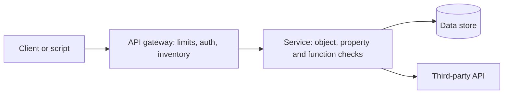

# OWASP API Security Top 10 explained

> **12-minute read. Written for builders and defenders of APIs. Helps to know the [OWASP Top 10](./owasp-top-10-explained.md) and basic HTTP.**

## The one-line answer

The OWASP API Security Top 10 is a separate list from the web Top 10. It covers the ten most important risks specific to APIs, where the client is code, the data comes back as raw objects, and most flaws are about who may do what, not about injection. This page follows the **2023 edition**. It is a shared vocabulary and priority list, not a checklist you can pass.

**[📖 OWASP API Security Top 10 (2023)](https://api-security.owasp.org/editions/2023/en/0x11-t10)** - the official list with a full write-up of each risk

## Why APIs get their own list

A web page hides the data model behind HTML. An API hands it over as JSON. Attackers (and your own mobile app) can call any endpoint directly, change any ID and read any field. So authorization mistakes that a UI would hide are fully visible. Three of the ten risks below (API1, API3, API5) are authorization problems.

## The ten, from a defender's point of view

| ID | Name | In plain English |
|---|---|---|
| API1 | Broken Object Level Authorization | Endpoints that take an object ID let a user reach objects that are not theirs |
| API2 | Broken Authentication | Weak login or token handling lets someone impersonate a user |
| API3 | Broken Object Property Level Authorization | Individual fields are exposed or changeable when they should not be |
| API4 | Unrestricted Resource Consumption | No limits on bandwidth, CPU, memory, storage or paid third-party calls |
| API5 | Broken Function Level Authorization | Unclear split between admin and normal functions lets users call the wrong ones |
| API6 | Unrestricted Access to Sensitive Business Flows | A flow such as purchasing or posting is abused at scale by automation |
| API7 | Server Side Request Forgery | The API fetches a user-supplied URL and is pointed at places it should not go |
| API8 | Security Misconfiguration | Complex settings are missed or left at unsafe values |
| API9 | Improper Inventory Management | Old versions, debug endpoints and undocumented hosts stay exposed |
| API10 | Unsafe Consumption of APIs | Data from third-party APIs is trusted more than user input |

The descriptions are our summaries of the official text.

## What to do about each group

### Authorization (API1, API3, API5)

- Check ownership on the server for **every** object access. "Is logged in" is not enough.
- Return only the fields the caller may see. Do not return the whole database row and hope the client hides parts.
- Do not bind request bodies straight onto internal objects. Allowlist the fields a caller may set.
- Separate admin functions clearly, and deny by default.
- Test it: write tests that call as user A for user B's object and expect a 403 or 404.

### Authentication (API2)

- Use a proven identity provider and standard flows. See [OAuth and OIDC explained](./oauth-and-oidc-explained.md).
- Rate limit login and password-reset endpoints. Use [MFA](./mfa-and-passkeys.md) where you can.
- Keep tokens short-lived and validate signature, issuer, audience and expiry on every call.

### Limits and abuse (API4, API6)

- Set rate limits, payload size limits, pagination caps and timeouts.
- Set spending caps on any paid downstream service you call.
- For business flows, ask "what if a script did this a million times?" Think ticket buying, coupon use, account creation. Add friction, per-account limits and monitoring for the flows that matter.

### Outbound requests and third parties (API7, API10)

- Allowlist the destinations your server may fetch. Block internal and metadata addresses.
- Treat responses from partner APIs as untrusted input: validate, size-limit and do not follow their redirects blindly.

### Configuration and inventory (API8, API9)

- Keep an inventory of every API host, version and environment. Retire old versions on a schedule.
- Turn off debug features and verbose errors in production. Lock down CORS. Use TLS everywhere ([TLS and HTTPS](./tls-and-https.md)).
- Generate documentation from the API definition so the docs and the real API cannot drift apart.

## How the risks line up on one request

The diagram shows where each control sits. The gateway handles authentication, rate limits and the inventory of what is exposed. The service handles the object, property and function authorization checks that a gateway cannot know. Calls to third parties go back out from the service and must be treated as untrusted input.

## How it fits with other pages

- The web list overlaps: see [OWASP Top 10 explained](./owasp-top-10-explained.md).
- Find these flaws early with [threat modeling](./threat-modeling-explained.md) and in the pipeline with [secure SDLC and DevSecOps](./secure-sdlc-and-devsecops.md).
- Log denied calls and spikes so you can see abuse: [Logging and detection](./logging-and-detection.md).

## Quick self-check

1. Which two checks does a request for `/invoices/1042` need? (Who are you, and does 1042 belong to you.)
2. Why is rate limiting a security control and not only a performance one? (API4 and API6.)
3. Why is a gateway alone not enough for API1? (It does not know who owns which object.)
