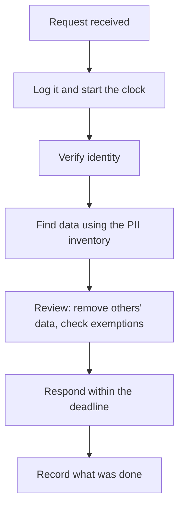

# Privacy engineering basics

> **12-minute read. Written for engineers who must build privacy into systems. This is not legal advice. Ask counsel about your legal duties.**

## The one-line answer

Privacy engineering turns privacy principles into things you build: collect less, know where personal data lives, keep it for a limited time, and be able to find, correct, export or delete a person's data when they ask. Security keeps data from the wrong people. Privacy also asks whether you should hold it at all.

**[📖 NIST Privacy Framework](https://www.nist.gov/privacy-framework)** - a voluntary tool to help organisations manage privacy risk through enterprise risk management (Version 1.0 is current; NIST lists 1.1 as an initial public draft)

**[📖 GDPR guide on this site](../../resources/compliance-guides/gdpr.md)** - the regulation in more detail

## Three ideas to start with

GDPR Article 5 states the principles behind most privacy engineering (text read at [gdpr-info.eu](https://gdpr-info.eu/art-5-gdpr/), a reproduction of the regulation):

- **Purpose limitation:** collect for specified, explicit and legitimate purposes, and do not use the data in conflicting ways later.
- **Data minimisation:** personal data must be adequate, relevant and limited to what is necessary.
- **Storage limitation:** keep identifiable data no longer than necessary for the purpose.

## Data minimisation in practice

- **Ask for each field:** what decision or feature needs this? If none, do not collect it.
- **Use less precise data:** a birth year instead of a full date, a city instead of an address.
- **Keep it out of logs and analytics.** Logs are a common place for stray personal data. Mask emails and tokens.
- **Delete on a schedule.** Set a retention period per data type and enforce it in code, not by memory.
- **Separate identity from activity.** Use internal IDs, and keep the lookup table in a tighter store.
- **Test and dev data:** use synthetic or masked data, not production copies.

## Build a PII inventory

You cannot protect, minimise or delete data you cannot find. Start with an inventory.

For each system or data store, record:

1. What personal data it holds (categories, such as contact details, payment, health).
2. Whose data it is (customers, staff, children).
3. Why you hold it (the purpose) and the lawful basis, if GDPR applies.
4. Where it came from and where it goes (processors, third parties, other countries).
5. How long you keep it.
6. How it is protected and who has access.

GDPR Article 30 requires records of processing for controllers with items like these: purposes, categories of data subjects and data, recipients, third-country transfers, planned erasure time limits and a general description of security measures (where possible). Check Article 30 and counsel for whether and how it applies to you.

Ways to find data: ask system owners, read schemas and API definitions, use data discovery tools (see [Data loss prevention explained](./data-loss-prevention-explained.md)), and re-check when systems change.

## Handling data subject access requests (DSARs)

People can ask what you hold about them and ask for it to be corrected or deleted. GDPR Article 12(3) says you must respond to such requests without undue delay and within one month of receipt. You may extend by two further months for complex or numerous requests, but you must tell the person within the first month and give reasons (text read at [gdpr-info.eu](https://gdpr-info.eu/art-12-gdpr/)). Rules differ by law and by right, so confirm with counsel.

A workable process:

The diagram shows one request from arrival to record. The clock starts when the request arrives, not when you verify identity or find the data, so log it on day one. The PII inventory is what makes the "find data" step possible.

Practical points:

- Give staff a single intake address and train everyone to forward requests there at once.
- Verify identity in a way that does not collect more personal data than needed.
- Build export and delete as features, including backups, logs and processors' copies. Decide and document how backups are handled.
- Review the output before sending so one person's data does not leak another's.
- Keep a record of every request, outcome and date.

## Privacy by design in the build cycle

- Add a short **privacy review** to design: what new data, why, how long, who sees it. A [threat model](./threat-modeling-explained.md) can include privacy harms.
- Make the **privacy-friendly option the default**.
- **Encrypt** data and restrict access: [Encryption explained](./encryption-explained.md), [Least privilege explained](./least-privilege-explained.md).
- Plan for breaches: [Incident response basics](./incident-response-basics.md).
- Run checks in the pipeline where possible: [Secure SDLC and DevSecOps](./secure-sdlc-and-devsecops.md).

## Unverified

We did not check US state privacy laws or non-EU rules for this page. The GDPR text was read through a reproduction site, not the Official Journal. For legal work, use the official text.
