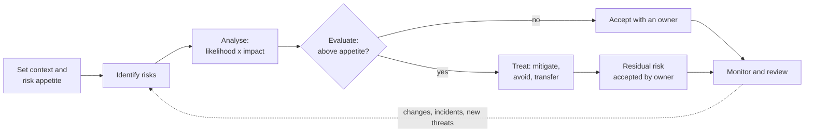

# Risk management basics

> **14-minute read. No prerequisites. [Threat modeling explained](./threat-modeling-explained.md) is the system-level version of the same thinking.**

## The one-line answer

Security risk management is how an organisation decides **which bad things to spend money and effort preventing, and which to live with**. You identify risks, estimate how likely and how damaging each one is, compare that with how much risk the business is willing to accept, and then choose a response: reduce it, avoid it, transfer it or accept it. The output is a **risk register** of decisions with owners, not a list of worries.

## Why it matters

No organisation can fix everything. There are always more vulnerabilities, missing controls and audit findings than people and budget. Without risk management, effort goes to whatever is loudest: the latest headline, the most persistent vendor, the auditor's last comment. Risk management makes the trade-offs explicit and puts them in business language, which is the language executives use to allocate money.

It is also the core of almost every framework. [ISO 27001](../../resources/compliance-guides/iso-27001.md) is built around a risk assessment, the [NIST CSF](../../resources/compliance-guides/nist-csf.md) Govern function asks for a risk management strategy, and regulations like [NIS2](../../resources/compliance-guides/nis2.md) and [DORA](../../resources/compliance-guides/dora.md) require "appropriate and proportionate" measures, which means measures chosen by risk.

## The vocabulary

These terms are used precisely in exams and in audits:

- **Asset**: anything of value: data, systems, people, reputation.
- **Threat**: something that could cause harm (a ransomware group, a flood, a careless admin).
- **Vulnerability**: a weakness a threat could exploit (an unpatched server, no MFA, a single data centre).
- **Likelihood**: how probable it is that a threat exploits a vulnerability in a given period.
- **Impact**: how bad it is if it happens.
- **Risk** = the combination of likelihood and impact for a threat acting on a vulnerability affecting an asset.
- **Control**: a safeguard that reduces likelihood or impact.
- **Inherent risk**: risk before controls. **Residual risk**: risk left after controls.
- **Risk appetite**: how much risk the organisation is willing to pursue or retain overall, set by leadership. **Risk tolerance**: the acceptable variation around that, often per category ("no more than 4 hours of outage for the payments platform").

## The process

*The risk management cycle: context sets the appetite, each identified risk is analysed and compared with it, treated or accepted by a named owner, and the register is reviewed as things change.*

This cycle is the same in ISO 31000 (general risk management), ISO/IEC 27005 (information security risk) and NIST SP 800-30 / 800-37 (risk assessment and the Risk Management Framework), with different names for the boxes.

## Qualitative vs quantitative analysis

### Qualitative: the heat map

Most organisations rate likelihood and impact on a 1-5 scale with defined meanings, and multiply or look up the score in a matrix:

| Likelihood \ Impact | 1 Minimal | 2 Minor | 3 Moderate | 4 Major | 5 Severe |
|---|---|---|---|---|---|
| **5 Almost certain** | 5 | 10 | 15 | 20 | 25 |
| **4 Likely** | 4 | 8 | 12 | 16 | 20 |
| **3 Possible** | 3 | 6 | 9 | 12 | 15 |
| **2 Unlikely** | 2 | 4 | 6 | 8 | 10 |
| **1 Rare** | 1 | 2 | 3 | 4 | 5 |

Fast and easy to explain, but subjective, and two people often score the same risk differently. **Define the scale in business terms** ("Major = over $1M loss or a regulator notification") to reduce the guessing.

### Quantitative: putting money on it

The classic formulas, still examined everywhere:

- **SLE (single loss expectancy)** = asset value (AV) x exposure factor (EF, the fraction of the asset lost in one event).
- **ARO (annualised rate of occurrence)** = how many times a year you expect it.
- **ALE (annualised loss expectancy)** = SLE x ARO.

A control is worth buying when the reduction in ALE is greater than the control's annual cost.

Modern quantitative methods such as **FAIR** (Factor Analysis of Information Risk) use ranges and simulations instead of single numbers ("between $200k and $2M, most likely $600k"), which is more honest about uncertainty.

## The four responses

| Response | Also called | What it means | Example |
|---|---|---|---|
| **Mitigate** | Reduce, modify | Add controls to lower likelihood or impact | Enforce phishing-resistant MFA |
| **Avoid** | Eliminate | Stop the activity that creates the risk | Stop storing card numbers; use a payment provider's hosted page |
| **Transfer** | Share | Shift the financial impact to someone else | Cyber insurance, a contract clause, a managed service |
| **Accept** | Retain, tolerate | Consciously live with it | A legacy system with no fix, isolated, accepted until its 2027 retirement |

Two exam favourites: **transferring does not transfer accountability** (if your provider leaks your customers' data, your customers and regulator still come to you), and **ignoring a risk is not accepting it**. Acceptance is a decision by someone with the authority to make it, recorded with a reason and an expiry date.

## The risk register

Every risk becomes a row. A minimal register:

| Field | Example |
|---|---|
| ID and title | R-014: Ransomware encrypts production and backups |
| Description | Attacker with domain admin deletes backups and encrypts servers |
| Owner | Head of Infrastructure (a business-accountable person, not "Security") |
| Inherent rating | Likelihood 4, Impact 5 = 20 |
| Controls | EDR on all servers; immutable backups in separate account; tested restore |
| Residual rating | Likelihood 2, Impact 4 = 8 |
| Treatment | Mitigate; remaining risk accepted |
| Review date | 2027-04-01 |

## A worked example: three risks, one budget

A 200-person SaaS company has $150,000 for security improvements this year. The risk workshop produces, among others:

1. **Account takeover of admins via phishing.** Likelihood 4, Impact 5 = **20**. Phishing-resistant MFA (hardware keys and passkeys) for all admins and engineers costs about $15,000. Residual: 2 x 5 = 10.
2. **Ransomware destroys production and backups.** Likelihood 3, Impact 5 = **15**. Immutable cross-account backups plus restore testing cost about $25,000 a year. Residual: 3 x 2 = 6, because even if it happens the company recovers in hours.
3. **Office building flood.** Likelihood 2, Impact 2 = **4**. Everyone can work remotely and nothing critical runs in the office. **Accept**, reviewed yearly.

Quantitatively for risk 2: the company estimates a successful attack would cost $2M (SLE) and expects one every ten years (ARO 0.1), so ALE = $200,000. With immutable backups, SLE drops to about $300,000 (downtime and response, no data loss) and ALE to $30,000. The control saves $170,000 a year for $25,000. That sentence gets budget approved; "we need immutable backups for security" often does not.

The remaining budget goes to the next risks on the register by residual score, and everything below the appetite line is documented as accepted.

## Third-party risk in brief

Your suppliers' risks are your risks. **Third-party risk management** (TPRM) applies the same cycle to vendors: tier them by how much access and data they have, assess the important ones (questionnaires, [SOC 2](../../resources/compliance-guides/soc2.md) reports, ISO certificates), put security requirements in contracts, and reassess periodically. DORA and NIS2 both make supply-chain risk a legal duty for regulated organisations.

**[📖 NIST SP 800-30 Rev. 1: Guide for Conducting Risk Assessments](https://csrc.nist.gov/pubs/sp/800/30/r1/final)** - the risk model, likelihood and impact scales, and the assessment process

**[📖 NIST SP 800-37 Rev. 2: Risk Management Framework](https://csrc.nist.gov/pubs/sp/800/37/r2/final)** - the seven-step RMF used across US federal systems

**[📖 The FAIR Institute](https://www.fairinstitute.org/what-is-fair)** - the quantitative model for information risk

## Common mistakes

- **"Security" owning every risk.** Risks belong to the business owner of the asset or process; security advises and measures.
- **Heat maps with no definitions.** A "4" that means different things to different people is noise.
- **A register that never changes.** Built for the audit, then forgotten. Review it when incidents happen, systems change and threats shift.
- **Accepting risks with no expiry.** Temporary exceptions become permanent. Every acceptance needs a review date.
- **Treating compliance as the risk assessment.** Passing an audit means you meet a framework's minimum, not that your biggest risks are handled.
- **False precision.** "ALE = $412,337" implies a certainty nobody has. Use ranges.

## How exams test this

- **CISSP**: the vocabulary (threat, vulnerability, risk, inherent vs residual), SLE / ARO / ALE calculations, qualitative vs quantitative analysis, the four responses, the NIST RMF steps, and supply chain risk management. Expect a calculation and several "what should the security manager do FIRST" questions where the answer is a risk assessment.
- **CISM**: risk management is a whole domain: risk appetite and tolerance, risk ownership, treatment options, and communicating risk to the board. Answers favour aligning with business objectives.
- **CISA**: auditing the risk management process: is the method documented, followed and reviewed?
- **Security+**: risk identification, analysis (qualitative vs quantitative, SLE / ARO / ALE), registers, appetite and tolerance, and third-party risk assessment.

## What to look at next

- **[Threat modeling explained](./threat-modeling-explained.md)** - finding the risks in a specific system's design
- **[Vulnerability management](./vulnerability-management.md)** - risk-based prioritisation applied to patching
- **[ISO 27001 guide](../../resources/compliance-guides/iso-27001.md)** - a whole certification built on the risk process
