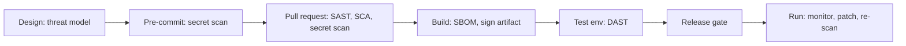

# Secure SDLC and DevSecOps

> **12-minute read. Written for engineers and defenders who want security checks built into delivery, not bolted on at the end.**

## The one-line answer

A secure software development life cycle (secure SDLC) means security work happens at every stage of building software: design, code, build, test, release and run. DevSecOps is the same idea applied to fast, automated delivery: the checks run inside the CI/CD pipeline, so a developer gets feedback in minutes and not in a report weeks later. The common name for this is "shift left": find the flaw where it is cheapest to fix.

**[📖 NIST SP 800-218, Secure Software Development Framework (SSDF) v1.1](https://csrc.nist.gov/pubs/sp/800/218/final)** - a core set of high-level secure development practices that can be added to any SDLC model (February 2022)

**[📖 OWASP DevSecOps Guideline](https://owasp.github.io/www-project-devsecops-guideline/latest)** - lists secrets management under pre-commit, and SAST, DAST, IAST and SCA under vulnerability scanning

## The four kinds of automated check

| Check | Looks at | Finds | Weak spot |
|---|---|---|---|
| **Secret scanning** | Code, commits, config | Keys, tokens and passwords in the repo | Only finds what its patterns know |
| **SAST** (static analysis) | Source code, not running | Injection patterns, unsafe functions | False positives; cannot see runtime config |
| **SCA** (software composition analysis) | Your dependencies | Known-vulnerable libraries, bad licences | Only known issues; needs a good inventory |
| **DAST** (dynamic analysis) | A running app, from outside | Real behaviour: missing headers, injection, broken auth flows | Slower; only tests what it can reach |

IAST (interactive testing) sits inside a running app during tests. We leave it out of the table because its tooling varies widely.

## Where each runs in CI

The OWASP guideline puts secrets management first (under pre-commit) and the scanners after it. The exact placement below is our practical suggestion, not an OWASP rule. Adjust to your pipeline speed.

The diagram shows the checks in order. Fast checks (secrets, SAST, SCA) run on every pull request so developers see results while the change is fresh. Slow checks (DAST) run against a deployed test environment. After release, scanning continues, because new vulnerabilities are published against old code.

## Stage by stage

1. **Design.** Do a short [threat model](./threat-modeling-explained.md) for any new feature that handles data or identity. Write down abuse cases next to use cases.
2. **Pre-commit and pull request.** Run secret scanning on the developer's machine and again in CI, since a local hook can be skipped. If a secret leaks, rotate it. Removing it from history is not enough. See [Secrets management](./secrets-management.md).
3. **Pull request.** Run SAST and SCA. Show findings in the pull request, not in a separate portal nobody opens.
4. **Build.** Produce an SBOM, pin dependencies and sign artifacts. See [Software supply chain security](./software-supply-chain-security.md). Protect the pipeline itself like production.
5. **Test environment.** Run DAST against a deployed copy, never against production without agreement.
6. **Release.** Gate on policy, for example "no new critical findings with a known fix".
7. **Run.** Re-scan images and dependencies on a schedule and feed findings into [vulnerability management](./vulnerability-management.md).

## Making it stick

- **Start with blocking only the worst.** If the first scan blocks every build with 400 findings, teams will turn it off. Block new critical findings, report the rest, and shrink the backlog over time.
- **Tune for false positives.** An ignored scanner is worse than none. Let developers mark a finding as a false positive with a reason that is reviewed.
- **Measure.** Time from finding to fix, and findings that escape to production, tell you more than counts of scans run.
- **Give an owner.** Every finding needs a team, a severity and a date.
- **Cover the pipeline.** Protect branches, require reviews, and keep CI credentials short-lived.

## Honest limits

No scanner replaces design review or a person reading risky code. Tool categories overlap and vendors name them differently, so judge a tool by what it finds in your code, not its label.

## Where it leads

- Web risks these tools look for: [OWASP Top 10 explained](./owasp-top-10-explained.md) and [OWASP API Security Top 10 explained](./owasp-api-security-top-10-explained.md).
- Runtime protection of the result: [Security headers and CSP](./security-headers-and-csp.md).
