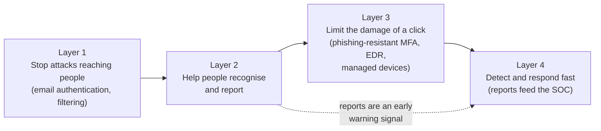

# Security awareness training

> **15-minute read. No prerequisites. [Phishing and social engineering](./phishing-and-social-engineering.md) covers the attacks; this page covers the programme that helps people deal with them, and how to tell whether it works.**

## The one-line answer

A security awareness programme exists to **change what people do**, not what they know: report the odd email quickly, verify before paying a changed invoice, use the password manager, lock the screen. Annual slide decks and click-rate scoreboards mostly fail at that. What works is narrower and more practical: short training delivered at the moment it is relevant, processes that make the safe action the easy one, a reporting button people actually use, and a culture where admitting a mistake is rewarded. Awareness is one layer of defence, never the only one; the technical controls underneath it are what make an occasional human mistake survivable.

## Why it matters

Almost every serious incident has a human step in it somewhere: a password typed into a fake page, an approved MFA prompt, a help-desk reset for a caller who sounded right, a payment sent to new bank details. Attackers aim at people because people are flexible, helpful and busy, and no patch changes that.

Every major framework therefore asks for an awareness programme, and auditors will check that one exists. That creates a trap. It is easy to build a programme that satisfies the auditor (everyone clicked through the annual module, here is the completion report) and changes nothing about how people behave. The rest of this page is about building the other kind.

## What awareness can and cannot do

Start with a realistic goal. Training will never make everyone spot every phishing email. Phishing emails can be written to be indistinguishable from real ones, and people read email quickly between other tasks. The UK National Cyber Security Centre's phishing guidance says plainly that no one can spot every phish, and recommends a layered defence in which helping users identify and report phishing is only one of four layers, alongside stopping mail reaching them, limiting the damage when someone clicks, and responding quickly.

That framing changes what you ask of people:

- **Not** "never click on anything suspicious", which is impossible, but **"report quickly when something seems off, including when you already clicked"**.
- **Not** "be able to recognise every scam", but **"know the handful of requests that always need a second check"**: changes to bank details, urgent payments, password or MFA resets, requests to bypass a normal process, and anything asking for a login after you clicked a link.
- **Not** "be the last line of defence", but **"be one of the sensors"**. A workforce that reports quickly gives the security team early warning that no filter provides.

*The diagram shows awareness as the second of four layers in a phishing defence, following the NCSC model. The first layer stops most attacks before they reach anyone. Awareness helps people recognise and report what gets through. The third layer makes a successful click less harmful, and the fourth detects and responds. The dotted line shows why reporting matters: each report is a detection signal that feeds the response layer.*

## Phishing and social engineering, from the programme's side

You do not need to teach people every attack type; you need to teach the patterns that recur, tied to their job. The common shapes (details in [Phishing and social engineering](./phishing-and-social-engineering.md)):

- **Credential phishing**: a link to a fake login page. The defence you teach: if a link leads to a login page, close it and go to the service directly. The control behind it: [phishing-resistant MFA](./mfa-and-passkeys.md), which a fake page cannot relay.
- **Business email compromise**: "please update our bank details". The defence you teach: always verify payment changes by calling a number you already have. The control behind it: a finance process that requires that callback and a second approver.
- **MFA fatigue and unexpected prompts**: the defence you teach: if you did not just try to log in, deny it and report it. The control behind it: number matching or passkeys.
- **Help-desk impersonation**: the defence you teach to help-desk staff: verification steps that do not rely on facts an attacker can look up. The control behind it: a documented reset process with callback or manager approval.
- **Voice and video deepfakes**: the defence you teach: an urgent request from a senior person over an unusual channel gets verified through a known channel, however real it sounds.

Notice the pattern. Each behaviour you teach is paired with a process or technical control that makes the behaviour easy and backs it up when people forget. Training that asks people to do something the process does not support ("verify payment changes", with no approved way to do it) fails.

## Role-based content

A finance clerk, a developer and a help-desk analyst face different attacks. One generic module for everyone wastes most people's time and under-prepares the people most targeted. A sensible split:

| Audience | What they need |
|---|---|
| Everyone | How to report, the few requests that always need verification, password manager and MFA basics, what to do after a mistake |
| Finance and procurement | Business email compromise, invoice fraud, verification callbacks, two-person approval |
| Help desk and IT support | Impersonation, identity verification for resets, refusing pressure |
| Executives and their assistants | Targeted phishing, deepfake voice and video, travel and public exposure |
| Developers and engineers | Fake package and repository notifications, OAuth consent phishing, secrets in code, token theft |
| Administrators | Why privileged accounts are targeted, separate admin accounts, phishing-resistant MFA |

NIST CSF 2.0 makes the same split: one outcome for general awareness of all personnel (PR.AT-01) and a separate one for people in specialised roles (PR.AT-02).

## Just-in-time training

The most effective moment to teach someone is when they are about to make the decision. Examples:

- A banner on external emails, and a stronger one when the sender's display name matches an internal executive but the address is external.
- A prompt when someone tries to grant a third-party app access to their mailbox, explaining what consent means.
- A short explanation shown when the password manager notices you are about to type a saved password into a site that does not match.
- A two-minute module triggered when someone joins finance, gets admin rights or starts handling card data, rather than waiting for the next annual cycle.
- A brief, friendly explanation after someone reports a real phish, telling them what it was and that it helped.

Just-in-time content is short, specific and about a decision the person is making now. That is the opposite of a 45-minute annual course covering everything, which people complete in the background and forget within weeks.

## Measuring behaviour change, not click rates

### Why click rate is a poor metric

Most programmes report one number: the percentage of staff who clicked a simulated phishing email. It is easy to measure and misleading:

- **It mostly measures the email, not the people.** Click rates depend heavily on how hard the lure is. NIST's Phish Scale was created precisely because of this: it rates a simulated phish by its visible cues and by how well its premise fits the audience, so that a high click rate on a very convincing message is not read as a failing workforce. A programme can "improve" its click rate simply by sending easier emails.
- **It counts a click as the failure**, when the harm usually comes later: credentials entered, an attachment run, a payment made. And it ignores whether the person then reported it.
- **It rewards the wrong thing.** A department that never opens email from outside looks great; a department that reports everything, including the occasional mistake, looks worse.

The evidence on simulation-and-training cycles is sobering. A 2025 randomised study by researchers at UC San Diego and the University of Chicago, run over eight months with ten simulated phishing campaigns sent to more than 19,500 staff at UC San Diego Health, found no significant relationship between recently completing annual awareness training and failing a simulation. Embedded training (the page shown after someone clicks a simulated phish) reduced failure rates by an average of only about 1.7 percentage points compared with a control group. Most users spent very little time on the training page, and failure rates varied from under 2% to over 30% depending on the lure. The authors concluded that phishing training "in their current and commonly deployed forms" is unlikely to offer significant practical value on its own.

That does not mean awareness is pointless. It means awareness measured by click rate and delivered as annual modules plus "gotcha" pages is weak, and the stronger levers are the technical controls and the reporting culture.

### Better measures

| Measure | Why it is better |
|---|---|
| **Reporting rate** (share of recipients who report a simulated or real phish) | Measures the behaviour you want; a rising rate means more sensors |
| **Time to first report** of a real phishing campaign | Measures how fast the organisation can react; the first report is what lets the SOC pull the message from every inbox |
| **Report-to-click ratio** | Rewards departments that report more than they click |
| **Real-world outcomes**: payment fraud attempts stopped by callback, help-desk resets refused, MFA prompts denied and reported | Measures behaviour in the situations that cost money |
| **Credential entry rate** (not just click rate) on simulations | Closer to actual harm, and should fall to near zero once phishing-resistant MFA is in place |
| **Repeat behaviour** among a small group | Points to people who need a conversation and support, or a process that keeps tripping them up |
| **Self-reported mistakes** | A rising count is a sign of trust, not of a worse workforce |

Pick a few, trend them over quarters, and report them to leadership alongside completion rates. Completion proves the auditor's box is ticked; behaviour measures prove the programme is doing something.

## Reporting culture

Reporting is the single behaviour that matters most, so make it effortless and rewarding:

- **One button.** A "Report phishing" button in every mail client, on desktop and mobile, that sends the message with headers to the security team or an automated triage tool.
- **Close the loop.** Every report gets a reply, ideally automated within minutes: "thanks, this was a real phish and we removed it from 42 inboxes" or "thanks, this one was legitimate". People keep reporting when they see it matters.
- **Report mistakes too.** Make it explicit that "I clicked and typed my password" is the most valuable report anyone can make, because it starts the clock on resetting the account.
- **Make the help channel obvious.** Staff should know one place to ask "is this real?" for texts, calls and messages, not only email.
- **Thank people publicly** for good catches, with their permission.

## Why blame backfires

Punishing people who click (naming them, mandatory remedial training framed as punishment, disciplinary threats) feels like accountability. It produces the opposite of what you need:

- **People stop reporting.** Someone who fears consequences for clicking will hope the problem goes away rather than admit it. The NCSC guidance makes this point directly: staff who are afraid for their jobs will not report mistakes. The minutes between a mistake and its report are when a click becomes a breach.
- **It erodes trust in the security team**, which then hears less about everything, from suspicious calls to shadow IT.
- **It treats a design problem as a people problem.** If people keep approving fraudulent payments, the payment process is too easy to abuse. If people keep entering passwords on fake pages, the login method is phishable.
- **It is unfair.** Simulations are designed to fool people. Penalising someone for being fooled by a test built to fool them is entrapment, not training.

The alternative is the approach used in blameless postmortems: assume people acted reasonably with the information they had, ask what in the system made the mistake easy, and fix that. Persistent problems with one person are handled privately and supportively, as a performance and support conversation, not a public scoreboard.

## Running a programme: the life cycle

NIST SP 800-50 Revision 1 (September 2024, *Building a Cybersecurity and Privacy Learning Program*) replaced the 2003 awareness guide and frames the work as a life cycle aimed at behaviour change and culture, with metrics feeding continuous improvement. In practice:

1. **Assess.** What attacks actually hit you (look at your reported phish, fraud attempts and incidents)? Which roles are most targeted? What does the organisation require (frameworks, contracts, regulators)?
2. **Design.** Choose a small set of behaviours per audience. Pair each with the process or control that supports it.
3. **Build and deliver.** Short modules, just-in-time prompts, onboarding content, role-specific sessions, and occasional simulations used to practise reporting, not to catch people.
4. **Measure.** Reporting rate, time to report, real-world outcomes, credential entry, as above.
5. **Improve.** Retire content nobody needs, add content for new attack patterns, fix the processes that keep causing mistakes. Review the whole programme at least yearly.

### Using simulations well

If you run phishing simulations:

- Use them to **practise reporting**, and measure reporting first.
- Rate the difficulty of each lure (the NIST Phish Scale is one method) so results are compared fairly over time.
- Avoid lures that cause real distress or damage trust (fake bonuses, fake layoffs, fake health alerts). The short-term click is not worth the long-term resentment.
- Tell staff simulations happen, and why. The goal is skill, not surprise.
- Never use results for discipline. Use them to find where processes or controls need work.

## The human layer in frameworks

Every major framework requires awareness, and most now push beyond completion counts:

| Framework | Requirement | What it emphasises |
|---|---|---|
| **[NIST CSF 2.0](../../resources/compliance-guides/nist-csf.md)** | Protect function, Awareness and Training category: PR.AT-01 (all personnel) and PR.AT-02 (specialised roles) | Awareness so people can perform their tasks with cybersecurity risk in mind, including recognising social engineering and reporting it; role-based training for specialised roles |
| **NIST SP 800-50 Rev. 1** | Guidance for building a cybersecurity and privacy learning programme | Life-cycle approach, behaviour change, culture, metrics and continuous improvement |
| **[ISO/IEC 27001:2022](../../resources/compliance-guides/iso-27001.md)** | Annex A control 6.3, *Information security awareness, education and training*; also clause 7.3 (Awareness) | Appropriate awareness, education and training, and regular updates on policies, relevant to each person's job |
| **[PCI DSS v4.0.1](../../resources/compliance-guides/pci-dss.md)** | Requirement 12.6: formal awareness programme; training on hire and at least every 12 months; programme reviewed at least every 12 months; 12.6.3.1 requires coverage of phishing and related social engineering attacks (mandatory since 31 March 2025) | Explicit phishing and social engineering content, kept current with threats |
| **[HIPAA Security Rule](../../resources/compliance-guides/hipaa.md)** | Security awareness and training is an administrative safeguard | Training for the workforce, including protection from malicious software and password management |
| **[SOC 2](../../resources/compliance-guides/soc2.md)** | Common criteria on communication and the control environment | Auditors look for evidence that staff understand their responsibilities |

None of these frameworks requires click-rate targets or punitive programmes. They require a programme that exists, fits roles, stays current and is evaluated. You can meet all of them with the behaviour-focused approach on this page.

**[📖 NIST SP 800-50 Rev. 1: Building a Cybersecurity and Privacy Learning Program](https://csrc.nist.gov/pubs/sp/800/50/r1/final)** - the current US government guide to running an awareness and training programme
**[📖 NIST Cybersecurity Framework](https://www.nist.gov/cyberframework)** - CSF 2.0 and its Awareness and Training (PR.AT) category
**[📖 NCSC: Phishing attacks, defending your organisation](https://www.ncsc.gov.uk/guidance/phishing)** - the four-layer model and the case against blaming users
**[📖 NIST Technical Note 2276: The NIST Phish Scale](https://nvlpubs.nist.gov/nistpubs/TechnicalNotes/NIST.TN.2276.pdf)** - rating how hard a simulated phish is to detect
**[📖 PCI Security Standards Council document library](https://www.pcisecuritystandards.org/document_library/)** - PCI DSS v4.0.1, including requirement 12.6

## A worked example: a 400-person company (illustrative)

Take a hypothetical 400-person logistics company with an annual 40-minute module, 98% completion and a monthly phishing simulation with a click rate around 12%. It also had two business email compromise losses in a year, and the security team learned about each one from the bank.

What they changed:

1. **Controls first.** Moved staff to passkeys for Microsoft 365 and required a managed device for sign-in. Credential phishing stopped being able to take over accounts even when someone typed their password into a fake page.
2. **Process.** Finance adopted a rule: any change of supplier bank details is confirmed by phone using the number already on file, and payments above a threshold need a second approver. Training for finance was rewritten around that rule.
3. **Reporting.** A report button in Outlook on desktop and mobile, with automated replies within ten minutes. Leadership sent a short message saying that reporting a mistake would never be punished.
4. **Content.** The annual module was cut to 15 minutes. Role-specific sessions were added for finance, the help desk and executives' assistants. A two-minute module was triggered when someone joined finance or got admin rights.
5. **Measures.** The monthly report changed from click rate to reporting rate, time to first report on real campaigns, and fraud attempts stopped by callback.

Six months later, the click rate on simulations was about the same. The reporting rate had risen sharply, the first report of real phishing campaigns now usually arrived within minutes, and finance had stopped three fraudulent bank-detail changes by calling back. That is a programme that works, even though the traditional metric barely moved.

## Common mistakes

- **Measuring completion and calling it success.** Completion shows the programme ran, not that anything changed.
- **Leading with click rate.** It mostly reflects lure difficulty and rewards departments that report nothing.
- **Punishing clickers.** It suppresses the reports you need most.
- **One module for everyone.** The most targeted roles get the least relevant content.
- **Training without process.** Telling people to verify payment changes, without a defined way to do it, sets them up to fail.
- **Using awareness instead of controls.** If one mistaken click can compromise the company, the problem is the missing phishing-resistant MFA and device controls, not the person.
- **Fear-based or cruel simulations.** Fake bonuses and fake layoffs cost trust you will need later.
- **No feedback loop.** Reports that disappear into a mailbox with no reply stop arriving.

## How exams test this

- **Security+ and ISC2 CC**: security awareness as a control; the purpose of phishing simulations; user training as a mitigation for social engineering; reporting suspicious activity; role-based training.
- **CISSP**: designing and measuring an awareness, education and training programme (Domain 1); the difference between awareness, training and education; periodic content review; measuring effectiveness.
- **CISM**: the information security programme, including awareness and culture, and metrics that show the programme is effective.
- **CISA**: auditing whether the awareness programme exists, covers the right roles and is evaluated.
- **PCI and ISO 27001 questions in any exam**: annual training, phishing content, and awareness as an Annex A control.

## What to look at next

- **[Phishing and social engineering](./phishing-and-social-engineering.md)** - the attacks the programme helps people handle
- **[MFA and passkeys](./mfa-and-passkeys.md)** - the control that makes a mistaken click survivable
- **[Email security: SPF, DKIM and DMARC](./email-security-spf-dkim-dmarc.md)** - layer one: stopping spoofed mail reaching people
- **[Incident response basics](./incident-response-basics.md)** - what happens after someone reports
- **[Risk management basics](./risk-management-basics.md)** - deciding where awareness fits among other controls

## Sources

- **[📖 Liu, Ho, Mirian et al.: Understanding the Efficacy of Phishing Training in Practice (IEEE Symposium on Security and Privacy, 2025)](https://sysnet.ucsd.edu/~voelker/pubs/phishtrain-oakland25.pdf)** - the eight-month randomised study of more than 19,500 employees; the 1.7 percentage point average effect of embedded training; failure rates by lure
- **[📖 UC San Diego Today: cybersecurity training programs don't prevent employees from falling for phishing scams](https://today.ucsd.edu/story/cybersecurity-training-programs-dont-prevent-employees-from-falling-for-phishing-scams)** - the university's summary of the same study
- **[📖 NCSC: Phishing attacks, defending your organisation](https://www.ncsc.gov.uk/guidance/phishing)** - the four layers; why blaming users does not work; why fearful staff do not report
- **[📖 NIST SP 800-50 Rev. 1 (September 2024)](https://csrc.nist.gov/pubs/sp/800/50/r1/final)** - replaces SP 800-50 (2003) and SP 800-16 (1998); life-cycle approach, behaviour change and culture
- **[📖 NIST Technical Note 2276: The NIST Phish Scale](https://nvlpubs.nist.gov/nistpubs/TechnicalNotes/NIST.TN.2276.pdf)** - rating phishing detection difficulty by cues and premise alignment
- **[📖 NIST Cybersecurity Framework 2.0](https://www.nist.gov/cyberframework)** - PR.AT-01 and PR.AT-02
- **[📖 PCI Security Standards Council document library](https://www.pcisecuritystandards.org/document_library/)** - PCI DSS v4.0.1 requirements 12.6.1 to 12.6.3.2
- **[📖 CISA: Phishing guidance, stopping the attack cycle at phase one](https://www.cisa.gov/resources-tools/resources/phishing-guidance-stopping-attack-cycle-phase-one)** - joint government guidance pairing awareness with technical controls
