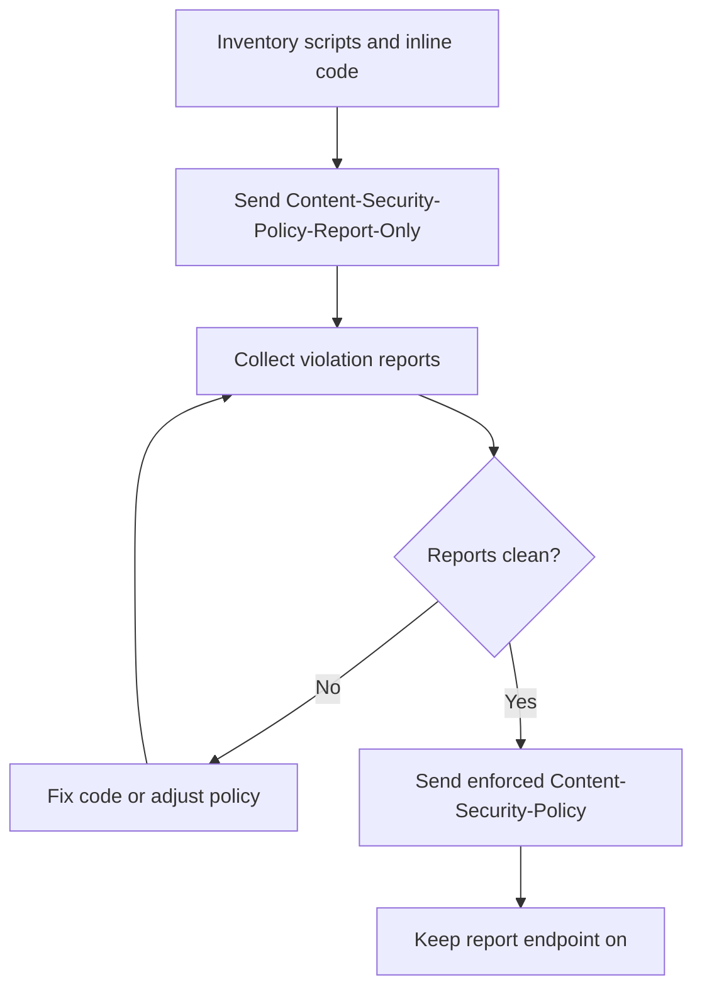

# Security headers and CSP

> **12-minute read. Written for builders and defenders of websites. Helps to know basic HTTP and [TLS](./tls-and-https.md).**

## The one-line answer

Security headers are HTTP response headers that tell the browser to switch on extra protections for your site. They are cheap, they work for every visitor, and they are defence in depth: they limit the damage when your code has a bug, but they do not replace fixing the bug. The most powerful and hardest one is the **Content Security Policy (CSP)**.

**[📖 MDN: Content Security Policy (CSP)](https://developer.mozilla.org/en-US/docs/Web/HTTP/Guides/CSP)** - what CSP protects against, nonces, strict CSP and report-only mode

## What each header protects

| Header | What it does | Example |
|---|---|---|
| **Strict-Transport-Security** (HSTS) | Tells the browser to use only HTTPS for this host and refuse to click through certificate errors | `max-age=31536000; includeSubDomains` |
| **Content-Security-Policy** | Limits which scripts and resources may load and who may frame the page | See below |
| **X-Content-Type-Options** | Stops the browser guessing a file's type, so uploaded text is not run as HTML or script | `nosniff` |
| **Referrer-Policy** | Controls how much of the page URL is sent to other sites | `strict-origin-when-cross-origin` |
| **Permissions-Policy** | Turns browser features (such as geolocation) on or off for your page and embedded frames | `geolocation=()` |

Source pages, all MDN: [Strict-Transport-Security](https://developer.mozilla.org/en-US/docs/Web/HTTP/Reference/Headers/Strict-Transport-Security), [X-Content-Type-Options](https://developer.mozilla.org/en-US/docs/Web/HTTP/Reference/Headers/X-Content-Type-Options), [Referrer-Policy](https://developer.mozilla.org/en-US/docs/Web/HTTP/Reference/Headers/Referrer-Policy), [Permissions-Policy](https://developer.mozilla.org/en-US/docs/Web/HTTP/Reference/Headers/Permissions-Policy).

Notes from those pages:

- **HSTS** works only after the browser has seen the header once over HTTPS. Send it only over HTTPS. `includeSubDomains` makes every subdomain without valid HTTPS unreachable, and with HSTS an expired certificate becomes a hard stop. Start with a short `max-age` and raise it. `preload` needs at least one year and `includeSubDomains`, so submit only when you are sure.
- **Referrer-Policy**: `strict-origin-when-cross-origin` is the browser default when you set nothing. Stricter values exist, such as `no-referrer`.
- **Clickjacking**: the CSP `frame-ancestors` directive controls who may embed your page, and `frame-ancestors 'none'` blocks all embedding. MDN says `'none'` is similar to `X-Frame-Options: deny`.

## What CSP does

CSP is mainly a defence against cross-site scripting (XSS). It tells the browser which sources of script are allowed. If an attacker injects a script tag that does not carry your secret nonce, the browser refuses to run it. MDN stresses that CSP is defence in depth and does not replace sanitising input.

A strict policy from MDN's guide uses a fresh random nonce per response:

```http
Content-Security-Policy:
  script-src 'nonce-{RANDOM}';
  object-src 'none';
  base-uri 'none';
```

Per MDN, strict CSP uses nonces or hashes rather than host allowlists, which are often bypassable and hard to maintain. The nonce must be unique and unpredictable on every response, so the page must be rendered by the server. For static pages use hashes instead. Inline event handlers, `javascript:` URLs and `eval()` are blocked by default and must be rewritten.

## Rolling out CSP safely

The risk is breaking your own site. The safe way is to watch first, then enforce.



The diagram shows the loop. You publish the policy in report-only mode, read what would have been blocked, fix it, and only when reports are clean do you switch to enforcing. You keep reporting on after that, because new code can break the policy later.

Steps:

1. **Start in report-only.** The `Content-Security-Policy-Report-Only` header applies the policy without blocking and reports violations. MDN notes that if both headers are sent, both are honoured, and a report-only policy cannot be set through a `<meta>` tag.
2. **Set up a report endpoint.** MDN recommends `report-to` with a `Reporting-Endpoints` header, and says to declare `report-uri` as well until `report-to` is supported in all browsers. Your server must accept and store the reports.
3. **Read the reports.** Look at `effectiveDirective` and `blockedURL`. Many early reports are browser extensions and are noise.
4. **Fix the real breakage.** Move inline handlers to `addEventListener()`, add nonces to legitimate scripts, and use `'strict-dynamic'` for scripts that load other scripts (MDN warns it weakens protection if those scripts build elements from untrusted input).
5. **Enforce.** Switch the header name to `Content-Security-Policy`. Start with one section of the site if you can.
6. **Keep watching.** Alert on a sudden rise in violations.

MDN's page does not give a numbered rollout. The steps above follow its guidance on report-only mode, and the ordering is our suggestion.

## Other protections worth knowing

- `upgrade-insecure-requests` upgrades HTTP subresource requests, but MDN says it does not replace HSTS.
- Trusted Types (`require-trusted-types-for 'script'`) force input through a sanitising policy before it reaches sinks like `innerHTML`. Browser support varies, so check before relying on it.

## Checking your site

Request your page and read the response headers in the browser's developer tools network tab, or with `curl -I https://your-site/`. Add a header check to CI so a config change cannot silently remove one. See [secure SDLC and DevSecOps](./secure-sdlc-and-devsecops.md).

## Related pages

- [TLS and HTTPS](./tls-and-https.md) - what HSTS builds on.
- [OWASP Top 10 explained](./owasp-top-10-explained.md) - XSS and misconfiguration, which headers reduce.
