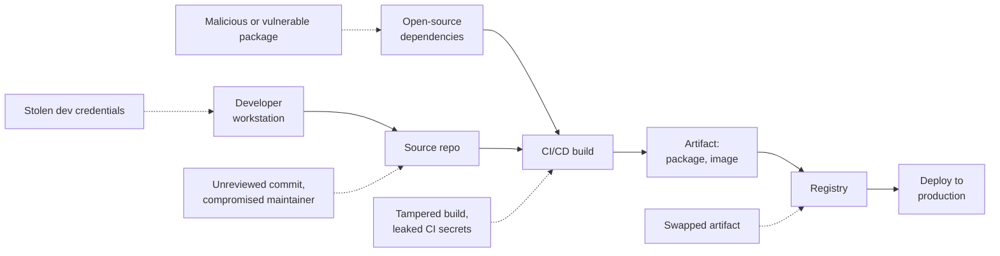

# Software supply chain security

> **14-minute read. Helps to know what a CI/CD pipeline is; [CI/CD explained](https://cloud.noblerworks.com/learn/concepts/cicd-explained/) on Cloud Zero to Hero covers it.**

## The one-line answer

Your software is mostly code you did not write, built by systems you may not fully control, and delivered through registries and update channels you trust by default. Software supply chain security is about making each of those links trustworthy and verifiable: **know what is in your software** (an SBOM), **keep dependencies healthy** (scanning, pinning, updating), **protect the build** (a hardened CI/CD pipeline), and **prove where artifacts came from** (signing and provenance, described by frameworks like SLSA).

## Why it matters

A typical application has hundreds of direct and transitive dependencies, often 80-90% of the code that actually runs. Attackers noticed: compromising one popular library or one vendor's build system reaches thousands of victims at once. Well-known examples show the range:

- **SolarWinds (2020)**: attackers compromised the vendor's build system and inserted a backdoor into signed updates shipped to around 18,000 customers.
- **Log4Shell (2021)**: a critical flaw in a ubiquitous Java logging library. The hard part for most teams was not patching, it was finding every place the library was used.
- **Codecov (2021)**: a modified CI script exfiltrated environment variables, including secrets, from customers' pipelines.
- **3CX (2023)**: a desktop app's build was compromised, itself via another compromised software package upstream.
- **xz Utils (2024)**: a contributor spent years gaining maintainer trust in a compression library, then added a carefully hidden backdoor that was caught shortly before it reached stable Linux releases.
- **Malicious packages on npm and PyPI**: typosquats (`reqeusts` for `requests`), hijacked maintainer accounts, and self-propagating packages that steal tokens and publish new malicious versions.

## The links in the chain

*Each stage of the software supply chain, with the kind of attack that targets it. Defences need to cover every link, because attackers pick the weakest.*

## Know what you have: SBOMs

A [software bill of materials (SBOM)](../glossary.md#term-sbom-software-bill-of-materials) is a machine-readable inventory of the components in a piece of software: names, versions, suppliers, licences and how they relate. The two main formats are **SPDX** (a Linux Foundation project, also an ISO standard) and **CycloneDX** (an OWASP project).

Why it matters:

- **Fast impact analysis.** When the next Log4Shell lands, you query your SBOMs instead of grepping every repository and image for a day.
- **Continuous vulnerability matching.** Feed SBOMs into a tool that watches for new CVEs in components you already ship.
- **Licence compliance** and **customer requirements**: US federal procurement and a growing number of enterprise customers ask vendors for SBOMs, and the EU Cyber Resilience Act is making them expected for products sold in the EU.

Generate SBOMs automatically in the build (tools such as Syft, Trivy, `cdxgen` or your package manager's built-in export), store them alongside the artifact, and regenerate on every release.

**[📖 CycloneDX](https://cyclonedx.org/)** - the OWASP SBOM standard

**[📖 SPDX](https://spdx.dev/)** - the Linux Foundation SBOM standard

## Keep dependencies healthy

### Choose carefully

Before adding a dependency, ask: is it maintained, how many maintainers does it have, does it have a security policy, how many transitive dependencies does it pull in, and do you need it at all? A ten-line utility you write yourself has no supply chain. The OpenSSF Scorecard project rates open-source repositories on practices like branch protection, code review and signed releases.

**[📖 OpenSSF Scorecard](https://github.com/ossf/scorecard)** - automated security health checks for open-source projects

### Pin and lock

Use lockfiles (`package-lock.json`, `poetry.lock`, `go.sum`, `Cargo.lock`) and commit them, so every build uses exactly the versions you reviewed, with integrity hashes. Pin container base images and CI actions by digest or commit SHA, not by a mutable tag like `latest` or `v4`: a tag can be moved to point at different code.

### Scan continuously

Software composition analysis (SCA) tools such as Dependabot, Renovate, Snyk, Trivy and Grype compare your dependencies against vulnerability databases and open update pull requests. Prioritise with the same signals as any vulnerability (see [Vulnerability management](./vulnerability-management.md)): is the vulnerable function reachable, is it exploited in the wild, is it internet-facing.

### Update steadily

Small, frequent dependency updates with good tests are far safer than a huge upgrade every two years. Automated update PRs plus a CI test suite make this routine. Some teams add a short delay (a "cooldown" of a few days) before adopting brand-new releases, because malicious versions are usually caught and pulled quickly.

### Watch for malicious packages

Vulnerability scanners look for known bugs; malicious packages are a different threat. Defences include using a private registry or proxy that only serves approved packages, blocking install-time scripts where your ecosystem allows it, watching for typosquats and dependency confusion (an attacker publishing a public package with the same name as your internal one), and tools that analyse package behaviour.

## Protect the build

The CI/CD system holds the keys to production, so treat it as production:

- **Least privilege for pipelines.** Build jobs get read access to source and write access to one registry path. Deploy jobs get deploy rights to one environment. See [Least privilege explained](./least-privilege-explained.md).
- **No long-lived secrets.** Use OIDC workload identity federation so the pipeline gets short-lived cloud credentials per run, scoped to the repository and branch.
- **Protect branches.** Require pull request review and passing checks before merging to the main branch; restrict who can change pipeline definitions.
- **Pin third-party CI actions and plugins** by commit SHA, and review them like code. They run with your pipeline's permissions.
- **Isolate builds.** Ephemeral, single-use build runners so one build cannot tamper with the next.
- **Scan in the pipeline**: secrets, dependencies, code (SAST), infrastructure as code and container images, failing the build on serious findings.
- **Protect developer accounts**: phishing-resistant MFA for source control and package registry accounts, and signed commits for sensitive repositories.

## Prove where artifacts came from: signing and provenance

### Signing

Signing an artifact proves it was produced by someone holding a particular key and has not changed since. **Sigstore** made this practical for everyone: its `cosign` tool signs container images and other artifacts using short-lived certificates tied to an OIDC identity (such as a specific CI workflow), with every signature recorded in a public transparency log. No long-lived signing keys to lose. npm, PyPI and Maven Central all now support Sigstore-based provenance or signatures.

**[📖 Sigstore](https://www.sigstore.dev/)** - free signing and verification for software artifacts

### Provenance and SLSA

Provenance is a signed statement of **how** an artifact was built: which source commit, which build system, which workflow, which inputs. [SLSA](../glossary.md#term-slsa-supply-chain-levels-for-software-artifacts) (Supply-chain Levels for Software Artifacts, pronounced "salsa") is an OpenSSF framework that defines increasing levels of build integrity:

| Build level | Requirement | What it protects against |
|---|---|---|
| L1 | Provenance exists, showing how the artifact was built | Mistakes; gives you an inventory of build facts |
| L2 | Hosted build platform generates and signs the provenance | Tampering after the build |
| L3 | Hardened build platform; builds isolated from each other and from secrets used to sign provenance | Tampering during the build, including by other tenants or compromised build steps |

Many CI platforms can generate SLSA provenance natively (for example GitHub artifact attestations), which gets you to Level 2 or 3 with little effort.

**[📖 SLSA](https://slsa.dev/)** - the framework, levels and requirements

### Verify at deploy time

Signing is only useful if something checks it. Enforce verification where artifacts are deployed: Kubernetes admission controllers (Sigstore policy-controller, Kyverno), cloud features such as Binary Authorization on Google Cloud, or a deploy pipeline step that refuses unsigned or unprovenanced artifacts.

## A worked example

A team ships a containerised API. A pragmatic first round of supply chain controls:

1. Lockfile committed; base image pinned by digest; Dependabot or Renovate enabled with CI tests on every update PR.
2. CI uses OIDC federation to the cloud; no stored cloud keys in CI secrets.
3. Third-party CI actions pinned to commit SHAs.
4. Build generates a CycloneDX SBOM and SLSA provenance, signs the image with cosign, and pushes all three to the registry.
5. Secret scanning and dependency scanning block merges on high-severity findings.
6. The cluster's admission policy only runs images signed by this repository's release workflow.

Now, when a new critical CVE appears, they query SBOMs to see where it is; if a registry credential leaks, an attacker's image will not be admitted because it lacks a valid signature from the release workflow.

## Common mistakes

- **No inventory.** Not knowing which services include a vulnerable library is the costliest gap during a major disclosure.
- **Mutable references.** `FROM node:latest` and `uses: some/action@v4` can change under you.
- **Over-privileged pipelines** with admin cloud credentials stored as long-lived secrets.
- **Signing without verifying.** Signatures nobody checks provide no protection.
- **Treating scanning as the whole story.** Scanners find known vulnerabilities, not malicious code or a compromised build.
- **Ignoring developer endpoints and accounts**, which are often the first link attacked.

## How exams test this

- **Security+ and CISSP**: supply chain risk as a concept, vendor and third-party risk management, code signing, and software integrity.
- **GitHub Advanced Security**: Dependabot alerts and updates, dependency review, secret scanning, code scanning and artifact attestations.
- **CKS and KCSA**: image scanning, signing and admission control in Kubernetes, minimal base images.
- **Cloud security exams**: container image scanning, Binary Authorization (GCP), workload identity federation for CI, and artifact registries.

For AI-specific supply chain risks (model weights, datasets, model hubs), see the AI site's **[AI safety and security hub](https://ai.noblerworks.com/safety/)**.

## What to look at next

- **[Vulnerability management](./vulnerability-management.md)** - prioritising the findings SCA tools produce
- **[Secrets management](./secrets-management.md)** - removing long-lived secrets from pipelines
- **[OWASP Top 10 explained](./owasp-top-10-explained.md)** - supply chain and integrity failures as web app risks
- **[GitHub Advanced Security](../../exams/github/advanced-security/)** - the certification for code, dependency and secret scanning
