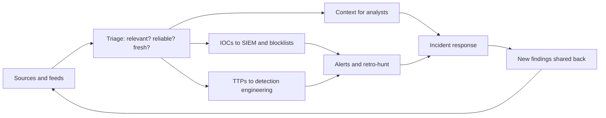

# Threat intelligence basics

> **10-minute read. Written for new analysts and engineers who keep hearing "IOC", "TTP" and "feed" and want to know what to do with them.**

## The one-line answer

Threat intelligence is information about threats that has been analysed so someone can make a decision. A list of bad IP addresses is data. Knowing which group targets your sector, how they get in and what to change because of it is intelligence. NIST SP 800-150 defines cyber threat information as any information that can help an organisation identify, assess, monitor and respond to cyber threats, with examples that include known malicious indicators, descriptions of how attackers operate, recommended defensive actions and findings from incident analysis.

**[📖 NIST SP 800-150: Guide to Cyber Threat Information Sharing](https://csrc.nist.gov/pubs/sp/800/150/final)** - setting sharing goals, choosing sources and using threat data in your security program (October 2016)

## IOCs versus TTPs

| | IOC (indicator of compromise) | TTP (tactics, techniques and procedures) |
|---|---|---|
| What | A technical artefact that suggests an attack: an IP, domain, file hash, email address | How an attacker behaves: their goals, methods and habits |
| Lifespan | Short. Attackers change infrastructure often | Long. Habits change slowly |
| Cost to attacker to change | Low | High |
| Best for | Fast blocking and searching past logs | Building detections that survive changes |
| Example use | Block a domain; search logs for it | Alert on a behaviour pattern, mapped to [ATT&CK](./mitre-attack-for-defenders.md) |

NIST's glossary describes an indicator of compromise as technical artefacts or observables that suggest an attack is imminent, in progress or already happened. IOCs go stale fast, so give each one an expiry date and a confidence level. TTPs are harder to collect but worth more.

## Types of intelligence

These are common labels, not one official standard:

- **Strategic:** for leaders. Which threats matter to our business and where to invest.
- **Operational:** about specific campaigns and groups. Used by security managers and incident leads.
- **Tactical:** TTPs, for detection engineers and hunters.
- **Technical:** raw IOCs, for tools that block and search.

## Sources

- **Your own data.** Incident history and logs are the most relevant intelligence you have.
- **Government and CERT advisories.** For example CISA alerts in the US. Free and usually well sourced.
- **Information sharing communities** for your sector. NIST SP 800-150 covers joining existing sharing communities.
- **Vendor reports** and **open-source feeds**. Quality varies widely. Check how a feed got its data and how old it is.
- **Social media and forums.** Fast but noisy and often wrong.

Judge every source on reliability and every item on credibility. A trusted source can pass on a weak claim.

## Sharing rules: TLP

The Traffic Light Protocol tells you how far you may pass something on. CISA's page lists TLP:RED (only the people in the original exchange), TLP:AMBER+STRICT (your own organisation only), TLP:AMBER (your organisation and its clients, need to know), TLP:GREEN (peers and the community, not public channels) and TLP:CLEAR (no restriction beyond copyright). Always respect the marking. The CISA page notes it may be outdated and that TLP 2.0 was adopted on 1 November 2022, so check the current definition at [CISA](https://www.cisa.gov/news-events/news/traffic-light-protocol-tlp-definitions-and-usage).

## How a SOC uses it

The diagram shows a loop. Intelligence comes in, gets filtered, and feeds three places: automatic matching of IOCs, new detections from TTPs, and context for analysts. What the SOC learns in incidents goes back out as new intelligence.

Practical uses:

1. **Enrich alerts.** When an alert shows an IP, look it up: is it known, how recent, how confident?
2. **Retro-hunt.** When a new IOC arrives, search past logs for it. A hit means you may already be compromised.
3. **Block.** Push high-confidence, fresh IOCs to firewalls, email and DNS filters.
4. **Build detections** from TTPs and track coverage against ATT&CK.
5. **Prioritise patching.** Vulnerabilities that attackers are exploiting now move to the front. See [Vulnerability management](./vulnerability-management.md).
6. **Brief leaders.** Short strategic notes on what changed and what we did.

## Common problems

- **Feed overload.** Millions of indicators, most irrelevant. Pick fewer, better sources tied to your questions.
- **Stale IOCs causing false alarms.** Expire them.
- **Blocking shared infrastructure.** An IP on a cloud provider may be used by innocent tenants too. Check context.
- **No owner.** Someone must own intake, quality and feedback.
- **Never measuring.** Track how many alerts or detections came from intelligence and whether they were useful.

## Where it leads

[Logging and detection](./logging-and-detection.md), [Incident response basics](./incident-response-basics.md), [Phishing and social engineering](./phishing-and-social-engineering.md).
