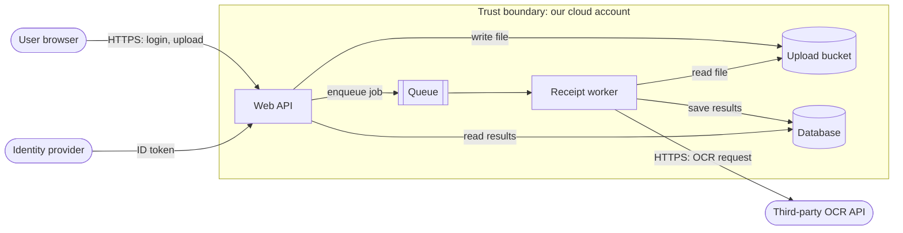

# Threat modeling explained

> **13-minute read. No prerequisites, though [OWASP Top 10 explained](./owasp-top-10-explained.md) gives useful examples of what you are looking for.**

## The one-line answer

Threat modeling is a structured way of asking **"what could go wrong with this system, and what are we going to do about it?"** while it is still a design on a whiteboard. You draw how data flows, look at each part with a checklist like STRIDE, and write down the threats and the controls that address them. It is the cheapest security activity there is: a flaw found in a design review costs a conversation; the same flaw found in production costs an incident.

## Why it exists

Scanners and pen tests find bugs in code that already exists. They are poor at finding **design** flaws: a password reset that can be abused, a service that trusts a header any client can set, an admin API reachable from the internet. Those flaws are built into the architecture, so fixing them late means rework. Threat modeling moves that thinking to the start.

It also forces something teams rarely do otherwise: write down how the system actually works. Half the value of a first threat model is everyone discovering they had different pictures of the same system.

## The four questions

The Threat Modeling Manifesto boils every method down to four questions. If you remember nothing else, remember these:

1. **What are we working on?** Model the system.
2. **What can go wrong?** Find threats.
3. **What are we going to do about it?** Decide on mitigations.
4. **Did we do a good enough job?** Review and validate.

**[📖 Threat Modeling Manifesto](https://www.threatmodelingmanifesto.org/)** - the four questions and the values behind them

## Step 1: Draw a data flow diagram

A data flow diagram (DFD) for threat modeling uses only a handful of shapes:

- **External entities** - people or systems outside your control (users, a payment provider).
- **Processes** - code that does something (a web app, an API, a worker).
- **Data stores** - where data rests (databases, buckets, queues, caches).
- **Data flows** - arrows showing data moving between them.
- **Trust boundaries** - dashed lines where the level of trust changes: the internet edge, the line between your app and a third party, between a container and its host, between tenants.

Most threats live where data crosses a trust boundary.

Here is a simple example: a web app where users upload receipts, which a worker processes.

*A data flow diagram for a receipt upload app: the subgraph is the trust boundary of our cloud account, and the user, identity provider and OCR service sit outside it.*

## Step 2: Find threats with STRIDE

STRIDE, created at Microsoft, is a mnemonic for six threat categories. Each one is the violation of a security property:

| Letter | Threat | Violates | Question to ask | Typical mitigations |
|---|---|---|---|---|
| **S** | Spoofing | Authentication | Can someone pretend to be another user or system? | Strong authentication, MFA, mTLS, signed tokens |
| **T** | Tampering | Integrity | Can someone change data in transit or at rest? | TLS, signatures, hashes, write permissions, immutability |
| **R** | Repudiation | Non-repudiation | Can someone deny doing something because there's no proof? | Audit logs, signed records, tamper-resistant log storage |
| **I** | Information disclosure | Confidentiality | Can data leak to someone who shouldn't see it? | Encryption, access control, data minimisation, error handling |
| **D** | Denial of service | Availability | Can someone make it unavailable? | Rate limits, quotas, autoscaling, timeouts, DDoS protection |
| **E** | Elevation of privilege | Authorization | Can someone gain rights they shouldn't have? | Least privilege, input validation, sandboxing, authorization checks |

Walk each element and each flow on the diagram, especially those crossing a trust boundary, and ask the six questions. A useful shortcut: processes are exposed to all six; data stores mostly to tampering, information disclosure and denial of service; data flows to tampering, information disclosure and denial of service.

**[📖 Microsoft: STRIDE threat categories](https://learn.microsoft.com/en-us/azure/security/develop/threat-modeling-tool-threats)** - each category with examples and mitigations

### Applying it to the example

A few threats a team might find in the receipt app:

| Element | STRIDE | Threat | Mitigation |
|---|---|---|---|
| User to API | S | Stolen session used from another device | Short sessions, MFA, re-auth for sensitive actions |
| API | E | User requests another user's receipt by changing the ID | Server-side ownership check on every read |
| Upload bucket | I | Bucket made public by mistake | Block public access at account level, policy-as-code check |
| Upload bucket | T | Uploaded file is not really an image and exploits the parser | Validate type and size, process in an isolated worker with no extra permissions |
| Worker to OCR API | I | Receipts contain personal data sent to a third party | Data processing agreement, send only the image, check provider's retention |
| Queue | D | Flood of uploads exhausts the worker and the OCR budget | Per-user rate limits and quotas, budget alarm |
| Database | R | No record of who deleted a receipt | Audit log of deletes with user ID |

Each row becomes a ticket, an accepted risk with an owner, or a note that an existing control covers it.

## Step 3: Decide what to do

For each threat, pick one of four responses:

- **Mitigate** - add a control that reduces likelihood or impact. The usual answer.
- **Eliminate** - remove the feature or data that creates the risk. ("Do we need to store the full receipt image at all?")
- **Transfer** - make it someone else's responsibility, through a managed service, contract or insurance.
- **Accept** - consciously decide the risk is tolerable, with a named owner and a date to revisit.

Rank by rough likelihood and impact. You will not fix everything; the point is to fix the right things first and to make the rest an explicit decision rather than an accident.

## Step 4: Validate

Check that mitigations were actually built (they often become "we'll do it later"), turn key threats into tests, and revisit the model when the design changes. A threat model is a living document, not a one-time gate.

## Other methods you will hear about

- **PASTA** (Process for Attack Simulation and Threat Analysis): a seven-stage, risk-centric method that ties threats to business impact. Heavier; used in larger organisations.
- **LINDDUN**: like STRIDE, but for privacy threats (linkability, identifiability, non-repudiation, detectability, disclosure, unawareness, non-compliance).
- **Attack trees**: start with an attacker goal at the root ("read another user's receipts") and branch into the ways to achieve it. Good for analysing one high-value risk in depth.
- **MITRE ATT&CK**: a catalogue of real-world attacker techniques. Useful for detection planning and for checking a threat model against how attackers actually operate.
- **Kill chain**: the stages of an intrusion, from reconnaissance to actions on objectives. A way to think about where defences can break the chain.

**[📖 OWASP Threat Modeling Cheat Sheet](https://cheatsheetseries.owasp.org/cheatsheets/Threat_Modeling_Cheat_Sheet.html)** - a practical walk-through of the process and methods

## Making it a habit

- **Keep it small and frequent.** A 45-minute session per significant feature beats a three-day workshop once a year.
- **Include the builders.** Developers know how the system really works; security people know what goes wrong. You need both in the room.
- **Store it with the code.** A diagram in the repository (Mermaid works well) and a threats table in the design doc stay current far longer than a slide deck.
- **Use tools if they help**: OWASP Threat Dragon and the Microsoft Threat Modeling Tool both support DFDs and STRIDE. A whiteboard works too.

## Common mistakes

- **Boiling the ocean.** Modelling the entire company at once. Scope to one feature or service.
- **Only listing threats.** A threat list with no decisions is a worry list. Every threat needs a response and an owner.
- **Forgetting third parties and internal actors.** Insiders, compromised vendors and over-privileged service accounts are threats too.
- **Doing it once.** The model goes stale with the next design change.
- **Gatekeeping.** If threat modeling is something security does *to* teams, it gets skipped. If it is a quick, useful conversation, teams ask for it.

## How exams test this

- **CISSP**: STRIDE, PASTA, DREAD (an older risk-rating scheme) and attack trees by name; threat modeling's place in the software development lifecycle; risk responses (mitigate, transfer, avoid, accept).
- **Security+ and CySA+**: threat actors and their motivations, attack surface, and frameworks like MITRE ATT&CK and the kill chain.
- **Azure SC-100**: threat modeling as part of designing a security strategy, mapped to Microsoft's tools.
- **AI security**: the same method applied to models and agents, covered on the AI site: **[AI threat modeling](https://ai.noblerworks.com/safety/security/ai-threat-modeling/)**.

## What to look at next

- **[OWASP Top 10 explained](./owasp-top-10-explained.md)** - a catalogue of common threats to check your model against
- **[Least privilege explained](./least-privilege-explained.md)** - the most common mitigation for elevation of privilege
- **[Logging and detection](./logging-and-detection.md)** - the mitigation for repudiation, and how you notice the threats you accepted
