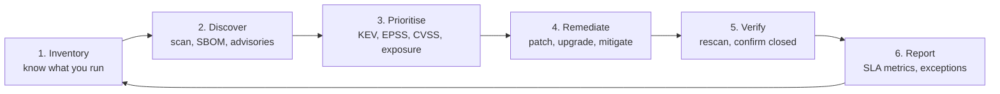

# Vulnerability management

> **13-minute read. No prerequisites.**

## The one-line answer

Vulnerability management is the ongoing loop of **finding** weaknesses in your systems, **deciding which ones matter**, **fixing** them within agreed timeframes, and **proving** they are fixed. Scanning is the easy part; every scanner produces thousands of findings. The real skill is prioritisation: using severity (CVSS), likelihood of exploitation (EPSS), evidence of real-world exploitation (CISA KEV) and your own context to fix the few that matter first.

## The vocabulary

### CVE

A [CVE](../glossary.md#term-cve-common-vulnerabilities-and-exposures) (Common Vulnerabilities and Exposures) identifier is a unique name for one publicly known vulnerability, like `CVE-2021-44228` (Log4Shell). It lets a vendor advisory, a scanner and your ticket all refer to the same thing. CVE IDs are assigned by CVE Numbering Authorities (vendors, open-source foundations, researchers' organisations) under the CVE Program. The US National Vulnerability Database (NVD) and others then enrich each CVE with severity scores and affected product lists.

A CVE is not a measure of risk. Tens of thousands are published every year, and most will never be exploited.

**[📖 CVE Program](https://www.cve.org/)** - search CVE records and learn how IDs are assigned

### CVSS: how bad could it be?

The [Common Vulnerability Scoring System](../glossary.md#term-cvss-common-vulnerability-scoring-system) gives a 0.0-10.0 score describing a vulnerability's technical severity. The base score comes from properties like:

- **Attack vector**: network, adjacent, local or physical. Network-reachable is worse.
- **Attack complexity and requirements**: does exploitation need special conditions?
- **Privileges required**: none, low or high.
- **User interaction**: does a victim have to click something?
- **Impact** on confidentiality, integrity and availability.

Scores map to ratings: 0.1-3.9 Low, 4.0-6.9 Medium, 7.0-8.9 High, 9.0-10.0 Critical. CVSS v4.0 (2023) is current, though v3.1 scores are still everywhere.

The catch: CVSS measures how bad a vulnerability **could** be in general, not how likely it is to be used against **you**. Around half of all CVEs score High or Critical, so "patch every High and Critical" quickly becomes "patch everything", which nobody can.

**[📖 FIRST: CVSS v4.0](https://www.first.org/cvss/v4.0/)** - the specification and calculator

### EPSS: how likely is it to be exploited?

The [Exploit Prediction Scoring System](../glossary.md#term-epss-exploit-prediction-scoring-system) estimates the probability (0 to 1) that a vulnerability will be exploited in the wild in the next 30 days, using a model trained on real exploitation data. It is updated daily. Most CVEs have an EPSS score below 1%. A small fraction are much higher, and those are where attackers are focused.

**[📖 FIRST: EPSS](https://www.first.org/epss/)** - the model, data and daily scores

### KEV: is it being exploited right now?

CISA's [Known Exploited Vulnerabilities (KEV)](../glossary.md#term-kev-known-exploited-vulnerabilities) catalog lists vulnerabilities with reliable evidence of active exploitation. It is short (well under 2,000 entries, compared with hundreds of thousands of CVEs) and authoritative. US federal agencies must remediate KEV entries by set deadlines under Binding Operational Directive 22-01, and many private organisations adopt the same rule: **anything on KEV that affects you jumps the queue.**

**[📖 CISA Known Exploited Vulnerabilities Catalog](https://www.cisa.gov/known-exploited-vulnerabilities-catalog)** - the catalog, with due dates and a machine-readable feed

### Putting them together

| Signal | Answers | Strength | Limitation |
|---|---|---|---|
| CVSS | How severe if exploited? | Universal, detailed | Says nothing about likelihood; too many Highs |
| EPSS | How likely to be exploited soon? | Data-driven, daily | A probability, not a guarantee; general, not your environment |
| KEV | Is it exploited right now? | High-confidence, small list | Lags new exploitation; not exhaustive |
| Your context | Does it matter here? | The only signal that knows your system | Needs an asset inventory to work |

Your context is the part only you can supply: Is the vulnerable component internet-facing? Does it hold sensitive data? Is the vulnerable function even reachable in your configuration? Is there a compensating control?

## The lifecycle

*The vulnerability management loop. It never finishes, because new vulnerabilities in existing software are published every day.*

### 1. Inventory

You cannot protect what you do not know you have. You need a current list of hosts, containers, cloud resources, applications and, ideally, the software components inside them (a software bill of materials; see [Software supply chain security](./software-supply-chain-security.md)). Unknown, forgotten systems are where breaches start.

### 2. Discover

Different tools find different things:

- **Infrastructure scanners** (Tenable, Qualys, Rapid7, AWS Inspector, Microsoft Defender for Cloud, GCP Security Command Center) check operating systems and installed packages.
- **Software composition analysis** (Dependabot, Snyk, Trivy, Grype) checks application dependencies and container images.
- **Static and dynamic application testing** (SAST, DAST) find flaws in your own code.
- **Cloud posture management** finds misconfigurations, which are vulnerabilities without a CVE.
- **Vendor advisories and threat intelligence** tell you about things before your scanner has a signature.

### 3. Prioritise

A practical, widely used order:

1. **On KEV and present on an exposed system** - fix now, as an emergency.
2. **High EPSS, or a public exploit exists, and exposed** - fix within days.
3. **Critical or High CVSS on internal or less exposed systems** - fix within the normal SLA.
4. **Everything else** - batch into routine patching.

### 4. Remediate

Remediation is usually an upgrade or a patch. When you cannot patch quickly (a vendor has not released a fix, or the system cannot be restarted until the weekend), **mitigate**: disable the vulnerable feature, block the path with a firewall or WAF rule, isolate the system, or add monitoring for exploitation attempts. Mitigation buys time; it is not the end state.

The best long-term remediation is structural: immutable infrastructure that is rebuilt from patched images, automated dependency update pull requests, and managed services where the provider patches for you (the [shared responsibility model](./shared-responsibility-model.md) in action).

### 5. Verify

Rescan to confirm the fix. Close the ticket only on evidence. A surprising number of "fixed" findings come back because the fix went to one environment, or an old image was redeployed.

### 6. Report

Track remediation against service-level agreements (SLAs) and report trends, not raw counts. A raw count goes up every time you add a scanner, which tells nobody anything.

## Patch SLAs

An SLA is the maximum time allowed to fix a finding of a given priority. There is no universal standard; a common starting point:

| Priority | Example criteria | Target |
|---|---|---|
| Emergency | On KEV, internet-facing | 24-72 hours |
| Critical | CVSS 9.0+ or high EPSS, exposed | 7 days |
| High | CVSS 7.0-8.9 | 30 days |
| Medium | CVSS 4.0-6.9 | 90 days |
| Low | CVSS below 4.0 | Next routine cycle or accept |

Compliance frameworks often set their own: PCI DSS, for example, requires critical security patches within one month of release. CISA BOD 22-01 sets per-entry due dates for KEV items.

### Exceptions

Some findings cannot be fixed in time: a legacy system the vendor no longer supports, a fix that breaks a critical integration. Handle these with a documented **risk exception**: what the risk is, what compensating controls are in place, who accepted it, and when it expires. An exception without an expiry date is a permanent hole.

## Metrics worth tracking

- **Mean time to remediate** by priority, against the SLA.
- **SLA compliance rate**: the share of findings fixed within target.
- **KEV exposure**: how many KEV vulnerabilities exist in your estate right now (target: zero on exposed systems).
- **Age of the oldest open critical finding.**
- **Coverage**: the share of assets that are actually being scanned.

## Common mistakes

- **Prioritising by CVSS alone.** It generates more urgent work than any team can do, and misses lower-scored vulnerabilities attackers are actively using.
- **No asset inventory.** Scanning only what you know about leaves the forgotten server unpatched.
- **Patching hosts but not images.** The running container gets fixed; the next deploy brings the vulnerability back from the old base image.
- **Unowned findings.** If tickets go to a shared queue with no owner, they age forever. Route each finding to the team that owns the asset.
- **Permanent exceptions.** Every exception needs an expiry and a review.
- **Ignoring misconfiguration.** A public storage bucket has no CVE but is often the bigger risk.

## How exams test this

- **CompTIA CySA+**: the heart of the exam. Interpreting scan output, CVSS vectors, false positives vs false negatives, credentialed vs non-credentialed scans, prioritisation and compensating controls.
- **Security+**: the vulnerability management lifecycle, scanning types, CVE and CVSS basics, and remediation options.
- **CISSP and CISM**: the governance view: risk-based prioritisation, exception handling, metrics and reporting to leadership.
- **Cloud security exams**: which native service scans what (Inspector, Defender for Cloud, Security Command Center) and automating patching (Systems Manager Patch Manager, Azure Update Manager, OS Config).

## What to look at next

- **[Software supply chain security](./software-supply-chain-security.md)** - dependencies, SBOMs and where many vulnerabilities come from
- **[Incident response basics](./incident-response-basics.md)** - what happens when a vulnerability was exploited before you patched
- **[Harden a Linux server (hands-on)](../../resources/hands-on-projects/harden-a-linux-server.md)** - set up automatic security updates on a real host
