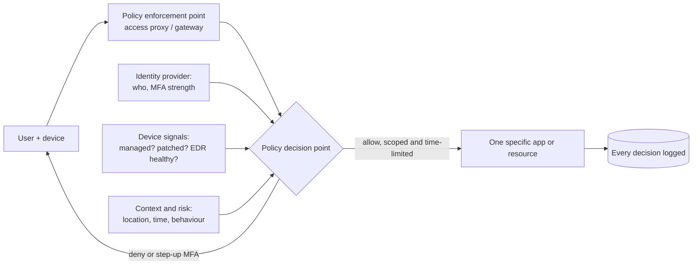

# Zero trust explained

> **8-minute read. The short concept. For the full reference design read the [zero trust architecture pattern](../../resources/architecture-patterns/zero-trust-architecture.md); to build it, do the [hands-on project](../../resources/hands-on-projects/implement-zero-trust.md).**

## The one-line answer

[Zero trust](../glossary.md#term-zero-trust) is the idea that **no request is trusted because of where it comes from**. Being on the office network or inside the VPC grants nothing. Every request to every resource is authenticated, authorized and checked against context (who, from what device, how risky) at the moment it is made, and access is kept as small as possible.

## The problem it replaces

The older model is often called "castle and moat". You build a strong perimeter (firewall, VPN), and everything inside is trusted. It made sense when staff, servers and data all sat in one building.

It fails today for three reasons:

1. **There is no single inside.** Staff work from home, apps run in several clouds, and data lives in SaaS products.
2. **Attackers get inside.** A phished laptop on the VPN is inside the castle, and in the old model can reach almost everything.
3. **Lateral movement is the damage.** Most serious breaches involve an attacker moving from a low-value foothold to high-value systems across a flat, trusted internal network.

Zero trust does not mean "trust nobody" in a paranoid sense. It means **trust is never implied by network location; it is earned per request from evidence**.

## The core principles

NIST SP 800-207 is the reference definition. Its tenets boil down to:

- **Verify explicitly.** Authenticate and authorize every request using all available signals: user identity, device health, location, time, the sensitivity of the resource, behaviour.
- **Use least-privilege access.** Grant only what the request needs, ideally just in time and just enough. See [Least privilege explained](./least-privilege-explained.md).
- **Assume breach.** Design as if an attacker is already inside: segment, encrypt internal traffic, log everything, and limit blast radius.

**[📖 NIST SP 800-207: Zero Trust Architecture](https://csrc.nist.gov/pubs/sp/800/207/final)** - the standard definition and logical components

## How a zero trust request works

*Every request passes through an enforcement point that asks a policy engine; the decision uses identity, device and risk signals, and the answer is scoped to one resource, not the whole network.*

The pieces:

- **Policy enforcement point**: the thing in the path that allows or blocks. An identity-aware proxy, a ZTNA gateway, an API gateway, a service mesh sidecar.
- **Policy decision point**: the engine that evaluates the rules. In Microsoft's world this is Conditional Access; in Google's, BeyondCorp and Identity-Aware Proxy access levels; in AWS, Verified Access policies.
- **Signals**: identity from the IdP, device posture from endpoint management, threat intelligence and behaviour analytics.

## What changes in practice

| Old habit | Zero trust replacement |
|---|---|
| VPN puts you "on the network" | Per-application access through an identity-aware proxy (ZTNA) |
| Password at login, then trusted all day | Strong, ideally [phishing-resistant MFA](./mfa-and-passkeys.md), plus re-evaluation during the session |
| Any device that knows the password | Only managed, healthy devices for sensitive apps |
| Flat internal network | [Segmentation and microsegmentation](./network-security-basics.md) |
| Plaintext traffic inside the data centre | [mTLS](./tls-and-https.md) between services |
| Service accounts with static keys | Workload identity with short-lived credentials |
| Logs reviewed after something breaks | Every access decision logged and fed to [detection](./logging-and-detection.md) |

## Common misunderstandings

- **"Zero trust is a product."** Vendors sell components (ZTNA, identity providers, microsegmentation). Zero trust is an architecture and an operating model. No single purchase delivers it.
- **"We have MFA, so we're zero trust."** MFA at login is one control. Device posture, least privilege, segmentation and continuous evaluation are the rest.
- **"It means removing the firewall."** Network controls stay. They just stop being the thing that grants trust.
- **"It's all or nothing."** It is a journey. CISA's maturity model describes stages from traditional to optimal across identity, devices, networks, applications and data. Start with identity and your most sensitive apps.

**[📖 CISA Zero Trust Maturity Model](https://www.cisa.gov/zero-trust-maturity-model)** - five pillars and four maturity stages for planning a rollout

## How exams test this

- **Security+ and ISC2 CC**: the principles, the control plane vs data plane split, and the policy engine / enforcement point vocabulary.
- **Azure SC-100, SC-900**: Microsoft's zero trust model is woven through the Cybersecurity Architect exam; expect scenario questions mapping requirements to Conditional Access, Defender and Entra features.
- **GCP Cloud Security Engineer**: BeyondCorp Enterprise, Identity-Aware Proxy, access levels and VPC Service Controls.
- **CCSK and CCSP**: zero trust and software-defined perimeter in cloud architecture.

## What to look at next

- **[Zero trust architecture pattern](../../resources/architecture-patterns/zero-trust-architecture.md)** - the reference design with AWS, Azure and GCP components
- **[Implement zero trust (hands-on)](../../resources/hands-on-projects/implement-zero-trust.md)** - build it in a cloud account
- **[MFA and passkeys](./mfa-and-passkeys.md)** and **[Least privilege explained](./least-privilege-explained.md)** - the two controls zero trust leans on hardest
