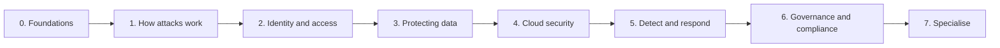

# 🔒 Security From Scratch

> **A plain-English path from "I have never thought about security" to working as a security engineer.**
>
> Seven phases. Each one ends with what you can actually do afterwards, and points to the pages on this site (and its sibling sites) that go deeper. No exam scaffolding until you want it.

---

## Who this is for

- You are new to security, or you came to it sideways from development, IT support or operations.
- You want to understand *why* the controls exist, not memorise a list of them.
- You may want a certification later, but not today.

If you already have an exam date, go straight to the **[Study Hub](../STUDY-HUB.md)**. If you want the certification order for a career, read the **[Security Engineer roadmap](../resources/certification-roadmap-security-engineer.md)** after Phase 3.

---

## How to work through it

Each phase has:

- **What you'll learn** - the ideas, in plain English
- **Why it matters** - where it shows up in real work
- **Try it** - one small hands-on exercise
- **Go deeper** - the pages to read next

Don't try to finish a phase before starting the next. Security is a web, not a ladder: you will loop back to identity and logging for the rest of your career.

*The seven phases in order. Phases 2 to 5 are the core of most security engineering jobs; Phase 7 is where you pick a lane.*

---

## Phase 0 - The foundations security sits on

**What you'll learn**

- How a computer talks to another one: IP addresses, ports, DNS, HTTP.
- What a server is, and what a terminal is for.
- Files, users and permissions on Linux.

**Why it matters**

Nearly every attack is a normal thing used in an abnormal way: a valid login, an open port, an over-permissive file. You cannot spot "abnormal" until "normal" is boring to you.

**Try it**

Open a terminal, `ssh` into a free-tier VM, list the open ports with `ss -tlnp`, and check who can read `/etc/shadow`. Then delete the VM.

**Go deeper** (on the Cloud Zero to Hero site, which owns the basics)

- [Day One](https://cloud.noblerworks.com/learn/day-one/) - terminal, git, HTTP and servers, assuming nothing
- [File permissions](https://cloud.noblerworks.com/learn/day-one/file-permissions/) and [SSH basics](https://cloud.noblerworks.com/learn/day-one/ssh-basics/)
- [Networking troubleshooting](https://cloud.noblerworks.com/learn/day-one/networking-troubleshooting/)
- [DNS explained](https://cloud.noblerworks.com/learn/concepts/dns-explained/)

You can now: explain what happens when you type a URL into a browser, and read a Linux permission string.

---

## Phase 1 - How attacks actually work

**What you'll learn**

- The CIA triad: confidentiality, integrity, availability. Every control protects at least one.
- Threats, vulnerabilities and risk, and why they are different words.
- The common attack shapes: phishing, credential theft, injection, misconfiguration, ransomware, supply-chain compromise.
- Defence in depth: no single control is trusted to hold.

**Why it matters**

Security work is choosing which risks to reduce with limited time. If you can't name how a system gets attacked, you can't decide what to fix first.

**Try it**

Pick an app you use every day. Write down three ways someone could get into your account without your password. For each, name the control that stops it.

**Go deeper**

- [Glossary: Security and Identity](./glossary.md#security--identity) - the vocabulary, defined once
- [Security topic index](../topics/security.md) - everything on this site about security, by subject
- [CompTIA Security+](../exams/comptia/security-plus/) and [ISC2 CC](../exams/isc2/cc/) - the two common first certs; their notes double as a structured syllabus even if you never sit the exam

You can now: describe a breach you read about in the news in terms of the vulnerability, the threat and the control that was missing.

---

## Phase 2 - Identity and access

**What you'll learn**

- Authentication (who are you?) versus authorisation (what may you do?).
- MFA, and why phishing-resistant MFA matters.
- Least privilege, roles versus policies, and federation (one login across many systems).
- Why identity has replaced the network edge as the main perimeter.

**Why it matters**

Most cloud breaches start with a credential, not an exploit. Identity is where a security engineer spends most of their week.

**Try it**

In a free-tier cloud account, create a user with no permissions, then grant exactly what it needs to read one storage bucket and nothing else. Prove it cannot read a second bucket.

**Go deeper**

- [IAM explained](./concepts/iam-explained.md)
- [Identity and IAM topic index](../topics/iam.md)
- [Identity and IAM services compared](../resources/service-comparison-identity-iam.md) - AWS, Azure and GCP side by side
- [Zero trust architecture](../resources/architecture-patterns/zero-trust-architecture.md)

You can now: design access for a small team so nobody holds a permission they don't use.

---

## Phase 3 - Protecting data

**What you'll learn**

- Encryption in transit (TLS) and at rest, and what each one does and does not protect against.
- Keys: who holds them, how they rotate, and why key management is the hard part.
- Secrets: API keys and passwords do not belong in code or config files.
- Data classification: you protect what you know you have.

**Why it matters**

When something does get through, encryption and good secrets handling decide whether it becomes a headline.

**Try it**

Run a secret scanner (for example `gitleaks`) over one of your own repositories. Move anything it finds into a secrets manager and rotate it.

**Go deeper**

- [TLS and HTTPS](./concepts/tls-and-https.md)
- [Secrets management](./concepts/secrets-management.md)
- [HashiCorp Vault Associate](../exams/hashicorp/vault-associate/) - secrets management as a discipline

You can now: explain to a developer why their `.env` file is a risk, and what to do instead.

---

## Phase 4 - Cloud security

**What you'll learn**

- The shared responsibility model: what the provider secures and what is still yours.
- Network controls in the cloud: private subnets, security groups, private endpoints.
- Posture management: finding the misconfigured bucket before someone else does.
- Container and Kubernetes security basics.

**Why it matters**

Most new systems are built in the cloud, and cloud mistakes are configuration mistakes made at scale.

**Try it**

Work through the [zero trust hands-on project](../resources/hands-on-projects/implement-zero-trust.md): identity provider, MFA, and access that checks who you are on every request.

**Go deeper**

- [Shared responsibility model](./concepts/shared-responsibility-model.md)
- [Cloud security in 1 hour](../resources/playlist-cloud-security-1hour.md) - a curated reading order
- [Security tools compared](../resources/service-comparison-security-tools.md) - each cloud's native security services
- For cloud itself (compute, networking, VPCs): [Cloud from Scratch](https://cloud.noblerworks.com/learn/cloud-from-scratch/) on the Cloud Zero to Hero site
- Certs: [CCSK v5](../exams/cloud-security-alliance/ccsk/), then the security exam for your main cloud: [GCP Cloud Security Engineer](../exams/gcp/cloud-security-engineer/), the [Azure SC-series](../exams/azure/), or [AWS](../exams/aws/)

You can now: review a cloud account and list the three changes that most reduce its risk.

---

## Phase 5 - Detect and respond

**What you'll learn**

- Logs as evidence: what to collect, where to keep it, and how long.
- Detection: turning logs into alerts that a human should act on, and cutting the noise.
- Incident response: prepare, detect, contain, eradicate, recover, learn.
- Vulnerability management: scanning is easy, deciding what to patch first is the job.

**Why it matters**

Prevention fails eventually. Teams are judged on how quickly they notice and how calmly they recover.

**Try it**

Turn on audit logging in your free-tier account, do something suspicious on purpose (create an access key for an unused user), and find the event in the logs. Then write a one-paragraph incident note as if it were real.

**Go deeper**

- [Security engineer interview prep](../resources/interview-prep/security-engineer-interview.md) - the incident response and detection sections are a good self-test
- Certs: [CompTIA CySA+](../exams/comptia/cysa-plus/) and [Microsoft SC-200](../exams/azure/sc-200/) are both built around this phase

You can now: take an alert, decide whether it is real, and write down what happened in an order someone else can follow.

---

## Phase 6 - Governance, risk and compliance

**What you'll learn**

- Policies, standards and controls, and how auditors test them.
- The frameworks you will meet most: SOC 2, HIPAA, PCI DSS, GDPR, FedRAMP.
- Risk registers and exceptions: security is a business decision, not a veto.

**Why it matters**

Compliance is why many companies fund a security team in the first place. Knowing the frameworks lets you turn "the auditor asked" into a control that also makes the system safer.

**Try it**

Pick SOC 2. For each of your Phase 2 to 5 exercises, write which control it would count as evidence for.

**Go deeper**

- Compliance guides: [SOC 2](../resources/compliance-guides/soc2.md), [HIPAA](../resources/compliance-guides/hipaa.md), [PCI DSS](../resources/compliance-guides/pci-dss.md), [GDPR](../resources/compliance-guides/gdpr.md), [FedRAMP](../resources/compliance-guides/fedramp.md)
- Certs: [ISACA CISA](../exams/isaca/cisa/) (audit) and [CISM](../exams/isaca/cism/) (management)
- AI-specific frameworks (NIST AI RMF, EU AI Act, ISO 42001) live on the AI site: start with the [NIST AI RMF](https://ai.noblerworks.com/safety/governance/nist-ai-rmf/) and the [AI safety and governance hub](https://ai.noblerworks.com/safety/)

You can now: read a compliance requirement and say which technical control satisfies it.

---

## Phase 7 - Pick a lane

Security engineering branches. Pick the one that matches the work you enjoyed most in Phases 2 to 6:

| If you liked... | Lane | Go deeper |
|---|---|---|
| Building access, guardrails and secure platforms | Cloud and platform security | [CCSP](../exams/isc2/ccsp/), [CKS](../exams/kubernetes/cks/), [GitHub Advanced Security](../exams/github/advanced-security/) |
| Finding the weakness before an attacker does | Offensive security | [OSCP (PEN-200)](../exams/offensive-security/oscp-pen-200/) |
| Alerts, investigations and incidents | Security operations | [CySA+](../exams/comptia/cysa-plus/), [SC-200](../exams/azure/sc-200/) |
| Policy, risk and audits | GRC | [CISA](../exams/isaca/cisa/), [CISM](../exams/isaca/cism/) |
| Designing the whole programme | Security architecture and leadership | [CISSP](../exams/isc2/cissp/), [SC-100](../exams/azure/sc-100/) |
| Securing AI systems and agents | AI security | [AI security on the AI site](https://ai.noblerworks.com/safety/) |

### AI security is now part of the job

Any team shipping an LLM feature has new attack surface: prompt injection, over-permissive agent tools, poisoned models and data. The AI Zero to Hero site covers it in depth:

- [OWASP Top 10 for LLM applications](https://ai.noblerworks.com/safety/security/owasp-llm-top-10/)
- [Prompt injection, explained](https://ai.noblerworks.com/safety/security/prompt-injection-explained/) and [how to defend against it](https://ai.noblerworks.com/safety/security/prompt-injection-defense/)
- [Agent and tool security](https://ai.noblerworks.com/safety/security/agent-security/)
- [AI threat modeling](https://ai.noblerworks.com/safety/security/ai-threat-modeling/)

The ideas carry straight over from Phases 2 and 3: least privilege for tools, untrusted input stays untrusted, and log everything.

---

## Where to go from here

- **[Study Hub](../STUDY-HUB.md)** - every security certification on this site, with a decision tree
- **[Security Engineer roadmap](../resources/certification-roadmap-security-engineer.md)** - the certification order for the career
- **[Practice questions](../resources/practice-questions/)** - one scenario bank per certification
- **[Topic indexes](../topics/)** - browse by subject instead of by provider

Spot something wrong or unclear? See [CONTRIBUTING.md](../CONTRIBUTING.md).
