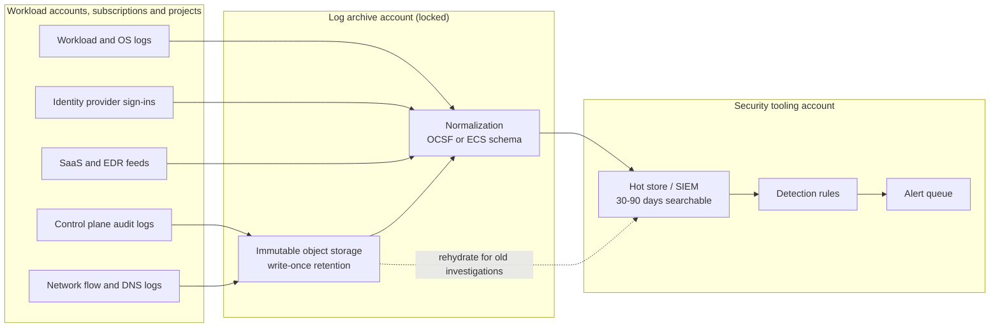

# Centralized Security Logging and SIEM Pipeline

A reference design for getting security-relevant logs out of every cloud account, subscription and project you own, into one place an attacker cannot edit, and on into a SIEM where detections run. It covers a multi-account AWS organization, Azure tenants and GCP organizations, and the hybrid case where all three feed one security team.

If you have not met the basics yet, read [Logging and detection](../../learn/concepts/logging-and-detection.md) first. If you want to build a small version by hand, the [centralized logging and alerting project](../hands-on-projects/centralized-logging-and-alerting.md) is the lab that matches this page.

---

## The problem this pattern solves

Every incident investigation starts with the same question: what happened, in what order, and who did it? The answer lives in logs. In a small company with one cloud account, the logs are in that account and the question is easy. In a real organization the answer is scattered across dozens or hundreds of accounts, three identity providers, a fleet of laptops and a pile of SaaS tools, each with its own retention, its own format and its own administrators.

That scattering causes four concrete failures that show up again and again in breach reports:

1. **The log was never turned on.** A team created a new account or project, nobody enabled audit logging or data access logging, and the evidence for the incident never existed.
2. **The log was there but the attacker deleted it.** If logs live in the same account the attacker compromised, and the compromised identity has rights over them, the first thing a careful intruder does is stop the trail or shorten retention.
3. **The log was there but nobody looked.** Logs that land in a bucket and are never queried catch nothing. Detection needs the logs to flow somewhere that runs rules and raises alerts.
4. **The log was there but expired.** Many breaches are found months after initial access. The [SolarWinds case study](../case-study-solarwinds-2020.md) is a good example: the intruders were inside for most of a year. A 30-day default retention means the early evidence is gone before anyone asks for it.

A central logging pipeline fixes all four. It makes logging a property of the organization rather than of each team, moves the logs out of reach of the workload accounts, normalizes them so one query works across sources, and keeps them for as long as an investigation might need.

---

## Architecture

*The diagram shows logs flowing left to right. Every workload account sends its audit, network, workload and identity logs to a separate log archive account, where they land in write-once storage and are normalized into one schema. A subset flows on to a SIEM in a security tooling account, which runs detection rules and feeds an alert queue. Older data stays in the cheap archive and is pulled back into the SIEM only when an investigation needs it.*

The two most important lines in that picture are the account boundaries. The log archive is a separate account (or subscription, or project) that workload teams cannot administer. The SIEM lives in a third place, the security tooling account, so an analyst with broad query rights does not also have rights to delete the archive.

---

## Components

### 1. Collection at the organization level

The single biggest improvement most teams can make is to enable collection once, at the top of the hierarchy, so that every new account inherits it. Per-account setup always drifts.

- **AWS:** an organization trail in CloudTrail records management events for every member account and cannot be disabled from inside a member account. Add VPC Flow Logs, Route 53 Resolver query logs and service logs (S3 server access, load balancer, WAF) through AWS Config rules or organization-wide automation. **[📖 Creating a trail for an organization](https://docs.aws.amazon.com/awscloudtrail/latest/userguide/creating-trail-organization.html)** - how the organization trail is created and who can change it.
- **Azure:** Activity Log and Entra ID sign-in and audit logs are exported through diagnostic settings. Use Azure Policy with a `DeployIfNotExists` effect so every new subscription and resource gets a diagnostic setting pointing at the central workspace. **[📖 Diagnostic settings in Azure Monitor](https://learn.microsoft.com/en-us/azure/azure-monitor/essentials/diagnostic-settings)** - which logs each resource can send and where.
- **GCP:** Admin Activity audit logs are always on. Data Access audit logs are off by default for most services and must be enabled deliberately. An aggregated sink at the organization or folder level routes logs from every child project to one destination. **[📖 Aggregated sinks](https://cloud.google.com/logging/docs/export/aggregated_sinks)** - routing logs from a whole organization to one place.

Identity logs deserve special mention. Most modern intrusions use valid credentials, so the sign-in logs from your identity provider (Entra ID, Okta, Google Workspace) are often more useful than anything from the network. Feed them in from day one.

### 2. The log archive

The archive is object storage with write-once protection. Its job is to be the evidence of record: complete, unaltered and available for years.

- **AWS:** an S3 bucket in a dedicated Log Archive account (the default layout in AWS Control Tower), with S3 Object Lock in compliance mode and a bucket policy that only allows writes from the organization's log delivery services. **[📖 S3 Object Lock](https://docs.aws.amazon.com/AmazonS3/latest/userguide/object-lock.html)** - write-once-read-many retention that even the root user cannot shorten in compliance mode.
- **Azure:** a storage account with immutable blob storage (time-based retention policies), in a subscription owned by the security team.
- **GCP:** a Cloud Storage bucket with a locked retention policy, in a dedicated logging project.

The archive should also be protected by organization-level guardrails: a service control policy, Azure Policy deny assignment or GCP organization policy that stops anyone in a member account from deleting the trail, the sink or the diagnostic setting. This is the control that defeats "the attacker turned off logging".

### 3. Normalization

Raw logs from three clouds and a dozen SaaS tools all describe the same things (a user signed in, a role was assumed, a file was read) in different shapes. Normalizing them into one schema means a detection can be written once.

Two schemas dominate. The **Open Cybersecurity Schema Framework (OCSF)** is vendor-neutral and is what Amazon Security Lake stores natively. The **Elastic Common Schema (ECS)** is common in Elastic and OpenTelemetry pipelines. Microsoft Sentinel uses its own normalized tables (ASIM) and Google Security Operations uses the Unified Data Model (UDM). Pick the schema your SIEM speaks and convert at ingestion.

**[📖 Open Cybersecurity Schema Framework](https://ocsf.io/)** - the schema, its event classes and the mapping effort behind it.

### 4. The SIEM or security data lake

The SIEM is where logs become searchable and where detection rules run. The main options:

| Cloud | Native option | What it does |
|---|---|---|
| AWS | Amazon Security Lake plus a query layer (Athena, OpenSearch) or a partner SIEM | Collects AWS and third-party logs into an OCSF data lake in your account |
| Azure | Microsoft Sentinel on a Log Analytics workspace | Cloud SIEM with built-in connectors, analytics rules and SOAR playbooks |
| GCP | Google Security Operations (formerly Chronicle) | Cloud SIEM priced around a long default retention, with UDM normalization |
| Any | Splunk, Elastic, Sumo Logic, Datadog and others | Cross-cloud SIEMs, usually fed from the archive or a streaming tier |

**[📖 What is Amazon Security Lake?](https://docs.aws.amazon.com/security-lake/latest/userguide/what-is-security-lake.html)** - the OCSF data lake and its subscriber model.
**[📖 What is Microsoft Sentinel?](https://learn.microsoft.com/en-us/azure/sentinel/overview)** - the cloud SIEM and how it is built on Log Analytics.
**[📖 Google Security Operations overview](https://cloud.google.com/chronicle/docs/overview)** - ingestion, UDM and detection in Google's SIEM.

A multi-cloud company does not need three SIEMs. The common shape is: each cloud's native collection writes into its own locked archive, and one SIEM (often the one the identity provider is closest to) ingests from all three.

### 5. Hot, warm and cold tiers

Not every log needs to be searchable in seconds. A tiered design keeps cost sane:

- **Hot (SIEM):** the last 30 to 90 days of high-value sources, indexed and fast. This is where detection rules run.
- **Warm (data lake):** a year or more in columnar files (Parquet) queried with a serverless engine. Slower, much cheaper, good for threat hunting.
- **Cold (archive):** the full raw record for as long as policy or regulation requires, usually in an archive storage class. Rehydrated into the hot tier only for an investigation.

---

## Design decisions and trade-offs

**Send everything, or send what matters?** Sending everything is simple to reason about and expensive. Sending only what has a detection or an investigation use is cheaper and needs discipline. The practical answer is: send everything to the archive (storage is cheap), and send only curated sources to the hot SIEM tier. Revisit the curation every quarter against your detection coverage.

**Native SIEM per cloud, or one central SIEM?** Native SIEMs are easiest to connect to their own cloud and often include free ingestion for some first-party logs. A central SIEM gives one place to search and one rule language. Most organizations with one dominant cloud use that cloud's SIEM and pull the others in. Organizations that are evenly split often choose a cloud-neutral SIEM.

**Schema at write time or at read time?** Normalizing at ingestion makes queries fast and detections portable, but every new source needs a parser before it is useful. Schema-on-read (store raw, parse at query) gets data in faster but makes every query and detection more complex. Security teams nearly always end up normalizing the sources they detect on and leaving the long tail raw.

**Streaming or batch?** CloudTrail delivers files to S3 every few minutes; Event Hubs and Pub/Sub can stream in near real time. For most detection, minutes are fine. For high-urgency signals such as root sign-in or disabling a trail, use a direct event route (EventBridge, Azure Monitor alerts, Cloud Monitoring log-based alerts) alongside the SIEM so alerting does not wait on batch delivery.

**Who owns the pipeline?** If the platform team owns it, collection is reliable but security cannot change it quickly. If security owns it, they own the pager for a data pipeline. A common split: platform owns collection and the archive as infrastructure as code; security owns the SIEM content (parsers, rules, dashboards).

---

## Failure modes

These are the ways a central logging pipeline quietly stops working. Each one has caught real organizations.

1. **Silent source loss.** A connector breaks, a role expires or a new region is not covered, and one source stops sending. Nothing errors; the SIEM just sees less. The fix is a **heartbeat detection** for every critical source: alert when a source that normally sends every few minutes has sent nothing for an hour.
2. **Unlogged new accounts.** Accounts created outside the landing zone process miss organization-level collection. Enforce account creation through one vending process and alert on accounts that exist without the trail.
3. **Data access logs left off.** Control plane logs show that someone changed a bucket policy; they do not show who read a million objects. S3 data events, GCP Data Access logs and Azure storage diagnostic logs are off by default because of volume. Turn them on at least for buckets and databases that hold sensitive data. In the [Capital One case](../case-study-capital-one-2019.md), the question "what did the role read?" is exactly what object-level logs answer.
4. **Clock and time zone drift.** Sources that log in local time, or hosts with drifted clocks, make timelines wrong. Store everything in UTC and record both event time and ingestion time.
5. **Parser drift.** A vendor changes a log format and a parser silently produces empty fields, so detections stop matching. Add tests to parsers the same way you test detections (see the [SOC detection pipeline pattern](./soc-detection-and-response-pipeline.md)).
6. **Cost shock leads to cuts.** A noisy source triples the SIEM bill and someone turns it off without telling the detection team. Put ingestion budgets and per-source volume dashboards in front of the people who pay, and make source removal a reviewed change.
7. **The archive is reachable from the SIEM.** If the SIEM's service identity has delete rights on the archive, a SIEM compromise becomes an evidence-destruction event. The SIEM should have read access only.

---

## Security of the pipeline itself

Logs contain sensitive data: usernames, IP addresses, sometimes tokens or personal data that leaked into an application log. The pipeline is a high-value target and needs its own controls.

- Encrypt the archive with a customer-managed key whose key policy is owned by the security team. See the [secrets and PKI platform pattern](./secrets-and-pki-platform.md) for key ownership.
- Restrict human read access to the archive. Analysts work in the SIEM; direct archive access is break-glass.
- Scrub or mask secrets at ingestion. A token in a log is a token anyone with query rights can use.
- Log access to the logs. Queries against the SIEM and reads of the archive are themselves audit events.
- Apply data residency rules. Under GDPR, NIS2 and similar regimes, logs containing personal data may need to stay in a region. See the [GDPR guide](../compliance-guides/gdpr.md) and the [NIS2 guide](../compliance-guides/nis2.md).

---

## Cost notes

Logging cost is dominated by **ingestion and indexing in the hot tier**, not storage. A rough order of cost per gigabyte, from most to least expensive, is: SIEM ingestion and indexing, streaming transport, warm data lake queries, object storage, archive storage. Concretely:

- **AWS:** the first copy of CloudTrail management events in each region is free; additional trails and data events are charged per event. Security Lake charges per gigabyte ingested and normalized. Object Lock adds no charge beyond storage.
- **Azure:** Sentinel and Log Analytics charge per gigabyte ingested, with commitment tiers that cut the per-gigabyte price at volume. Some Microsoft sources (for example, Azure Activity logs and Office 365 audit logs) are free to ingest into Sentinel. Basic and auxiliary log tiers are cheaper for high-volume, low-value sources.
- **GCP:** Cloud Logging charges for ingestion beyond a free allotment, and Data Access logs can generate large volumes quickly. Google Security Operations is typically licensed rather than metered per gigabyte.

Practical cost controls:

- Filter at the source. Drop debug-level application logs and health check noise before they leave the account.
- Send VPC flow logs to the archive and only a sampled or summarized view to the SIEM.
- Use the cheaper "basic" or "auxiliary" tiers for sources you only search during investigations.
- Review the top ten sources by volume every month. One chatty source usually dominates.

Check current prices before you size anything: **[📖 AWS CloudTrail pricing](https://aws.amazon.com/cloudtrail/pricing/)**, **[📖 Microsoft Sentinel pricing](https://azure.microsoft.com/en-us/pricing/details/microsoft-sentinel/)** and **[📖 Cloud Logging pricing](https://cloud.google.com/stackdriver/pricing)**.

---

## Production checklist

- [ ] Audit logging enabled at the organization, management group or folder level, not per account
- [ ] Identity provider sign-in and audit logs flowing to the SIEM
- [ ] Data access logging on for every store that holds sensitive data
- [ ] Log archive in a separate account with write-once retention
- [ ] Guardrail policy blocks disabling trails, sinks or diagnostic settings from member accounts
- [ ] Retention matches your longest regulatory or contractual requirement (often one year searchable plus several years archived)
- [ ] Every critical source has a heartbeat detection
- [ ] SIEM identity has read-only access to the archive
- [ ] Logs encrypted with a security-team-owned key
- [ ] Ingestion volume and cost reviewed monthly
- [ ] A tested runbook for rehydrating archived logs into the SIEM during an incident

---

## Related

- [Logging and detection](../../learn/concepts/logging-and-detection.md) - the concept page behind this pattern
- [Incident response basics](../../learn/concepts/incident-response-basics.md) - what the logs are for
- [SOC detection and response pipeline](./soc-detection-and-response-pipeline.md) - what happens after the logs arrive
- [Zero trust access for internal apps](./zero-trust-access-internal-apps.md) - the access proxy is one of the richest log sources you will have
- [Centralized logging and alerting (hands-on)](../hands-on-projects/centralized-logging-and-alerting.md) - build a small version of this pipeline
- [Security tools compared](../service-comparison-security-tools.md) - GuardDuty, Defender for Cloud and Security Command Center side by side
- **[📖 NIST SP 800-92, Guide to Computer Security Log Management](https://csrc.nist.gov/pubs/sp/800/92/final)** - the long-standing reference on log management programs
