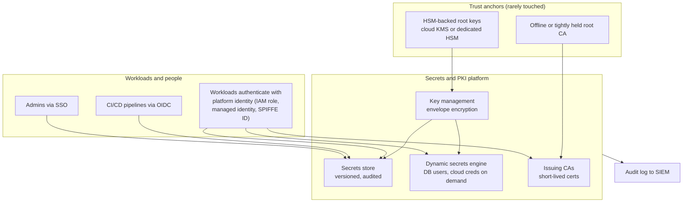

# Secrets and PKI Platform

A reference design for a central platform that issues, stores, rotates and revokes the credentials your systems use to prove who they are: API keys, database passwords, encryption keys and certificates. The goal is a world where most credentials are short-lived, issued on demand, never written into code, and replaced automatically before anyone has to remember to.

For the basics, read [Secrets management](../../learn/concepts/secrets-management.md), [Encryption explained](../../learn/concepts/encryption-explained.md) and [TLS and HTTPS](../../learn/concepts/tls-and-https.md) first.

---

## The problem this pattern solves

Leaked and long-lived credentials are behind a large share of cloud breaches. The pattern repeats: an access key committed to a repository, a database password in a config file copied to a wiki, a service account key downloaded to a laptop, a certificate that expired at 2am on a holiday and took down checkout. Each of these is a symptom of the same problem: credentials are treated as static configuration rather than as something a system manages.

Four forces make this worse over time:

1. **Volume.** Every microservice, pipeline and SaaS integration needs credentials. Hundreds become thousands.
2. **Lifetime.** A credential that never expires stays valid long after the person who created it leaves and the system that used it is decommissioned.
3. **Certificate churn.** Public TLS certificate lifetimes are shrinking. The CA/Browser Forum's ballot SC-081, approved in April 2025, cuts the maximum validity of public TLS certificates from 398 days to 200 days from 15 March 2026, 100 days from 15 March 2027 and 47 days from 15 March 2029. Manual renewal stops being possible. **[📖 Ballot SC-081v3](https://cabforum.org/2025/04/11/ballot-sc081v3-introduce-schedule-of-reducing-validity-and-data-reuse-periods/)** - the schedule as adopted.
4. **Revocation is hard.** When a credential leaks, you need to know everywhere it is used before you can safely rotate it. With no inventory, rotation becomes an outage.

A secrets and PKI platform turns each of these from a manual chore into an automated property of the system.

---

## Architecture

*The diagram shows three layers. At the top, a small set of trust anchors (HSM-protected root keys and a root certificate authority) are used rarely and guarded heavily. In the middle, the platform offers four services built on those anchors: key management for envelope encryption, a versioned secrets store, a dynamic secrets engine that mints credentials on demand, and issuing certificate authorities that sign short-lived certificates. At the bottom, workloads, pipelines and people authenticate to the platform with an identity they already have, never with a stored secret, and every operation is logged to the SIEM.*

The design principle is that **no consumer starts with a secret**. A workload proves who it is using something the platform gives it for free (an IAM role on AWS, a managed identity on Azure, an attached service account on GCP, a Kubernetes service account token, a SPIFFE identity), and exchanges that for whatever credential it needs. This is how you escape the "secret zero" problem: the first secret is replaced by platform identity.

---

## Components

### 1. Key management service (KMS)

A KMS holds encryption keys inside hardware security modules and never lets the plaintext key leave. Applications use **envelope encryption**: the KMS key encrypts a data key, and the data key encrypts the data. Rotating the KMS key does not require re-encrypting all the data.

- **AWS:** AWS KMS, with CloudHSM for dedicated single-tenant HSMs. **[📖 AWS KMS concepts](https://docs.aws.amazon.com/kms/latest/developerguide/overview.html)** - keys, key policies and envelope encryption.
- **Azure:** Azure Key Vault (keys, secrets and certificates in one service) and Managed HSM. **[📖 About Azure Key Vault](https://learn.microsoft.com/en-us/azure/key-vault/general/overview)** - vaults, access models and HSM tiers.
- **GCP:** Cloud KMS, with Cloud HSM and Cloud External Key Manager for keys held outside Google. **[📖 Cloud Key Management Service overview](https://cloud.google.com/kms/docs/key-management-service)** - key rings, protection levels and rotation.

Key ownership matters as much as the technology. Separate the people who can **use** a key from the people who can **administer** it, and make the key policy (not only IAM) the place where that separation is enforced.

### 2. Secrets store

The secrets store holds static secrets that must exist: third-party API keys, legacy database passwords, signing keys for systems that cannot use KMS. It versions every secret, encrypts with KMS, logs every read, and can rotate on a schedule.

- **AWS:** Secrets Manager (with managed rotation for RDS and other services) and Systems Manager Parameter Store for lower-sensitivity config. **[📖 Rotate AWS Secrets Manager secrets](https://docs.aws.amazon.com/secretsmanager/latest/userguide/rotating-secrets.html)** - rotation strategies and Lambda rotation functions.
- **Azure:** Key Vault secrets, referenced from App Service, Functions and AKS via the Secrets Store CSI driver.
- **GCP:** Secret Manager. **[📖 Secret Manager overview](https://cloud.google.com/secret-manager/docs/overview)** - versions, replication and rotation notifications.
- **Cross-cloud:** HashiCorp Vault (or its open-source fork OpenBao) is the most common choice when an organization wants one secrets API across clouds and on-premises.

### 3. Dynamic secrets

Dynamic secrets are the biggest step change. Instead of storing a database password, the platform creates a new database user with a short time to live when a workload asks, and deletes it when the lease expires. Every workload instance gets its own credential, so a leak identifies the exact consumer and expires on its own.

Vault's database and cloud secrets engines are the reference implementation. **[📖 Vault database secrets engine](https://developer.hashicorp.com/vault/docs/secrets/databases)** - dynamic database credentials with leases. Cloud-native equivalents exist in narrower forms: IAM database authentication for RDS and Cloud SQL, and Entra ID authentication for Azure SQL, all of which replace passwords with short-lived tokens tied to the workload's identity.

### 4. Workload identity instead of keys

The best secret is one that does not exist. Every cloud now lets workloads and pipelines get short-lived credentials without stored keys:

- **AWS:** IAM roles for EC2, ECS, Lambda and EKS (IRSA, EKS Pod Identity); IAM Roles Anywhere for on-premises workloads holding a certificate.
- **Azure:** managed identities and workload identity federation. **[📖 Managed identities for Azure resources](https://learn.microsoft.com/en-us/entra/identity/managed-identities-azure-resources/overview)** - system and user-assigned identities.
- **GCP:** attached service accounts and Workload Identity Federation. **[📖 Workload Identity Federation](https://cloud.google.com/iam/docs/workload-identity-federation)** - exchanging external tokens for short-lived Google credentials.
- **CI/CD:** GitHub Actions, GitLab and others issue OIDC tokens that each cloud can trust, so pipelines deploy without long-lived cloud keys stored as repository secrets.

For service-to-service identity across platforms, **SPIFFE** defines a standard identity format and short-lived X.509 or JWT credentials, with SPIRE as the reference implementation. **[📖 SPIFFE overview](https://spiffe.io/docs/latest/spiffe-about/overview/)** - workload identity documents and the trust domain model.

### 5. Private PKI

A private PKI issues certificates for internal TLS, mutual TLS between services, device identity (used by the [zero trust access pattern](./zero-trust-access-internal-apps.md)) and SSH certificates for admins.

- **AWS:** AWS Private CA, including short-lived certificate mode. **[📖 What is AWS Private CA?](https://docs.aws.amazon.com/privateca/latest/userguide/PcaWelcome.html)** - CA hierarchies and certificate issuance.
- **Azure:** no first-party general-purpose private CA in the same shape; Key Vault integrates with partner CAs for issuance and renewal, and many teams run Vault PKI or a partner CA.
- **GCP:** Certificate Authority Service. **[📖 Certificate Authority Service overview](https://cloud.google.com/certificate-authority-service/docs/ca-service-overview)** - CA pools, tiers and issuance policies.
- **Kubernetes:** cert-manager automates issuance and renewal from any of these, or from ACME for public certificates. **[📖 cert-manager documentation](https://cert-manager.io/docs/)** - issuers, certificates and renewal.
- **Vault PKI** issues certificates with lifetimes of hours. **[📖 Vault PKI secrets engine](https://developer.hashicorp.com/vault/docs/secrets/pki)** - roles, issuers and short-lived certificates.

A sound CA hierarchy has a **root CA** that is offline or tightly controlled and used only to sign intermediates, and **issuing CAs** per environment or purpose. If an issuing CA is compromised, you revoke and replace it without touching the root that every device trusts.

**Short-lived certificates change revocation.** Certificate revocation lists and OCSP are slow and often ignored by clients. A certificate that lives 24 hours does not need reliable revocation; it simply expires. This is why service mesh and SPIFFE certificates are typically valid for hours.

---

## Rotation as a design property

Rotation is where most secrets programs fail, because it is the part that can cause outages. Design for it:

- **Two valid versions at once.** Rotate by adding a new credential, moving consumers to it, then retiring the old one. Secrets Manager's rotation steps (create, set, test, finish) follow this pattern.
- **Consumers fetch at runtime, not at build time.** A secret baked into a container image cannot be rotated without a rebuild. Fetch from the platform at startup and refresh on a schedule or on notification.
- **Automate certificate renewal end to end.** Use ACME (for public certificates) or cert-manager and the cloud certificate managers (for private ones), and alert on any certificate within a fraction of its lifetime of expiry that has not renewed.
- **Inventory first.** You cannot rotate what you cannot find. The platform's audit log tells you which identity read which secret, which is the inventory you need during an incident.
- **Practise emergency rotation.** Pick a secret each quarter and rotate it as if it had leaked. The first time is always painful; the fourth is boring.

---

## Trade-offs

**Cloud-native versus Vault.** Cloud-native services (Secrets Manager, Key Vault, Secret Manager, the KMSs) are managed, integrated with IAM and cheap to start. Vault gives one API across clouds, dynamic secrets for many backends and richer PKI, at the cost of running a stateful, highly available, security-critical cluster (or paying for HCP Vault). Single-cloud shops usually stay native; multi-cloud and on-premises-heavy shops often adopt Vault.

**Centralization versus blast radius.** One platform is easier to audit and operate. It is also a single point of failure and a high-value target. Mitigate with separate instances or namespaces per environment, strict separation of admin roles and break-glass procedures that do not depend on the platform being up.

**Short lifetimes versus availability.** A one-hour credential is great for security and terrible if the platform is down for two hours. Size lifetimes to the platform's availability and cache appropriately.

**Customer-managed keys versus provider-managed keys.** Customer-managed keys give you control over rotation, key policy and the ability to revoke the provider's access by disabling the key. They also add cost, operational overhead and the risk of locking yourself out. Use them where regulation or data sensitivity requires; provider-managed keys are fine elsewhere.

---

## Failure modes

1. **Secret zero in disguise.** The platform is in place, but workloads authenticate to it with a static token stored in an environment variable. You moved the problem rather than solved it. Use platform identity.
2. **Root keys too reachable.** If the same admins who run day-to-day operations can use or delete root keys and the root CA, a single compromised admin account undermines everything. Keep trust anchors behind separate roles, MFA and approval.
3. **Expired certificates take down production.** Usually an internal certificate someone issued by hand years ago. Inventory, monitor expiry, and automate.
4. **Accidental key deletion.** A deleted KMS key makes every piece of data encrypted under it permanently unreadable. Cloud KMSs enforce a waiting period before deletion for this reason; alert on any scheduled key deletion.
5. **Leaked secrets in logs and repositories.** Secrets end up in application logs, crash dumps and commits. Run secret scanning on repositories (GitHub push protection, GitLab secret detection, pre-commit hooks) and redact at log ingestion. See the [centralized logging pattern](./centralized-security-logging-siem.md).
6. **Over-broad read access.** A single IAM policy that lets every workload read every secret is common and dangerous. Scope secret access by path or tag to the one workload that needs each secret.
7. **No audit review.** The platform logs every read, but nobody alerts on a workload reading secrets it has never read before, or a human reading production secrets outside a change window.

---

## Cost notes

- **KMS:** charged per key per month plus per API request. Envelope encryption and data key caching keep request counts down. HSM-dedicated options (CloudHSM, Managed HSM, single-tenant Cloud HSM) are priced per HSM per hour and are much more expensive.
- **Secrets stores:** Secrets Manager charges per secret per month plus per API call; Key Vault and Secret Manager charge per operation and per secret version. Parameter Store standard parameters are free for low-sensitivity config.
- **Private CA:** AWS Private CA charges per CA per month plus per certificate, with a lower rate for short-lived certificate mode. GCP CA Service has DevOps and Enterprise tiers with different per-certificate pricing.
- **Vault:** open source is free to run but costs engineering time; HCP Vault and Vault Enterprise are licensed.
- **The real cost** is usually migration effort: finding every hard-coded secret and moving each consumer to runtime fetch or workload identity.

Check current prices: **[📖 AWS KMS pricing](https://aws.amazon.com/kms/pricing/)**, **[📖 AWS Secrets Manager pricing](https://aws.amazon.com/secrets-manager/pricing/)**, **[📖 Azure Key Vault pricing](https://azure.microsoft.com/en-us/pricing/details/key-vault/)** and **[📖 Cloud KMS pricing](https://cloud.google.com/kms/pricing)**.

---

## Production checklist

- [ ] No long-lived cloud access keys for workloads or CI/CD; workload identity and OIDC federation everywhere they are supported
- [ ] Secrets fetched at runtime, never baked into images or committed to repositories
- [ ] Secret scanning with push protection on every repository
- [ ] Each secret readable only by the workload that needs it
- [ ] Dynamic or token-based database credentials for new services
- [ ] Root CA offline or behind separate admin roles; issuing CAs per environment
- [ ] Internal certificates short-lived and renewed automatically; expiry monitored
- [ ] Public TLS renewal automated ahead of the shrinking validity schedule
- [ ] KMS key admins separated from key users; scheduled key deletion alerts
- [ ] Platform audit logs in the SIEM with detections for unusual reads
- [ ] Emergency rotation practised at least quarterly

---

## Related

- [Secrets management](../../learn/concepts/secrets-management.md) - the concept page
- [Encryption explained](../../learn/concepts/encryption-explained.md) and [TLS and HTTPS](../../learn/concepts/tls-and-https.md) - the cryptography underneath
- [Least privilege explained](../../learn/concepts/least-privilege-explained.md) - scoping who can read what
- [Software supply chain security](../../learn/concepts/software-supply-chain-security.md) - signing keys and build identity
- [Zero trust access for internal apps](./zero-trust-access-internal-apps.md) - device certificates and SSH certificates in use
- [Capital One 2019 case study](../case-study-capital-one-2019.md) - what short-lived role credentials do and do not protect against
- [Security tools compared](../service-comparison-security-tools.md) - secrets managers and KMS side by side
- **[📖 NIST SP 800-57 Part 1, Recommendation for Key Management](https://csrc.nist.gov/pubs/sp/800/57/pt1/r5/final)** - key lifecycles and cryptoperiods
