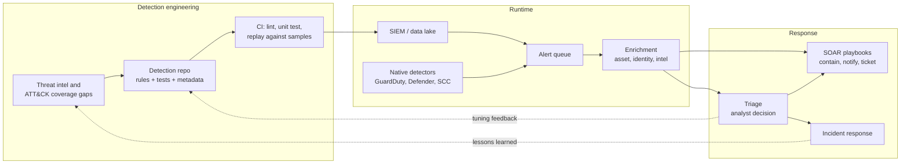

# SOC Detection and Response Pipeline

A reference design for the part of a security operations center (SOC) that turns logs into handled incidents: how detections are written, tested and deployed as code, how alerts are enriched and triaged, and how response actions are automated with SOAR without automating yourself into an outage.

This pattern picks up where the [centralized security logging pattern](./centralized-security-logging-siem.md) stops. That page gets the data into one place. This one is about what the security team does with it. For the concepts, read [Logging and detection](../../learn/concepts/logging-and-detection.md) and [Incident response basics](../../learn/concepts/incident-response-basics.md) first.

---

## The problem this pattern solves

Most SOCs fail in one of two ways. Either they see too little (the logs are there but there are no detections for the techniques that matter) or they see too much (thousands of alerts a day, most of them noise, so analysts stop looking). Both lead to the same outcome: the alert that mattered was missed or ignored.

The usual root causes are:

1. **Detections built by hand in a console.** Nobody knows which rules exist, why they were written, whether they still work, or which attacker techniques they cover.
2. **No testing.** A rule that has never been fired against a known-bad sample may never fire at all. A parser change can silently break dozens of rules.
3. **Alerts without context.** An alert that says "suspicious sign-in for user 4f2a..." makes the analyst spend twenty minutes finding out who the user is, what they normally do and whether the IP is known. Multiply by a few hundred alerts.
4. **Manual response.** Every containment step (disable the user, isolate the host, revoke the session) waits for a human to log into three consoles.
5. **No feedback loop.** False positives are closed and forgotten instead of being used to tune the rule.

Treating detection as a software engineering problem, with version control, tests, review, deployment and metrics, fixes most of these. The industry calls this **detection as code** or **detection engineering**.

---

## Architecture

*The diagram shows three stages. In detection engineering, threat intelligence and gaps in MITRE ATT&CK coverage drive new rules, which live in a repository with tests and are deployed through CI to the SIEM. At runtime, the SIEM and the cloud providers' native detectors both feed one alert queue, and every alert is enriched with asset, identity and threat intel context. In response, an analyst triages the enriched alert, SOAR playbooks run containment and notification, and confirmed incidents go to the incident response process. Two feedback loops close the cycle: triage outcomes tune the rules, and incident lessons feed new detection ideas.*

---

## Components

### 1. Detection sources: write your own and use the native ones

There are two kinds of detection, and you need both.

**Managed detectors** from the cloud providers watch their own telemetry with models you cannot easily build yourself: Amazon GuardDuty, Microsoft Defender for Cloud and Defender XDR, and Google Security Command Center with its Event Threat Detection. They catch things like credential use from unusual infrastructure, crypto mining and known-malicious IPs, and they need almost no tuning to start.

- **[📖 What is Amazon GuardDuty?](https://docs.aws.amazon.com/guardduty/latest/ug/what-is-guardduty.html)** - managed threat detection across CloudTrail, VPC, DNS, EKS and more.
- **[📖 Security Command Center overview](https://cloud.google.com/security-command-center/docs/security-command-center-overview)** - GCP's findings and threat detection hub.

**Custom detections** are the rules your team writes in the SIEM's query language for things specific to your environment: "a production IAM role used from outside our CI system", "a new OAuth app granted mail read scope", "a break-glass account signed in". These encode knowledge only you have.

### 2. Detection as code

Each custom detection lives in a repository as a file containing:

- **The rule itself**, either in the SIEM's native language (KQL for Sentinel, YARA-L for Google Security Operations, SPL for Splunk, SQL for a data lake) or in **Sigma**, a vendor-neutral format that converts to many backends. **[📖 Sigma rules](https://github.com/SigmaHQ/sigma)** - the generic signature format and its community rule set.
- **Metadata:** owner, severity, the ATT&CK technique it covers, the data sources it needs, expected false positives and a link to the response runbook.
- **Tests:** at least one known-bad sample that must trigger the rule and one known-good sample that must not.

CI runs on every change: lint the rule, convert it if using Sigma, run it against the test samples, and check that the data sources it depends on actually exist. Merging to main deploys the rule through the SIEM's API or infrastructure as code (Sentinel supports deploying content from a repository, and most SIEMs have Terraform providers).

**[📖 Deploy Microsoft Sentinel content from repositories](https://learn.microsoft.com/en-us/azure/sentinel/ci-cd)** - connecting GitHub or Azure DevOps to a workspace.
**[📖 MITRE ATT&CK](https://attack.mitre.org/)** - the adversary technique catalogue used to map and measure coverage.

Map every rule to ATT&CK techniques and keep a coverage view. The point is not to colour in every cell; it is to see that you have, for example, five rules for initial access and none for credential access in your cloud control plane.

### 3. Alert queue and deduplication

Everything that fires, from custom rules and native detectors, goes into one queue. Two features keep it manageable:

- **Grouping:** related alerts (the same user, host or campaign within a window) become one incident instead of twenty tickets.
- **Suppression:** known-benign patterns (a vulnerability scanner, a scheduled admin job) are suppressed by explicit, reviewed, expiring exceptions, not by deleting the rule.

### 4. Enrichment

Before a human sees an alert, automation should attach:

- **Identity context:** who the user is, their manager, department, normal sign-in locations, recent MFA changes.
- **Asset context:** what the host or resource is, its owner, environment (prod or dev), data sensitivity, internet exposure.
- **Threat intel:** reputation of IPs, domains and file hashes involved.
- **History:** prior alerts on the same entity and how they were resolved.

Good enrichment is the single biggest lever on analyst time. Many SIEMs do some natively (Sentinel's entity pages, Google SecOps' entity graph); the rest is done by SOAR playbooks that run before assignment.

### 5. Triage

The analyst's job at triage is to answer three questions quickly: is it real, how bad is it, and what happens next? A good triage process has:

- **Runbooks per detection** that say what to check and what the possible outcomes are.
- **Clear severity definitions** tied to business impact, so "high" means the same thing to everyone.
- **Defined outcomes:** true positive (escalate to incident), benign true positive (real activity, authorized), false positive (rule needs tuning). Each outcome is recorded because it feeds the metrics and the tuning loop.

AI assistants are increasingly used here to summarize alerts, draft investigation queries and suggest next steps. Treat them as an analyst's helper, keep a human on the decision for anything with impact, and log what the assistant was shown and suggested.

### 6. SOAR: automated response

Security orchestration, automation and response (SOAR) runs playbooks: sequences of actions triggered by an alert or by an analyst.

| Cloud | Native SOAR | Typical actions |
|---|---|---|
| AWS | Security Hub automation rules, EventBridge to Step Functions or Lambda, Systems Manager Automation | Quarantine an instance's security group, disable an access key, snapshot a volume for forensics |
| Azure | Microsoft Sentinel automation rules and playbooks (Logic Apps), Defender XDR automated investigation | Disable a user, revoke sessions, isolate a device, post to Teams |
| GCP | Google Security Operations SOAR, Pub/Sub to Cloud Functions or Workflows | Disable a service account key, apply an organization policy, open a case |

**[📖 Automation in Microsoft Sentinel](https://learn.microsoft.com/en-us/azure/sentinel/automation/automation)** - automation rules and playbooks.
**[📖 Automation rules in AWS Security Hub](https://docs.aws.amazon.com/securityhub/latest/userguide/automation-rules.html)** - updating and routing findings automatically.

A useful way to decide what to automate is by reversibility and confidence:

- **Always automate:** enrichment, ticket creation, notification, evidence collection (snapshots, log exports). These are safe and save the most time.
- **Automate with high-confidence detections:** reversible containment such as revoking sessions, disabling an access key or isolating a single laptop. Notify the owner at the same time.
- **Human approval required:** anything that can take down production (isolating a production server, blocking an IP range at the edge, disabling a service account used by a critical app). The playbook prepares the action; a human clicks approve.

### 7. Incident response hand-off

Confirmed incidents leave the queue and enter the incident response process: an incident commander, communications, containment, eradication, recovery and a post-incident review. NIST's current guidance, SP 800-61 Revision 3 (April 2025), frames incident response as part of overall risk management aligned to CSF 2.0. **[📖 NIST SP 800-61r3](https://csrc.nist.gov/pubs/sp/800/61/r3/final)** - incident response recommendations and considerations.

The post-incident review should always ask: which detection should have caught this earlier, and does it exist now? That question is the second feedback loop in the diagram.

---

## Metrics that matter

Measure the pipeline like any production system:

- **Mean time to detect (MTTD)** and **mean time to respond (MTTR)**, measured from first malicious event, not from alert creation.
- **Alert volume per analyst per shift**, and the share that were true positives. A true positive rate in the low single digits means the rules need tuning.
- **ATT&CK coverage** for the techniques most relevant to your threat model, with tested rules.
- **Detection test pass rate** in CI, and the number of rules with no test.
- **Source health:** percentage of critical sources sending data in the last hour.
- **Automation rate:** share of alerts fully enriched before assignment and share of containment actions executed by playbook.

---

## Trade-offs

**Build versus buy for detections.** Vendor and community content (Sentinel solutions, Sigma, Elastic rules) gives broad coverage fast and is generic. Custom rules catch what matters in your environment and take engineering time. The usual mix: start from vendor content, tune it, and spend custom effort on your crown jewels and your cloud control plane.

**Automation versus safety.** Automated containment saves minutes that can matter, and a bad playbook can lock out your CEO or take down production. Use the reversibility rule above, add rate limits (a playbook that tries to disable 200 users in a minute should stop and page someone) and test playbooks against non-production first.

**In-house SOC versus MDR.** A managed detection and response provider gives 24x7 coverage that a small team cannot. It also knows less about your environment. Many organizations keep detection engineering and incident command in-house and outsource first-line, out-of-hours triage.

**One SIEM versus native consoles.** Analysts working across GuardDuty, Defender and SCC consoles lose time. Routing native findings into the one queue costs some ingestion and saves far more analyst time.

---

## Failure modes

1. **Rules that cannot fire.** The data source was renamed or a field changed and the rule matches nothing. Only replay tests in CI and source heartbeats catch this.
2. **Alert fatigue.** Volume grows until analysts bulk-close. Track the true positive rate per rule and retire or tune rules below a threshold.
3. **Suppressions that never expire.** A temporary exception for a migration becomes a permanent blind spot. Every suppression has an owner and an end date.
4. **Playbook blast radius.** An automation runs on a false positive at scale. Rate limits, approval gates for high-impact actions, and dry-run modes prevent this.
5. **The SOAR platform as a target.** Playbooks hold powerful credentials (disable users, change security groups). Protect them like production admin access: least privilege, short-lived credentials, audit, and no shared service accounts.
6. **Detection gaps in the control plane.** Many teams detect well on endpoints and poorly on cloud API activity. The [Capital One](../case-study-capital-one-2019.md) and [SolarWinds](../case-study-solarwinds-2020.md) case studies both turn on control plane and identity signals.
7. **No exercise.** Rules and playbooks that have never been tested in a purple team or tabletop exercise usually fail the first time they are needed.

---

## Cost notes

- **SIEM ingestion** dominates, as covered in the [logging pattern](./centralized-security-logging-siem.md). Detection as code helps here: when every rule declares its data sources, you can see which ingested sources no rule uses.
- **Native detectors** are metered on the volume of events analysed (GuardDuty, Defender plans per resource, SCC tiers). They are usually cheaper than ingesting the same raw logs into a SIEM and writing the rules yourself.
- **SOAR:** cloud-native playbooks (Logic Apps, Step Functions, Lambda) cost little per run. Commercial SOAR platforms are licensed.
- **People** are the largest cost. A 24x7 in-house SOC needs enough analysts to cover every shift plus leave and training, which is why automation and MDR are common.

---

## Production checklist

- [ ] Every custom detection lives in version control with metadata and at least one positive and one negative test
- [ ] CI blocks merges that break tests or reference missing data sources
- [ ] Detections mapped to ATT&CK with a reviewed coverage view
- [ ] Cloud-native detectors enabled in every account and region, findings routed to the one queue
- [ ] Alerts enriched with identity, asset and intel context before assignment
- [ ] A runbook linked from every detection
- [ ] Suppressions have owners and expiry dates
- [ ] SOAR playbooks classified by reversibility, with approval gates and rate limits on high-impact actions
- [ ] Playbook credentials are least-privilege and audited
- [ ] MTTD, MTTR, true positive rate and source health reported monthly
- [ ] Purple team or tabletop exercises at least twice a year, with findings turned into detections

---

## Related

- [Centralized security logging and SIEM pipeline](./centralized-security-logging-siem.md) - the data foundation
- [Logging and detection](../../learn/concepts/logging-and-detection.md) and [Incident response basics](../../learn/concepts/incident-response-basics.md) - concept pages
- [Endpoint security: EDR and XDR](../../learn/concepts/endpoint-security-edr-xdr.md) - the endpoint side of detection
- [Threat modeling explained](../../learn/concepts/threat-modeling-explained.md) - deciding which techniques matter most to you
- [CySA+ study guide](../../exams/comptia/cysa-plus/) and [SC-200 study guide](../../exams/azure/sc-200/) - the certifications that test this work
- [Security tools compared](../service-comparison-security-tools.md) - GuardDuty, Defender for Cloud and SCC side by side
