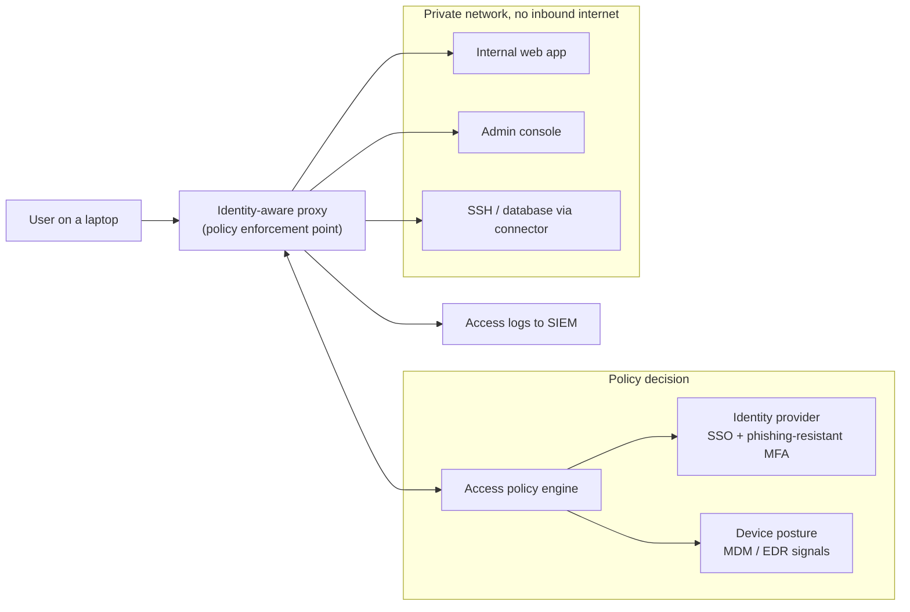

# Zero Trust Access for Internal Apps

A reference design for replacing the corporate VPN with per-application access that checks who the user is, what device they are on and whether that device is healthy, on every request. It is the most common first project in a zero trust program because it delivers a visible win (no more VPN) and a large risk reduction (no more flat network access) at the same time.

This page is narrower than the [zero trust architecture](./zero-trust-architecture.md) pattern, which covers the whole model including workload identity and microsegmentation. Here the focus is one question: how does a human reach an internal web app, SSH host or database safely? For the concepts, start with [Zero trust explained](../../learn/concepts/zero-trust-explained.md). For a hands-on build, see [Implement zero trust](../hands-on-projects/implement-zero-trust.md).

---

## The problem this pattern solves

The traditional model puts internal apps on a private network and gives employees a VPN. Once the VPN connects, the laptop is "inside" and can usually reach a large part of the network. That model has three problems:

1. **A stolen credential opens the whole network.** VPN access is typically one decision at connect time. If an attacker phishes a password and an MFA code, or steals a session, they get the same broad network reach as the employee.
2. **The VPN concentrator is itself an internet-facing target.** Remote access appliances have been among the most exploited products of the last several years, and they appear repeatedly on CISA's Known Exploited Vulnerabilities catalog. A single vulnerable appliance can be the front door for an intrusion.
3. **The network says nothing about the device.** A personal laptop with no disk encryption and an out-of-date operating system gets the same access as a managed, patched corporate machine.

Google described its answer to this in the BeyondCorp papers from 2014 onward: treat the corporate network as no more trusted than the internet, and make every access decision at the application layer, using user identity and device state. NIST later generalized the idea in SP 800-207. **[📖 NIST SP 800-207, Zero Trust Architecture](https://csrc.nist.gov/pubs/sp/800/207/final)** - the reference definition of policy decision and enforcement points.

---

## Architecture

*The diagram shows a user who never touches the private network directly. Every request goes to an identity-aware proxy, which asks a policy engine whether to allow it. The policy engine checks the user's identity and MFA with the identity provider and the device's health with MDM and EDR signals. Only if both pass does the proxy forward the request to the specific app, and every decision is logged to the SIEM. The apps themselves have no inbound internet exposure.*

The key shift is in the arrows. In a VPN model, the user connects to a network. Here, the user connects to an application, through a proxy, and the decision is remade for each request or session.

---

## Components

### 1. Identity provider

Everything starts with strong identity. The identity provider (Entra ID, Okta, Google Workspace or Cloud Identity, Ping) authenticates the user with single sign-on and, for this pattern, **phishing-resistant MFA**: FIDO2 security keys or platform passkeys. Push notifications and one-time codes can be relayed by an adversary-in-the-middle phishing kit; WebAuthn cannot, because the browser binds the credential to the real site's origin. See [MFA and passkeys](../../learn/concepts/mfa-and-passkeys.md).

Group membership in the identity provider becomes the basis for authorization. "Finance team can reach the finance app" is a group, not a firewall rule.

### 2. Device posture

Device posture answers "is this a device we manage and trust right now?" Signals typically come from:

- **MDM** (Intune, Jamf, Google endpoint management): is the device enrolled, encrypted, on a supported OS version, screen-locked?
- **EDR** (Defender for Endpoint, CrowdStrike, SentinelOne): is the agent running, and is the device's risk score low?
- **A device certificate** issued at enrollment, which proves the request comes from that specific machine. The [secrets and PKI platform pattern](./secrets-and-pki-platform.md) covers how those certificates are issued and rotated.

Posture should be checked continuously, not only at sign-in. If EDR raises the device's risk to high mid-session, the next request should be denied.

### 3. Identity-aware proxy (the enforcement point)

The proxy sits in front of each application. It terminates TLS, checks the session, calls the policy engine and forwards the request. The main cloud options:

| Cloud | Service | Notes |
|---|---|---|
| AWS | AWS Verified Access | Per-application access with identity provider trust and device trust providers; fronts apps in a VPC without a VPN |
| Azure | Microsoft Entra Application Proxy, Entra Private Access (Global Secure Access) with Conditional Access | Connector-based publishing of on-premises and private apps; Conditional Access evaluates user, device and risk |
| GCP | Identity-Aware Proxy (IAP), Chrome Enterprise Premium | IAP fronts App Engine, Cloud Run, GKE and Compute Engine apps and TCP forwarding; access levels add device context |
| Vendor-neutral | Cloudflare Access, Zscaler Private Access, Netskope, Tailscale, Teleport, HashiCorp Boundary | Often used across clouds and on-premises |

**[📖 What is AWS Verified Access?](https://docs.aws.amazon.com/verified-access/latest/ug/what-is-verified-access.html)** - trust providers, groups and policies for per-app access.
**[📖 Microsoft Entra Conditional Access](https://learn.microsoft.com/en-us/entra/identity/conditional-access/overview)** - the policy engine behind Microsoft's zero trust access.
**[📖 Microsoft Entra application proxy](https://learn.microsoft.com/en-us/entra/identity/app-proxy/overview-what-is-app-proxy)** - publishing internal web apps through an outbound connector.
**[📖 Identity-Aware Proxy overview](https://cloud.google.com/iap/docs/concepts-overview)** - how IAP authenticates and authorizes requests to Google Cloud apps.

### 4. Connectors and private apps

The applications stay on private networks with no inbound internet access. Many products use an **outbound connector**: a small agent inside the private network that dials out to the proxy service, so no firewall port needs to be opened inward. This removes the internet-facing attack surface that a VPN concentrator represents.

### 5. Non-web access: SSH, RDP and databases

Web apps are the easy case. Administrators also need SSH, RDP and database sessions. Options include IAP TCP forwarding on GCP, AWS Systems Manager Session Manager and EC2 Instance Connect Endpoint, Azure Bastion, and session brokers such as Teleport or Boundary. The best of these issue **short-lived credentials per session** (an SSH certificate valid for minutes, a database user created on demand) and record the session. Standing SSH keys on servers should disappear.

### 6. Logging

Every allow and deny decision, with user, device, app and reason, goes to the SIEM. These logs are some of the most valuable you will have during an investigation, because they tie a human identity and a device to each access. See the [centralized logging pattern](./centralized-security-logging-siem.md).

---

## Writing the access policy

A good access policy reads like a sentence a business owner could approve:

> Members of `grp-finance` may reach the finance app from a company-managed device that is encrypted, on a supported OS and has EDR reporting low risk, after phishing-resistant MFA in the last 12 hours.

Practical rules for policy design:

- **Default deny.** An app published through the proxy with no policy should be unreachable, not open.
- **Per-app, not per-network.** Each application gets its own policy. Group apps by sensitivity tier so you do not write hundreds of unique rules.
- **Tier by sensitivity.** Low-risk apps (wiki, lunch menu) might allow any authenticated user on a registered device. High-risk apps (production consoles, payroll) require a managed device, phishing-resistant MFA and a shorter session.
- **Step-up for sensitive actions.** Re-prompt for MFA when a user moves from reading to administering.
- **Break-glass.** Keep a documented, monitored path for when the identity provider or proxy is down, with a small set of emergency accounts whose use pages the security team.

---

## Rollout: how to get there from a VPN

Big-bang VPN removal fails. A staged rollout works:

1. **Inventory apps and who uses them.** VPN and firewall logs show which internal destinations people actually reach.
2. **Fix identity first.** Single sign-on for every app you plan to publish, and phishing-resistant MFA for administrators at minimum.
3. **Publish low-risk web apps through the proxy** alongside the VPN. Users learn the new path; nothing breaks.
4. **Add device posture in report-only mode.** See how many requests would fail before enforcing.
5. **Move admin access** (SSH, RDP, consoles) to the session broker. This is where the biggest risk reduction is.
6. **Shrink the VPN** to the apps that cannot be proxied (thick clients, odd protocols), then to a named group of users, then retire it.

---

## Trade-offs

**User experience versus friction.** Done well, users get fewer prompts than with a VPN: single sign-on into a browser, and no client to start. Done badly (MFA on every request, frequent posture failures), users route around it. Tune session lengths by tier.

**Unmanaged devices.** Contractors and bring-your-own-device users cannot pass managed-device checks. Options are a browser isolation or virtual desktop path, a limited set of apps for unmanaged devices, or a lightweight agent that reports posture without full MDM.

**Legacy protocols.** Apps that need raw network access, broadcast discovery or non-HTTP protocols are hard to proxy. Some stay behind a narrowly scoped VPN for years.

**Vendor dependence.** The proxy and identity provider become critical paths. An outage at either blocks all access. Plan for it with break-glass access and, where the business needs it, regional redundancy.

**Policy sprawl.** Without tiers and templates, hundreds of per-app policies become unmaintainable. Manage policies as code and review them like any other change.

---

## Failure modes

1. **Proxy bypass.** The app still has a public IP or an internal path that does not go through the proxy, so the policy is decorative. Verify by scanning: the app should be unreachable except through the proxy, and the app should validate the proxy's signed header or token (IAP's signed JWT header, for example), not trust any request that arrives.
2. **Weak MFA as the root of trust.** If the identity provider accepts SMS or push for the proxy's sign-in, an adversary-in-the-middle kit steals the session and the device check may still pass from the attacker's side if posture is only checked at sign-in. Phishing-resistant MFA and session binding to the device close this.
3. **Posture checked once.** A device that was healthy at 9am and compromised at 11am keeps access until the session ends. Use continuous signals and short sessions for sensitive apps.
4. **Overly broad groups.** "All employees" on an admin app recreates the flat network at the application layer. Review group membership and app assignments quarterly.
5. **Help desk as the weak link.** If an attacker can call the help desk and get MFA reset onto a new device, every control above is bypassed. Strong identity verification for MFA resets is part of this pattern.
6. **Logs not reviewed.** The proxy produces excellent signals (impossible travel, new device, repeated denies) that are wasted if they never reach a detection.

---

## Cost notes

- **Cloud-native proxies** are usually priced per application per hour plus data processed (AWS Verified Access), per user (Entra ID P1/P2 licensing for Conditional Access, Global Secure Access licensing) or bundled with other products (GCP IAP itself has no charge for basic use; Chrome Enterprise Premium is a per-user license).
- **Identity and device signals** often depend on license tiers you may already own (Entra ID P1/P2, Intune, an EDR subscription).
- **Savings** come from retiring VPN appliances and their support contracts, and from fewer incidents tied to flat network access.
- **Hidden costs** are the engineering time to move apps to single sign-on and the help desk load during rollout.

Check current prices: **[📖 AWS Verified Access pricing](https://aws.amazon.com/verified-access/pricing/)** and **[📖 Identity-Aware Proxy pricing](https://cloud.google.com/iap/pricing)**.

---

## Production checklist

- [ ] Every published app is unreachable except through the proxy (tested)
- [ ] Apps validate the proxy's signed identity assertion
- [ ] Phishing-resistant MFA required for administrators and high-risk apps
- [ ] Device posture enforced for sensitive tiers, with continuous re-evaluation
- [ ] Admin access uses short-lived, per-session credentials and session recording
- [ ] Access policies are managed as code and reviewed
- [ ] Every decision logged to the SIEM, with detections for anomalies
- [ ] Break-glass procedure documented, tested and monitored
- [ ] Help desk MFA reset requires strong identity verification
- [ ] VPN scope shrinking on a dated plan

---

## Related

- [Zero trust architecture](./zero-trust-architecture.md) - the wider model this pattern is one part of
- [Zero trust explained](../../learn/concepts/zero-trust-explained.md) - the concept page
- [IAM explained](../../learn/concepts/iam-explained.md) and [OAuth and OIDC explained](../../learn/concepts/oauth-and-oidc-explained.md) - the identity building blocks
- [Endpoint security: EDR and XDR](../../learn/concepts/endpoint-security-edr-xdr.md) - where device risk signals come from
- [Secrets and PKI platform](./secrets-and-pki-platform.md) - device certificates and short-lived SSH certificates
- [Implement zero trust (hands-on)](../hands-on-projects/implement-zero-trust.md) - build it
- [Identity and IAM services compared](../service-comparison-identity-iam.md) - Entra ID, IAM Identity Center and Cloud Identity side by side
- **[📖 BeyondCorp: A New Approach to Enterprise Security](https://research.google/pubs/beyondcorp-a-new-approach-to-enterprise-security/)** - Google's original 2014 paper
- **[📖 CISA Zero Trust Maturity Model](https://www.cisa.gov/zero-trust-maturity-model)** - the five pillars and maturity stages used by US federal agencies
