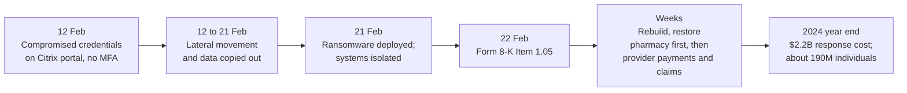
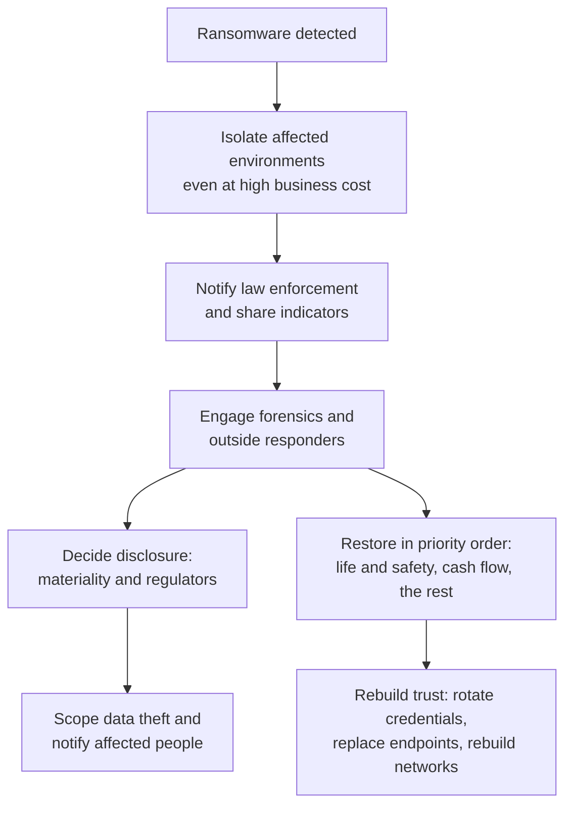

# Case Study: Change Healthcare Ransomware, 2024

> In February 2024 a ransomware group that calls itself ALPHV or BlackCat deployed ransomware inside Change Healthcare, a UnitedHealth Group company that moves claims, payments and prescription transactions between providers, pharmacies and insurers. Per UnitedHealth's CEO, the criminals had entered nine days earlier using compromised credentials on a remote-access portal that did not have multi-factor authentication. Systems were taken offline, pharmacies and providers struggled to submit claims and get paid, and the company later estimated about 190 million people were affected. This page covers the public record, root causes and the controls that limit exposure. It is written for defenders and contains no attack technique.

---

## Why this case matters

1. **A chokepoint in a whole sector.** Change Healthcare is a clearinghouse. When it stopped, the CEO's own testimony describes pharmacists submitting claims by hand and a rural practice struggling to make payroll. Concentration risk turned one company's incident into a sector-wide disruption.
2. **A basic control gap.** The entry point described to Congress was a remote-access portal without MFA, reached with valid credentials. This is the same pattern as the [Snowflake customer breaches](./case-study-snowflake-customer-breaches-2024.md) and the [Colonial Pipeline](./case-study-colonial-pipeline-2021.md) VPN account.
3. **Dwell time.** Nine days passed between first access and the ransomware. Data was copied out during that window.
4. **The money and the scale.** UnitedHealth reported billions of dollars of direct response costs and provider loans, and an estimate of about 190 million people affected.

---

## What happened (public record)

Facts below are from UnitedHealth Group's SEC filings, its CEO's written testimony to the House Energy and Commerce Committee, and a CISA, FBI and HHS joint advisory. Where the sources do not say something, this page does not either.

- **12 February 2024.** According to CEO Andrew Witty's written testimony, criminals used compromised credentials to remotely access a Change Healthcare **Citrix portal**, an application that enables remote access to desktops. "The portal did not have multi-factor authentication." Once inside, the threat actor "moved laterally within the systems in more sophisticated ways and exfiltrated data."
- **21 February 2024.** The ransomware was deployed. UnitedHealth said it did not know the entry point at that moment, so it **immediately severed connectivity** to Change's data centers to stop the spread. It said there has never been evidence of spread beyond Change to Optum, UnitedHealthcare or UnitedHealth Group.
- **Within hours.** The company contacted the FBI and shared indicators of compromise.
- **22 February 2024.** UnitedHealth filed a **Form 8-K under Item 1.05 (Material Cybersecurity Incidents)** reporting that on 21 February it had identified "a suspected nation-state associated cyber security threat actor" with access to some Change Healthcare IT systems, that it had isolated the affected systems, and that it could not estimate the duration or extent of disruption. (The later testimony names ALPHV/BlackCat, a criminal ransomware group, rather than a state actor.)
- **Recovery.** Witty testified that experts from Google, Microsoft, Cisco, Amazon, Mandiant and Palo Alto Networks joined the effort, and that the team **replaced thousands of laptops, rotated credentials, rebuilt the data center network and core services**, and added server capacity. By 7 March, 99 percent of pre-incident pharmacies could process claims. As of the 1 May 2024 hearing, Change's payment processing, which he said is about 6 percent of all payments, was at about 86 percent of pre-incident levels.
- **Ransom.** Witty testified: "As chief executive officer, the decision to pay a ransom was mine." The testimony does not state the amount.
- **Provider support.** As of 26 April 2024, UnitedHealth said it had advanced more than $6.5 billion in accelerated payments and no-interest loans to thousands of providers. The 2024 annual report says interest-free loans exceeded **$9 billion** through 31 December 2024.
- **Cost.** For 2024 UnitedHealth reported **$2.2 billion of direct response costs**, and about **$640 million** of medical costs from temporarily suspending some care management activities to help providers.
- **People affected.** In its 2024 annual report UnitedHealth said it had determined that the estimated number of individuals impacted was **approximately 190 million**, with the final number to be confirmed and filed with the HHS Office for Civil Rights. Witty had testified that files contained protected health information and personally identifiable information that "could cover a substantial proportion of people in America," and that there was no evidence of exfiltration of items such as full medical histories or doctors' charts. Secondary reporting says Change later told HHS about 192.7 million, but I could not open the HHS page, so that figure is unverified.
- **Government advisory.** The FBI, CISA and HHS jointly published advisory AA23-353A on ALPHV Blackcat (first released 19 December 2023, updated 27 February 2024). The update says healthcare had been the most commonly victimized sector among nearly 70 leaked victims since mid-December 2023.

**[📖 Written testimony of Andrew Witty, 1 May 2024](https://democrats-energycommerce.house.gov/sites/evo-subsites/democrats-energycommerce.house.gov/files/evo-media-document/Testimony_Witty_OI_2024.05.01.pdf)** - the CEO's statement to the House Energy and Commerce Oversight Subcommittee.

**[📖 UnitedHealth Group Form 8-K, Item 1.05](https://www.sec.gov/Archives/edgar/data/731766/000073176624000045/unh-20240221.htm)** - the incident disclosure (event date 21 February 2024).

**[📖 UnitedHealth Group 2024 annual report (Form 10-K)](https://www.sec.gov/Archives/edgar/data/731766/000073176625000063/unh-20241231.htm)** - costs, provider loans and the 190 million estimate.

**[📖 CISA, FBI and HHS advisory AA23-353A: #StopRansomware ALPHV Blackcat](https://www.cisa.gov/news-events/cybersecurity-advisories/aa23-353a)** - the group's behaviour at a high level and mitigations.

*The diagram shows the timeline from the public record. Access came on 12 February with no MFA. Nine days of movement and data theft preceded ransomware on 21 February, which triggered isolation and an Item 1.05 filing the next day. Restoration took weeks, restoring pharmacy first, and the year-end filing gave the cost and the people-affected estimate.*

---

## Root causes

### 1. Remote access without MFA

Valid credentials were enough to reach a desktop-access portal on the internet. Per the CEO, the portal lacked MFA. The testimony does not explain why, and does not say how the credentials were obtained. Media reports about how they were stolen are not in the primary sources, so they are not repeated here.

### 2. Time to detect

The attacker was in for nine days. The testimony does not say how or when the first intrusion was noticed; the response is described as starting when ransomware was launched. Detection of unusual remote logins, lateral movement and large outbound transfers inside that window was the missed opportunity, as the sources describe the outcome.

### 3. Flat paths to critical systems

Moving laterally to many systems implies that a single foothold could reach a lot. The testimony says only that the actor "moved laterally within the systems", so how much segmentation existed is not public. Segmentation and tiered access are the standard control.

### 4. Single point of failure for the sector

The testimony says Change's payment processing alone represents about 6 percent of all payments, and that UnitedHealth worked around the outage by pushing volume to Change's **competitors** so transactions could flow.

### 5. Recovery depended on a rebuild

Replacing thousands of laptops and rebuilding the data center network and core services shows the environment could not be trusted after the compromise. Rebuild speed ("a new technology environment in just weeks", in the CEO's words) depended on pulling in outside capacity.

### 6. Data volume

Files containing health and personal information for roughly 190 million people were involved. A smaller data footprint would have meant fewer people affected.

---

## What would have stopped or limited it

| Weakness | Preventive control | Detective control |
|---|---|---|
| Remote portal without MFA | Require MFA on every externally reachable system, with **phishing-resistant** methods for remote access (CISA's advisory recommends FIDO/WebAuthn or PKI-based MFA); retire direct desktop-portal exposure behind a [zero trust access](./architecture-patterns/zero-trust-access-internal-apps.md) layer | Inventory of internet-facing logins; alert on any external service that accepts a password alone |
| Stolen valid credentials | Credential hygiene, conditional access, device checks; monitor for exposed credentials | Impossible-travel and new-device sign-in alerts on remote access |
| Lateral movement over nine days | Segmentation, tiered admin accounts, least privilege ([least privilege explained](../learn/concepts/least-privilege-explained.md)) | EDR and [SIEM](./architecture-patterns/centralized-security-logging-siem.md) rules for remote-tool abuse and unusual admin activity ([EDR and XDR](../learn/concepts/endpoint-security-edr-xdr.md)) |
| Data copied out | Egress controls; data minimization and retention limits ([DLP](../learn/concepts/data-loss-prevention-explained.md)) | Alerts on large or unusual outbound transfers |
| Encryption of core systems | Offline, immutable, tested backups; segmented recovery environment ([backup and ransomware resilience](../learn/concepts/backup-and-ransomware-resilience.md)) | Detection of mass file changes |
| Sector concentration | Tested failover or alternate processing paths; clear priorities for restoring pharmacy, claims, payments | Business impact analysis that names single points of failure |
| Customer-side exposure | Provider and payer continuity plans for a clearinghouse outage; alternate submission channels | Third-party risk reviews of critical suppliers |

The first row is the cheapest. CISA's advisory on this group recommends enabling and enforcing MFA, and monitoring network traffic for lateral movement. Together with a short list of exposed logins, that closes the entry path described to Congress.

---

## The response playbook

Change Healthcare's own sequence is a usable template for a ransomware event at an essential service. See also the [ransomware first hour playbook](./playbooks/ransomware-first-hour.md).

*The diagram shows the response sequence. Isolation comes first, then notification of law enforcement, then forensics and outside help. Disclosure decisions and prioritized restoration run in parallel. Credential rotation and rebuilds restore trust in the environment, and scoping of stolen data drives notification of affected people.*

Points this case made clear:

- **Isolate first.** UnitedHealth cut connectivity before it knew the entry point. It accepted heavy disruption to keep the harm from spreading, and says it did.
- **Restore by consequence.** Pharmacy came first. The testimony lists the priorities as pharmacy, provider payments and claims.
- **Money is part of resilience.** Cash-flow support for providers was part of the response, not an afterthought.
- **Disclosure is a clock.** The company filed an Item 1.05 8-K the day after the event date. See the [SEC cyber disclosure guide](./compliance-guides/sec-cyber-disclosure-rule.md).
- **Health data brings regulators.** The testimony says the company worked with HHS's Office for Civil Rights on notice. See [HIPAA](./compliance-guides/hipaa.md).

---

## Defender's checklist

- [ ] Every internet-facing login (VPN, remote desktop, Citrix-style portals, admin consoles) is inventoried and requires MFA
- [ ] Remote access uses phishing-resistant MFA where possible
- [ ] Alerts exist for new-device, impossible-travel and off-hours remote logins
- [ ] Lateral movement is segmented and monitored; admin accounts are tiered
- [ ] Outbound data transfers are limited and alerted
- [ ] Sensitive data is minimized and retention is enforced
- [ ] Backups are offline or immutable, and a full-environment rebuild has been rehearsed
- [ ] Restore priorities are written down in advance, by consequence
- [ ] A materiality and disclosure process exists and has been exercised
- [ ] Critical-supplier outages are in the business continuity plan with named alternatives

---

## Cert mapping

| Cert | What this case tests |
|---|---|
| [Security+](../exams/comptia/security-plus/) | MFA, remote access, ransomware response, backups |
| [CySA+](../exams/comptia/cysa-plus/) | Detecting lateral movement and exfiltration, incident response |
| [CISM](../exams/isaca/cism/) | Incident management, disclosure obligations, third-party and concentration risk |
| [CISA](../exams/isaca/cisa/) | Auditing remote access controls and business continuity |
| [CISSP](../exams/isc2/cissp/) | Access control, business continuity, legal and regulatory duties |

---

## Discussion questions

1. List every remote-access portal your organization exposes. Which of them accept a password alone?
2. Your largest supplier is down for three weeks. What stops working first, and what is your workaround?
3. How would you know if someone had been inside a remote-access system for nine days?
4. Who decides whether an incident is material, and how fast could they decide?
5. If you had to rebuild your environment from nothing, which systems would you restore first, and who decided that?

---

## Related

- [Ransomware first hour playbook](./playbooks/ransomware-first-hour.md)
- [MFA and passkeys](../learn/concepts/mfa-and-passkeys.md)
- [Incident response basics](../learn/concepts/incident-response-basics.md)
- [Risk management basics](../learn/concepts/risk-management-basics.md) - concentration risk
- [HIPAA](./compliance-guides/hipaa.md) and [SEC cybersecurity disclosure rule](./compliance-guides/sec-cyber-disclosure-rule.md)
- Other case studies: [Snowflake customers 2024](./case-study-snowflake-customer-breaches-2024.md), [MGM Resorts 2023](./case-study-mgm-resorts-2023.md), [Colonial Pipeline 2021](./case-study-colonial-pipeline-2021.md), [MOVEit 2023](./case-study-moveit-2023.md)
