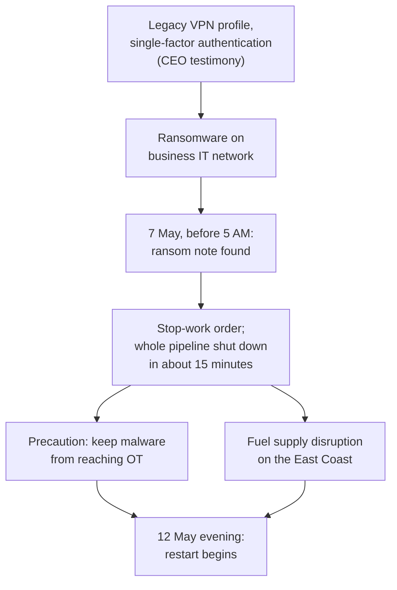
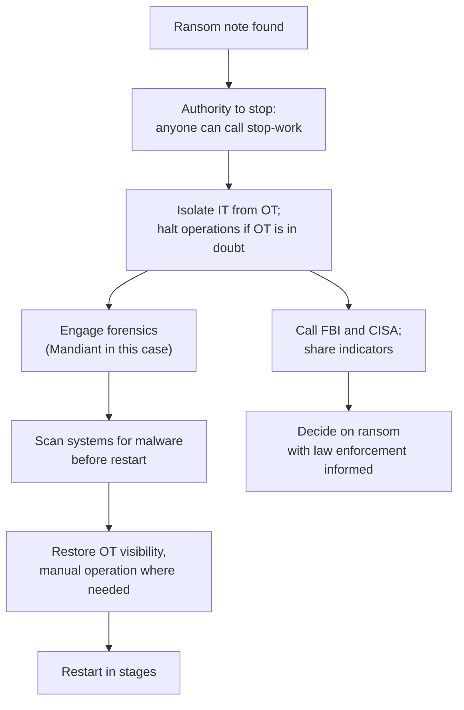

# Case Study: Colonial Pipeline Ransomware, 2021

> On 7 May 2021 a ransomware group called DarkSide encrypted Colonial Pipeline's business IT systems. Colonial shut down its entire 5,500-mile fuel pipeline as a precaution, because it could not be sure the attack had not reached the operational technology that runs the pipeline. Panic buying and shortages followed on the US East Coast. The company's CEO told Congress the attackers used a legacy VPN profile that was not meant to be in use and had only single-factor authentication. This page covers the public record, root causes and the controls that limit exposure. It is written for defenders and contains no attack technique.

---

## Why this case matters

1. **IT trouble became an operational shutdown.** The ransomware hit business systems, not the systems that move fuel. The pipeline still stopped. The link between IT and operations, and the uncertainty about it, decided the outcome.
2. **One legacy account.** A forgotten access path with a single factor was the reported way in.
3. **Critical infrastructure, voluntary rules.** The case led to mandatory reporting directives from the Transportation Security Administration (TSA), which are mentioned in the Senate hearing record.
4. **The ransom debate in public.** The CEO paid, explained why, and the Department of Justice recovered most of the money.

---

## What happened (public record)

Facts below come from the CEO's written testimony to the House Homeland Security Committee (9 June 2021), the Senate Homeland Security and Governmental Affairs Committee hearing record (8 June 2021) and CISA and FBI advisory AA21-131A.

- **Company.** Colonial Pipeline's system spans more than 5,500 miles, carries product from 29 refineries on the Gulf Coast to the New York Harbor area, and, in Blount's words, accounts for "nearly half of the fuel consumed on the East Coast."
- **Detection, 7 May 2021.** "just before 5:00 AM Eastern Daylight Time", an employee found a **ransom note** on a system in the IT network. The employee told the Control Center's Operations Supervisor, who put in a stop-work order to halt operations. Employees began the shutdown at about 5:55 AM and by 6:10 AM confirmed the whole pipeline was shut down, about fifteen minutes in all.
- **Why shut down.** Blount testified the aim was to "isolate and contain the attack to help ensure the malware did not spread to the Operational Technology (OT) network" and that "we did not know the point of origination of the attack nor the scope of it." At the Senate hearing he said that "if there was one percent chance that that OT system was compromised, it was worth shutting the pipeline system down." He told Senators the attack was detected only in the IT network, per the investigation up to that point.
- **Federal view.** CISA and FBI advisory AA21-131A says the company's IT network was hit with DarkSide ransomware, the company proactively disconnected certain OT systems, and there were no indications that the actor had moved laterally into OT.
- **Entry point.** In written testimony Blount said "we believe the attacker exploited a legacy virtual private network (VPN) profile that was not intended to be in use," and that the company was still working to learn how the attackers got the credentials. At the Senate hearing, asked about multifactor authentication, he said the legacy VPN "did only have single-factor authentication. It was a complicated password" and "not a 'Colonial 123' type password." Mandiant's investigation into how the credentials were compromised was ongoing.
- **Restart.** Colonial brought in Mandiant. Within hours some local lines returned to manual operation; the company began returning all pipelines to service on the evening of **Wednesday 12 May**. Blount noted that restarting is not like "flicking a switch."
- **Ransom.** Blount testified: "I made the decision that Colonial Pipeline would pay the ransom to have every tool available to us." In the Senate hearing the Committee described a payment of **75 bitcoin, worth about $4.4 million**, and Blount affirmed the decision. The Committee also noted the Department of Justice had announced recovery of **63.7** of those bitcoins. Blount said the decryption tool the criminals supplied "does work to some degree" but "is not a perfect tool."
- **After the attack.** At the Senate hearing, Colonial said it had shut down the legacy VPN profile and used RSA tokens for remote access in its normal operation. Senators noted that the TSA had issued new directives requiring reporting of cyber incidents to CISA and a designated cybersecurity coordinator.

**[📖 Testimony of Joseph Blount, House Homeland Security Committee, 9 June 2021](https://www.congress.gov/117/meeting/house/112689/witnesses/HHRG-117-HM00-Wstate-BlountJ-20210609.pdf)** - the CEO's written statement.

**[📖 Senate hearing S. Hrg. 117-429: Threats to Critical Infrastructure: Examining the Colonial Pipeline Cyberattack](https://www.congress.gov/117/chrg/CHRG-117shrg46569/CHRG-117shrg46569.pdf)** - the 8 June 2021 hearing record, including the questions on MFA and the ransom.

**[📖 CISA and FBI advisory AA21-131A: DarkSide Ransomware](https://www.cisa.gov/news-events/cybersecurity-advisories/aa21-131a)** - the group, the Colonial incident summary and mitigations (marked archived).

*The diagram shows the chain of events. A legacy VPN profile without MFA is the reported way in. Ransomware hit the business IT network, an employee found the ransom note on 7 May, and the stop-work order shut the pipeline. The shutdown was precautionary to keep malware from reaching operational technology, but it caused fuel disruption, and restart began on the evening of 12 May.*

---

## Root causes

### 1. A forgotten access path

The CEO described the VPN profile as legacy and "not intended to be in use". Access methods that nobody owns are not monitored, patched or retired. The cause of this is an asset and account inventory failure.

### 2. Single-factor remote access

A password, however complex, was the only barrier on that path. The CEO said the normal remote access process used RSA tokens, which means the control existed in general but not on this path.

### 3. Unknown boundary between IT and OT

The decision to shut everything was driven by not knowing whether OT was affected ("we did not know ... the scope"). Strong segmentation, and the monitoring to prove it, shrinks that uncertainty and shrinks the shutdown.

### 4. Business systems the operation depends on

The testimony describes the IT network as being encrypted and the operation being halted anyway. The CISA advisory recommends testing manual controls, which implies how the business works without IT is a design question. This page does not claim which IT systems Colonial's operations needed, because the sources read do not say.

### 5. Voluntary regulation of the sector

The Senate record shows the TSA had given industry leeway and mandated reporting only after the attack. That is context, not a cause of the intrusion.

---

## What would have stopped or limited it

| Weakness | Preventive control | Detective control |
|---|---|---|
| Legacy VPN profile | Inventory every remote access path and account; retire anything unowned; periodic access recertification ([IAM explained](../learn/concepts/iam-explained.md)) | Alert on logins to dormant or legacy accounts |
| Single factor | MFA for remote access to both OT and IT networks, as AA21-131A recommends; preferably phishing-resistant ([MFA and passkeys](../learn/concepts/mfa-and-passkeys.md)) | Alert on any remote login without MFA; test the policy by trying |
| Credential theft | Unique passwords, credential exposure monitoring, conditional access | Impossible-travel and new-device alerts on VPN |
| IT-to-OT uncertainty | Robust segmentation between IT and OT, with a demilitarized zone, as the advisory recommends ([network security basics](../learn/concepts/network-security-basics.md)) | Monitoring that can show no traffic crossed the boundary |
| Business-system dependence | Tested manual operating procedures; independent operation of essential functions | Tabletop of an IT-loss scenario for operations |
| Encryption of IT systems | Backups that are regularly tested, stored separately and kept offline or isolated, plus gold images ([backup and ransomware resilience](../learn/concepts/backup-and-ransomware-resilience.md)) | Detection of mass file changes and known ransomware behaviour (EDR) |
| Slow reporting | Pre-agreed contact with the FBI and CISA | Incident process with notification steps |

The first two rows are the cheapest. A list of every remote-access method, with MFA enforced on each, closes the path the CEO described.

---

## The response playbook

Colonial's own sequence is a model for the first hours of a ransomware event at an operator.

*The diagram shows the response order. Anyone with a safety concern can stop work. The team isolates IT from OT and halts operations if OT is in doubt, notifies the FBI and CISA, and brings in forensics. Systems are scanned before restart, OT visibility is restored with manual operation as needed, and restart is staged. The ransom decision is made with law enforcement informed.*

What the testimony showed:

- **Stop-work authority for everyone.** Blount said everyone from the CEO to field operators has stop-work authority if safety is at risk. It let a note on an IT system stop a pipeline in minutes.
- **Contact law enforcement early.** Colonial reached the FBI the morning of the attack and shared indicators of compromise.
- **Manual operation is a fallback.** Employees collected and reported key pipeline data manually while OT was not visible, and Colonial increased air surveillance and drove thousands of miles of inspection.
- **Ransom is a business decision with a record.** Colonial said it followed regulatory guidance before paying and explained its dealings to law enforcement. CISA and the FBI do not encourage paying ransoms (AA21-131A).
- **Payments may be partly recoverable.** The Department of Justice recovered 63.7 of the 75 bitcoin, per the hearing record, but the Committee noted it would not be able to recover payments in other cases.

---

## Defender's checklist

- [ ] An inventory of every remote access method and account, each with an owner
- [ ] MFA on every remote path into IT and OT networks
- [ ] Dormant and legacy accounts and VPN profiles disabled and alerted on
- [ ] IT and OT networks segmented, with a DMZ between them
- [ ] Monitoring that can prove whether activity crossed the boundary
- [ ] Manual operating procedures for losing business IT, and a rehearsal
- [ ] Backups offline or isolated, with tested restores and gold images
- [ ] Everyone in operations knows they can stop work for safety
- [ ] Contacts at CISA and the FBI recorded, with a reporting procedure
- [ ] Ransom policy decided in advance by leadership, legal and law enforcement liaison

---

## Cert mapping

| Cert | What this case tests |
|---|---|
| [Security+](../exams/comptia/security-plus/) | MFA, VPN, ransomware, segmentation, backups |
| [CySA+](../exams/comptia/cysa-plus/) | Detection of anomalous remote access, incident response |
| [CISM](../exams/isaca/cism/) | Incident management, business continuity, critical infrastructure risk |
| [CISSP](../exams/isc2/cissp/) | Network segmentation, access control, business continuity |

---

## Discussion questions

1. List every way someone can connect remotely to your environment. Which accounts do you not recognize?
2. If a ransom note appeared on a business system tonight, who could order operations to stop, and what would it cost?
3. Could you prove, within an hour, that an attack on IT did not touch the systems that run the business?
4. What does your business do for a week with no business IT?
5. Who in your leadership decides on a ransom, and what do they need to know first?

---

## Related

- [Ransomware first hour playbook](./playbooks/ransomware-first-hour.md)
- [Network security basics](../learn/concepts/network-security-basics.md)
- [Least privilege explained](../learn/concepts/least-privilege-explained.md)
- [Incident response basics](../learn/concepts/incident-response-basics.md)
- Other case studies: [Change Healthcare 2024](./case-study-change-healthcare-2024.md), [MGM Resorts 2023](./case-study-mgm-resorts-2023.md), [Snowflake customers 2024](./case-study-snowflake-customer-breaches-2024.md), [SolarWinds 2020](./case-study-solarwinds-2020.md)
