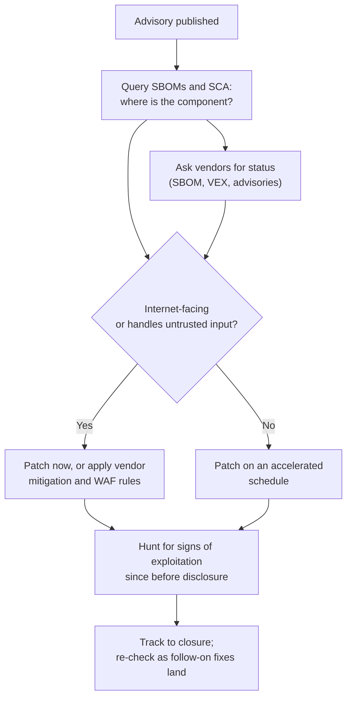

# Case Study: Log4Shell, 2021

> A critical flaw in Apache Log4j 2, a logging library embedded in a huge share of Java software, let an attacker who could get a crafted string logged cause the application to load and run remote code. It scored the maximum CVSS 10.0 and was exploited within hours of public disclosure. Log4Shell was less a single breach than an industry-wide test of one question: do you know where your dependencies are? This page covers the public record, why the response was so hard, and what a good dependency vulnerability response looks like. It is written for defenders; it contains no exploit strings or attack instructions.

---

## Why this case matters

Most organizations did not choose to use Log4j. It arrived inside frameworks, application servers, vendor appliances and SaaS products, often several layers down the dependency tree. When the vulnerability became public, the hard part was not patching; it was finding every place the library existed. Teams that had a software inventory answered "are we affected?" in hours. Teams without one spent weeks searching file systems and emailing vendors.

The US Cyber Safety Review Board (CSRB) chose Log4j as the subject of its first-ever review and concluded that it is an **endemic vulnerability**: vulnerable copies will remain in systems for years, perhaps a decade or longer.

---

## What happened (public record)

- **The flaw.** Log4j 2 supported "lookups", a feature that expanded special patterns inside logged text. One lookup used the Java Naming and Directory Interface (JNDI), which could fetch and load objects from a remote directory server. Because applications routinely log text that comes from users (a username, a header, a search term), an outsider could get a pattern logged that made the server reach out and load code. That is remote code execution reachable through ordinary input. The vulnerability is **CVE-2021-44228**, CVSS **10.0**.
- **Affected versions.** Log4j 2 from 2.0-beta9 up to (but not including) 2.15.0, apart from the separately patched 2.3.1 and 2.12.2 releases for older Java versions. Log4j 1.x does not have lookups and is not affected by this CVE, although it is end-of-life and has its own vulnerabilities.
- **Reporting.** A researcher on the Alibaba Cloud security team reported the flaw privately to Apache on **24 November 2021**. Details began circulating publicly on **9 December 2021**, and Apache published the CVE and the 2.15.0 release on **10 December 2021**. Exploitation attempts were seen at internet scale almost immediately.
- **Follow-on fixes.** The first fix was incomplete in some configurations, so Apache released further versions in quick succession: **2.16.0** (CVE-2021-45046, which removed message lookups and disabled JNDI by default), **2.17.0** (CVE-2021-45105, a denial of service issue) and **2.17.1** (CVE-2021-44832). Teams that patched to 2.15.0 had to patch again within days, and again after that.
- **Government response.** CISA issued **Emergency Directive 22-02** on **17 December 2021**, requiring federal civilian agencies to identify internet-facing systems, check every software asset against CISA's community-maintained list of affected products, patch or mitigate by **23 December**, and report by **28 December**.
- **The review.** The CSRB published its report on **11 July 2022** with 19 recommendations. It found that the open-source volunteers maintaining Log4j responded quickly, that no authoritative source existed to understand exploitation across sectors, and that organizations' inability to find vulnerable software was the main obstacle to response. It also noted that it was not aware of significant Log4j-based attacks on critical infrastructure systems at the time of writing, while warning that exploitation would continue for years.

**[📖 Apache Log4j security vulnerabilities](https://logging.apache.org/log4j/2.x/security.html)** - the project's own list of CVEs, affected ranges and fixed versions.
**[📖 CISA Emergency Directive 22-02](https://www.cisa.gov/news-events/directives/ed-22-02-mitigate-apache-log4j-vulnerability-closed)** - required actions and deadlines for federal agencies.
**[📖 CSRB Review of the December 2021 Log4j Event](https://www.cisa.gov/sites/default/files/publications/CSRB-Report-on-Log4-July-11-2022_508.pdf)** - the Cyber Safety Review Board's full report and recommendations.
**[📖 CVE-2021-44228 in the NVD](https://nvd.nist.gov/vuln/detail/CVE-2021-44228)** - the National Vulnerability Database entry.

---

## Root causes

### 1. A powerful feature on by default

JNDI lookups in log messages were a feature almost nobody needed in production, enabled by default in a component almost everybody used. The safe default (off) only arrived with the fix. Secure-by-default design would have made the flaw far less reachable.

### 2. Untrusted input reached an interpreter

Logging is usually treated as a passive, safe operation. Here the logger interpreted the text it was given. This is the same pattern as SQL injection and template injection: data crossed into a context where it was treated as instructions. See [OWASP Top 10 explained](../learn/concepts/owasp-top-10-explained.md).

### 3. Nobody knew where the library was

The CSRB's central finding. Log4j was a transitive dependency of a transitive dependency, bundled inside "fat" JAR files, shaded into other libraries, baked into vendor appliances and container images. Without a software bill of materials (SBOM), organizations had to search for it by file name and hash, and vendors had to do the same before they could tell customers whether they were affected.

### 4. Critical open source with thin resourcing

Log4j was maintained by a small group of volunteers. Their response was fast, but the industry depended on a component without any corresponding investment in its security.

### 5. Egress was open

The exploitation path required the vulnerable server to make an outbound connection to an attacker-controlled directory service. Servers that could not make arbitrary outbound connections were far harder to exploit.

---

## What good dependency vulnerability response looks like

Log4Shell is the canonical drill for a critical library vulnerability. The organizations that did well had most of the following in place before December 2021.

### Before the next one

1. **Maintain SBOMs for everything you build.** Generate them in CI for every build (CycloneDX or SPDX format) and store them where they can be searched. Then "where is library X at version Y?" is a query, not a project. See [Software supply chain security](../learn/concepts/software-supply-chain-security.md).
2. **Ask suppliers for SBOMs and vulnerability status statements.** For vendor products you cannot scan, a supplier SBOM and a VEX (Vulnerability Exploitability eXchange) statement tell you quickly whether they are affected.
3. **Run software composition analysis (SCA)** in CI and against deployed images and hosts, so known-vulnerable versions are flagged continuously. Dependabot, Renovate, GitHub Advanced Security, Amazon Inspector, Defender for Cloud and Artifact Analysis all do this.
4. **Keep dependencies current.** Teams on recent versions could take the fix as a minor upgrade. Teams pinned to years-old versions faced major upgrades under pressure.
5. **Restrict outbound traffic from servers.** Default-deny egress with explicit allow-lists blocks the callback step that much exploitation of this class depends on.
6. **Have a critical-vulnerability runbook** with named roles, an inventory query, a communication template and a decision tree for patch, mitigate or isolate. See [Vulnerability management](../learn/concepts/vulnerability-management.md).

### During the response

*The diagram shows the response flow for a critical dependency vulnerability. When an advisory is published, the team queries its SBOMs and composition analysis tools to find every place the component exists, and asks vendors for the status of products it cannot inspect. Each finding is triaged by exposure: anything internet-facing or handling untrusted input is patched or mitigated immediately, the rest on an accelerated schedule. In parallel, the team hunts for signs that exploitation began before disclosure. Work is tracked to closure and re-checked as the maintainers publish follow-on fixes.*

Key points from the Log4Shell experience:

- **Prioritize by exposure, not by count.** Internet-facing systems and anything that logs user-controlled data come first.
- **Temporary mitigations buy time.** WAF rules, configuration flags and removing the vulnerable class from the JAR were used as stopgaps. They were later shown to be incomplete in some cases, so treat them as time-buying, not as a fix.
- **Expect follow-on fixes.** The first patch for a newly scrutinized component is often not the last. Plan to patch twice.
- **Hunt, do not just patch.** Exploitation started before most teams patched. Search logs for outbound connections from application servers to unusual destinations and for indicators published by CISA and vendors. Logs need to go back far enough; see the [centralized logging pattern](./architecture-patterns/centralized-security-logging-siem.md).
- **Track to closure.** A vulnerability like this has a long tail of forgotten servers, appliances and test environments. Keep the tracking open until the inventory says zero.

### After the response

- Run a post-incident review focused on time-to-inventory. How long did it take to answer "where is it?" and what would make that faster next time?
- Turn the hunting queries into permanent detections.
- Fund or contribute to the open-source components you depend on most.

---

## Cloud-specific notes

- **AWS:** Amazon Inspector scans EC2 instances, container images in ECR and Lambda functions for vulnerable packages, including Java libraries inside JARs. AWS also shipped managed WAF rule updates for this vulnerability class.
- **Azure:** Defender for Cloud's vulnerability assessment and Defender for Containers flag vulnerable packages; Azure WAF managed rule sets received updates.
- **GCP:** Artifact Analysis scans container images; Cloud Armor offered preconfigured WAF rules for this vulnerability.

Managed services where the provider runs the software (serverless platforms, managed databases) shift patching to the provider, which is one of the clearest practical benefits of the [shared responsibility model](../learn/concepts/shared-responsibility-model.md). Your own code and dependencies inside those services remain yours.

---

## Defender's checklist

- [ ] SBOM generated in CI for every build and stored centrally
- [ ] Composition analysis on repositories, registries and running workloads
- [ ] A query that answers "which deployed systems include component X at version Y?" in minutes
- [ ] Suppliers asked for SBOMs or VEX statements for products with privileged access
- [ ] Default-deny outbound traffic from application servers, with explicit allow-lists
- [ ] Critical-vulnerability runbook with roles, prioritization rules and communication templates
- [ ] Ability to deploy WAF rules quickly as a temporary mitigation
- [ ] Logs retained long enough to hunt back before the disclosure date
- [ ] CISA Known Exploited Vulnerabilities catalogue watched and tied to patch SLAs
- [ ] Dependencies kept reasonably current so emergency upgrades are small

---

## Cert mapping

| Cert | What this case tests |
|---|---|
| [Security+](../exams/comptia/security-plus/) | Vulnerability management, injection attacks, mitigation techniques |
| [CySA+](../exams/comptia/cysa-plus/) | Vulnerability prioritization, threat hunting, IOCs |
| [GitHub Advanced Security](../exams/github/advanced-security/) | Dependency review, Dependabot, SBOM export |
| [CKS](../exams/kubernetes/cks/) | Image scanning, supply chain security, network policies for egress |
| [CISSP](../exams/isc2/cissp/) | Software development security, patch and vulnerability management |

---

## Discussion questions

1. If a critical CVE in a common library were published tomorrow at 6pm, how long would it take you to list every affected system? What is the slowest step?
2. Which of your servers can make arbitrary outbound internet connections? Why?
3. You applied a WAF rule as a mitigation and the vendor later says it can be bypassed. How do you decide whether to take the service offline?
4. How would you hunt for exploitation that started before the vulnerability was public?
5. Which open-source components does your business depend on most, and who maintains them?

---

## Related

- [Vulnerability management](../learn/concepts/vulnerability-management.md) - the concept page
- [Software supply chain security](../learn/concepts/software-supply-chain-security.md) - SBOMs, SCA and provenance
- [OWASP Top 10 explained](../learn/concepts/owasp-top-10-explained.md) - injection and vulnerable components
- [Network security basics](../learn/concepts/network-security-basics.md) - egress filtering
- [SOC detection and response pipeline](./architecture-patterns/soc-detection-and-response-pipeline.md) - turning hunts into detections
- Other case studies: [Capital One 2019](./case-study-capital-one-2019.md), [SolarWinds 2020](./case-study-solarwinds-2020.md), [MOVEit 2023](./case-study-moveit-2023.md)
- **[📖 CISA Known Exploited Vulnerabilities catalog](https://www.cisa.gov/known-exploited-vulnerabilities-catalog)** - the list to prioritize patching against
