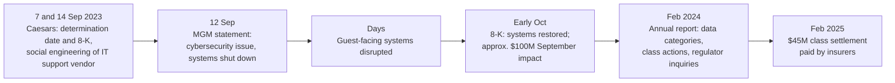

# Case Study: MGM Resorts Cyber Incident, 2023

> In September 2023 MGM Resorts International shut down systems across its US properties after criminals gained unauthorized access to them. For days, guests met disruption: the company later estimated a hit of about $100 million to one profit measure for the month. The company's own filings do not say how the criminals got in. A rival, Caesars Entertainment, disclosed the same month that it had been hit by a social engineering attack on an outsourced IT support vendor. CISA and the FBI have published an advisory on a criminal group that targets large companies and their IT help desks. This page keeps those three things separate: what MGM says, what Caesars says, and what the government says about the technique. It is written for defenders and contains no attack instructions.

---

## Why this case matters

1. **The people layer is an attack surface.** The government advisory on this kind of actor describes attackers who phone or message an IT help desk, impersonate an employee and ask for a password reset or a new MFA device. A control that depends on a human recognizing a voice or a name fails.
2. **Shutting down is a real cost, and sometimes the right call.** MGM chose to shut down systems to protect customer information, which caused operational disruption. It also says that choice helped keep payment card and bank data out of reach.
3. **Disclosure before the new SEC rule.** The events came before the SEC's Item 1.05 8-K requirement started on 18 December 2023, so MGM's first public filings used Regulation FD (Item 7.01) and results (Item 2.02) items, and Caesars used Item 8.01. They are a useful before-and-after pair with [Change Healthcare](./case-study-change-healthcare-2024.md).
4. **Loyalty and customer data is a target.** The data that was taken was customer identity data.

---

## What happened (public record)

### What MGM says

- **12 September 2023.** MGM issued a statement that it "recently identified a cybersecurity issue affecting certain of the Company's systems", began an investigation with outside experts, notified law enforcement and was taking steps including "shutting down certain systems." It filed that statement with the SEC on 13 September under Item 7.01.
- **Early October 2023 (8-K).** MGM said it had shut down systems to mitigate risk to customer information, which "resulted in disruptions at some of the Company's properties but allowed the Company to prevent the criminal actors from accessing any customer bank account numbers or payment card information." Domestic operations had returned to normal and "virtually all" guest-facing systems were restored. It estimated a negative impact in September of approximately **$100 million** to Adjusted Property EBITDAR for the Las Vegas Strip Resorts and Regional Operations, and less than **$10 million** in one-time Q3 expenses for consulting and legal fees. It expected cyber insurance to cover the financial impact.
- **Annual report for 2023.** MGM said unauthorized access to certain US systems by criminal actors obtained, for some customers, personal information including name, contact information, gender, date of birth and driver's license numbers; for a limited number, Social Security and passport numbers. It said it did not believe customer passwords, bank account numbers or payment card information were obtained. It became subject to consumer class actions and state and federal regulatory inquiries.
- **Annual report for 2024.** The company agreed a **$45 million** settlement to resolve the purported civil class action litigation related to the 2023 cybersecurity issue and a 2019 issue, paid by insurance carriers into a settlement fund in February 2025. It said it remained the subject of investigations by state and federal regulators.

**[📖 MGM Resorts statement on cybersecurity issue, 12 September 2023](https://www.sec.gov/Archives/edgar/data/789570/000119312523233855/d502352dex991.htm)** - Exhibit 99.1 to the Form 8-K filed 13 September.

**[📖 MGM Resorts Form 8-K, 5 October 2023](https://www.sec.gov/Archives/edgar/data/789570/000119312523251667/d461062d8k.htm)** - the impact estimate and customer-data statement.

**[📖 MGM Resorts 2023 annual report (Form 10-K)](https://www.sec.gov/Archives/edgar/data/789570/000078957024000005/mgm-20231231.htm)** - categories of data obtained, litigation and inquiries.

**[📖 MGM Resorts 2024 annual report (Form 10-K)](https://www.sec.gov/Archives/edgar/data/789570/000078957025000008/mgm-20241231.htm)** - the class action settlement.

### What MGM does not say

In the filings read for this page, MGM does not describe the **method of entry**, does not name the criminal actors, and does not state the number of customers affected. Public commentary has attributed the incident to a particular group and technique. That attribution is **not established in the primary sources I read**, so this page does not state it as fact. The government sources below are the right place to learn the technique in general.

### What Caesars says

Caesars Entertainment filed an 8-K (Item 8.01) on 14 September 2023 saying it had identified suspicious activity "resulting from a social engineering attack on an outsourced IT support vendor used by the Company." It determined on 7 September that the unauthorized actor acquired a copy of, among other data, its **loyalty program database**, which included driver's license numbers and/or Social Security numbers for a significant number of members. It reported no evidence that passwords, bank account information or payment card information were acquired, and said its customer-facing operations were not impacted.

**[📖 Caesars Entertainment Form 8-K, 14 September 2023](https://www.sec.gov/Archives/edgar/data/1590895/000119312523235015/d537840d8k.htm)** - the company's own description.

### What the government says about the technique

CISA and the FBI's advisory AA23-320A on **Scattered Spider** (first published 16 November 2023, last revised 29 July 2025) describes a group that "targets large companies and their contracted information technology (IT) help desks." Initial-access methods it lists include:

- Posing as company IT or help desk staff by phone or SMS to obtain credentials or get employees to run remote access tools. The 2025 update adds posing as employees to get IT staff to reset passwords and move MFA to a device the attacker controls.
- **SIM swapping**, moving a victim's phone number to a SIM the attacker controls to receive MFA prompts.
- **MFA fatigue**, sending repeated prompts until an employee approves one.
- Phishing, smishing, purchased credentials and compromise of third-party services.

The advisory refers to the MGM incident only in a footnote citation, not in its description of events. I also checked two US Department of Justice releases on Scattered Spider charges (September 2025 and July 2026); neither mentions MGM or casinos.

**[📖 CISA and FBI advisory AA23-320A: Scattered Spider](https://www.cisa.gov/news-events/cybersecurity-advisories/aa23-320a)** - tactics, techniques and mitigations.

*The diagram shows the public timeline. Caesars disclosed a social engineering attack on a vendor in mid-September, MGM announced a cybersecurity issue and shut down systems on 12 September, systems were restored in the weeks after, and the financial and legal effects were reported in later filings through the 2025 settlement.*

---

## Root causes

Because MGM has not published its root cause, this section covers the **weaknesses the government advisory and the Caesars filing point to**, not a finding about MGM.

### 1. Help desk identity verification

If a help desk can reset a password or enrol a new MFA device on the strength of a phone call, the help desk is a bypass of every other control. The advisory's descriptions are of exactly this path.

### 2. MFA that can be talked around

Push-based MFA can be approved by a tired user. SIM swap defeats SMS codes. Phishing-resistant MFA (FIDO/WebAuthn, PKI-based) is the control the advisory recommends.

### 3. Outsourced access

Caesars' filing names an outsourced IT support vendor as the point of compromise. A supplier with the power to reset credentials has the power to compromise you.

### 4. Large, centrally held identity data

The data in the public record is identity data (driver's license numbers, dates of birth, in limited cases Social Security and passport numbers). Keeping it for as long as a loyalty relationship lasts makes it a target.

### 5. Business operations tied to IT systems

A shutdown of IT affected guest-facing systems at properties. How well a business can run in a degraded mode determines how much a shutdown costs.

---

## What would have stopped or limited it

| Weakness | Preventive control | Detective control |
|---|---|---|
| Help desk resets | Written, strong identity verification before any password or MFA reset (for example call-back to a number on file, manager approval, or in-person verification for high-risk accounts); extra review for privileged users | Alerts on resets followed by a new MFA device or sign-in from a new location |
| Weak MFA | Phishing-resistant MFA for admins and remote access ([MFA and passkeys](../learn/concepts/mfa-and-passkeys.md)); number matching and rate limits on push prompts | Alerts on repeated MFA prompts and MFA registration changes |
| Vendor with reset power | Contract and technical limits on what the vendor can do; just-in-time access; the vendor follows your verification rules | Review of vendor-initiated changes; separate logging |
| Lateral movement and cloud abuse | Least privilege and tiered admin accounts; restrict remote-access tools to approved ones (the advisory recommends allowlisting and auditing them) | EDR and identity-provider logs into a [SIEM](./architecture-patterns/centralized-security-logging-siem.md); alert on new remote tools |
| Data held too long | Minimize and delete; encrypt; segregate identity data ([DLP](../learn/concepts/data-loss-prevention-explained.md)) | Alerts on bulk reads of loyalty or customer tables |
| Business continuity | Rehearsed manual fallbacks for check-in, payments, keys and gaming operations; offline backups | Tabletop exercises with a shutdown scenario |

The cheapest fix is the first row. Some help desks verify with details an attacker can look up (name, employee number, manager). A verification process that does not depend on facts found online closes the path.

---

## Response lessons

- **A shutdown is a decision with a price.** MGM chose to shut down systems; its filing says this prevented access to payment card and bank account numbers while causing operational disruption. Decide in advance who may take that decision and what it costs per day.
- **Speak early, then correct.** The company's first statement was short; the figures came about three weeks later in an 8-K.
- **Ready the paper too.** Under the SEC rule that started in December 2023, a company in this position would have to decide on materiality and file an Item 1.05 8-K within four business days of that decision. See the [SEC cyber disclosure guide](./compliance-guides/sec-cyber-disclosure-rule.md). MGM's 2023 annual report contains an Item 1C Cybersecurity section, the new annual disclosure.
- **Insurance helps but does not close the loop.** Insurers paid the class settlement, and regulator investigations were still open in the 2024 report.

---

## Defender's checklist

- [ ] Help desk has a written, tested identity verification procedure that does not rely on facts findable online
- [ ] Password resets and MFA enrolment for admins need a second approver
- [ ] Phishing-resistant MFA for administrators and remote access
- [ ] Alerts for MFA device changes, repeated push prompts and resets followed by new sign-in locations
- [ ] Outsourced IT and help desk vendors are bound by your verification rules and logged separately
- [ ] Remote access tools are allowlisted and audited
- [ ] Identity data retention is limited and encrypted
- [ ] Manual fallback procedures for core guest or customer operations exist and are rehearsed
- [ ] A decision owner and criteria exist for shutting systems down
- [ ] Staff are trained on impersonation and know how to report suspected calls ([phishing and social engineering](../learn/concepts/phishing-and-social-engineering.md))

---

## Cert mapping

| Cert | What this case tests |
|---|---|
| [Security+](../exams/comptia/security-plus/) | Social engineering, MFA types and attacks, vendor risk |
| [CySA+](../exams/comptia/cysa-plus/) | Identity-based detection, incident response |
| [CISM](../exams/isaca/cism/) | Third-party risk, incident management, disclosure |
| [CISSP](../exams/isc2/cissp/) | Identity and access management, business continuity |

---

## Discussion questions

1. Write down exactly how your help desk verifies a caller who says they are the CFO and have lost their phone. Could an attacker find the answers online?
2. Which of your vendors can reset a password or enrol an MFA device? What limits them?
3. If the business had to shut down IT for three days, what would still work?
4. Who has the authority to order a shutdown, and have they ever practiced the decision?
5. What identity data do you keep that you no longer need?

---

## Related

- [Phishing and social engineering](../learn/concepts/phishing-and-social-engineering.md)
- [MFA and passkeys](../learn/concepts/mfa-and-passkeys.md)
- [IAM explained](../learn/concepts/iam-explained.md)
- [Security awareness training](../learn/concepts/security-awareness-training.md)
- [Incident response basics](../learn/concepts/incident-response-basics.md)
- Other case studies: [Change Healthcare 2024](./case-study-change-healthcare-2024.md), [Snowflake customers 2024](./case-study-snowflake-customer-breaches-2024.md), [Colonial Pipeline 2021](./case-study-colonial-pipeline-2021.md)
