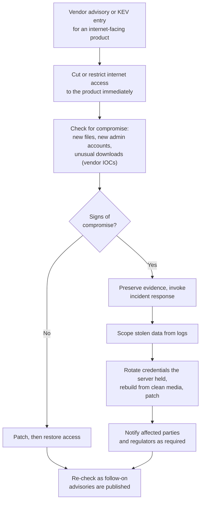

# Case Study: MOVEit Transfer Mass Exploitation, 2023

> A ransomware and extortion group used a previously unknown SQL injection flaw in Progress Software's MOVEit Transfer, a managed file transfer product, to install a web shell and steal data from internet-facing servers at scale over a few days around the US Memorial Day weekend in 2023. It did not encrypt anything; it stole files and demanded payment not to publish them. By one widely cited tally, more than 2,700 organizations and over 95 million individuals were affected, many of them through a supplier that ran MOVEit on their behalf. This page covers the public record, root causes and the controls that limit exposure. It is written for defenders; it contains no exploit details.

---

## Why this case matters

MOVEit is a textbook example of three trends that still shape incident response:

1. **Edge appliances and file transfer tools as mass targets.** One vulnerability in a product exposed to the internet by thousands of organizations gives an attacker thousands of victims at once.
2. **Extortion without encryption.** Backups do not help when the threat is publication. The damage is the stolen data.
3. **Fourth-party exposure.** Many affected organizations never ran MOVEit. Their payroll provider, pension administrator or benefits processor did, and their data was on that server.

The same group had run the same play before against other file transfer products: Accellion FTA in 2020-2021 and Fortra GoAnywhere MFT in early 2023. Defenders who noticed that pattern had a reason to treat their own file transfer servers as high risk before MOVEit happened.

---

## What happened (public record)

- **The vulnerability.** **CVE-2023-34362**, a SQL injection flaw in the MOVEit Transfer web application that let an unauthenticated outsider gain access to the application's database and escalate privileges. It affected the on-premises MOVEit Transfer product and Progress's hosted MOVEit Cloud service.
- **Exploitation.** According to the joint CISA and FBI advisory, the CL0P ransomware gang (also tracked as TA505) began exploiting the flaw on **27 May 2023**. Compromised servers were given a web shell, which CISA named **LEMURLOOT**, that let the operators list and download stored files, read database contents and Azure storage settings used by the application, and create or delete administrative accounts. Incident responders at Kroll later reported evidence in customer logs suggesting the group had been testing ways to exploit MOVEit as early as 2021.
- **Disclosure and patches.** Progress published an advisory and patches on **31 May 2023**, telling customers to cut off HTTP and HTTPS traffic to MOVEit Transfer until they had patched and checked for compromise. Code review after the first disclosure turned up more SQL injection flaws: **CVE-2023-35036** (announced by Progress on 9 June) and **CVE-2023-35708** (announced on 15 June), each with its own patch.
- **Government response.** CISA added CVE-2023-34362 to its Known Exploited Vulnerabilities catalog on **2 June 2023**, and CISA and the FBI published joint advisory **AA23-158A** on **7 June 2023**, with indicators of compromise and recommended mitigations.
- **Extortion.** From mid-June, CL0P began naming victims on its leak site and demanding payment. Victims included government agencies, universities, airlines, media companies, health providers, banks and the service providers who process data for all of them.
- **Scale.** Emsisoft's running tally, compiled from breach notifications, SEC filings and other public disclosures, reached **2,773 organizations** and about **95.8 million individuals** by June 2024. The true number is likely higher because not every victim discloses.

**[📖 CISA and FBI advisory AA23-158A](https://www.cisa.gov/news-events/cybersecurity-advisories/aa23-158a)** - timeline, LEMURLOOT behaviour, indicators and mitigations.
**[📖 Progress MOVEit Transfer critical vulnerability advisory (May 2023)](https://community.progress.com/s/article/MOVEit-Transfer-Critical-Vulnerability-31May2023)** - the vendor's advisory, affected versions and remediation steps.
**[📖 CVE-2023-34362 in the NVD](https://nvd.nist.gov/vuln/detail/CVE-2023-34362)** - the National Vulnerability Database entry.
**[📖 Unpacking the MOVEit breach: statistics and analysis](https://www.emsisoft.com/en/blog/44123/unpacking-the-moveit-breach-statistics-and-analysis/)** - the Emsisoft victim tally and its methodology.

---

## Root causes

### 1. A high-value data store exposed directly to the internet

Managed file transfer servers exist to exchange files with outside parties, so they face the internet. They also tend to accumulate everything that has ever been exchanged: payroll files, member lists, medical records. An internet-facing server that keeps years of sensitive files is a concentrated prize.

### 2. Injection in a web application

SQL injection is one of the oldest and best-understood vulnerability classes. Its presence in a security-focused product, and the discovery of two more instances once researchers looked closely, points to gaps in secure development practice (parameterized queries everywhere, code review and testing focused on injection). See [OWASP Top 10 explained](../learn/concepts/owasp-top-10-explained.md).

### 3. Data retained long after it was needed

Many victims found that the stolen files were old transfers that had completed months or years earlier. A retention policy that deleted files after successful transfer would have left far less to steal.

### 4. Third-party concentration risk

Many organizations' data sat on their service providers' MOVEit servers. Their own vendor risk processes often did not ask what file transfer software suppliers used, how it was exposed, or how long data stayed on it.

### 5. A repeating attacker playbook

The group's prior campaigns against file transfer appliances were public. Organizations that tracked threat intelligence about their own technology stack had reason to harden or monitor file transfer servers in advance.

### 6. Exploitation timed for a holiday weekend

Mass exploitation began on a US public holiday weekend, when staffing was thin. Response speed in the first 48 hours determined whether a server was compromised before the patch.

---

## What would have stopped or limited it

Against a true zero-day, prevention alone is not enough. The aim is to shrink exposure, limit what can be taken, and detect quickly.

| Weakness | Preventive control | Detective control |
|---|---|---|
| Internet-facing admin and web interfaces | Expose only the transfer endpoints that partners need; put admin interfaces behind a VPN or [identity-aware proxy](./architecture-patterns/zero-trust-access-internal-apps.md); restrict partner access by IP allow-list where feasible | External attack surface monitoring that lists every internet-facing file transfer and edge appliance |
| Data retained on the server | Delete files automatically after successful transfer or a short retention window; encrypt at rest with keys the application tier cannot export in bulk | Alert on stored data volume growing past the expected window |
| Web application compromise | WAF in front of the application; least-privilege database account for the app; application server cannot write new executable files to its web directories | File integrity monitoring on web directories (a new script file appearing is a strong signal); EDR on the server |
| Large data download | Egress limits and rate limiting on the file transfer service | Alerts on unusual download volume, new admin accounts and unexpected database queries |
| Slow patching on edge products | Emergency patch SLA for internet-facing products listed in CISA's KEV catalog (hours to days, not the monthly cycle) | Watch vendor advisories and KEV for your edge products specifically |
| Supplier exposure | Vendor risk questions about file transfer tooling, exposure and retention; contract terms for breach notification timelines | Ask suppliers directly during an event like this rather than waiting for their notice |

The **file integrity monitoring** row deserves emphasis. The web shell was a new file in the application's web directory. Monitoring for new or changed executable files in web roots is cheap, low-noise and would have flagged most compromises within minutes.

The **retention** row is the cheapest control on the list and often the most effective. Data that has already been deleted cannot be stolen.

---

## The response playbook for an exploited edge product

MOVEit is a good template for the response to any mass-exploited internet-facing product (VPN gateways, firewalls, file transfer tools, email gateways).

*The diagram shows the response sequence for an exploited internet-facing product. The first step is to cut or restrict internet access, before investigating, because exploitation is already happening at scale. The team then checks for the vendor's indicators of compromise. If there are none, it patches and restores access. If there are signs of compromise, it preserves evidence, invokes incident response, scopes what data was taken from the logs, rotates any credentials the server held, rebuilds and patches, and handles notifications. In both branches the team keeps watching for follow-on advisories, since a product under scrutiny often has more flaws found.*

Points that MOVEit made clear:

- **Isolate first, investigate second.** When exploitation is mass and automated, every hour exposed matters more than a tidy investigation order.
- **Patching is not remediation.** A server compromised before the patch stays compromised after it. Check for the web shell, new accounts and data access.
- **Rotate what the server knew.** LEMURLOOT could read cloud storage settings used by the application. Any credentials the server held must be assumed stolen.
- **Scoping drives notification.** Regulations such as [GDPR](./compliance-guides/gdpr.md), [HIPAA](./compliance-guides/hipaa.md) and US state breach laws require notification based on what was taken. Without logs of file access, you may have to assume everything was.
- **Expect more advisories.** Two further CVEs followed within three weeks.

---

## Cloud-specific notes

Running file transfer in the cloud does not remove this risk, but managed services shift some of it:

- **AWS Transfer Family**, **Azure Blob Storage SFTP support** and **SFTP gateways in front of Google Cloud Storage** give managed SFTP or FTPS endpoints in front of object storage. The provider patches the protocol endpoint; you own identity, bucket policies, encryption and retention.
- Object storage lifecycle rules make short retention easy to enforce (delete objects after N days).
- Object-level access logs (S3 data events, Azure storage logs, GCP Data Access logs) let you scope exactly which files were read if an incident happens.

Note that Progress's own hosted MOVEit Cloud was also affected. "Hosted by the vendor" does not mean "not your problem"; it changes who patches, not who is accountable for the data.

---

## Defender's checklist

- [ ] Inventory of every internet-facing file transfer, VPN, firewall and email gateway product, with owners
- [ ] Admin interfaces of edge products not exposed to the internet
- [ ] Emergency patch SLA for KEV-listed vulnerabilities in internet-facing products
- [ ] Ability to cut internet access to any edge product within an hour, including on weekends
- [ ] File transfer data deleted automatically after transfer or a short retention period
- [ ] File integrity monitoring on web roots of internet-facing applications
- [ ] EDR on edge servers where the vendor supports it
- [ ] Logs of file access and downloads retained and searchable
- [ ] Alerts on new admin accounts and unusual download volume
- [ ] Supplier questionnaire covers file transfer tooling, exposure and retention
- [ ] Incident response plan covers data-theft extortion without encryption, including notification decisions

---

## Cert mapping

| Cert | What this case tests |
|---|---|
| [Security+](../exams/comptia/security-plus/) | SQL injection, web shells, patch management, data retention |
| [CySA+](../exams/comptia/cysa-plus/) | IOC-driven hunting, vulnerability prioritization with KEV, incident response |
| [CISM](../exams/isaca/cism/) | Third-party risk, incident management, notification obligations |
| [CISA](../exams/isaca/cisa/) | Auditing vendor management and data retention controls |
| [CISSP](../exams/isc2/cissp/) | Software development security, asset retention, supply chain risk |

---

## Discussion questions

1. List every product your organization exposes to the internet that is not your own code. For each, how quickly could you cut its internet access on a Saturday?
2. How long does data stay on your file transfer servers after a transfer completes? Who decided that?
3. Which of your suppliers hold your sensitive data, and what software do they use to receive it?
4. If a supplier told you your data was taken, what would you need from them to decide whether you must notify regulators?
5. Why do backups not help against this kind of attack, and what does?

---

## Related

- [Vulnerability management](../learn/concepts/vulnerability-management.md) - KEV-driven prioritization
- [Data loss prevention explained](../learn/concepts/data-loss-prevention-explained.md) - retention and exfiltration controls
- [Backup and ransomware resilience](../learn/concepts/backup-and-ransomware-resilience.md) - why extortion without encryption changes the plan
- [Risk management basics](../learn/concepts/risk-management-basics.md) - third-party and concentration risk
- [Incident response basics](../learn/concepts/incident-response-basics.md)
- [Zero trust access for internal apps](./architecture-patterns/zero-trust-access-internal-apps.md) - keeping admin interfaces off the internet
- Other case studies: [Capital One 2019](./case-study-capital-one-2019.md), [SolarWinds 2020](./case-study-solarwinds-2020.md), [Log4Shell 2021](./case-study-log4shell-2021.md), [Snowflake customers 2024](./case-study-snowflake-customer-breaches-2024.md)
- **[📖 CISA Known Exploited Vulnerabilities catalog](https://www.cisa.gov/known-exploited-vulnerabilities-catalog)** - the list to prioritize patching against
