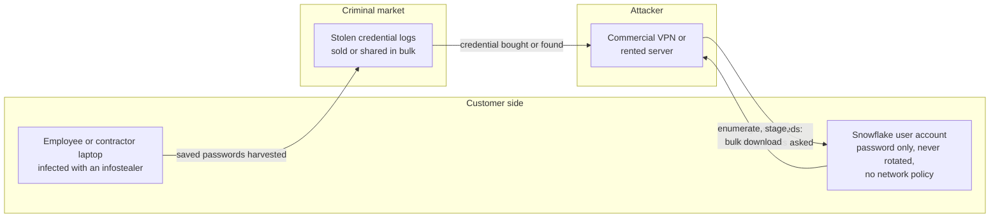
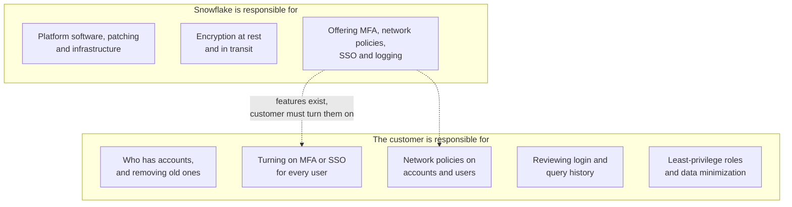

# Case Study: Snowflake Customer Account Breaches, 2024

> In 2024 a financially motivated group that Mandiant tracks as **UNC5537** logged in to the Snowflake accounts of customer organizations using usernames and passwords stolen by infostealer malware, some of them years earlier. Around 165 organizations were notified as potentially exposed. The accounts used typically had no multi-factor authentication, passwords that had not been rotated, and nothing restricting where a login could come from. The group copied out large tables and then tried to extort the victims or sell the data. Snowflake's own platform was not breached; every incident Mandiant investigated traced back to a customer credential. This page covers the public record, why ordinary controls were missing, how to detect and respond, and the controls that close the gap. It is written for defenders; it contains no attack instructions.

---

## Why this case matters

The Snowflake campaign is the clearest recent example of three lessons that apply to every SaaS and cloud platform, not just Snowflake:

1. **A valid password is the whole attack.** There was no exploit, no zero-day and no malware on the victims' servers. The attacker typed in credentials that worked. Every control that assumes "attackers break in" missed a group that simply logged in.
2. **Shared responsibility is easy to misread.** A managed data platform patches its own software, but the customer decides who can log in, how, and from where. Many victims assumed the provider's security covered their accounts. It did not, because account configuration was the customer's job.
3. **Data platforms concentrate data.** A warehouse exists to hold everything in one place, which is exactly why it is valuable. Call records for nearly all of a carrier's customers, years of ticketing data, bank customer records: one account, one stolen password, one very large download.

If you run any SaaS data platform (a warehouse, a CRM, a file share, a ticketing system), the question this case asks is: if someone had a valid password for one of our service or user accounts today, what would stop them?

---

## What happened (public record)

The timeline below comes from Mandiant's investigation, Snowflake's own statements, company securities filings and the US Department of Justice.

- **How credentials were stolen.** Infostealer malware (Mandiant names VIDAR, RISEPRO, REDLINE, RACOON STEALER, LUMMA and METASTEALER) runs on an infected computer and harvests saved passwords, browser cookies and other secrets, which are then sold or shared in bulk. Mandiant found that **at least 79.7%** of the accounts the group used had prior credential exposure, and the **earliest infostealer infection** linked to a credential used in the campaign dated back to **November 2020**. In several investigations Mandiant found the initial infection on contractors' computers that were also used for personal activity, including gaming and downloading pirated software. A contractor's laptop can hold credentials for several client organizations at once.
- **April 2024.** Mandiant received threat intelligence about database records that turned out to come from one victim's Snowflake instance, notified that victim, and was hired to investigate.
- **14 to 25 April 2024.** AT&T later reported that a threat actor copied files from an AT&T workspace on a third-party cloud platform in this window, containing records of calls and texts of nearly all of its wireless customers between roughly 1 May and 31 October 2022, plus 2 January 2023. The files held phone numbers, interaction counts and call durations, not the content of calls or texts.
- **20 May 2024.** Live Nation identified unauthorized activity in a third-party cloud database containing mainly Ticketmaster data. On 27 May a criminal offered what it claimed was the company's user data for sale. Live Nation disclosed this in a Form 8-K on 31 May.
- **22 May 2024.** Mandiant, having found evidence of a broader campaign, contacted Snowflake and began notifying other potential victims.
- **2 June 2024.** Snowflake published a joint statement with CrowdStrike and Mandiant: no evidence the activity was caused by a vulnerability, misconfiguration or breach of Snowflake's platform, and the campaign appeared to target **users with single-factor authentication**. Snowflake published indicators of compromise and hardening steps. CISA amplified the guidance on 3 June.
- **10 June 2024.** Mandiant published its UNC5537 report: roughly **165 potentially exposed organizations** notified, and three primary factors behind the successful compromises (below). A week later it published a threat hunting guide with detection queries.
- **12 July 2024.** AT&T filed its Form 8-K describing the call-record theft above.
- **October to November 2024.** A Canadian man, Connor Moucka, was arrested in Canada on a US request, and an indictment against him and a US citizen, John Binns, was unsealed in the Western District of Washington. It alleged extortion of at least 36 bitcoin (about $2.5 million at the time) from at least three victims.
- **5 August 2026.** Moucka pleaded guilty to conspiracy, computer fraud, wire fraud and aggravated identity theft. The Justice Department said he and co-conspirators used stolen login credentials to compromise data belonging to at least 165 customers of a US software-as-a-service company between February and October 2024, that victim companies suffered over $9.5 million in actual losses, and that at least 100 million individuals were affected. Sentencing was set for 27 October 2026.

Neither the AT&T nor the Live Nation filing names the cloud platform; both were widely reported as Snowflake customers caught up in this campaign.

**[📖 Mandiant: UNC5537 targets Snowflake customer instances for data theft and extortion](https://cloud.google.com/blog/topics/threat-intelligence/unc5537-snowflake-data-theft-extortion)** - the primary investigation: timeline, root causes, infostealer families and indicators.
**[📖 Snowflake: Detecting and preventing unauthorized user access](https://community.snowflake.com/s/question/0D5VI00000Emyl00AB/detecting-and-preventing-unauthorized-user-access)** - Snowflake's joint statement, indicators of compromise and hardening guidance.
**[📖 CISA: Snowflake recommends customers take steps to prevent unauthorized access](https://www.cisa.gov/news-events/alerts/2024/06/03/snowflake-recommends-customers-take-steps-prevent-unauthorized-access)** - the US government alert.
**[📖 US Department of Justice: Canadian man pleads guilty to hacking US cloud storage provider's customers](https://www.justice.gov/opa/pr/canadian-man-pleads-guilty-hacking-us-cloud-storage-provider-and-extorting-its-customers)** - the plea, the scale and the losses.

---

## How the intrusions worked, from the defender's side

There is nothing clever to explain, which is the point. The pattern Mandiant described, stated as the signals a defender would see:

1. **A login from an unfamiliar place.** The group connected through commercial VPN services and rented servers, never from the victim's own networks. A login from a hosting provider's IP range, by a user who always logs in from the office or a known BI server, is the first signal.
2. **An unusual client.** Logins came through tools such as the DBeaver database client, the SnowSQL command-line tool and the web interface, and through a custom reconnaissance utility Mandiant named FROSTBITE. The published indicators included the client application identifiers seen in these sessions. An account that normally connects only from a BI tool or a pipeline suddenly using a desktop database client is a second signal.
3. **Reconnaissance.** Listing databases, schemas, tables and stages, and querying who the current user and role are. Normal users rarely enumerate everything they can see.
4. **Bulk export.** Creating temporary stages, copying large tables into them compressed, and downloading the results, or running `SELECT *` on very large tables. The data volume read and the number of objects touched spike far above the account's normal pattern.
5. **Extortion and sale.** Weeks later, a ransom demand or a listing on a criminal forum, which is how many victims first learned anything had happened.

*The diagram shows the chain from an infected laptop to a data theft. An infostealer on an employee's or contractor's computer harvested saved passwords, which were sold or shared in criminal markets, sometimes years before use. The attacker used a credential from those logs through a VPN or rented server, and because the account accepted a password alone from any IP address, the login succeeded with nothing else asked. The attacker then enumerated the account and downloaded data. Every control that could have broken the chain sits on the customer side.*

---

## Why the controls failed

### 1. No multi-factor authentication

Mandiant's first finding: the compromised accounts did not have MFA enabled. A password is something that can be copied; once it is in an infostealer log, anyone who buys the log has it. MFA adds a factor that the infostealer did not steal. Snowflake supported MFA at the time, but it was opt-in per user, and many organizations had not turned it on, especially for older accounts and for accounts used by tools.

Why was it not on? The usual reasons, all of them understandable and all of them wrong in hindsight: MFA prompts break automated jobs, BI tools and service accounts cannot answer a push notification, the platform was adopted by a data team rather than by IT, and the warehouse sat outside the company's single sign-on.

### 2. Credentials that never expired

Mandiant's second finding: credentials had not been rotated, in some cases for years after they were stolen. A password harvested in 2020 still worked in 2024. Rotation alone is a weak control (an attacker who uses a stolen password the next day beats any rotation schedule), but a password that never changes gives an attacker unlimited time to find a buyer and get round to using it.

### 3. No network restrictions

Mandiant's third finding: no network allow lists. Snowflake network policies can limit an account, or an individual user, to logins from known IP ranges: the corporate network, the VPN, the BI tool's servers, the pipeline's egress addresses. Without one, a login from a rented server in another country is accepted as readily as one from the office.

### 4. Accounts outside identity governance

Many compromised accounts were local Snowflake users with passwords, not identities federated from the organization's identity provider. That matters for two reasons. Local accounts do not inherit the company's MFA, conditional access or device checks. And they are not removed when someone leaves: an account created for a contractor years ago, or a demo account, or a service account nobody owns, keeps working until someone remembers it.

### 5. Shared responsibility, misread

*The diagram splits the responsibilities. The provider runs and patches the platform, encrypts data, and offers security features such as MFA, network policies, single sign-on and logging. The customer decides who has accounts, turns those features on for every user, sets network policies, reviews the logs and grants least-privilege roles. The dotted lines show the gap this campaign exploited: the features existed, but turning them on was the customer's job.*

This is the [shared responsibility model](../learn/concepts/shared-responsibility-model.md) in its SaaS form. The provider supplies the controls; the customer configures them. Snowflake's statement that its platform was not breached was accurate, and also not much comfort to the victims, because the missing controls were theirs to turn on. The useful takeaway is not who was to blame, but that "we bought a secure platform" is not a security control.

### 6. Endpoint hygiene at contractors

In several investigations Mandiant traced the infostealer infection to contractors' machines used for both work and personal activity. A contractor who serves several clients from one laptop concentrates many organizations' credentials in one place. The victims had no control over those machines and often no visibility that their credentials lived there.

### 7. Over-broad access and long retention

Once in, the attacker could read whatever the compromised user could read. Accounts with wide roles reading entire production schemas, and warehouses holding years of detailed records, turned single logins into very large thefts. The AT&T records, for example, covered a six-month period that had ended a year and a half before the theft.

---

## What would have stopped or limited it

| Weakness | Preventive control | Detective control |
|---|---|---|
| Password-only human logins | Single sign-on through the corporate identity provider, which enforces [phishing-resistant MFA](../learn/concepts/mfa-and-passkeys.md) and conditional access; MFA required by an authentication policy for any remaining local users | Report of users without MFA or SSO, reviewed weekly until empty |
| Password-based service accounts | Key-pair authentication, OAuth or workload identity federation for tools and pipelines; no passwords on service users at all | Alert on any password login by a service user |
| Logins from anywhere | Network policies on the account, plus tighter per-user policies for service users (pipeline and BI egress IPs only) | Alert on logins from IPs outside the expected ranges, especially VPN and hosting provider ranges |
| Stale and orphaned accounts | Provisioning through SCIM from the identity provider so leavers are removed automatically; quarterly access review | Report of users with no login in 90 days, and of users not linked to the identity provider |
| Credentials in infostealer logs | Managed, patched devices with [EDR](../learn/concepts/endpoint-security-edr-xdr.md) for anyone with data platform access, including contractors; no saved passwords in browsers for privileged access | Credential exposure monitoring (threat intelligence feeds that match your domains and usernames in stealer logs) |
| Over-broad read access | [Least-privilege](../learn/concepts/least-privilege-explained.md) roles; separate roles for bulk export; masking or tokenization of the most sensitive columns | Alert on first-time access to sensitive schemas by a user |
| Bulk export | Restrict who can create stages and run unload commands; disable unloading to external locations where not needed | Alert on unusual query volume, rows read, new temporary stages and large downloads |
| Data kept long after it is useful | Retention policy enforced in the warehouse (drop or aggregate detailed records after a set period) | Report of tables holding detailed personal data older than the policy allows |

The first two rows would have stopped this campaign on their own. Mandiant named the same three missing controls as the primary factors behind the compromises: MFA, credential rotation and network allow lists. Either MFA or a network policy would have turned a working password into a failed login.

Two rows deserve more explanation:

- **Service accounts are the hard part.** Human users can be moved to SSO with MFA in a few weeks. Service accounts (the ETL tool, the BI server, the dbt job, the reverse ETL sync) are why many organizations left passwords in place: the tool could not answer an MFA prompt. The answer is not to exempt them, but to give them a credential that is not a password: a key pair, an OAuth client, or a federated workload identity, combined with a narrow network policy so the credential only works from the tool's own servers.
- **Credential exposure monitoring** turns infostealer logs from an attacker's asset into an early warning. Several threat intelligence services index stealer logs; matching your corporate domains against them tells you which credentials to reset before someone uses them.

---

## Detection and response

### What to look for

Snowflake records every login and every query. In this campaign, the evidence was in the customers' own accounts; the problem was that few were watching it. The signals worth alerting on:

- **Logins from unexpected networks**, especially VPN providers and hosting providers, for any user, and any login at all from outside the allowed range for a service user.
- **Logins by unusual client applications** for that user (a desktop SQL client for an account that only ever connects from a BI tool).
- **Failed logins followed by a success** from a new IP.
- **Enumeration**: a burst of `SHOW` commands across databases and schemas from one session.
- **Bulk export**: new temporary stages, large unload operations, and query volume or bytes scanned far above the user's baseline.
- **Logins by dormant users**: an account with no activity for months suddenly active.

Snowflake's `LOGIN_HISTORY` and `QUERY_HISTORY` views (in the `SNOWFLAKE.ACCOUNT_USAGE` schema) hold this information, with a year of history. Mandiant's hunting guide gives example queries. Sending these logs to your [SIEM](./architecture-patterns/centralized-security-logging-siem.md) means the same detection rules and on-call process cover the data platform as everything else.

### When you suspect a compromised account

1. **Contain first.** Disable the user, or apply a network policy that blocks everything except your incident response network. Revoke active sessions.
2. **Rotate every credential the user could reach**: their password and keys, and any secrets stored in the account (storage integrations, API keys used by external functions).
3. **Scope.** Use login history to find every session from the attacker's IP addresses, then query history for those sessions to list exactly what was read, staged and downloaded. Look for other users logging in from the same IPs.
4. **Check for persistence**: new users, new roles or grants, new network policies, changed authentication policies, new integrations.
5. **Hunt across all accounts.** If you run several Snowflake accounts, or other SaaS platforms used by the same people, check them for the same IPs and the same users.
6. **Notify as required.** What was read determines your obligations under breach notification laws, [GDPR](./compliance-guides/gdpr.md), [HIPAA](./compliance-guides/hipaa.md) and, for US public companies, the SEC's Form 8-K Item 1.05 rule on material cybersecurity incidents. Query history is what lets you scope narrowly instead of assuming the worst.

See [Incident response basics](../learn/concepts/incident-response-basics.md) for the wider process.

---

## What changed afterwards

Snowflake responded by moving MFA from opt-in towards mandatory. It made MFA available by default for all users, added authenticator apps and passkeys as MFA methods, offered a Trust Center that scans accounts against security benchmarks, and published a phased plan to deprecate single-factor password sign-ins. As documented in October 2026, that plan required MFA for all human users of the Snowsight web interface between September 2025 and January 2026, strong authentication for newly created users between May and July 2026, and strong authentication for all users, with password sign-in blocked for service users, between August and October 2026.

The lesson for other platforms is that "secure by default" beats "secure if configured". If your organization runs SaaS platforms that still allow password-only logins, do not wait for each vendor to force the change.

**[📖 Snowflake: Planning for the deprecation of single-factor password sign-ins](https://docs.snowflake.com/en/user-guide/security-mfa-rollout)** - the phased enforcement timeline and what each phase requires.
**[📖 Snowflake: Network policies](https://docs.snowflake.com/en/user-guide/network-policies)** - restricting logins by IP address at account and user level.
**[📖 Snowflake: Multi-factor authentication](https://docs.snowflake.com/en/user-guide/security-mfa)** - enrolling users and requiring MFA.
**[📖 Snowflake: Authentication policies](https://docs.snowflake.com/en/user-guide/authentication-policies)** - controlling which authentication methods and clients each user may use.
**[📖 Snowflake: Key-pair authentication](https://docs.snowflake.com/en/user-guide/key-pair-auth)** - replacing passwords for service users.
**[📖 Snowflake: Trust Center overview](https://docs.snowflake.com/en/user-guide/trust-center/overview)** - scanning accounts against security recommendations.
**[📖 Snowflake: LOGIN_HISTORY view](https://docs.snowflake.com/en/sql-reference/account-usage/login_history)** - the login record used to scope and detect this activity.

---

## Lessons

- **Treat every SaaS data platform as an identity problem first.** The questions are the same everywhere: are all users behind SSO with MFA, do service accounts use something other than passwords, are logins restricted by network, and are leavers removed automatically?
- **"Not breached" is not the same as "not your problem".** A provider can be secure and its customers still lose data through configuration that only the customer controls.
- **Old credentials are live ammunition.** Assume any password ever typed on an unmanaged device is in someone's stealer log. Rotation will not save you; MFA and network restrictions will.
- **Contractors are part of your identity perimeter.** Require managed devices, or at least SSO with MFA and conditional access, for anyone with access to production data, whatever their employment status.
- **Watch the logs you already have.** The evidence of every intrusion in this campaign was in the victims' own login and query history.
- **Hold less.** Data that has been deleted or aggregated cannot be stolen in bulk.

---

## Defender's checklist

- [ ] Every human user of every data platform signs in through SSO with MFA; local password users are an exception list that is reviewed
- [ ] No service account uses a password; each has a key pair, OAuth client or workload identity, and a network policy limited to its own servers
- [ ] An account-level network policy exists, and stricter user-level policies cover service users
- [ ] Users are provisioned and removed through SCIM from the identity provider; dormant accounts are disabled automatically
- [ ] Login and query history are exported to the SIEM, with alerts for unexpected networks, unusual clients, enumeration and bulk export
- [ ] Credential exposure monitoring covers corporate domains and contractor accounts
- [ ] Contractors with data access use managed devices or are covered by conditional access
- [ ] Roles follow least privilege; bulk unload rights are limited to named roles
- [ ] Retention rules limit how long detailed personal data stays in the warehouse
- [ ] The incident response plan covers a compromised SaaS account, including how to scope what was read

---

## Cert mapping

| Cert | What this case tests |
|---|---|
| [Security+](../exams/comptia/security-plus/) | Credential theft, MFA, password policy, shared responsibility, indicators of compromise |
| [CySA+](../exams/comptia/cysa-plus/) | Log analysis for anomalous logins, threat hunting with vendor indicators, incident scoping |
| [CCSP](../exams/isc2/ccsp/) | SaaS shared responsibility, cloud identity and access management, data retention |
| [CCSK](../exams/cloud-security-alliance/ccsk/) | Customer responsibilities in SaaS, identity federation, cloud logging |
| [CISM](../exams/isaca/cism/) | Third-party and contractor risk, incident management, regulatory notification |
| [CISSP](../exams/isc2/cissp/) | Identity and access management lifecycle, account provisioning and review, security operations |
| [SnowPro Advanced: Administrator](https://data.noblerworks.com/exams/snowflake/snowpro-advanced-administrator/) | Network policies, authentication policies, MFA and access history in Snowflake itself |

---

## Discussion questions

1. List every SaaS platform that holds your organization's sensitive data. For each, can a user log in with a password alone, from any IP address?
2. Which of your service accounts use passwords, and what stops you moving each one to key-pair or federated authentication?
3. If a contractor's personal laptop were infected with an infostealer today, which of your systems would the stolen credentials open?
4. How long would it take you to answer "what did this user read in the last 90 days?" for your data warehouse?
5. Snowflake's platform was not breached, yet around 165 of its customers were notified. Who should own the security configuration of a SaaS platform inside a company, and how would you make sure it does not fall between teams?

---

## Sources

- **[📖 Mandiant: UNC5537 targets Snowflake customer instances for data theft and extortion (10 June 2024)](https://cloud.google.com/blog/topics/threat-intelligence/unc5537-snowflake-data-theft-extortion)** - timeline from April to June 2024, about 165 organizations notified, the 79.7% prior-exposure figure, the November 2020 earliest infection, the three root-cause factors, infostealer families and tooling.
- **[📖 Snowflake: Detecting and preventing unauthorized user access (2 June 2024, updated)](https://community.snowflake.com/s/question/0D5VI00000Emyl00AB/detecting-and-preventing-unauthorized-user-access)** - joint statement with CrowdStrike and Mandiant, indicators of compromise, hardening steps.
- **[📖 CISA alert, 3 June 2024](https://www.cisa.gov/news-events/alerts/2024/06/03/snowflake-recommends-customers-take-steps-prevent-unauthorized-access)** - government amplification of Snowflake's guidance.
- **[📖 AT&T Form 8-K, filed 12 July 2024](https://www.sec.gov/Archives/edgar/data/732717/000073271724000046/t-20240506.htm)** - discovery on 19 April 2024, exfiltration between 14 and 25 April 2024, scope of the call and text records.
- **[📖 Live Nation Entertainment Form 8-K, filed 31 May 2024](https://www.sec.gov/Archives/edgar/data/1335258/000133525824000081/lyv-20240520.htm)** - unauthorized activity identified 20 May 2024, data offered for sale 27 May.
- **[📖 US Attorney's Office, Western District of Washington: United States v. Connor Riley Moucka and John Erin Binns](https://www.justice.gov/usao-wdwa/united-states-vs-connor-riley-moucka-and-john-erin-binns)** - the case page.
- **[📖 US Department of Justice: guilty plea, 5 August 2026](https://www.justice.gov/opa/pr/canadian-man-pleads-guilty-hacking-us-cloud-storage-provider-and-extorting-its-customers)** - February to October 2024 intrusion window, at least 165 customers, over $9.5 million in losses, at least 100 million individuals, sentencing date.
- **[📖 CyberScoop: the indictment against Moucka and Binns (November 2024)](https://cyberscoop.com/connor-moucka-snowflake-data-breach-indictment-john-binns/)** - the unsealed indictment, including the 36 bitcoin extortion figure.
- **[📖 Snowflake: Planning for the deprecation of single-factor password sign-ins](https://docs.snowflake.com/en/user-guide/security-mfa-rollout)** - the post-incident MFA enforcement phases.

---

## Related

- [MFA and passkeys](../learn/concepts/mfa-and-passkeys.md) - why a second factor would have stopped every login in this campaign
- [Shared responsibility model](../learn/concepts/shared-responsibility-model.md) - who secures what in SaaS
- [IAM explained](../learn/concepts/iam-explained.md) and [Least privilege explained](../learn/concepts/least-privilege-explained.md) - limiting what one account can read
- [Secrets management](../learn/concepts/secrets-management.md) - credentials for service accounts without passwords
- [Endpoint security: EDR and XDR](../learn/concepts/endpoint-security-edr-xdr.md) - catching infostealers on the endpoint
- [Logging and detection](../learn/concepts/logging-and-detection.md) and [Incident response basics](../learn/concepts/incident-response-basics.md)
- [Centralized security logging and SIEM](./architecture-patterns/centralized-security-logging-siem.md) - getting SaaS login and query logs in front of a detection team
- Other case studies: [Capital One 2019](./case-study-capital-one-2019.md), [SolarWinds 2020](./case-study-solarwinds-2020.md), [Log4Shell 2021](./case-study-log4shell-2021.md), [MOVEit 2023](./case-study-moveit-2023.md)
