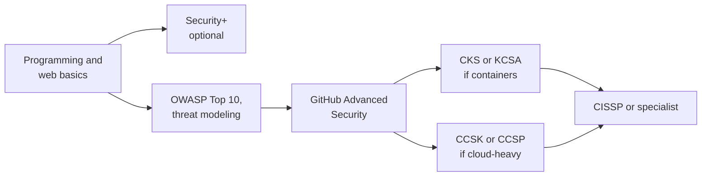

# Application Security Engineer Certification Roadmap

An AppSec engineer helps developers ship software that is hard to attack. The job is part code reviewer, part tool owner, part teacher. Certificates matter less here than anywhere else in security: a portfolio of real fixes and tooling counts for more. This site has fewer AppSec-specific certs, so the roadmap leans on concepts and builds.

Beside the [Security Engineer roadmap](./certification-roadmap-security-engineer.md), this is the path for people who like code.

## What the job is

- **Design review:** threat model new features. See [Threat modeling explained](../learn/concepts/threat-modeling-explained.md).
- **Code and dependency review:** find flaws before release. See [OWASP Top 10 explained](../learn/concepts/owasp-top-10-explained.md) and [Software supply chain security](../learn/concepts/software-supply-chain-security.md).
- **Tooling:** run SAST, SCA, secrets scanning and container scanning in CI, and tune the noise.
- **Response:** help fix findings, handle vulnerability reports. See [Vulnerability management](../learn/concepts/vulnerability-management.md).

Titles: application security engineer, product security engineer, DevSecOps engineer, security champion lead.

*The path starts with the ability to read and write code. Certificates are optional steps on top.*

## Stage 1 - build the base

You need to program in at least one language and know how a web app works end to end: requests, sessions, cookies, APIs, databases.

Read: [OWASP Top 10 explained](../learn/concepts/owasp-top-10-explained.md), [OAuth and OIDC explained](../learn/concepts/oauth-and-oidc-explained.md), [TLS and HTTPS](../learn/concepts/tls-and-https.md), [Hashing and password storage](../learn/concepts/hashing-and-password-storage.md), [Secrets management](../learn/concepts/secrets-management.md).

Primary references:

- **[📖 OWASP Application Security Verification Standard](https://owasp.org/www-project-application-security-verification-standard/)** - a checklist of security requirements for applications.
- **[📖 OWASP Web Security Testing Guide](https://owasp.org/www-project-web-security-testing-guide/)** - how to test web apps (use it on systems you own or are allowed to test).
- **[📖 OWASP Cheat Sheet Series](https://cheatsheetseries.owasp.org/)** - short, practical guides per topic.

## Stage 2 - certificates that fit

- **[GitHub Advanced Security](../exams/github/advanced-security/)** - code scanning, secret scanning and dependency review on the platform most teams use. The closest thing here to an AppSec tooling cert.
- **[CompTIA Security+](../exams/comptia/security-plus/)** - optional vocabulary for those moving from software into security.
- **[Kubernetes CKS](../exams/kubernetes/cks/)** and **[KCSA](../exams/kubernetes/kcsa/)** - if you secure containerised apps. See [Container security basics](../learn/concepts/container-security-basics.md) and [Kubernetes security basics](../learn/concepts/kubernetes-security-basics.md).
- **[HashiCorp Vault Associate](../exams/hashicorp/vault-associate/)** - secrets management in practice.
- **[CCSK](../exams/cloud-security-alliance/ccsk/)** or **[CCSP](../exams/isc2/ccsp/)** - for cloud-native apps.
- **[OSCP](../exams/offensive-security/oscp-pen-200/)** - optional and demanding. It builds an attacker's view of an application, which helps with review and threat modeling. It suits people heading toward testing roles more than design review.
- **[CISSP](../exams/isc2/cissp/)** - later, for broad leadership. It includes a software development security domain.

## Skills that matter more than certificates

| Skill | How to practise |
|---|---|
| Threat modeling | Model one app you know: data flow diagram, STRIDE table, top five mitigations |
| Reading code for flaws | Review open-source pull requests against the OWASP Top 10 |
| CI security | Add secret scanning, dependency scanning and a SAST tool to a pipeline, then tune out the false positives |
| Supply chain | Generate an SBOM and pin dependencies. **[📖 SLSA](https://slsa.dev/)** - a framework for build integrity |
| Communication | Write a finding a developer can fix in ten minutes: what, where, why, how to fix |
| Fix, not just find | Send real fixes; developers trust the engineer who also fixes |

## Getting the first job

- Publish a small project: a pipeline with scanning that you tuned, with before and after numbers.
- Report a real vulnerability responsibly to an open-source project that accepts reports.
- Practise: [AppSec interview prep](./interview-prep/appsec-interview.md).

## Next steps

- [Study Hub](../STUDY-HUB.md) and [Study strategies](./study-strategies.md)
