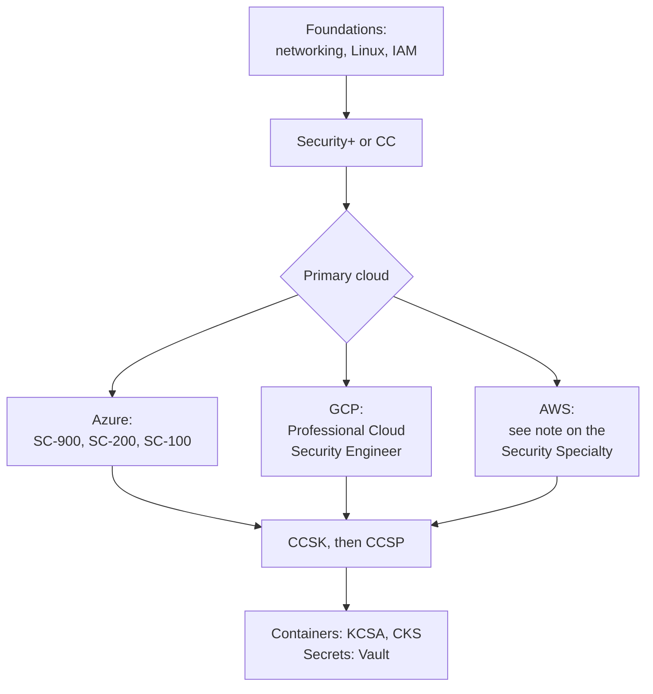

# Cloud Security Engineer Career Roadmap

A cloud security engineer secures what the organisation builds in AWS, Azure or GCP: identities, networks, data, logging and the guardrails that stop mistakes. The existing [Security Engineer roadmap](./certification-roadmap-security-engineer.md) covers the whole field with a cloud emphasis. This page is the short, focused version: pick a primary cloud, go deep, add one more.

## What the job is

- **Identity:** least-privilege roles, federation, no long-lived keys. See [IAM explained](../learn/concepts/iam-explained.md) and [Least privilege explained](../learn/concepts/least-privilege-explained.md).
- **Posture:** find and fix misconfiguration at scale. See [CSPM and CNAPP explained](../learn/concepts/cspm-and-cnapp-explained.md).
- **Data protection:** encryption, keys, secrets. See [Encryption explained](../learn/concepts/encryption-explained.md) and [Secrets management](../learn/concepts/secrets-management.md).
- **Detection and response:** logs, alerts, runbooks. See [Logging and detection](../learn/concepts/logging-and-detection.md) and the [playbooks](./playbooks/).
- **Guardrails as code:** policies and infrastructure as code that prevent the bad state.

Titles: cloud security engineer, cloud security architect, platform security engineer, DevSecOps engineer.

*Pick one cloud, go deep, then add the vendor-neutral certificates and the container track.*

## Stage 1 - foundations

Networking, Linux, and one cloud's console and CLI. Read [Shared responsibility model](../learn/concepts/shared-responsibility-model.md), [Network security basics](../learn/concepts/network-security-basics.md) and [Zero trust explained](../learn/concepts/zero-trust-explained.md). The cloud sibling site covers fundamentals: [Cloud Zero to Hero](https://cloud.noblerworks.com/).

## Stage 2 - first certificate

- **[ISC2 CC](../exams/isc2/cc/)** or **[CompTIA Security+](../exams/comptia/security-plus/)**.

## Stage 3 - your cloud's security certificate

- **Azure:** [SC-900](../exams/azure/sc-900/) for vocabulary, [SC-200](../exams/azure/sc-200/) for operations, [SC-300](../exams/azure/sc-300/) for identity, and [SC-100 Cybersecurity Architect](../exams/azure/sc-100/) for design. The [AZ-500](../exams/azure/az-500/) guide is kept as reference because that exam is retired; see its notice.
- **GCP:** [Professional Cloud Security Engineer](../exams/gcp/cloud-security-engineer/).
- **AWS:** the current exam is the [Security Specialty SCS-C03](../exams/aws/specialty/security-scs-c03/) guide. The [SCS-C02](../exams/aws/specialty/security-scs-c02/) guide is kept as reference because that exam is retired. Check AWS's site for price and availability before booking.
- **IBM:** [IBM Cloud Security Engineer](../exams/ibm/cloud-security-engineer/) if your employer uses IBM Cloud.

## Stage 4 - vendor-neutral and specialist

- **[CCSK](../exams/cloud-security-alliance/ccsk/)** - cloud security principles; a good second certificate.
- **[ISC2 CCSP](../exams/isc2/ccsp/)** - the cloud security professional credential, with an experience requirement.
- **[KCSA](../exams/kubernetes/kcsa/)** then **[CKS](../exams/kubernetes/cks/)** - Kubernetes security; CKS is a hands-on exam.
- **[HashiCorp Vault Associate](../exams/hashicorp/vault-associate/)** and **[Boundary Associate](../exams/hashicorp/boundary-associate/)** - secrets and access.
- **[Palo Alto PCNSA](../exams/palo-alto-networks/pcnsa/)** - firewalls, if the role is network heavy.
- **[CISSP](../exams/isc2/cissp/)** - later, for leadership.

## Skills that matter more than certificates

| Skill | How to practise |
|---|---|
| Least-privilege IAM | Take one role and cut it to what it uses, using the provider's access analysis tools |
| Logging and alerting | [Centralized logging and alerting](./hands-on-projects/centralized-logging-and-alerting.md) |
| Zero trust access | [Implement zero trust](./hands-on-projects/implement-zero-trust.md) |
| Incident handling | Walk the [leaked key](./playbooks/leaked-cloud-access-key.md) and [exposed bucket](./playbooks/publicly-exposed-storage-bucket.md) playbooks in a sandbox account |
| Infrastructure as code | Write a guardrail policy and a template that passes it |
| Comparing clouds | [Security tools comparison](./service-comparison-security-tools.md) and [Identity and IAM comparison](./service-comparison-identity-iam.md) |

## Getting the first job

- Build a sandbox with a locked-down account, central logs and tested alerts. Write it up with diagrams.
- Know one breach well enough to explain it: [Capital One 2019](./case-study-capital-one-2019.md).
- Practise: [Cloud security interview prep](./interview-prep/cloud-security-interview.md) and the broader [Security engineer interview prep](./interview-prep/security-engineer-interview.md).

## Next steps

- [Study Hub](../STUDY-HUB.md) and [Budget study plan](./budget-study-plan.md)
